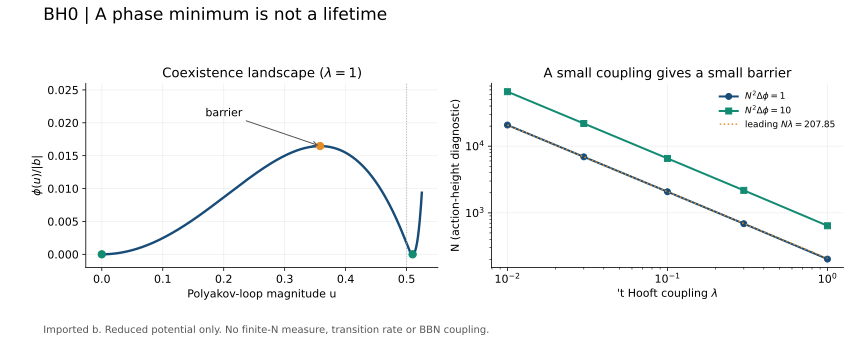

# BH0: барьер между фазами

Вычислен барьер **заданного редуцированного потенциала** Anthropic. Он исчезает
как λ² при ослаблении связи, хотя скачок параметра порядка стремится к 1/2.
Поэтому возникновение двух минимумов само по себе не устанавливает устойчивость
или способность состояния воспроизводить условия продолжения. Для нашей линии
U010 это количественный пример этой границы, а не решение вопроса происхождения.

Источник: Claude (Anthropic), [hexagon:2611.00175v1](https://hexagonmath.org/pdf/2611.00175v1),
7 ноября 2026, CC BY 4.0; уравнения (19), (21), (22), (24), (63), (64).
Значение b импортировано. Свой код решает скалярную задачу и не пересчитывает
трёхпетлевой коэффициент. Предыдущие 13 проверок находятся в
[предыдущем пакете](../ANTHROPIC_BH_20261112/REPORT.md).

## Вывод внутри усечения

Обозначим q=|b|, a=m₁², φ=S/N². Тогда

\[
\phi(u)=W(u)+au^2-qu^4,\qquad
W(u)=\begin{cases}0,&u\le1/2,\\
1/4-\tfrac12\ln[2(1-u)]-u^2,&u>1/2.
\end{cases}
\]

На сосуществовании φ(u_c)=0, φ′(u_c)=0; φ(0)=0.
Седло внутри ungapped-ветви имеет u_s²=a_c/(2q). Следовательно,

\[
\Delta\phi=\phi(u_s)-\phi(0)=\frac{a_c^2}{4q}.
\]

Разложение W(1/2+ε)=4ε³/3+O(ε⁴) даёт

\[
a_c=q/4+q^{3/2}/6+O(q^2),\qquad
u_c=1/2+\sqrt q/4+O(q),
\]
\[
\Delta\phi=q/64+q^{3/2}/48+O(q^2),\qquad
\Delta S\simeq2.314705625\cdot10^{-5}(N\lambda)^2.
\]

Это следствие уже опубликованной модели; приоритет нового физического результата
не заявляется. Члены порядка λ³ здесь принадлежат усечению: неизвестные поправки
к b и остальным членам полной теории возникают на том же порядке. Точный корень
усечённого потенциала не превращает их в известную физическую поправку.

## Что означает масштаб Nλ

В ведущем действии уровень ΔS=1 соответствует Nλ≈207.85, а ΔS=10 — примерно
657.28. Это **уровни действия**, не критическое число цветов и не доказанный
порог метастабильности. Не вычислены конечные по N поправки к мере,
флуктуационные определители, другие пути перехода, кинетический закон и префактор.
Нельзя подставить exp(ΔS) и назвать результат временем жизни в секундах.

При фиксированном N ведущий барьер стремится к нулю с λ²; при фиксированной
λ>0 он растёт как N². Одновременный предел чувствителен к Nλ. Эта диагностика
показывает, почему фазовую картинку нельзя без проверки переносить на конечную
систему. Само существование конечного скачка u ещё не обеспечивает большой барьер.

## Проверка и исполнение

План и код закреплены **до расчёта** в
`6f8fbde0c912d4fb1f9b816b8aeaf32f29072abb`.
Пять λ и четыре диагностических q; бискекция Decimal при 60/90 знаках;
независимая система φ=φ′=0 через mpmath при 70 знаках, с аналитическим начальным
приближением. Проверяются остатки, кривизны и порядок седел, предел q→0,
контроль b>0. Последний не допускает второго минимума при a≥0, поскольку φ′>0.
Много цифр проверяет численную реализацию; точность импортированного b остаётся
точностью источника. Критерии и лимиты: [PLAN.json](PLAN.json).

Полный расчёт занял 0.4435 с, 9 случаев, 38 проверок пройдены, максимум RSS
около 16 MiB. Прогноз первой некалиброванной реализации: 20 с, диапазон
0.01–90 с, лимит 90 с; полный состав исполнен. Значительное отличие от центральной
оценки объясняется малой скалярной задачей, не пропуском трёхпетлевого расчёта:
он изначально исключён из этого контракта. Этот замер применим к BH0, не к BBN.

Числа: [ATLAS.json](results/ATLAS.json), [сводка](results/SUMMARY.json),
[проверки](results/CHECKS.json), [паспорт](results/ADMISSION.json),
[таблица](results/TABLE.md). `verify.py` проверяет исходники и артефакты;
`verify.py --recompute` воспроизводит малую задачу во временном каталоге.
GitHub Actions запускает эту проверку при изменениях пакета, сохраняет лог и
проверяет подключение BH0 через существующий общий контроллер. Тяжёлый BBN не запускается.

BH0 подключён в PIPELINE.json как проверяемый импорт завершённого результата.
Ветка интеграции: `science/anthropic-bh0-20261114`, над PR #49. Это ещё не
развёртывание в main. Запущенный S1 и его входы не изменялись. BH1 остаётся
отдельной открытой физической связью; статусы R/C/L/U не повышаются.

## Что остаётся предметом настоящей внешней репликации

В §8.2 авторы отмечают несовпадение кулоновского класса **чистой Янга–Миллса**:
−2.095 против −3.388 в единицах их таблицы 5; §10.3 указывает диаграммы
3c/3f/3n. Это не наша находка и не поправка, которую разрешено численно переносить
в N=4. Часть ряда loop-kernel проверена только одним движком (§6.6).
Исходники движков нами не получены: PDF прочитан; API и прямая загрузка при этой
попытке недоступны. Это не утверждение, что у авторов кода нет.
Для решения расхождения нужны интегралы, правила регулятора, контрчлены,
нормировки и независимый расчёт. Настоящий пакет эту задачу не закрывает.
