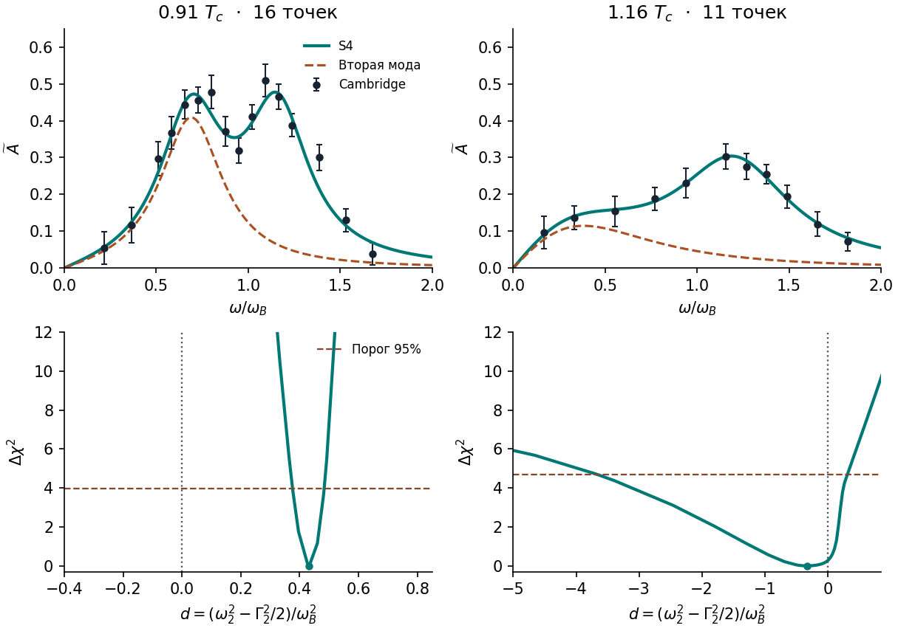

# БКТ в двумерном газе ³⁹K. Насколько уверенно спектр выделяет второй звук?

**При 0,91 Tс на опубликованных 16 частотах различим ненулевой пик второй моды. При 1,16 Tс на 11 частотах совместимы и нулевой пик, и небольшой ненулевой.** Лучший горячий фит даёт максимум при нуле. Эти два вывода имеют разную статистическую силу.



### Что именно измерено

Christodoulou и соавторы опубликовали поглощающий отклик газа и применили сумму двух затухающих осцилляторов (S4) к обеим температурам. Здесь повторена эта обработка и измерена различимость двух областей параметров. Для второй компоненты динамического структурного фактора $S_2\propto A_2/\omega$ положение максимума определяется величиной $d=(\omega_2^2-\Gamma_2^2/2)/\omega_B^2$. При $d>0$ максимум равен $\sqrt d$ в единицах $\omega_B$. При $d\le0$ он находится в нуле. Порог осциллирующих полюсов $\Gamma_2=2\omega_2$ описывает другое свойство.

| Температура | Точки | $d$ | Профильная область 95% для $d$ | $\omega_{\rm peak}/\omega_B$ и интервал | $\Delta\chi^2$ при $d=0$ | Бутстрап $p$ |
|---|---:|---:|---:|---:|---:|---:|
| 0,91 Tс | 16 | 0,432 | [0,376; 0,483] | 0,658 [0,613; 0,695] | 75,29 | 0,001 |
| 1,16 Tс | 11 | −0,328 | [−3,664; 0,314] | 0 [0; 0,560] | 0,269 | 0,700 |

При фиксированном правиле сумм свободны пять параметров. В таблице ниже интервалы для частот и затухания — отдельные 2,5-й и 97,5-й процентили параметрического бутстрапа (999 имитаций от лучшего фита). Профиль выше использует переоптимизацию остальных параметров. Числа относятся к конкретной принятой модели ошибок.

| $T/T_c$ | $\omega_1/\omega_B$ | $\omega_2/\omega_B$ | $\Gamma_1/\omega_B$ | $\Gamma_2/\omega_B$ | $x_1,x_2$ | Вес первой / второй компоненты | $\chi^2$/степени свободы |
|---|---|---|---|---|---|---|---|
| 0,91 | 1,177 [1,146; 1,205] | 0,721 [0,677; 0,786] | 0,411 [0,285; 0,495] | 0,417 [0,290; 0,625] | 0,143 / 0,232 | 0,622 / 0,378 | 13,210 / 11 |
| 1,16 | 1,257 [1,168; 1,352] | 0,633 [0,246; 1,041] | 0,745 [0,284; 0,913] | 1,207 [0,022; 2,113] | 0,158 / 0,172 | 0,783 / 0,217 | 0,657 / 6 |

Горячий вес 0,217 принадлежит низкочастотной компоненте S4. Его отнесение к распространяющемуся второму звуку требует различимого ненулевого максимума. При номинальных параметрах $\omega_B/(2\pi)=34,22$ Гц. Для холодного спектра это даёт $\omega_2/(2\pi)=24,66$ Гц, $\Gamma_2/(2\pi)=14,27$ Гц и максимум $S_2$ около 22,50 Гц. Это три разные частоты. Контроль S4+S5 на горячих точках даёт $\Gamma_T/\omega_B=0,306$ и $\chi^2=1,58$ при шести степенях свободы. На холодных точках получено 65,98 при одиннадцати степенях свободы и амплитуде диффузии у нуля. У отдельной S5 за пределами измеренной полосы расходится вклад в правило сумм. В обоих спектрах S5 использована только как контроль.

### Что выдержал результат

- В уравнениях (1) и (S1) интегрирование двустороннее. Поэтому $f_i=\pi x_i(\omega_i/\omega_B)^2$. При освобождении общей нормировки получены $f_{\rm sum}=1,065$ и 1,012 для холодного и горячего спектров, $d=0,425$ и −0,410 соответственно. При свободной нормировке штраф за границу равен 28,92 и 0,264. У первичных точек конечная полоса. Прямые интегралы по ней с учётом симметрии равны 0,831 и 0,633. Хвосты восполняет модель.
- При удалении любой одной холодной частоты $\Delta\chi^2$ остаётся между 54,37 и 76,63. Наибольшее снижение даёт удаление точки 0,729 $\omega_B$. На горячей сетке диапазон 0,100–0,347. Для этой диагностики взят исходный порог каждой полной сетки. Расширение численных границ воспроизводит оба минимума. Полные локальные и бутстрап-ковариации шести физических параметров, остатки и все удаления записаны в [BLIND.json](results/BLIND.json).
- При калибровке границы 0 из 999 холодных и 699 из 999 горячих имитаций дали статистику не меньше наблюдаемой. Использована поправка +1. Холодное $p=0,001$ — предел разрешения этой серии. Пороги 95% по $\Delta\chi^2$ равны 3,980 и 4,694. Интервалы основаны на локальной калибровке у границы, рассчитаны для каждого спектра отдельно. На горячем спектре малое $\chi^2$ имеет нижнюю хвостовую вероятность около 0,0046 при идеальных независимых гауссовых ошибках. Опубликованы стандартные ошибки фита без полной ковариации точек. Возможные корреляции и размер этих ошибок ограничивают точность вероятностей. Потери атомов могут влиять на физическую ширину и на значение $d$.
- Мощность оценена **до основного фита** на фактических сетках и их ошибках. На каждое из трёх состояний и каждую сетку приходится по 1000 имитаций. В заданном сценарии с ненулевым максимумом правильный положительный ответ получен в 85,1% случаев на холодной сетке и в 73,0% на горячей. При заданном широком режиме ($\Gamma_2/\omega_2=2,4$, вес второй компоненты 0,18) правильный отрицательный ответ получен лишь в 1,5% и 0,4% случаев. Сами частоты и доля веса в этой симуляции закреплены протоколом. Такой опыт существенно лучше выявляет выраженный пик, чем доказывает его исчезновение. Все три категории и биномиальные интервалы даны в [POWER.json](results/POWER.json).

### Генеалогия и предел вывода

| Было | План | Получено | Стало |
|---|---|---|---|
| Авторы дали спектры, интерпретацию и стандартные ошибки | Одинаковой процедурой оценить знак $d$ | Холодный интервал выше нуля, горячий покрывает оба знака | Проверка различимости на двух опубликованных спектрах завершена |
| В R143 требовались данные для инверсии | Совместить рисунки 2c, 3a и контроль 3b | Совпали девять температурных строк. В шести есть две скорости, в трёх нули кодируют авторскую классификацию | Подготовлена таблица входов и диапазонов ошибки при неизвестной корреляции |

Работа проверяет метод различимости на внешнем физическом образце. Методологические предшественники — R135 и контроль идентифицируемости в E002e. Физический донор — измерения Cambridge. E38 сохраняет смысл границы переноса к BBN. Вывод о происхождении вероятности и термодинамический скачок этим опытом открыты.

### Следующий измеримый шаг

В [THERMO_INPUTS.csv](results/THERMO_INPUTS.csv) скорости измерены в единицах $c_B$. Для шести строк сохранены $S=c_1^2+c_2^2$, $P=c_1^2c_2^2$ и диапазоны их линеаризованных стандартных ошибок при $-1\le\rho(c_1,c_2)\le1$. Для холодного полного спектра бутстрап дал корреляцию частот +0,44; перенос этого коэффициента на другие температуры потребовал бы отдельного обоснования. В двух соседних строках авторская обработка даёт $D_s=4,93\pm0,47$ при $T/T_c=0,9903\pm0,0579$ и $2,99\pm0,52$ при $1,0003\pm0,0675$. Температурные интервалы перекрываются. Эти числа принадлежат рисунку 3b и служат контрольными выходами.

Для независимой инверсии подставить уравнение состояния (EOS) для $\tilde g=0,64(3)$ и согласовать обе комбинации $c_{20}^2=S-c_{10}^2=\gamma P/c_{10}^2$. Тогда $D_s=Dc_{20}^2/(c_{20}^2+Ts^2/(mc_V))$. [Код](thermodynamics.py) проверен прямым и обратным ходом на заданном EOS. [Таблица I Prokof’ev–Svistunov](https://arxiv.org/pdf/cond-mat/0206223) даёт вход для слабосвязанного EOS. Для переноса нужны согласованные давление, производные и область применимости при экспериментальной связи. Нужны совместные ошибки скоростей на остальных температурах или анализ чувствительности по допустимым корреляциям. Для абсолютных величин общие шкалы $n$ (около 15%), $T$ (10%), $q$ (5%), $F_0$ (5%) распространяются совместно с учётом отмены общих множителей в нормированных величинах. Отдельных спектров $R(\omega)$ и остальных семи полных $A(\omega)$ в архиве нет. Есть одиночная временная трасса и девять сводных строк.

Сравнение с $D_s(T_c^-)=4$ относится к пределу большого размера и нулевой частоты. $n_s=2mk_BT_c/(\pi\hbar^2)$ и $\lambda_T^2=2\pi\hbar^2/(mk_BT_c)$ дают 4 тождественно при подстановке условия Нельсона–Костерлица. Это проверка нормировки. Для различения скачка и конечного кроссовера нужны оценка конечного размера и динамической поправки либо сопоставимые серии по размеру и частоте. [Christodoulou et al., Methods](https://arxiv.org/pdf/2008.06044) · [Динамическая теория](https://arxiv.org/abs/2006.11504)

### Воспроизведение

Исходный архив Cambridge от 23 ноября 2026 года имеет SHA-256 `70537f6f458b9b015a6014de181bfab8a6c5fd72715fadaec43ef5d9256b3510`. Авторы данных — P. Christodoulou, M. Gałka, N. Dogra, R. Lopes, J. Schmitt, Z. Hadzibabic. Лицензия CC BY 4.0. В пакете сохранены оригинальные байты авторов, подписаны наши таблицы и производные результаты. [Исходные данные](https://doi.org/10.17863/CAM.66056) · [Лицензия](https://creativecommons.org/licenses/by/4.0/)

[Первый протокол](https://github.com/IgorSabirov/vm-lab/commit/37b2cd0bedf34d3305e7f3c7e68a7304ea6e6656) → [поправка двустороннего правила сумм](https://github.com/IgorSabirov/vm-lab/commit/06cc9dc13e9069d89f90da7b222ee9d5c7a0f17f) → [анонимная таблица до раскрытия](https://github.com/IgorSabirov/vm-lab/commit/37205bfb73c6a317625a9834d24a35fe76756999). Соответствие температур и размеров выборки было известно из статьи. Температурные метки не входили в вычисления. Пробный прогон с односторонней нормировкой был просмотрен до исправления. Это ретроспективный анализ открытых данных.

Из этого каталога, Python 3.12, NumPy, SciPy, Matplotlib, компилятор C++17. Прогноз 30–600 секунд. На использованном CPU мощность заняла 2,1 секунды, основные фиты и профили — 24,4 секунды. Проверка целостности выполняется отдельно.

```sh
python power.py
python replay.py
python thermodynamics.py
python verify.py
python figure.py
python -m unittest discover -s tests
```
