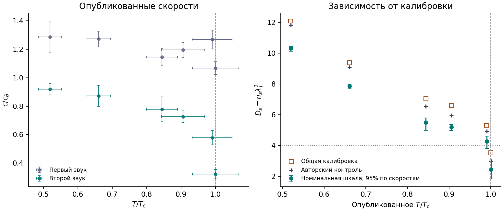

# Сверхтекучая плотность двумерного ³⁹K по двум скоростям звука

**Шесть опубликованных пар скоростей дают шесть оценок $D_s=n_s\lambda_T^2$.** Вблизи перехода при $T/T_c=0{,}9903$ и $1{,}0003$ номинальная калибровка даёт 4,29 и 2,45. Единая для всего опыта подстройка шкал с учётом ошибок температуры даёт 5,30 и 3,52. В этой паре измерений второй звук изменился как минимум на 3,14 стандартной ошибки. Разница температур составляет максимум 1,05 стандартной ошибки даже при наиболее благоприятной корреляции. Поэтому из этих данных нельзя определить величину статического скачка при $T_c^-$.



| $T/T_c$ | $D_s$ при номинальных шкалах | Интервал 95% только по скоростям | $\chi^2$ пары, 1 ст. св. | $D_s$ при общей калибровке | Рис. 3b авторов |
|---:|---:|---:|---:|---:|---:|
| 0,5193 | 10,31 | 10,13–10,43 | 0,40 | 12,08 | 11,84 |
| 0,6607 | 7,86 | 7,68–7,98 | 0,78 | 9,38 | 9,10 |
| 0,8442 | 5,51 | 5,00–5,80 | **7,11** | 7,05 | 6,55 |
| 0,9058 | 5,20 | 4,97–5,38 | **15,49** | 6,60 | 5,96 |
| 0,9903 | 4,29 | 3,82–4,61 | 1,72 | 5,30 | 4,93 |
| 1,0003 | 2,45 | 1,85–2,99 | **9,71** | 3,52 | 2,99 |

Номинальные интервалы фиксируют EOS, температурную координату и приборные шкалы, с нулевой корреляцией ошибок двух скоростей. Жирным выделены значения выше заранее выбранного порога 3,84. При таком расхождении интервал описывает положение минимума несовместимых входов. Авторский столбец прочитан после решения и основан на том же опыте. Три строки нормальной фазы с опубликованным $c_2=0$ исключены из инверсии, поскольку нули кодируют классификацию моды. [Сводная CSV](summary.csv) · [Все оценки, остатки, профили и ковариации](results.json)

### Что определяет абсолютную величину

Исходные данные — рис. 3a Christodoulou et al. с двумя скоростями и их стандартными ошибками. Для основной шкалы использованы $n=3{,}0$ мкм⁻², $T_c=42$ нК и $\tilde g=0{,}64$. Это даёт $D(T_c)=5{,}587$ по определению $D=n\,2\pi\hbar^2/(mk_BT)$. Если привязать ту же ось к критической полной плотности слабосвязанной теории $D_c=\ln(380/\tilde g)=6{,}386$, два ближайших результата становятся 5,14 и 2,66. На этой шкале все шесть пар укладываются в условный порог 3,84. Разница шкал относится к **полной** плотности. Значение $D_s=4$ в инверсию не вводилось. [Эксперимент, Methods](https://arxiv.org/pdf/2008.06044) · [Архив измерений, CC BY 4.0](https://doi.org/10.17863/CAM.66056)

Для нормальной термодинамики использованы $X$ и $\theta(X)$ из таблицы I Prokof’ev–Svistunov. Столбец сверхтекучей плотности из этой теории в расчёт не входит. С $x=\mu/(k_BT)$ и $x_c=(\tilde g/\pi)\ln(13{,}2/\tilde g)$ полная плотность равна $D=D_c+\pi[X+\theta(X)-\theta(0)]$, где $x=x_c+\tilde gX$. Монотонная интерполяция $X+\theta(X)$ даёт и $D' = dD/dx$. Безразмерное давление $\mathcal P$ получается из $d\mathcal P/dx=D$. Константа выбрана по давлению Hartree–Fock при том же $x_c$. Проверка с точкой согласования $X=-0{,}5$ приведена ниже. [Prokof’ev–Svistunov, формулы 8–11 и таблица I](https://arxiv.org/pdf/cond-mat/0206223) · [Ozawa–Stringari, термодинамика и выбор константы давления](https://arxiv.org/pdf/1310.3654)

В единицах $k_B$ энтропия на частицу $s=2\mathcal P/D-x$, а теплоёмкость $c_V=2\mathcal P/D-D/D'$. Пусть $b=2\pi/(\tilde gD)$, $A=b\,2\mathcal P/D$, $B=bD/D'$ и $H=bs^2/c_V$. Тогда квадрат скорости в единицах $c_B^2$ — корень $u^4-(A+z^2)u^2+Bz^2=0$, где $z=c_{20}/c_B$ и $D_s=Dz^2/(H+z^2)$. Для каждой строки один свободный $z$ согласуется с двумя скоростями с заданной ковариацией. Сохранены и отдельные оценки $z^2$ по сумме и произведению корней. При $1{,}0003T_c$ на номинальной шкале первая даёт −0,125, вторая +0,164. Здесь расхождение видно до любой подгонки общего $z$. [Уравнение (S2) эксперимента](https://arxiv.org/pdf/2008.06044) · [Код инверсии](inversion.py)

### Что объясняет общая калибровка

При номинальных условиях сумма шести $\chi^2$ равна 35,21. В совместном расчёте все строки используют одни множители $n,T,q,\tilde g$. Табличные температуры могут сдвигаться в пределах своих гауссовых ошибок. Один свободный параметр плотности оставлен у каждой строки. Для базового варианта получено $\chi^2=4,91$ на шесть номинальных степеней свободы, включая 1,95 от штрафов за общие поправки. Коэффициенты относительно опубликованной калибровки равны 1,041 для $n$, 0,894 для $T$, 0,960 для $q$ и 1,016 для $\tilde g$. Наибольшая поправка — температура, −1,06 принятой стандартной ошибки. Даже с этими же масштабами и с возвратом каждой строки к её табличной температуре отдельные $\chi^2$ не превосходят 1,42.

Эти множители выведены из тех же звуковых данных и показывают существование согласованного решения. Реальная калибровка отдельно не измерялась нами. В расчёте масштабы имеют независимые гауссовы штрафы с ширинами 15%, 10%, 5% и 0,03 по $\tilde g$. Ковариация калибровок эксперимента неизвестна, а термометрия сама использует EOS. Амплитуда силы $F_0$ не входит в частоты. Для приборных сдвигов сохранены матрица ковариации шести результатов, индивидуальные сдвиги и все 16 совместных комбинаций знаков. Эти комбинации задают сценарии, а не доверительный интервал. Локальные стандартные ошибки совместного решения в порядке строк равны 0,94, 0,70, 0,59, 0,60, 0,38 и 0,69 и зависят от формы EOS. [Совместный расчёт](joint.py) · [Машиночитаемые сценарии](results.json)

При изменении корреляции ошибок двух скоростей с −0,9 до +0,9 получены совместные минимумы $\chi^2=3,65$ и 8,28. Исключение двух самых холодных строк даёт $4,54$ на четыре степени свободы. Именно внизу диапазона номинальная сверхтекучая доля достигает 0,96 и 0,93. Авторы предупреждают об ограничении слабосвязанного EOS вблизи насыщения. Численная проверка использует несколько начальных точек и выбирает лучший сошедшийся минимум. Часть стартов достигла лимита итераций, а часть попала в соседние минимумы. Число сошедшихся стартов и значения функции потерь сохранены. В лучшем решении ни один параметр не достиг границы поиска.

### Зависимость от давления, размера и частоты

При переносе точки согласования давления из $X=0$ в −0,5 номинальные значения у двух ближайших температур меняются с 4,29 и 2,45 до **3,12 и 1,43**. Совместная подгонка в этом варианте даёт $\chi^2=11,32$ на шесть степеней свободы. Это отдельная модельная неопределённость. При 512 имитациях табличных ошибок $\theta$ сохранилось 511 монотонных кривых. На номинальной шкале их центральные 95% дают соответственно 3,67–4,54 и 1,89–2,87. Для этого испытания ошибки узлов условно независимы. Исключение сгущённых узлов $|X|<0,06$ даёт 4,22 и 2,36. [Проверка таблицы EOS](theta_sensitivity.json)

У ближайших измерений $|\Delta c_2|/c_B=0,2563$, а $|\Delta T|/T_c=0,01001$. Для двух опубликованных стандартных ошибок $s_a,s_b$ ошибка разности лежит между $|s_a-s_b|$ и $s_a+s_b$. Поэтому при любой корреляции величина изменения скорости составляет **не менее 3,14** таких ошибок, а разность температур — **не более 1,05**. При нулевой корреляции это соответственно 4,34 и 0,11. При совместной подгонке ближайшие температурные метки даже меняют порядок. Это допускают их ошибки. Плотности в совместном решении оценивались отдельно для каждого условия, монотонность кривой не задавалась. [Расчёт разрешения](resolution.json)

В статье обсуждается возможное повышение $T_c$ в конечной системе примерно до 10%. Если $T_c^{\rm box}/T_c^\infty=1{,}10$, две метки на оси $T/T_c^\infty$ станут 1,089 и 1,100 при прежней физической температуре. Это проверка чувствительности горизонтальной оси. При номинальном $L_y=33$ мкм получаются $q=\pi/L_y$ и $\omega_B/(2\pi)=34,22$ Гц. Для двух измеренных $c_2$ это соответствовало бы 19,8 и 11,0 Гц. Статья сообщает о разных размерах ловушки. Архив не ставит каждой строке рис. 3a в соответствие точные $L_y,q,\omega$ и не содержит серии при одной температуре с меняющимся $q$. Для независимой динамической поправки также нужен масштаб движения вихрей. Поэтому оценка относится к измеренному отклику, а экстраполяция $q,\omega\to0$ остаётся открытой. [Конечный размер в эксперименте](https://arxiv.org/pdf/2008.06044) · [Динамическая теория БКТ](https://arxiv.org/abs/2006.11504)

### Проверка исходной термометрии

В [проверке двух ближайших серий](../paired/REPORT.md) установлено, что статистическая ось зависит от плотности каждой серии. Для абсолютной температуры нужен также коэффициент $n_B/n_A$. По публикации и двум диссертациям проверены геометрии и схема корреляций, подготовлен расчёт для реальных парных записей.

### Что закрыто и что измерять дальше

| Было | Выполнено | Следующая проверка |
|---|---|---|
| Две скорости и маргинальные ошибки, шесть условий | Восстановлены шесть условных плотностей, проверка двух корней, ковариации и чувствительность EOS | Уточнить абсолютные $n,T$ и давление при экспериментальной связи, особенно у перехода |
| Две близкие температуры и резкое изменение звука | Выведена граница разрешения по температурам для всех допустимых корреляций опубликованных ошибок | Получить исходную парную термометрию или новые более точные измерения с контролем разности $T$. При независимых одинаковых ошибках для разности 0,010 нужно $\sigma_{T/T_c}<0,01001/(1,96\sqrt2)\approx0,00361$ для двустороннего различения на уровне 95% |
| Размер и частота меняют интерпретацию $D_s=4$ | Оценены масштабы и эффект возможного сдвига оси $T_c$ | Измерить или получить отклики при совпадающих температурах, нескольких известных $q$ и размерах. Затем сравнить модели резкого скачка и кроссовера с теми же калибровками |

Проверка относится к внешнему физическому представителю R143. Данные не определяют независимо значение универсального скачка. Критерий Нельсона–Костерлица использован только для итогового сопоставления.

### Воспроизведение

Код берёт скорости непосредственно из двух файлов рис. 3a в авторском ZIP и сверяет SHA-256. Плотность рис. 3b служит только контрольным выходом. [Зафиксированный план](https://github.com/IgorSabirov/vm-lab/commit/5aea0c70f6ab4b7ac9367f31d47576dfbf3d8a46) · [Полный ZIP расчёта](../bkt-sound.zip) · [Этап 1, спектры](../REPORT.md)

Из каталога этапа 2, Python 3.12, NumPy 2.3.5 и SciPy 1.17.0. Для рисунка нужен Matplotlib. План численного исполнения 2–180 секунд. Основной расчёт на CPU занял 26,7 секунды. Проверяются нормировка EOS, производная давления, восстановление заданной плотности по двум синтетическим скоростям, шесть реальных инверсий, глобальная функция потерь и границы разрешения.

```sh
export OPENBLAS_NUM_THREADS=1
python run.py
python theta_sensitivity.py
python resolution.py
python figure.py
python -m unittest discover -s ../tests -p test_eos.py
```
