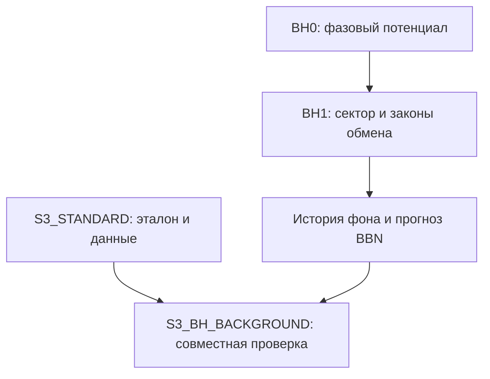

# S3 и фазовый сектор Anthropic: физический мост BH1

15 ноября 2026, Москва. **MANUAL_DERIVATION / BH1_NOT_EXECUTED / SCIENTIFIC_ACCEPTANCE=false.**

Родители: [PR #54](https://github.com/IgorSabirov/vm-lab/pull/54), [задача #56](https://github.com/IgorSabirov/vm-lab/issues/56), [BH0](../../../ANTHROPIC_BH0_BARRIER_20261114/README.md), [дизайн S3](../PHYSICAL_UNCERTAINTY_DESIGN.md), [аудит rate covariance](../manual_covariance_20261114/REPORT.md). Точная база vm-lab: `9e2f5cec303e1a58f354479ffd1fca0db9cbd9b2`; PRIMAT: `6f7e5680614fb119d65a6c9c65a292240b27c61e`.

## 1. Результат проработки

Связь проходит через **термодинамику и историю космологического фона**. S3_STANDARD предоставляет стандартный прогноз, его неопределённости и наблюдательный контракт. BH0 предоставляет проверку редуцированной фазовой модели. BH1 должен вывести из физически идентифицированного сектора X энергию, давление и обмен с видимой плазмой; только после этого появляется предсказание для совместного сравнения.

Получены два условных аналитических результата:

1. Для изолированного конформного сектора, расширяющегося вместе с физической трёхсферой, адиабатическая эволюция сохраняет `chi = T_X R`. Поэтому расширение само по себе не пересекает фазовую границу при фиксированной связи. Это конкретное препятствие для самого простого переноса BH0 в космологию.
2. Поздний нагрев фотонов связывает `eta_BBN/eta_CMB` и нейтринный вклад в `N_eff`. Используя существующий S_eta, можно вывести направление одной части отклика D/H и Yp без нового BBN. Этот вклад нельзя считать полным прогнозом BH1.

Добавляется отдельный контракт `S3_BH_BACKGROUND`, зависящий от `BH1` и `S3_STANDARD`. Изменение фона при фиксированной микрофизике не требует найденного закона дрейфа S2. Прежний `S3_EXTENDED`, зависящий от `S2_PREDICTION`, сохраняет своё назначение. Новый контракт не исполняется автоматически и не меняет очередь.

## 2. Что означает «чёрные дыры Anthropic»

Первичный источник — Claude (Anthropic), *The Hawking–Page transition at weak coupling*, [hexagon:2611.00175v1](https://hexagonmath.org/pdf/2611.00175v1), §§1.1, 1.7, 3.3. Это большая N, слабо связанная N=4 SYM на S³. Работа устанавливает отрицательный коэффициент при четвёртой степени и переход первого рода в данном режиме. При слабой связи классической геометрии чёрной дыры нет; непрерывное продолжение фазовой линии к сильной связи не доказано. Поэтому результат не задаёт популяцию первичных чёрных дыр, их массы или испарение.

BH0 в vm-lab проверил редуцированную модель, импортировав коэффициент b: 9 случаев, 38 проверок; ведущий барьер `Delta I ≈ 2.314705625e-5 (N lambda)^2`. Он не определил конечную N меру и кинетику. Этот барьер безразмерен; он не является временем жизни или скоростью зарождения пузырей.

| Имеющееся в BH0 | Что требуется для BBN |
|---|---|
| Разность редуцированных действий и экстремумы | Нормированная энергия и давление физического сектора |
| Седло между минимумами | Динамика перехода, носитель, мера, градиентные члены и кинетический коэффициент |
| Равновесная энергия перехода на S³ | Космологический объём/плотность и действительная доля преобразованной энергии |
| Безразмерные N, lambda, T_X R | Отождествление R, начальная температура и связь с видимой плазмой |

Глобальный Polyakov-loop потенциал на компактной сфере не содержит пространственного bounce-решения. Из него нельзя подстановкой получить `Gamma_nuc/H^4`, wall velocity или механизм образования астрофизических ЧД. Стандартная пространственная смесь фаз и её поверхностная энергия также требуют отдельного обоснования.

## 3. Термодинамический перевод: действие не равно энергии

Далее используются `hbar=c=k_B=1`, фиксированные размерные константы и стандартная GR как **условный эталон для проверки моста**. Это не вывод уравнений из CCC+TL. Для CCC нужны собственные согласованные уравнения гравитации и обмена.

Обозначим евклидово действие через I, термодинамическую энтропию через S_X. В седловом приближении `F_X=T_X I_* + F_0(T_X,R)`. Тогда

\[
E_X=F_X-T_X\left(\frac{\partial F_X}{\partial T_X}\right)_{R},\qquad
p_X=-\left(\frac{\partial F_X}{\partial V}\right)_{T_X},\qquad
\rho_X=E_X/V.
\]

Производные требуют полного температурного и геометрического задания коэффициентов, а не одного b при переходе. Отброшенный при сравнении фаз общий член `F_0` может влиять на абсолютный тензор энергии-импульса. Его нельзя определить из двух минимумов, нормировав первый к нулю.

Источник, уравнение (26), даёт равновесную скрытую теплоту `Delta E = 3N²/(8R)[1+O(lambda)]`. Деление на собственный объём `2 pi² R³` даёт

\[
\Delta\rho_{S^3}=\frac{3N^2}{16\pi^2R^4}[1+O(\lambda)].
\]

Это разность энергий в исходной геометрии, не автоматически источник `Q_gamma(t)` в нашей Вселенной. Если R — космологический радиус кривизны, геометрия входит и в Friedmann. Если это размер отдельных объектов или иной компактной структуры, нужны их число, распределение, вклад напряжений и правило усреднения. Нельзя произвольно положить `R=H^-1`.

## 4. Условный запрет на запуск перехода одним расширением

**Собственный вывод, не заявленный новый результат источника.** Предположим:

- единственный размерный масштаб равновесного сектора — R; N и lambda фиксированы;
- сектор занимает физическую S³ с `R proportional to a`, изолирован и эволюционирует адиабатически;
- применима квазистатическая термодинамика; отсутствуют дополнительные массовые деформации, перенос энергии, существенные внеравновесные поправки и вклады конформной аномалии в гравитационном фоне.

Для каждой гладкой устойчивой ветви конформная форма свободной энергии имеет вид

\[
F_X(T_X,R)=R^{-1}f(\chi;N,\lambda),\qquad \chi=T_X R.
\]

Прямое дифференцирование при `V=2 pi² R³` даёт

\[
S_X=-f'(\chi),\quad E_X=\frac{f-\chi f'}R,\quad p_X=\rho_X/3,
\quad C_R=-\chi f''(\chi).
\]

Следовательно, `dS_X = C_R dln(chi)`. На ветви с конечной положительной теплоёмкостью `dS_X=0` означает `dchi=0`. Фазовая граница находится при `chi_c(N,lambda)`, также постоянной. Охлаждение `T_X proportional to a^-1` компенсируется ростом R: **расширение не сканирует фазовую диаграмму**.

Это не запрет всех переходов: подготовленная метастабильная система может релаксировать, а при точном сосуществовании исходное фазовое состояние и динамика требуют отдельного описания. Но момент перехода из закона расширения здесь не следует. На неустойчивой ветви аргумент через положительную теплоёмкость не применяется.

При тепловом обмене, если всё ещё допустима одна равновесная температура и нет иных видов работы,

\[
\dot S_X=\frac{VQ_{\rm in}}{T_X},\qquad
\frac{d\ln\chi}{dt}=\frac{VQ_{\rm in}}{T_X C_R}.
\]

Чтобы получить космологический переход, нужно физически обосновать нарушение хотя бы одной исходной предпосылки: обмен, фиксированный иной масштаб, массивную деформацию, неадиабатическую подготовку либо динамические параметры с уравнениями движения и энергетическим балансом. Ни одна из этих возможностей не выбирается в данном отчёте как уже существующая физика.

## 5. Минимальный сохраняющий энергию интерфейс BH1

Пусть `Q_Xem` и `Q_Xnu` положительны при передаче энергии из X; `Q_emnu` положителен при передаче из электромагнитной плазмы нейтрино. Электромагнитный сектор включает e±, пока они существенны. Для однородного фона:

\[
\dot\rho_X+3H(\rho_X+p_X)=-Q_{Xem}-Q_{X\nu},
\]
\[
\dot\rho_{em}+3H(\rho_{em}+p_{em})=Q_{Xem}-Q_{em\nu},
\]
\[
\dot\rho_\nu+4H\rho_\nu=Q_{X\nu}+Q_{em\nu},\qquad
H^2=\frac{8\pi G}{3}\rho_{\rm total}-\frac{k}{a^2}.
\]

Нейтрино в этих энергетических уравнениях считаются релятивистскими. Сумма обменных членов равна нулю; барионы и другие компоненты включаются в `rho_total` и имеют собственный баланс. При сохранении барионного числа `dot n_b+3H n_b=0`.

Одной `rho_nu` недостаточно для слабых реакций: `Gamma_n↔p` зависит от `f_nu_e(p,t)` и `f_antinu_e(p,t)`. Замена на T_nu допустима только при проверенной термальности и учтённых chemical potentials. Опубликованная работа [Giovanetti, Schmaltz & Weiner, arXiv:2402.10264](https://arxiv.org/abs/2402.10264) использует PRIMAT для конкретной модели нейтринно-тёмного обмена и показывает существенность участия электронных нейтрино. В этом аудите проверена аннотация; её полный код и likelihood не импортировались. Это источник для интерфейсного сравнения, не готовая реализация Anthropic.

Если фазовая энергия уже входит в `rho_X(T_X,phase)`, нельзя ещё раз добавить ту же скрытую теплоту как независимый источник. Передача тепла и изменение фазовой энергии должны замыкать один баланс. Для неравновесной конверсии нужны кинетика и дополнительные переменные; здесь они не заменены произвольным `phase(t)`.

PRIMAT должен получить согласованную траекторию в физическом времени. При разогреве T_gamma может перестать быть монотонной; адаптер с T_gamma как независимой переменной требует проверки и при необходимости иного параметра интегрирования. Постоянные `DeltaNeff` и `Omegabh2` не кодируют произвольную историю обмена.

## 6. Связь S_eta с наблюдаемым следом BH1

Рассмотрим **ограниченный диагностический предел**, не выбранный BH1: дополнительное выделение энергии в фотоны после окончания BBN и стандартной e± аннигиляции, до эпохи CMB; барионное число сохранено, нейтрино не получают энергию, фотонный спектр полностью термализован до Planck, ядерные abundances не изменены фотодиссоциацией. Если эти условия не выполнены, приведённые формулы недостаточны.

Пусть `D_gamma = (s_gamma a³)_after/(s_gamma a³)_before`. Для чёрнотельных фотонов отношение комовинговых чисел равно D_gamma. Тогда

\[
\eta_{\rm CMB}=\eta_{\rm BBN}/D_\gamma,\qquad
N_{\rm eff,\nu}^{\rm after}=N_{\rm eff,\nu}^{\rm before}D_\gamma^{-4/3}.
\]

`N_eff,nu` здесь означает именно вклад нейтрино в нормировке относительно фотонов после e± аннигиляции. Сохраняющееся излучение X учитывается дополнительно; приведённая формула не включает его автоматически. Для мгновенной тепловой добавки с `epsilon=Delta rho_gamma/rho_gamma` при фиксированном a: `D_gamma=(1+epsilon)^(3/4)`.

Похожую роль независимой истории `eta(T)` и `N_eff(T)` в конкретных тёмных секторах рассматривают [Berlin, Blinov & Li (2019), PRD 100, 015038](https://doi.org/10.1103/PhysRevD.100.015038), §§II–III. Их модель не принимается как физическое отождествление X. Наши формулы выше непосредственно следуют из сохранения барионов, чёрнотельного числа фотонов и свободного красного смещения нейтрино.

При фиксированном позднем eta_CMB имеющийся S_eta даёт **только компоненту изменения BBN через eta**:

\[
\delta Y_p\big|_\eta\simeq0.009638830789\ln D_\gamma,
\]
\[
\delta\ln(D/H)\big|_\eta\simeq-1.641661189832\ln D_\gamma.
\]

Эквивалентно, для `z=(Yp,log10(D/H),ln N_eff,nu)`:

\[
\frac{\partial z}{\partial\ln D_\gamma}\bigg|_{\eta\ \rm component}
=\left(0.009638830789,-0.712964395899,-\frac43\right).
\]

Получается условное соотношение `delta ln(D/H)|eta ≈ 1.231245892374 delta ln N_eff,nu`. Это переиспользование локальной секущей S_eta около F0; лишние цифры обозначают вычислительное происхождение, не доказанную физическую точность или разрешение на дальнюю экстраполяцию.

При D_gamma>1 данный eta-вклад снижает D/H и повышает Yp. В существующей исторической сводке стандартный D/H расположен ниже выбранного наблюдательного центра; один этот вклад не исправляет расхождение. **Полный знак эффекта BH1 не установлен:** источник энергии X может влиять на H уже во время BBN, а обмен — на weak rates и спектры. Эти вклады не равны нулю просто потому, что итоговый нагрев произошёл позднее.

Это не новая совместная significance и не новая физическая ковариация. Ни D_gamma, ни epsilon, ни распределение параметров BH1 здесь не выбирались.

## 7. Что S3 способен различить

При фиксированных ядерных и слабых законах два физических сектора, создающие одинаковые входные траектории `H(t),T_gamma(t),n_b(t),f_nu(t)` и одинаковые начальные условия, дают одинаковую BBN-эволюцию. Это следствие одной и той же задачи для решателя. Поэтому BBN ограничивает мост и его последствия; совпадение с D/H и Yp само по себе не идентифицирует именно Anthropic/SYM или чёрные дыры.

| Канал связи X | Что обязано учитываться | Отличающий контроль |
|---|---|---|
| Только гравитация, Q=0 | rho_X,p_X,H и начальная плотность | Q=0 не равно отсутствию X; rho_X=0 восстанавливает baseline |
| Обмен с фотонами | Энтропия, eta(t), H и термализация | Совместная eta_BBN/eta_CMB и N_eff,nu связь в указанном пределе |
| Обмен с нейтрино | H и электронно-нейтринные спектры, weak rates | Одинаковая суммарная rho_nu не гарантирует одинаковый Yp |
| Прямое изменение микрофизики | Отдельная карта масс, связей и сечений | Это уже требует S2_RESPONSE и собственного физического закона |

В S3 нужно сохранять общие nuclear nuisance и их provenance для стандартной и BH-модели. Необъяснённый сдвиг BH1 нельзя прятать расширением ядерных ошибок. Если используются линейные ковариации, `J_nuclear C_nuclear J_nuclear^T` и обоснованный вклад иных неопределённостей разделяются; cross terms сохраняются при зависимости. Неизвестные параметры модели сами по себе не являются Gaussian noise.

Для нештатной истории или сохраняющегося сектора X стандартный CMB-only posterior может оказаться неприменимым даже без BBN-данных: надо проверить helium consistency, модель излучения, free-streaming/взаимодействия и perturbations. Нельзя переиспользовать стандартный marginal eta prior без проверки его физических предпосылок. Однородного background достаточно для BBN-интерфейса, но не для полного CMB likelihood нового сектора.

## 8. Критерии и реальная готовность

**Закрыто в этой проработке:** термодинамический перевод, условный адиабатический предел, баланс обмена, поздние entropy identities, привязка к S_eta и структура зависимостей pipeline. Семь символьных тождеств проверены в [CHECKS.json](CHECKS.json); [verify_identities.py](verify_identities.py) использует существующий parent RESULT по ссылке внутри checkout, сверяет SHA256 и не запускает BBN. SymPy 1.14.0; ручная проверка заняла менее секунды, лимит 60 s.

**До физического BH1-расчёта остаётся:**

1. Назвать сектор X и смысл R; определить geometry/averaging, начальные условия и область применимости слабой связи/большого N.
2. Получить полную свободную энергию/тензор энергии-импульса и механизм изменения chi либо иной физический триггер. Один фазовый потенциал этого не даёт.
3. Задать выводимые из модели collision terms и кинетику; проверить отсутствие двойного счёта фазовой энергии, устойчивость и выполнение приближений.
4. Построить background/neutrino adapter с контролями ниже и закрепить матрицу, допуски, pin и фактическую калибровку до нового BBN-пакета.
5. Завершить nuclear/weak covariance и совместимый наблюдательный контракт S3; только затем оценивать модель статистически.

Обязательные контроли будущего адаптера:

- **NULL:** rho_X=p_X=Q=0 возвращают существующий F0 без нового подбора входов.
- **DECOUPLED:** Q=0 при rho_X≠0 сохраняет гравитационный эффект и отдельную энергию X.
- **CONFORMAL:** для предпосылок §4 chi постоянно; автоматический crossing означает ошибку модели или адаптера.
- **ENERGY/BARYON:** сумма обменов нулевая, барионное число сохранено в выбранной модели, скрытая теплота не посчитана дважды.
- **LATE_PHOTON:** в пределе §6 воспроизводятся аналитические entropy identities; за его пределами они не навязываются.
- **NU_SPECTRUM:** изменение электронного спектра передаётся в weak rates, а не только в H.
- **NUMERICAL:** отдельная сходимость и сравнение реализаций; старые FAIL/REVIEW сохраняются. Новые numerical tolerances пока не назначены.

Ни новый физический сектор, ни portal, ни drift law не выбраны. Это не обычный недописанный runner: недостающие пункты 1–3 задают сам физический опыт. При этом отсутствие BH1 не блокирует S3_STANDARD и текущую работу над ковариацией скоростей. Автономный бюджет, CURRENT, RUN_REQUEST и научные статусы не изменены.
