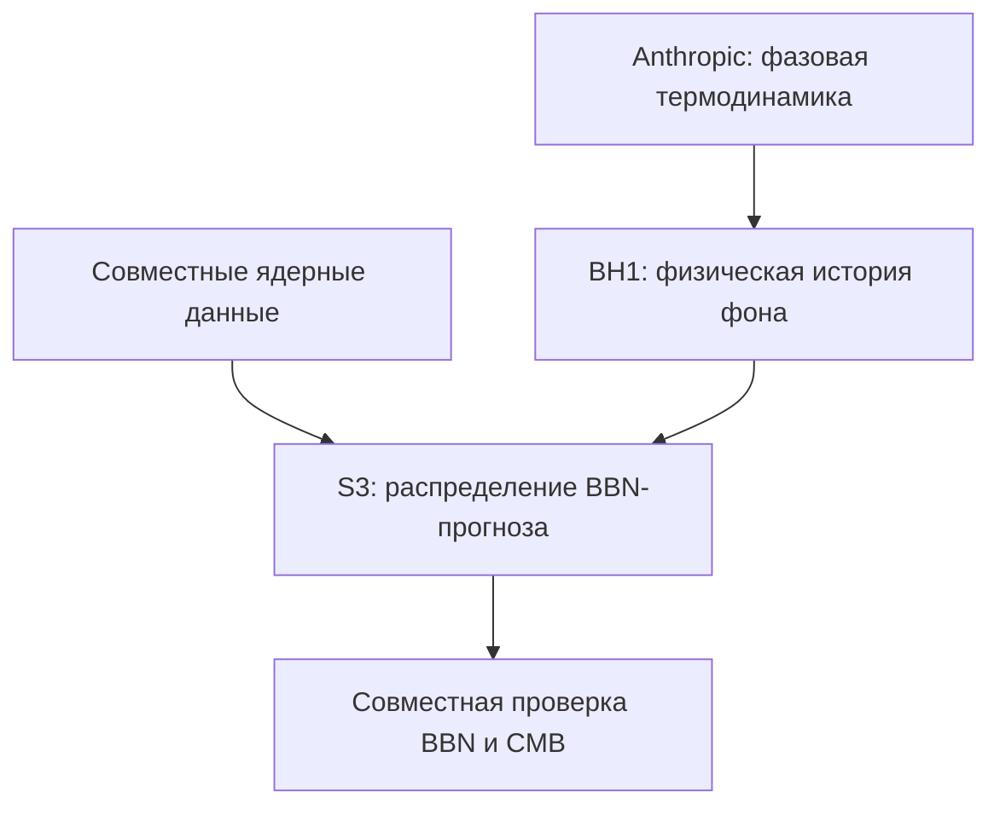

> **Действующее решение 16 ноября 2026:** [площадку выбирает владелец; временного потолка нет](../../../../COMPUTE_AUTHORITY.md). Гейт времени — калибровка, прогноз и план/факт. Прежние временные ограничения и маршрутизация в тексте ниже отменены; факты прошлых запусков сохраняются.

# Межканальная ковариация и проверяемость фазового сектора Anthropic

15 ноября 2026, Москва. **MANUAL_ANALYSIS_COMPLETE / BH1_NOT_EXECUTED / SCIENTIFIC_ACCEPTANCE=false.**

Продолжение [физического моста BH1](../bh_bridge_20261115/REPORT.md) и [аудита неопределённостей PRIMAT](../manual_covariance_20261114/REPORT.md), [задача #56](https://github.com/IgorSabirov/vm-lab/issues/56), [PR #54](https://github.com/IgorSabirov/vm-lab/pull/54). База: `065272ad94bce1c95beb7986fd8ed64cd2b90b8c`; закреплённый PRIMAT: `6f7e5680614fb119d65a6c9c65a292240b27c61e`.

## 1. Какая связь установлена

Матрица Leonard описывает неопределённость лабораторных ядерных данных. Фазовая теория Anthropic описывает другой физический сектор. Между ними сейчас есть **связь через проверку предсказаний**: ядерная ковариация определяет распределение стандартного BBN-прогноза, относительно которого можно проверять влияние дополнительного сектора на космологический фон.

Она не определяет коэффициент фазового потенциала, закон дрейфа S2 или скорость образования чёрных дыр. Из величины экспериментальной корреляции нельзя вывести силу связи скрытого сектора с фотонами. Это разные математические объекты: неопределённость знания лабораторных параметров и физические корреляции состояний системы.



Для ветви B→D сохраняется незакрытое физическое условие предыдущего отчёта: сектор X, геометрия R, полная свободная энергия, механизм перехода и обмен с плазмой должны быть заданы независимо от желаемого D/H. Работа [Anthropic, v1](https://hexagonmath.org/pdf/2611.00175v1), §§1.7, 2, относится к слабой связи, большой N и N=4 SYM на S³. Она не предоставляет готового космологического источника. В изолированном конформном адиабатическом пределе с R∝a сохраняется T_X R; само расширение не запускает пересечение фиксированной фазовой границы. Этот ранее выведенный барьер остаётся в силе.

## 2. Что проверено на предоставленной матрице

Все 256 элементов независимо извлечены из первичного PDF [Leonard et al. (2006), Table V, страница 14](https://arxiv.org/pdf/nucl-ex/0601035v2) и сопоставлены с предоставленной транскрипцией. Оба межканальных блока прочитаны отдельно; максимальное отличие численного представления — 1.74×10⁻¹⁸. Порядок: восемь убывающих лабораторных энергий p-канала, затем те же восемь n-канала. Сечения и ошибки Table III считаны отдельно.

| Проверка | Результат |
|---|---:|
| Размерность | 16×16 |
| Асимметрия | 0 |
| Минимальное собственное значение C_a0 | 4.9517383×10⁻⁵ |
| Число обусловленности C_a0 | 721.9155 |
| Максимальное расхождение восстановленной ошибки с округлённой Table III | 0.004286 mb < 0.005 mb |
| Диапазон межканальных корреляций | 0.017802–0.989955 |

Правильная размерная конвенция: a₀ имеет единицы дифференциального сечения; при принятой конвенции телесного угла σ=4πa₀ и C_σ=(4π)²C_a0 в mb². Комментарий «dimensionless a0²» в приложенном коде исправлен. Переход к S-фактору при фиксированных номинальных энергиях — диагональное преобразование; E_cm=E_lab/2 в нерелятивистском приближении. Неопределённость энергетических координат требует отдельного совместного описания и не добавляется повторно поверх уже учтённой в fit матрицы.

Дополнительный общий 1% масштаб не внесён в основную таблицу. Модель одного общего масштаба δ даёт в первом порядке C_scale=10⁻⁴ μμᵀ. Она повышает стандартные отклонения узлов примерно на 2.61–23.91% относительно неокруглённых ошибок Table V. Это не величина эффекта на D/H. Для буквально мультипликативной независимой случайной величины (1+δ)X точная ковариация равна (1+s²)C_X+s²μμᵀ; простая добавка ранга один опускает член s²C_X. Энергетически зависимая неопределённость p–d-референса остаётся открытой.

В [Launders, Giovanetti & Liu, v1, §III.3](https://arxiv.org/html/2604.16600v1#S3.SS3) межканальные корреляции явно оставлены для будущей работы. Это локализует открытый участок именно данного анализа; универсальное утверждение обо всех BBN-расчётах не делается.

## 3. Ковариация меняет направления неопределённости

Пусть x_p=δlnσ_p, x_n=δlnσ_n в одной точке энергии. Рассмотрим общий режим u₊=(x_p+x_n)/2 и относительный режим u₋=(x_p−x_n)/2. В линейном приближении:

\[
\operatorname{Var}(u_\pm)=\tfrac14(s_p^2+s_n^2\pm2C_{pn}).
\]

При E_lab=112.2 keV (E_cm=56.1 keV) получены отношения стандартных отклонений полной модели к модели с теми же маргиналами и нулевым межканальным блоком:

| Величина | Полная / независимая |
|---|---:|
| Общий логарифмический режим, или логарифм геометрического среднего сечений | 1.410647 |
| Логарифм отношения сечений | 0.100377 |

**Разбор независимого отзыва:** [REVIEW_RESOLUTION.md](REVIEW_RESOLUTION.md) воспроизводит обе пары. Для абсолютных изменений a₀/σ получаются 1.409760 и 0.112148; для определённых здесь δlnσ — 1.410647 и 0.100377. Во втором случае применяется якобиан `C_log[i,j]=C_sigma[i,j]/(mu_i*mu_j)`; исходную сумму дисперсий `0.0099307` нельзя подставлять как сумму логарифмических дисперсий. Исходный verifier и CHECKS.json сохранены; [независимый Decimal-пересчёт](verify_coordinates.py), [результат](REVIEW_CHECKS.json).

Это новый расчёт **на лабораторных узлах**, без добавления 1% масштаба. Он не утверждает рост ошибки D/H на 41%. Ковариация ухудшает определение одного сочетания и улучшает другого. Общий мультипликативный масштаб сокращается в отношении двух каналов.

Общий матричный аргумент:

\[
\Sigma_A=\begin{pmatrix}P&C\\C^{\mathsf T}&N\end{pmatrix},\quad
\Sigma_B=\begin{pmatrix}P&0\\0&N\end{pmatrix},\quad
\Delta\Sigma=\begin{pmatrix}0&C\\C^{\mathsf T}&0\end{pmatrix}.
\]

При ненулевом C у ΔΣ есть положительные и отрицательные собственные значения, равные ± сингулярным значениям C. Следовательно, нет общего порядка «полная ковариация всегда даёт более слабые ограничения». Для экспериментальной C_σ крайние значения ΔΣ равны примерно ±2.757509 mb².

Положительность всех элементов экспериментального блока ещё не доказывает положительность всех элементов ковариации будущего GP-постериора или определённый знак BBN-отклика. Подгонка, энергетические веса и нелинейное отображение должны быть выполнены явно.

## 4. Контракт переноса в S3

Сначала строится совместный posterior двух непрерывных S-факторов с остальными данными и обоснованной нормировкой. Затем интегрированием по энергии получается совместное распределение функций скоростей. Дискретные 16×16 данные не задают продолжение на весь энергетический диапазон.

Основной контролируемый опыт сравнивает:

- A: выборки полного совместного posterior двух функций скоростей;
- B: произведение **тех же** двух маргинальных posterior; каждая температурная кривая переносится целиком.

Для совместного Gaussian posterior достаточно обнулить межканальный блок ковариации. Для негауссовского распределения нулевая ковариация не гарантирует независимости: нужны независимые комбинации целых кривых. Повторный GP-fit с обнулёнными корреляциями данных может изменить маргиналы и является другим опытом. Выбор модели нормировки проверяется отдельно.

На температурной сетке обозначим q=(lnR_p(T_k),lnR_n(T_k),…), z=(Y_p,ln(D/H),…), а J_θ=∂z/∂q для **данного** фона θ. Линейный перенос даёт

\[
C_{\rm nuc,A}(\theta)=J_\theta\Sigma_AJ_\theta^{\mathsf T},\qquad
\Delta C_{\rm nuc}(\theta)=J_\theta(\Sigma_A-\Sigma_B)J_\theta^{\mathsf T}.
\]

Сетка включает согласованные квадратурные веса; отдельные температурные узлы не считаются независимыми. J стандартного BBN нельзя автоматически переносить на резко изменённую BH1-историю. При нелинейности применяется исходное совместное семплирование. В частности, при одинаковых входных средних и маргиналах возможен сдвиг выходного среднего:

\[
\Delta\mathbb E[z_i]\simeq\tfrac12\operatorname{tr}(\mathcal H_i\Delta\Sigma),
\]

где H_i — гессиан BBN-отображения; для негауссовских распределений нужны и более высокие моменты. Такой сдвиг сам по себе не является свидетельством дополнительного сектора.

Для заранее определённого физического θ вычисляется s(θ)=μ_θ−μ_0. В Gaussian приближении:

\[
-2\ln L(\theta)=(z_{obs}-\mu_\theta)^{\mathsf T}C_\theta^{-1}(z_{obs}-\mu_\theta)
+\ln\det C_\theta+\text{const}.
\]

Сумма C_obs+C_nuc+C_other допустима только для независимо заданных источников; общие nuisance-параметры требуют совместного учёта. Член ln det C обязателен, когда C меняется между сравниваемыми моделями. Простое увеличение ошибки не является улучшением физического предсказания.

Диагностика sᵀC⁻¹s показывает ожидаемую различимость заданного сигнала при фиксированной ковариации. Это не готовая significance, не Bayes factor и не подтверждение Anthropic; свободные параметры и внешние данные должны быть учтены. Ядерные неопределённости ограничиваются лабораторными данными, а не подбираются по космологическому остатку.

## 5. Выявленное вырождение: η и поздний фотонный нагрев

Рассмотрим только условный предел предыдущего моста: нагрев фотонов после BBN и e± аннигиляции, до CMB, восстановленный Planck-спектр, сохранение барионов, отсутствие нейтринного нагрева и фотодиссоциации. Здесь выделяется **η-компонента**; раннее влияние X на расширение и слабые процессы должно вычисляться отдельно.

Введём e=δlnη_CMB и d=lnD_γ, где D_γ — прирост комовинговой фотонной энтропии. Из сохранения барионов и свободного охлаждения нейтрино:

\[
\delta\ln\eta_{BBN}=e+d,\qquad
\delta\ln N_{eff,\nu}=-\tfrac43d.
\]

Переиспользованный, проверенный по SHA результат S_η даёт около F0:

\[
a=\frac{\partial Y_p}{\partial\ln\eta}=0.009638830789,\qquad
b=\frac{\partial\ln(D/H)}{\partial\ln\eta}=-1.641661189832.
\]

Локальная матрица отклика по (e,d):

\[
\begin{pmatrix}\delta Y_p\\\delta\ln(D/H)\\\delta\ln N_{eff,\nu}\end{pmatrix}
=\begin{pmatrix}a&a\\b&b\\0&-4/3\end{pmatrix}
\begin{pmatrix}e\\d\end{pmatrix}.
\]

Конвенция оценки: `a = Yp_F0 * ln(Yp_HIGH/Yp_LOW) / ln(eta_HIGH/eta_LOW)`, `b = ln(DoH_HIGH/DoH_LOW) / ln(eta_HIGH/eta_LOW)`. [Повторная проверка](REVIEW_RESOLUTION.md#4-дополнительно-проверены-a-и-b-из-s_eta) воспроизвела их непосредственно из захешированных выходов завершённых прогонов. Прямая секущая Yp и baseline × логарифмическая секущая немного различаются на конечном интервале; это не новая проверка сходимости производной.

Две первые строки имеют ранг 1. **По одним BBN-abundances эту компоненту позднего нагрева нельзя отличить от изменения η.** Любая линейная комбинация, устраняющая чувствительность к η, одновременно устраняет эту часть сигнала. Улучшение ядерной ковариации сужает неопределённость, но не повышает этот ранг.

С известным нейтринным компонентом ранг становится 2. Получаются две проверяемые условные связи:

\[
R_D=\delta\ln(D/H)+1.64166119\,e-1.23124589\,\delta\ln N_{eff,\nu}=0,
\]
\[
R_Y=\delta Y_p-0.00963883\,e+0.00722912\,\delta\ln N_{eff,\nu}=0.
\]

Это наши аналитические диагностические остатки, не найденный сигнал. Ковариация (R_Y,R_D) получается линейным преобразованием **полной совместной** ковариации Y_p, ln(D/H), lnη_CMB, lnN_eff,ν. Для её численного значения ещё нет всех входов.

Критическая оговорка: CMB обычно ограничивает суммарный N_eff и свойства излучения, а не отдельно N_eff,ν. Если сохраняется излучение X, неизвестно исходное нейтринное состояние или имеются спектральные искажения, третья строка не является доступным независимым наблюдением. Нужна совместная физическая модель; CMB-only posterior стандартной космологии нельзя без проверки использовать для произвольного BH1.

При фиксированном η_CMB и D_γ>1 η-компонента снижает D/H. Относительно исторического остатка в нашем F0 это имеет неблагоприятный знак. Полный BH1 может содержать другие вклады; знак полного эффекта и его величина пока не вычислены. Нулевые R_D и R_Y также не подтверждают наличие нагрева: нулевая модель их удовлетворяет.

## 6. Что именно будет проверять связь с Anthropic

| Уровень | Доступный результат | Что ещё требуется |
|---|---|---|
| Лабораторная ковариация | Table V подтверждена; общие и относительные режимы различены | Полная модель нормировки и энергетических ошибок |
| Стандартный S3 | Формулы переноса и корректный A/B-контроль | Совместный posterior S(E), ковариация скоростей, отклики полного BBN |
| BH1 | Термодинамические условия и условные энтропийные соотношения | Физическое X, геометрия, источник перехода, кинетика, collision terms |
| Проверка различимости | Ранг и остатки для ограниченного η-компонентного предела | Полный сигнал μ_θ, независимый наблюдательный контракт, согласованный CMB likelihood |

Критерий полезности реконструкции: установить, насколько корректная межканальная зависимость меняет предсказательные интервалы и способность отличить **заданный** дополнительный фон от стандартного. Результат может оказаться малым; это также содержательное ограничение.

Даже обнаруженный нештатный фон не идентифицирует именно Anthropic: различные сектора с одинаковыми H(t), T_γ(t), n_b(t), нейтринными спектрами и микрофизикой дают одинаковую BBN-задачу. Для установления происхождения нужны дополнительные отличительные предсказания.

## 7. Исполнение и воспроизводимость

Выполнены независимая сверка таблицы, детерминированные матричные расчёты и символьная проверка трёх тождеств и рангов. Основной verifier занял менее секунды; [CHECKS.json](CHECKS.json) содержит фактическое время, версии Python/NumPy/SymPy и SHA входов.

```bash
python analysis/CCC_BBN_NETWORK_20261114/s3_standard/bh_covariance_20261115/verify_connection.py
```

[LEONARD_INPUT.json](LEONARD_INPUT.json) содержит численные входы и происхождение; [CONNECTION_CONTRACT.json](CONNECTION_CONTRACT.json) — формальный статус. Parent RESULT.json читается на месте и проверяется по SHA256; он не копируется и не перезаписывается.

Новые BBN/GP/MC/BH1 расчёты не запускались. Это ручное продолжение научного разбора, без нового автономного пакета, изменения очереди, CONTROL, CURRENT, RUN_REQUEST, порогов или статусов R/C/L/U. Физическое отождествление сектора не выбиралось.
