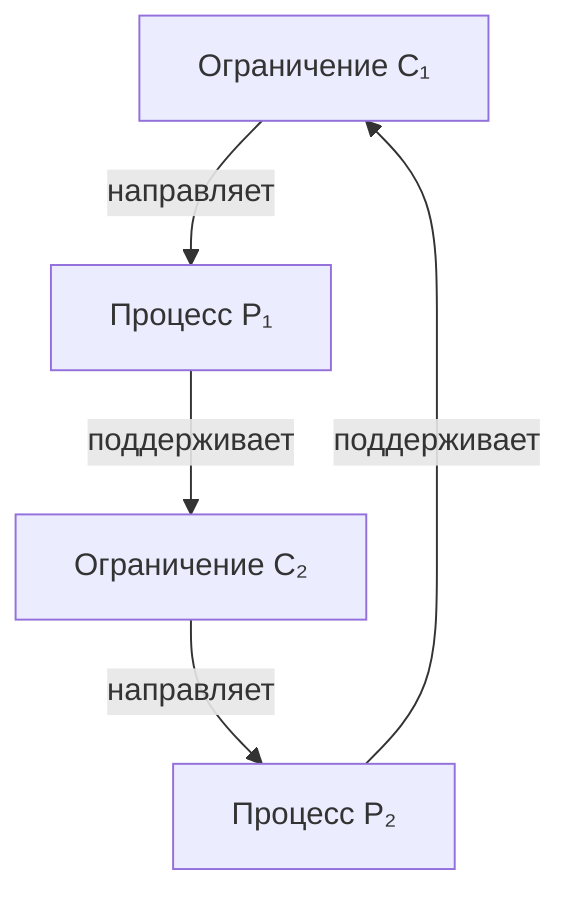

# От биологических механизмов к модели «сейчас»: разбор отзывов

3 ноября 2026. Анализ, проверка источников и точные аналитические контрпримеры; новых численных прогонов и обращений к ВМ нет. Концепт следующего опыта не утверждён.

## Цель, уточнённая пользователем

Биология интересует нас как опорная структура, в которой можно наблюдать связи и механизмы для сборки модели «сейчас». В этой ветке мы не ставим самостоятельную задачу доказать квантовую память ДНК или вывести происхождение жизни. Из биологического примера извлекаем причинный механизм, его условия и контроли; затем проверяем, можно ли перенести их в нашу постановку.

Главное полезное добавление соседей — переход от долговечности корреляций к взаимному поддержанию физических ограничений. Главная поправка к отзыву: несколько разных проверок пока соединены стрелками, но не объединены одной определённой динамикой. Применимость одного механизма не устанавливает автоматически следующий.

## Что берём из опорных систем

| Опора | Что она позволяет сформулировать | Что остаётся проверить у нас |
|---|---|---|
| Временный электронный посредник | Механизм формирования состояния может завершиться раньше существования результата | Корректную динамику после удаления посредника и функцию оставшихся отношений |
| Спиновая химия радикальных пар | Спиновая динамика может влиять на выход химической реакции | Обратную связь от продуктов и структуры к поддержанию необходимых условий |
| Замыкание ограничений | Структуры направляют процессы, которые поддерживают другие необходимые структуры | Конкретные физические носители, масштабы и причинные зависимости в нашей модели |
| Коррелированные приготовления | Состояние части может быть недостаточным для предсказания её будущего | Достаточное описание текущего целого и роль его отношений |

Для спиновой химии есть конкретная экспериментальная опора: Xu et al. (2021) показали магнитную чувствительность фотохимии CRY4 европейской зарянки **in vitro**; мутации помогли исследовать участие последовательных радикальных пар. Это установленный эффект в изученном белке, а не окончательное доказательство всего механизма навигации живой птицы. [Источник](https://www.nature.com/articles/s41586-021-03618-9).

У Montévil–Mossio (2015) ограничение сохраняет релевантные свойства на масштабе действия на процесс. Зависимость означает, что другое ограничение направляет процесс, производящий необходимые свойства первого. В их определении каждое ограничение непосредственно зависит хотя бы от одного другого и поддерживает хотя бы одно; строгий вариант исключает разбиение на два замкнутых набора. Это концептуальный формальный каркас, не готовая динамика нашей системы. [Полный текст, определения 1–4](https://montevil.org/publications/articles/2015-mm-organisation-closure-constraints/).

Для нашего применения важно не навязывать единственное правило «медленное всегда управляет быстрым»: масштабы сохранения, действия и восстановления нужно согласовать для каждой связи. Замыкание не означает термодинамической изоляции.

## Центральный переход: воспроизводство ограничения

Нужно выбрать физическое свойство C₁ — например, геометрию связи или конфигурацию, управляющую доступом к переходам. Затем определить процесс P₁, который зависит от C₁ и поддерживает свойства C₂. Для замыкания требуется путь от C₂ обратно к поддержанию C₁, возможно через дополнительные структуры и процессы.

Схема обозначает проверяемые зависимости, не найденную нами реализацию. Ресурсы и среда учитываются отдельно. Для каждого ребра нужен механизм: что меняется при вмешательстве, как это влияет на процесс и какие свойства другой структуры из-за этого перестают поддерживаться.

В отзыве встречается избыточное требование проверять обратную зависимость для каждой пары. Цикл может иметь вид C₁→C₂→C₃→C₁ без попарных обратных стрелок. С другой стороны, сам граф циклических воздействий ещё не доказывает воспроизводства ограничений. При совместно необходимых условиях могут потребоваться групповые вмешательства; наличие резервного пути может скрыть эффект одиночного отключения.

Восстановление после повреждения — сильная операциональная проверка, но не требование пережить любое разрушение. Заранее фиксируем класс повреждений, сохранённые ресурсы и горизонт наблюдения. Проверяем восстановление способности ограничивать процесс, а не просто возврат произвольного числа к исходному значению.

## Одинаковая ρ_N и разное будущее: точный смысл

Соседи правильно указывают на недостаточность редуцированного состояния при разных корреляциях с окружением. Однако тест следует усилить: совпадать должны обе маргинальные матрицы ρ_N и ρ_E, последующий закон взаимодействия и внешние условия. Иначе различие будущего может объясняться другим состоянием окружения без выделения роли корреляций.

Простейший аналитический контроль состоит из двух классических битов N и E:

| Приготовление | Совместные состояния с вероятностями 1/2 | Маргиналы каждого бита |
|---|---|---|
| A | 00 и 11 | 0/1 поровну |
| B | 01 и 10 | 0/1 поровну |

Применим одно и то же обратимое правило N′ = N XOR E, E′ = E. В A получаем N′ = 0 с вероятностью 1; в B — N′ = 1 с вероятностью 1. Обе исходные маргинали совпадали, но разные текущие отношения дали разные результаты. В квантовой записи это диагональные сепарабельные состояния и вентиль CNOT с управлением E; следовое расстояние конечных состояний N равно 1.

Таким образом, этот тест сам по себе не выделяет квантовость, самоподдержание или наблюдателя. Для модели «сейчас» его польза конкретна: **текущее целое включает отношения между частями; перечня состояний частей может быть недостаточно**. Здесь не нужна самостоятельная причинная сила исчезнувшего прошлого: различие уже присутствует в нынешнем совместном состоянии.

Если совпадают полное релевантное состояние и последующий закон, квантовое описание даёт одинаковую статистику результатов. Различная история подготовки не добавляет ещё одну физическую переменную сверх достаточного текущего состояния.

Работа Pechukas (1994) подтверждает проблему редуцированных карт при коррелированных начальных условиях: их продолжение на весь набор состояний подсистемы не обязано быть физическим положительным каналом. Она не утверждает, что всякая корреляция запрещает всякое CP-описание. [Источник](https://doi.org/10.1103/PhysRevLett.73.1060). Одной пары траекторий также недостаточно для полной реконструкции канала.

## Почему ΔL = G[ρ_NE] пока не является механизмом

Для замкнутого совместного описания с заданным H можно точно разложить

\[
\rho_{NE}=\rho_N\otimes\rho_E+\chi,
\]

\[
\dot\rho_N=-\frac{i}{\hbar}\operatorname{Tr}_E[H,\rho_N\otimes\rho_E]
-\frac{i}{\hbar}\operatorname{Tr}_E[H,\chi].
\]

Последний член показывает, как текущие корреляции входят в производную состояния подсистемы. Это ещё не определение отдельного универсального линейного генератора на ρ_N. Чтобы получить замкнутую редуцированную динамику, надо задать эволюцию ρ_E и χ либо обосновать их исключение. Один результат действия оператора не определяет весь оператор.

Физическое ограничение может менять эффективную динамику части при неизменном фундаментальном законе целого. Не требуется вводить новый нелинейный закон квантовой механики каждый раз, когда меняется организация состояния.

Сравнение «ΔL→0 — память; ΔL не стремится к нулю — самоподдержание» непригодно как классификатор. Ненулевой сдвиг может задаваться постоянным пассивным объектом. Воспроизводимая организация может иметь неизменный эффективный генератор. Результат также зависит от выбранного базового L. Рабочий критерий должен относиться к физическому восстановлению ограничений и его причинным условиям.

## Контроли: отключаем поддерживающую связь, сохраняем снабжение

Предложенная соседями отдельная проверка пускового механизма полезна. Но ослабление резервуара само по себе не отличает внешнюю стабилизацию от самоподдержания: прекращение подачи энергии или вещества разрушает и живую организацию. Нужно различать поток ресурсов и навязанное извне восстановление конкретной структуры.

Для следующего концепта предлагается одна основная проверка:

1. После физического завершения пускового события определить C, его функцию и нормальное продолжение организации.
2. При одинаковом последующем снабжении нанести заранее выбранное ограниченное повреждение C.
3. Сопоставить восстановление с действующим внутренним путём и с избирательно нарушенным предполагаемым путём восстановления; проверить, что вмешательство не меняет результат только через дефицит ресурсов или дополнительный нагрев.
4. Восстановить связь либо заменить её функционально эквивалентной и проверить возвращение способности к восстановлению. Отдельно установить, чем поддерживаются компоненты самого этого пути.

Если выбранная связь не влияет на восстановление при корректных контролях, гипотеза о её необходимой роли опровергается в данном режиме. Если влияет и эффект устраняется возвращением связи, получаем аргумент о причинной роли. Для организационного замыкания требуется проверить и обратные пути поддержания; один успешный ремонт этого не заменяет.

Базовый термостат полезен как контроль: он регулирует параметр, обычно не производя собственные датчик и исполнительный механизм. Однако задача не состоит в исключении любого искусственного устройства по названию. Если устройство действительно воспроизводит необходимые ограничения, его результат надо оценивать по тому же функциональному критерию.

Удаление узла, после которого исчезает различимость, может выявить необходимый датчик. Это ещё не выделяет роль Я. Организационное замыкание и роли Я/Мысли требуют раздельных критериев.

Для организма допустим открытый ресурсный контур. При переносе на «сейчас» как целое источник и сток должны войти в описание целого; предположение о внешнем бесконечном насосе нельзя молча перенести вместе с биологическим механизмом. Локальная демонстрация может помочь построению модели, не решая этот переход автоматически.

## Исправления обозначений и термодинамики

В отзыве старые обозначения местами получили новые значения. По сохранённому исходному фрагменту `Resonance .txt`:

| Обозначение | Смысл в проверенном исходном фрагменте | Проблема отзыва |
|---|---|---|
| A_obs | Алгебра разрешённых наблюдаемых/операций | Не готовая численная мера «внутренней значимости» |
| η_tot | Максимальное отклонение доступного канала от константного на заданных матричных единицах | Не «количество информации полного описания» |
| R_ε(T_rec) | Максимальная entanglement fidelity восстановления при заданном классе операций | Не произвольная восстановимость любых существенных свойств |
| Adm_T⁺ | Кандидатный критерий допустимости конфигураций в разобранных предложениях | Не автоматически множество будущих состояний или переходное ядро |

Формула B* = F(P₀,D,K₂;B*) требует определения F, его области и физических переменных. В отзыве она не выводит границу. Значения η_obs и новая роль K₂ также требуют отдельного закрепления. [Архив исходных определений](../ADM_T_REGULATOR_REVIEW_20261102/SOURCE_EXCERPTS.json).

N_local, I_structure и C_causal полезно различать как вопросы. Последние два в отзыве ещё не определены как измеримые величины. Формула N_A = S_max,A−S_A зависит от выбранных ограничений; это не универсальная мера пригодной для работы энергии. У белловской пары локальные состояния максимально смешаны, хотя совместные корреляции есть: требовать положительной локальной негэнтропии для любой интересующей нас корреляции нельзя.

Для энтропий фон Неймана действует точное равенство

\[
S(N)+S(E)=S(NE)+I(N:E).
\]

Следовательно, сумма изменений локальных энтропий не тождественна изменению энтропии целого. При совместной унитарной динамике ΔS(NE)=0 и ΔS(N)+ΔS(E)=ΔI(N:E); при расходовании начальных корреляций последняя величина может быть отрицательной. Наш двухбитовый контроль даёт такой пример. Термодинамическое производство энтропии, тепло, начальные корреляции и резервуары нужно описать с явными предпосылками, прежде чем применять неравенство второго начала.

## Мера и время

Мера порождения остаётся открытой. Квантовая мера Соркина и наш факторный остаток совместного действия вмешательств — разные объекты; их связь не следует из слова «неаддитивность». Биологические и квантовые протоколы уже заданы во времени: они помогают изучать продолжение организации, но сами не выводят время или стрелу. Истории могут служить способом вычисления нынешних отношений без предположения о внешнем физическом архиве прошлого.

[Проверка литературных уточнений, меры и границ переноса](SOURCES_AND_LIMITS.md) сохранена отдельно.

## Рабочий вывод

Из отзыва берём проверяемую взаимозависимость **«физическое ограничение направляет процесс — процесс поддерживает физическое ограничение»**, с ресурсами и масштабами. Биология помогает найти такие зависимости. Для модели «сейчас» решающим становится вопрос, какие отношения в нынешнем целом обеспечивают воспроизводство необходимых ему отношений.

Не принимаем смену смысла старых обозначений, ненулевое ΔL как критерий автопоэзиса, голодание как универсальный тест замыкания и равенство маргиналей как равенство полного состояния. Новую архитектуру T-CORE, меру и второй канал этим разбором не утверждаем.

Исходный отзыв: [SOURCE_TEXT.txt](SOURCE_TEXT.txt); происхождение и проверенные источники: [SOURCE.json](SOURCE.json). Предыдущий разбор: [временный посредник и продолжающееся «сейчас»](../TRANSIENT_MEDIATOR_20261103/REVIEW.md).
