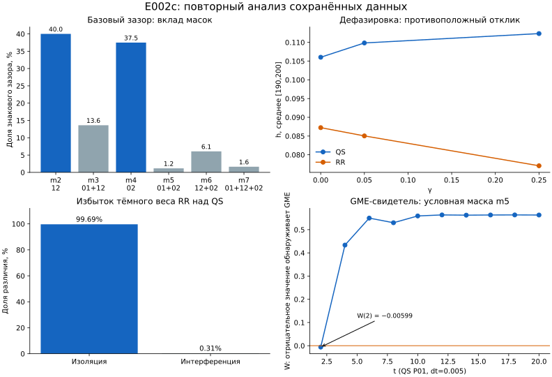

Время исходной динамики: прогноз по закреплённой формуле **4204,850356 с**;
полный факт **4228,108483 с**; отклонение **+23,258126 с (+0,553126%)**;
диапазон **2522,910214–5886,790499 с — PASS**.
Время пересборки: прогноз **9 с**; полный факт **4,755989 с**;
отклонение **−4,244011 с**; диапазон **0–69 с — PASS**.
Очереди: 0,236733 и 0,165079 с соответственно; публикация исключена,
её отдельная длительность не измерена. Прогнозы не менялись задним числом.

# E002c: независимый повторный анализ, 30 октября 2026

Источник — [исправленный отчёт](https://github.com/IgorSabirov/vm-lab/tree/7fd36d60044b436484e81a5e92a80163c4688b45/results/E002c_REPAIR_v001_r001),
один неизменяемый SHA `7fd36d60044b436484e81a5e92a80163c4688b45`.
Все **233 файла** повторно проверены по размерам/SHA256 через
`infra/github_result_reader.py`; независимый verifier снова дал
**VERIFIED_EXPORTED_ARRAYS**. Это анализ уже опубликованных данных: новых
траекторий и RHS нет; полные состояния ВМ не открывались. Старый FAILED-отчёт сохранён.

**Главный вывод:** базовый зазор подтверждается, но предложенное соседями
объяснение через более частые «полные маршруты» недостаточно. Большая часть
базового зазора наблюдается в однорёберных масках; разложение выделяет различие
условных токов внутри масок. Избыток тёмного веса RR почти целиком изоляционный.
Сертифицированная GME обнаружена в ранних условных состояниях, а не как
подтверждённое свойство стационара. IC-поиск оказался существенно ограничен
по охвату параметров. Это новые выводы из NPZ и журнала подбора, не пересказ RESULT.

## 1. Базовая проверка и проценты

При Phi=epsilon=0, gamma=0,05, dt=0,005 средние на [190,200]:

|Величина|Значение|
|---|---:|
|h QS|0,109840093217|
|h RR|0,085033676236|
|QS−RR|0,024806416981|
|(QS−RR)/QS|22,58411865%|
|(QS−RR)/RR|29,17246211%|

Фраза «QS на 22,58% больше RR» использует неверный знаменатель.
RR ниже QS на 22,58%; QS выше RR на 29,17%. Это одна и та же разница.
Максимальное абсолютное различие шести pL/ell в базовой паре — **2,30e−13**.
Оценки соседей порядка 2e−7 получены из округлённых масок, а не из точных массивов.
Маргиналы действительно не определяют транспорт в этих двух моделях.
RR сохраняет когерентный hop; сравнение не является «квант против классики».

Далее масочные токи берутся на общей конечной точке **t=200, dt=0,005**.
Её токовый зазор отличается от среднего [190,200] лишь на −1,56e−9.
Это важно обозначить: экспорт диагностики не содержит всех шести точек
стационарного окна. Дополнительная проверка на общей сетке [192,196,200]
практически не меняет приводимые доли. Финальные состояния обеих веток стационарны;
базовая точка имеет парную проверку dt.

## 2. Где находится токовый зазор

Три границы **99,69%, 66,23%, 77,5%** сведены в воспроизводимую
[таблицу маска×сектор](BOUNDARIES.md) с исходными файлами, SHA256 и сетками.
Они относятся к одной базовой паре, но не к одной ячейке и не к одному
знаменателю: первая — к тёмному весу N=1, вторая — к току N=2,
третья — к току масок m2+m4 по всем секторам.

Вычислено непосредственно из I12_m и I02_m: h_m=I12_m+I02_m.
Биты маски 1/2/4 означают рёбра 01/12/02.

|Маска|Активные рёбра|h_m(QS)−h_m(RR)|Доля базового зазора|
|---|---|---:|---:|
|m2|12|0,009924011|40,006%|
|m3|01,12|0,003378750|13,620%|
|m4|02|0,009300081|37,491%|
|m5|01,02|0,000289584|1,167%|
|m6|12,02|0,001507067|6,075%|
|m7|01,12,02|0,000406923|1,640%|
|m0, m1|нет рёбер / только 01|0|0%|

**77,496% базового зазора приходится на m2 и m4.** На полный треугольник — 1,640%.
Это не подтверждает ожидание, что главные вклады обязательно находятся в m3/m6/m7.
Рёберная конфигурация m2 не содержит пути от источника 0 к стоку 2, но в ней
есть текущий перенос 1→2. Нельзя отождествлять мгновенную маску с полным маршрутом
возбуждения за всю историю переключений. Проверка этой истории требует отдельной диагностики.

Обычные 59,27/40,73% по I12/I02 сохраняются: это другое, маршрутное разложение.
Доля m2+m4 не универсальна: среди 24 сопоставимых грубых QS/RR-пар она лежит
между **49,44% и 102,05%**. Значение выше 100% возможно из-за отрицательных
вкладов остальных масок. Восемь пар разных горизонтов исключены из этого диапазона.

## 3. Частоты масок и условные токи — разные объяснения

Ввёл j_m=h_m/p_m. Все базовые веса существенно выше FLOOR.
Для каждой маски использовано точное симметричное тождество:

Δh_m = Δp_m × (j_m^QS+j_m^RR)/2 + (p_m^QS+p_m^RR)/2 × Δj_m.

|Слагаемое|Вклад в Δh|Доля|
|---|---:|---:|
|Различие вероятностей масок|0,001599323|6,4472%|
|Различие условных токов внутри масок|0,023207092|93,5528%|

Поэтому фраза «разный hop потому, что по-разному заполняются маски» слишком узкая.
Сами вероятности масок оставляют основную разницу в j_m, то есть в условных
узловых состояниях и их токах. Это **описательное разложение**, не причинное
приписывание 6,45/93,55% физическим механизмам и не доли классики/кванта.
Симметричная конвенция явно фиксирована; реальные вмешательства не проводились.

Устойчивость: на общем окне [192,200] первая доля — 6,44721624% против
6,44721642% в t=200. Максимальное различие масочных зазоров между dt=.01
и .005 в этой точке — 3,4e−16. Полное вариационное расстояние между
распределениями масок QS/RR — 0,02074357.

## 4. Тёмный вес: почти вся разница — изоляция

|Диагностика при t=200|QS|RR|
|---|---:|---:|
|Суммарный тёмный вес|0,347059466|0,365947705|
|Изолированная часть|0,336652052|0,355482152|
|Интерференционная часть|0,010407414|0,010465553|

Избыток RR над QS равен 0,018888239. Из него **99,6922%** относится
к изолированным компонентам и **0,3078%** — к интерференционным.
Таким образом, в базовой точке total dark нельзя интерпретировать как
преимущественно интерференционную ловушку. Эти проекторы относятся к
одновозбудительному секторному гамильтониану, не к инварианту всего Лиувиллиана.

Дополнительно восстановлены токи из сохранённых узловых матриц 8×8,
отдельно по секторам одного и двух возбуждений. Например, при Phi=0:
I12=−2 Im(rho[1,2]+rho[5,6]), I02=−2 Im(rho[1,4]+rho[3,6]);
соответствующее слагаемое допускается только при активном ребре маски.
Реконструкция совпала с опубликованными масочными токами.

|Сектор тока|QS|RR|
|---|---:|---:|
|Одно возбуждение|0,045939694|0,037563799|
|Два возбуждения|0,063900399|0,047469879|

**66,235% токового зазора** находится в секторе двух возбуждений.
Объяснять весь эффект только одновозбудительными тёмными проекторами или
C01=rho[2,4] нельзя. C01 также не является полной когерентностью каждого
стокового ребра: I12/I02 используют другие элементы и оба сектора.

## 5. Не все фазовые отклики связаны с изменением статистики рёбер

Соседи верно описали максимальный QS-отклик, но неправомерно распространили его
population-coupled статус на весь свип. Из 34 фазовых сравнений **23** имеют
разрешённый отклик и population_near_matched: **7 QS и 16 RR**.
Здесь near-matched означает объявленный набор девяти структурных показателей,
не равенство всех элементов состояния.

Особенно показателен парно уточнённый RR-контроль при epsilon=0, gamma=.05:
Phi: 0→pi/2 даёт **Δh=0,000200647885 (+0,235963%)**.
Максимальное изменение всех восьми p_m — **1,11e−16**;
структурных показателей относительно их базы — 3,23e−16.
Статус — flux_response, REFINEMENT_CHECKED. Узловые населённости меняются;
неизменной остаётся именно статистика рёбер при тех же независимых скоростях RR.

Фазовый транспортный отклик при фиксированном распределении рёбер уже есть
в сохранённых данных. Он не требует когерентного образования рёбер QS;
когерентный hop есть и у RR. Это не идентификация Fano и не доказательство,
что именно этот отклик объясняет весь QS/RR-зазор.

## 6. Дефазировка и C01 не дают простого правила «больше когерентности — больше зазор»

При Phi=epsilon=0:

|gamma|h QS|h RR|Зазор/QS|abs(c01_m6) QS|
|---|---:|---:|---:|---:|
|0|0,106026459|0,087237125|17,72%|0,062721|
|0,05|0,109840093|0,085033676|22,58%|0,051583|
|0,25|0,112341916|0,077063596|31,40%|0,026273|

Зазор растёт, а модуль условной C01 в m6 у QS падает более чем вдвое.
Сходное падение есть для m7. Ненормированная abs(C01_m6) QS сначала слегка
растёт 0,001832→0,001878, затем падает до 0,001368: нормировка существенна.
В базовой точке abs(c01_m6) почти одинакова у QS/RR: 0,051583/0,051460.
Этого одного показателя недостаточно для объяснения токового различия.

Это три заранее заданные точки, а не доказанный оптимум ENAQT или причинная
регрессия. Меняются другие свойства состояния. Избирательное подавление C01
может быть полезной будущей пробой, но её эффект не следует из одного графика.

## 7. GME: ранний условный сигнал, шесть физических точек

Все семь записей GME_CERTIFIED относятся к **state=6, то есть маске m5={01,02}**,
при **gamma=0, t=2**. Это шесть физических точек QS: P01/P04/P07/P10/P13/P16;
P01 присутствует дважды из-за dt=.01/.005. Нельзя считать это семью
независимыми физическими случаями или свидетельством стационарной GME.

Веса маски в момент сертификата — 0,00837–0,00846, значительно выше FLOOR.
Минимальные собственные значения нормированных блоков положительны,
примерно 0,00305–0,00322: данный сигнал не похож на деление шума на исчезающий вес.
Максимальная отрицательность свидетеля — −0,008155857 против порога 1,563e−7.
На опубликованной временной сетке отрицательные значения этих свидетелей
наблюдаются только при t=2; в конечных состояниях соответствующие W положительны
(около 0,55–0,57). Это отсутствие обнаружения данным семейством, не доказательство
отсутствия запутанности вообще. Для P01 есть собственная dt-проверка; остальные
пять точек используют общий численный экран и требуют этой оговорки.

Нулевая парная negativity в основном отчёте относится к **безусловным**
узловым редукциям. Для условного блока m5 в P01, dt=.005, t=2 пересчёт даёт
парные negativity **0,08308; 0,15145; 0,15104** (исключены узлы 0/1/2).
Разные условия отбора состояния нельзя смешивать в одном утверждении
«парной запутанности нет». Причинная необходимость GME для стационарного
транспортного преимущества по-прежнему не установлена.

## 8. Главная проблема интерпретации IC — охват поиска

Выбранный кандидат имеет alpha=(0,09374267; 0,06878384; 0,12160647).
Структурные ошибки при проверке достигают 32,67% вместо допустимого 1%.
Формальный отказ корректен; физическая невозможность IC-1 из него не следует.

Журнал всех 48 вычислений показывает:

|Старт|Вызовы|Различных alpha01|Различных alpha12|Различных alpha02|alpha02|
|---|---:|---:|---:|---:|---:|
|0,25×seed|16|10|7|1|0,03040162|
|1×seed|16|12|5|1|0,12160647|
|4×seed|16|12|5|1|0,48642586|

**alpha02 ни разу не менялся внутри каждого старта.** Третий параметр
представлен только тремя стартовыми значениями. Все старты израсходовали
полный бюджет; результаты завершения OptimizeResult не сохранены, поэтому
объявлять поиск сошедшимся нельзя. Протокол соблюдён, но его бюджет не дал
полноценного обследования трёх параметров.

Есть и аналитическая проверка: в стационаре pR=1−1,4pL и
alpha02×⟨PR C⟩=ell02, причём 0≤C≤1. Даже с допуском 1% необходимо
alpha02≥**0,05984402**. Первый старт держит alpha02=0,03040162 — ниже
этой необходимой границы. Пока параметр фиксирован, этот старт не может
удовлетворить объявленной цели. Это не исключает другие alpha02.

Поэтому первым новым шагом я рекомендую предзарегистрированный **повторный
поиск в том же IC-1**, с проверяемым охватом всех трёх координат и журналом
завершения оптимизатора. Вводить обратный канал и расширять цель до IC-2
до этой проверки преждевременно. Нового поиска здесь не запускал.

## 9. Какие следующие проверки имеют смысл

Предложенное соседями требование «сохранить все узловые населённости и проверить,
исчезнет ли стационарный токовый зазор» несовместимо с балансом этой модели:

**d⟨n2⟩/dt = h − kappa_out⟨n2⟩; в стационаре h = 0,5⟨n2⟩.**

Если сохранить n2 и скорость стока, h изменить нельзя. При будущем контроле
следует фиксировать внешние скорости и выбранные структурные цели, а отклик
узловых населённостей измерять, не запрещать. Исчезновение отдельного
GME-свидетеля также не доказывает уничтожение всякой GME. Дефазирующий контроль
должен быть задан физическим каналом, с проверкой того, какие ещё когерентности
и токи он изменяет; произвольное зануление одного элемента матрицы не достаточно.

Практический порядок: закончить обследование IC-1; затем проверять условные
токи/сектора и фазовые контроли с согласованной структурой; отдельную причинную
пробу GME проектировать после этого. Автоматических новых экспериментов нет.

12 not_comparable в отчёте — точно **8 QS/RR-gap и 4 gap_phase**,
а не неизвестные пропуски: это разные горизонты. Все 34 phase-сравнения
сопоставимы по объявленным правилам. Исправленные [190,200] остаются отдельными
конечновременными сравнениями. Стационарность нельзя присваивать им задним числом.
Fano/BIC/автопоэзис/квантовая необходимость здесь не установлены.

## Воспроизводимость и ограничения

`analyze.py --github-cache <кэш отчёта 7fd36d60>` повторяет проверку источника,
все вычисления и рисунок. Точные значения, масочные строки, сертификаты,
покрытие IC и ограничения записаны в `findings.json`.
Используются только series/diagnostics/evidence из GitHub. Реконструкция токов
из редуцированных блоков не восстанавливает полное состояние 216×216.
Прежние ограничения пропущенных экспортом точек и глобального численного
экрана сохраняются. Этот описательный анализ после просмотра результатов
не является новой подтверждающей причинной проверкой.
