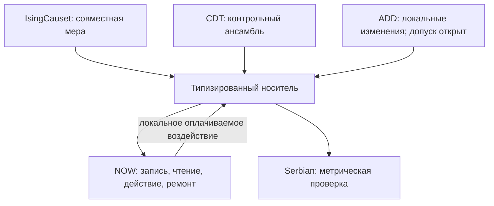

# Четыре кандидата в модели «сейчас»: итоговая интеграция v1.1

8 ноября 2026. **Архитектурное дополнение к существующему NOW_INTEGRATED_CONTINUATION_V1; новый эксперимент не вводится.**

Ревизия v1.1: [мнение соседей и решения](NEIGHBOR_REVISION.md), [проект патча прежнего опыта](../INTEGRATED_EXPERIMENT_20261107/PATCH_20261108.md). Тихая дихотомия и секторные числа относятся к реконструкции ADD v1. C1: соответствие переносу FAIL; C2: BLOCKED_NOT_ATTESTED; C3-D: ещё не реализован и не аттестован. «Потеря информации» из возврата двух битов не следует. Все следующие N01–N08 — дополнительные контракты внутри прежних X01–X16.

Основание: реестр на `29dd0e9e188e3cfc5bdfe9317e4823f543fb2ca2`, NOW v0.3 на `ea49ebce07495aa3a8dff6ed2c8cfa4ebfa0b2e8`, отчёт о его проверке на `f5e2e47baea7225626a530a8c123e9457a79d263`, три предоставленных обсуждения кандидатов и оба архива ADD. Последний аудит ADD включён как воспроизведённое свидетельство с конкретным отрицательным результатом о соответствии полусдвига.

**Решение:** сохранить один процесс организации NOW и присоединить четыре инструмента через разные, явно типизированные роли. Сербское ядро оценивает локальную метрику; IsingCauset задаёт совместную статистическую меру порядка и состояний; CDT поставляет независимый контроль геометрических ансамблей; ADD предлагает локальную динамику изменения носителя. Общими остаются физический доступ к записи, действие, конечные ресурсы и профиль дальнейшего продолжения. Соединение четырёх названий не заменяет совместного закона.

## 1. Главный вопрос и нулевая строка

Исходная цель — происхождение абсолютного «ничего» и организованного «сейчас» — сохраняется. Рабочий вопрос данного расширения:

> Может ли организация при локальных повреждениях и изменении носителя сохранять и воспроизводить условия причинного продолжения, а её внутреннее действие — изменять эти условия, при конечном учтённом ресурсе?

Это проверяемый промежуточный переход к L04/L06/L07/L08/L09/L10. Происхождение первичной меры и самого закона относится к L01 и этим опытом не выводится.

| Компонент | Что дано на входе | Что допускается получить |
|---|---|---|
| Альтернативы и мера | Объявленные пространства конфигураций, границы, сектор, веса и правило выборки | Зависимость результата от этих предпосылок; не происхождение вероятности |
| Динамика | NOW и отдельно определённый закон изменения носителя | Причинную роль организации при данном законе |
| Геометрия | Порядок, комплекс и/или интервалы — по возможностям конкретного адаптера | Реконструкцию метрики, пригодность путей, условное влияние состояний на структуру |
| Подготовка | Носители, аппараты чтения/записи, локальная память, донор и границы | Продолжение после завершения инициатора либо из полного подготовленного среза |
| Ресурс | Конечная материальная/операционная бухгалтерия | Цена, предел и восстановление доступности; не энергия без физической модели |
| Время | Причинный порядок; собственные часы только при наличии метрики | Раздельные выводы об ориентации, динамике и организационной направленности |

Сохраняются два маршрута C004/C005: пуск с последующим завершением инициатора и подготовка согласованного целого на произвольной допустимой внутренней стадии. Второй маршрут не считается воспроизведённым космогенезом. Равенство полных состояний и закона даёт одинаковое дальнейшее распределение лишь в рамках принятой полноты состояния; это контроль реализации, а не новое доказательство происхождения.

## 2. Что действительно дали дымные и технические проверки

| Узел интеграции | Свидетельство | Допустимый вывод | Непокрытый остаток |
|---|---|---|---|
| NOW v0.3 | Сохранённый отчёт: 54 теста, 18 проверок исполнения, дымовой цикл 15,59198 с; три VM-калибровки | Конечный исполнитель и восстановление после сбоев проверены в объявленном объёме | Основные 326 задач не исполнены; геометрические расширения в них не входят |
| Сербский C++ | 41 586 авторских проверок, 12 проверок адаптера; исходники и лицензия сохранены | Ядро классификации доступно как инструмент | Не повторены большие авторские генераторы; это не новая статистика сигнатур |
| Сербское ядро × NOW | 10 проверок сохранённой трассы: 46 событий, 64 тройки, 12 причинных передач | Геометрический анализатор стыкуется с форматом NOW | Геометрия не управляла этой трассой и не производилась организацией |
| IsingCauset | Статьи, README, лицензия и зафиксированный авторский commit | Известный пример совместного статистического выбора порядка и спинов | Нашей сборки, дымового и термализованной выборки нет |
| 2D CDT | Статья, README, лицензия и зафиксированный авторский commit | Доступна методика выборки и контроля геометрий | Нашей сборки, дымового и переноса NOW нет |
| ADD reconstruction v1 | 64 C1 и 4096 C2 состояний, 18 620 переходов; точные секторные подсчёты повторены | Внутренние свойства конкретного исходника установлены | Проверка соответствия заявленному свободному переносу статьи провалена; организации в графе нет |

Свидетельства NOW и сербского ядра прочитаны из сохранённых отчётов; повторных прогонов в этой работе нет. ADD был независимо воспроизведён в предыдущем шаге этой сессии; исходники и JSON сохранены в `evidence/add_reconstruction/`. Статусы IsingCauset/CDT не повышаются по наличию чужого кода или общему слову «дымовые».

Прогноз 19,45 с с пределом 120 с относится только к прежним 326 задачам NOW v0.3. На новый состав и на термализацию ансамблей он не переносится.

## 3. Роли четырёх кандидатов

| Кандидат | Вход → выход | Роль внутри общего опыта | Граница переноса |
|---|---|---|---|
| Serbian / piecewise-flat | Согласованный комплекс и интервалы q → инерция форм, вырождение и надёжность | Проверка метрической стороны носителя, диагностика общих граней и локальных размерностей | Сигнатура сама не задаёт ориентацию, траекторию сигнала или закон роста |
| IsingCauset | Два линейных порядка, спины и параметры веса → выборка частичного порядка со спинами | Подготовка совместных ансамблей и контроль статистического обратного влияния | Шаг MC не является временем; спин не является читателем; при j=0 получается чистая мера 2d orders, не сербский ансамбль |
| 2D CDT | Фиксированные топология/слои/типы рёбер, параметры и MC → ансамбль триангуляций | Независимая среда проверки доставки и устойчивости выводов к выбору геометрического семейства | Топология и фолиация заданы; 2D не становится 4D; евклидовы длины выборки нельзя выдавать за лоренцевы интервалы |
| ADD | Пространственный цикл с портами и битами, локальный закон → последовательность изменений носителя | Динамическая проверка продолжения при изменении числа мест и локальных контактов | Сначала восстановить соответствие полусдвига и обращения времени; метрика и физический читатель не предоставлены исходной моделью |

Статистическая мера IsingCauset, ансамбль CDT и динамика ADD — разные математические объекты. Они входят в одну систему сравнений и один формат физического исполнения, но не перемножаются как готовые факторы одной физической меры без нового обоснования.

Стрелка NOW→носитель означает требуемый исполняемый интерфейс воздействия. Она не означает, что он уже реализован в четырёх исходных программах.

## 4. Единое состояние и границы «сейчас»

Вычислительный представитель текущего состояния на допустимом срезе:

\[
X_\Sigma=(G_\Sigma,M_\Sigma,Z_\Sigma,A_\Sigma,B_\Sigma,Q_\Sigma,C_\Sigma).
\]

- `G`: текущий носитель, порты, идентификаторы и локальные отношения;
- `M`: метрические данные и карты перехода, если они определены;
- `Z`: физические носители записей и внутренние состояния;
- `A`: читатели, писатели, корректоры и их исправность;
- `B`: свободный, зарезервированный, связанный ресурс и отходы;
- `Q`: передачи в пути, промежуточные фрагменты, локальные обязательства и таймеры;
- `C`: локальные часы и доступная контроллерам память.

Срез — способ представления расчёта. Единственная объективная космическая одновременность этим обозначением не вводится. Для обратимых/релятивистских вариантов нужен согласованный перенос состояния между допустимыми срезами.

Контроллер получает только текущее локальное состояние и доставленные ему сообщения. Диагностический журнал и будущие узлы заранее выбранной геометрии ему недоступны. История может быть физически представлена текущими записями; внешняя таблица истории не подменяет их. Имена ADD нельзя бесплатно использовать как доступную устройству память происхождения.

Классический протокол описывается нормированным ядром

\[
K_b(X'\mid X,a),\qquad \sum_{X'}K_b(X'\mid X,a)=1.
\]

Это спецификация семейства конечных операционных моделей, а не найденный фундаментальный закон. Стохастический генератор в программе — средство выборки; утверждение о замкнутом физическом целом требует отдельно описать источник случайности/окружение. Ни вероятностность, ни глобально определённая история сами по себе не устанавливают тип 2.

## 5. Два уровня объединения: мера и причинное исполнение

### 5.1. Подготовка окружения

Для семейства b фиксируются пространство конфигураций Ω_b, мера μ_b, границы, сектор, способ размещения устройства и состояния подготовки. Мера именованных конфигураций, мера классов изоморфизма и мера орбит не взаимозаменяемы.

В IsingCauset применим известный совместный вес порядка и спинов. При j=0 и фиксированном N сумма по свободным спинам даёт постоянный множитель 2^N; при переменном N он меняет вес объёмов. Это аналитический контроль. В CDT учитываются вероятности предложения/принятия ходов и автокорреляция. MC используется только для подготовки независимых или статистически учтённых окружений.

Не следует вводить вес вида exp(λY_T), а затем объявлять высокий Y_T возникшим самоподдержанием: успех уже внесён в меру. Статистический отклик геометрии на Ising-связь и локальное физическое воздействие корректора измеряются отдельно.

### 5.2. Исполнение внутри окружения

На выбранном окружении запускается тот же конечный процесс NOW. Каждая операция объявляет входные носители, область причинной зависимости, начало и завершение, расход, выходные носители и отказ. Удалённое знание о повреждении появляется только после доставки уведомления.

Для фиксированной геометрии:

\[
P_{b,k}(g,h)=\mu_b(g)P_k(h\mid g),\qquad \sum_h P_k(h\mid g)=1.
\]

Следовательно, корректор может изменить вероятность успешного продолжения, но не безусловную μ_b(g). Изменение геометрии в подвыборке успехов — условный отбор. Это уже выведенное ограничение, а не новый опыт.

Для изменяемого носителя требуется совместное ядро по `(g,z,a,budget)`. Оно должно задавать локальную причинную последовательность применения правил и обратное действие. Порядок «сначала геометрия, потом ремонт» не считается нейтральным: если операции не коммутируют, порядок входит в физический кандидат и проверяется альтернативным допустимым расписанием.

## 6. Контракты адаптеров

Обязательный общий интерфейс: `capabilities`, `prepare`, `local_view`, `admissible_events`, `apply_event`, `snapshot`, `restore`, `resource_delta`, `causal_parents`, `provenance`.

Дополнительные возможности включаются явно:

| Возможность | Обязательство |
|---|---|
| `causal_order` | Строгое различие полного отношения и непосредственных links; проверка ацикличности |
| `metric_geometry` | Интервалы, инерция, порог надёжности, общие грани и карты перехода |
| `proper_time` | Часы вдоль заданной линии, единицы и способ получения |
| `ensemble_measure` | Вес, границы, сектор, маркировка, генератор и корреляции выборки |
| `local_rewrite` | Область изменения, одновременные конфликты, сохранения, обратимость при заявке |
| `transport` | Реальные допустимые каналы, длительность и цена, а не только связность |

Неподдерживаемая возможность возвращает `NOT_DEFINED`, а не фиктивную метрику или нулевую задержку. Для чистого порядка можно задать положительные операционные задержки на links; это отдельное допущение. Такие единицы не сравниваются с собственным временем метрической ветви как физические секунды.

В CDT сначала выбирается конечный причинный участок. Если авторская выборка имеет периодическое время, оно разворачивается в конечное окно с указанными границами; цикл по временному направлению нельзя молча превратить в DAG. Применение сербского ядра к CDT допустимо только с корректно восстановленными лоренцевыми типами интервалов. В размерности 1+1 проверяются треугольники; пять точек на таком фоне дают вырождение, а не новую 3+1-геометрию.

## 7. Запись, читатель и перенос через изменения носителя

Минимальный тест содержит два сообщения одинаковой стоимости и одного сохраняемого сектора. Конкретный вариант кодирования — частица одного типа в одном из двух локальных регистров: перестановка её позиции меняет сообщение, не число частиц. Привязка регистров и правило чтения являются частью аппарата, а не внешним знанием экспериментатора.

Чтение считается физически реализованным, когда локальный аппарат принимает носитель и содержание меняет последующее действие. Контроли: переставить содержание при сохранённом секторе, разрушить запись, отключить читатель, подать неверную копию. Один внешний счётчик `active_patterns` для этого недостаточен.

Для ADD обязательны отдельные правила:

1. При split каждый входной объект получает определённый выходной адрес; копия возникает только через явную операцию с носителем и затратой.
2. При merge сохраняется судьба ОБОИХ содержимых. Алгебра имени не задаёт объединение записей. Нельзя стирать конфликтующий объект или бесплатно расширять память. Остаточная информация либо хранится в учтённом регистре, либо передаётся явно описанному окружению.
3. При полусдвиге носитель следует конкретному порту/каналу; местоположение записи и аппарата обновляется тем же локальным событием.
4. Изменение доступности из-за недостатка ёмкости или ресурса входит в новый связанный закон. После этого исходные теоремы ADD не переносятся без проверки.

Это контракты выбора физической реализации, а не уже написанный закон ремонта ADD. До их конкретизации динамическая ветвь не получает статус исполняемой. Статические ветви и проверка общей структуры опыта от этого не исчезают.

Учёт ресурса ведётся по уникальным носителям: свободные + резерв + в пути + связанные + отходы. Внутренний перевод не является расходом второй раз; возврат уже учтённого ресурса не создаёт отрицательного истощения. Из отходов не возникают новые рабочие носители без правила переработки. Увеличение числа пустых вершин не производит автоматически память, читателя или запас.

## 8. Единые наблюдаемые и профиль продолжения

Общий дополнительный исход геометрических режимов (старый `final_function` NOW 0.3 сохраняется отдельно; конкретная независимая от флага ремонта проба `Y_task` определена в проекте патча):

\[
Y_T=\mathbf1\{\text{запись доставлена, верно прочитана и вызвала требуемое действие до }T\}.
\]

Факт ремонта не входит в определение успеха. Режим OFF должен иметь возможность успеха. Для повторений отдельно измеряются число выполненных действий, время первого отказа, восстановление, число причинно поддержанных передач аппарата и цена каждого успешного перехода.

Профиль C041 задаётся на заранее фиксированном конечном классе протоколов Π:

\[
I_\Pi(X)=\{\Pr(Y_T=1\mid X,do(\pi)),\;\text{распределение затрат и времени}\}_{\pi\in\Pi}.
\]

Совпадение этого профиля — операционная эквивалентность для Π, не универсальный генетический инвариант. При физической передаче дополнительно доказывается причинное происхождение профиля потомка от организации предка. Одинаковый одиночный отклик этого не заменяет.

Геометрические наблюдаемые: инерция и её надёжность; согласованность соседств; наличие реального пути; длительность и цена доставки; размер носителя; глобальная и локальная плотности. Локальная плотность фиксируется относительно устройства/его области, а не произвольно выбранного лучшего участка после опыта.

Энтропия считается только после объявления укрупнения и меры. Для проверяемой C2-реконструкции сохраняется вектор четырёх чисел частиц; смешение секторов не изображается эволюцией одной траектории. Рост размера, связность, локальная пригодность и успех — разные переменные.

Разделены: индекс MC, индекс программных событий, собственное/операционное время и направление записи. Величина log(P_F/P_R) допускается только при заданном обратном протоколе, его подготовке и опоре. Неопределённый обратный процесс даёт `UNDEFINED`, не бесконечность. Отражение координат и `reverse_schedule` не подменяют обратную физическую динамику.

## 9. Общая экспериментальная матрица

Один набор протоколов выполняется внутри каждого поддержанного семейства. Различные семейства не объединяются в одну статистическую выборку. Сначала оцениваются причинные контрасты внутри семейства, затем устойчивость их направления и границ между семействами.

| ID | Сравнение | Что оно разрешает | Исход и ограничение |
|---|---|---|---|
| N01 | Один носитель: полный процесс / разрушенная запись / отключённый читатель / переставленное содержание | R074/R075: причинную роль содержания и аппарата | Если успех не зависит от предусмотренного сообщения, заявленный читатель не подтверждён |
| N02 | Геометрии с сопоставимыми начальными локальными маргиналами, разными путями и согласованностью | R018/R023/R034/R058: достаточность маргиналов и роль связей | Значимый эффект путей уточняет профиль; нулевой эффект ограничивает только выбранную задачу |
| N03 | Локальная коррекция ON/OFF, фиктивное воздействие с той же ценой, внешнее удаление неудач | R076/R123: действие коррекции против отбора | Поддержка требует изменения безусловного Y_T в ожидаемом причинном канале |
| N04 | Воспроизведение записи / записи и читателя / записи, читателя и средств ремонта | R064/R120–R122: повторение функции против производства условий | Следить за пределом поколений и остаточным подготовленным аппаратом |
| N05 | IsingCauset j=0 / j≠0 при объявленных N, β, мере и граничных условиях | Статистическое влияние внутренних состояний на порядок | Не выдавать изменение ансамбля за физическую работу корректора |
| N06 | Прежний G×K плюс D×K на общей C3-подготовке | Вклад ремонта сверх локального сгущения частиц | C3: QI3D, не QI2+D; эффект G включает весь I3. Подробные 15 клеток — в проекте патча X07/X09 |
| N07 | Прямой и корректно подготовленный обратный протокол; отдельно смена координат | R077/R078/R123: закон, история, ориентация и подготовка | До реализации обратного закона статистика стрелы не определена |
| N08 | Пуск с завершением инициатора / подготовленный полный срез; затем удаление компонента среза | R094/R096/R119: полноту текущего состояния для продолжения | Не устанавливает меру возникновения или факт прохождения представленного прошлого |

Главная новая гипотеза для N06: локальная коррекция способна уменьшить потерю продолжения, вызываемую изменением носителя, в некоторой ограниченной области ресурсов. Это не универсальная гарантия. Измеряются четыре P(Y_T) и взаимодействие

\[
\Delta_{int}=[P(Y\mid dynamic,on)-P(Y\mid dynamic,off)]-[P(Y\mid static,on)-P(Y\mid static,off)].
\]

Положительная Δ_int означает больший эффект коррекции в динамическом режиме, но сама не доказывает происхождение метрики, стрелы или субъекта. Нулевая/отрицательная Δ_int — содержательный результат в объявленной области. Предсказание «без ремонта организация обязательно погибнет» не вводится.

Сопоставляются начальные условия, размещение аппарата, сектор, ресурс и допустимые ошибки. Плотность после воздействия — возможный посредник эффекта: нельзя подбирать по ней итоговые группы и затем трактовать разницу как полный причинный эффект. При разном числе событий случайность связывается с устойчивыми идентификаторами операций либо используется явно независимая схема; одинаковый seed сам не гарантирует парность.

Полные знаменатели, отказы, неразрешимые случаи и потери выборки сохраняются. Допуски эффекта, объём выборки и мощность — поля будущего предрегистрированного запуска. Сейчас чисел для них не выдумано.

## 10. Связь с реестром и обязательства родителям

Машиночитаемые обязательства и типизированное покрытие всех 42 конструкций находятся в [REGISTRY_MAP.json](REGISTRY_MAP.json). Прямые родители, ограничения и отложенные физические ветви различаются.

| Родители | Было | План интеграции | Получено сейчас → статус |
|---|---|---|---|
| C001/C002/C004/C005; R003/R090/R094/R096 | Два маршрута и открытое основание | N08, нулевая строка и полный срез | Сохранены оба маршрута; происхождение меры/закона открыто |
| C009/C037; R058/R085; L09 | PSD-геометрия откликов не равна метрике | Отдельные интервалы, метрический классификатор и транспорт | Рабочий классификатор унаследован; происхождение метрики не заявлено |
| C016/C019/C026/C040; R018/R023/R034 | Маргиналы могут не фиксировать транспорт | N02 на другом явно названном объекте | Подготовлен контроль связей; квантовые результаты не перенесены на графовую игрушку |
| C010/C033; R074/R075/R119; L04 | Нужны внутренний след и причинная роль чтения | N01 и одинаковый Y_T | Общий операционный контракт; новая геометрическая реализация чтения не исполнена |
| C030/C032/C041; R063/R064/R120–R125; L03/L06/L07 | Ремонт и передача зависят от аппарата/ресурса | N03/N04/N06, учёт носителей и адресов | Схема производства условий разработана; общий инвариант не получен |
| C034/C042; R076/R083/R123; L08 | Тип 2 определяется корректирующей ролью | N03/N07, причинная область и обратное действие | Критерий сохранён; энтропия не заменяет корректор или самопрезентацию |
| C035; R077/R078 | Ограничения конечного унитарного класса и симметрии ансамбля | ADD как иной класс; N06/N07 | R126 фиксирует несоответствие текущего кода, не опровержение статьи или R077 |
| C038; R086–R089 | Конкретные результаты CSG/TP | Использовать как ограничение переноса, не переименовывать в CDT | C038 сохранена; новые семейства не подставлены вместо старого объекта |
| C020/C021/C024; R041/R097/R119 | Защита/загрузка, спины–дырки–протоны и PW имеют собственные физические условия | Сохранять интерфейсные требования; отдельная будущая физическая реализация | Эти ветви не исполнены и не заменены Ising-спинами/битами ADD |
| C039; R090/R100; L10 | Успехи частей не дают совместной модели | Единая спецификация, свидетельства и проверка стыков | R127 — завершённый проект интеграции, не завершённая физическая реализация |

Для каждого N-контракта сохранены исходное утверждение родителя, ожидаемое приращение, положительный/отрицательный/неопределённый исход и ссылка на будущую проверку. Это перспективные обязательства; дымовые прошлого не переименованы в их предрегистрацию.

Все L01–L10 остаются открытыми. Для L04/L06/L07/L08/L09/L10 добавляется конкретная программа проверок, а для L01/L02/L03/L05 — явная граница и необходимые физические входы. Статус «открыто» не означает запрета развивать модель.

## 11. ADD: обязательная поправка к интеграции

Точная карта C1/C2/C3, алгебра без ложной потери информации, FT-1…13, D/I3, определения средней/суммы энтропий и полные знаменатели приведены в [ревизии v1.1](NEIGHBOR_REVISION.md). Она уточняет следующий исторический аудит, не отменяя его чисел.

Исходник `add_backend_smoke_v1.py`, SHA-256 `ee607902b61b28328affc9ca3474ee8881b610aac9b8ec1773081abe3d585e27`, сохраняется как историческая реконструкция. Его внутренние тесты проходят, но два полусдвига восстанавливают циклическое слово вместо заявленного в статье переноса. Также проверка с выбранным R меняет метки портов, а не только биты; это требует сверки соглашений.

Числа E0 и тихого класса, включая 23,807343% в секторе (4,6,7,7), остаются результатами этого исходника. Они не аттестуют авторскую динамику. Статус: `INTERNAL_CHECKS_PASS / AUTHOR_TRANSPORT_CONTRACT_FAIL`. После исправления правил зависящая от них комбинаторика пересчитывается; результаты v1 не переписываются задним числом.

Следующий контроль ADD конкретен: независимо задать полный перенос по портам и проверить квадрат полусдвига; проверить оба направления, ориентацию второго канала, обратимость и заявленное обращение времени. Затем определить физический перенос содержимого. Сопоставление Definition 4 с рисунком и описанием необходимо; причина не объявляется однозначно установленной опечаткой авторов.

## 12. Порядок реализации и экономия

1. Внести [патч](../INTEGRATED_EXPERIMENT_20261107/PATCH_20261108.md) в прежний каталог и исполнитель NOW v0.3; не создавать новый опыт. Сохранить 326-задачную базу по SHA, добавить выбранные клетки и отдельный прогноз их стоимости. Первый шаг — обёртка прежней flat_1p1, повторное использование сербской диагностики и общий исход задачи; затем адаптеры фиксированных порядков.
2. Реализовать общий формат носителя, причинных событий и capability-проверки; первым сквозным переносом выбрать фиксированные 2d orders при j=0. Это минимальная проверка «геометрия → продолжение» без нового закона физической обратной связи.
3. Добавить CDT как независимое семейство среды и сербское ядро как метрическую диагностику там, где интервалы определены. Сравнить N01–N04 с одинаковой семантикой исхода.
4. Воспроизвести ансамблевую связь IsingCauset j≠0 отдельно от временного исполнения. Поддержанный статистический эффект даст основание специфицировать локальное физическое взаимодействие, но не заменит его.
5. Исправить и раздельно аттестовать ADD C1/C2/C3-D; подключить перенос содержимого к существующим X07/X09. N06 включает контроль сгущения D, восемь G×D×K клеток и адресные контроли. N07 различает обратный носитель и полный обратный NOW; последний без физического инструмента не определён.
6. Для нового научного пакета: конкретный закон/состав → ревизия → исправления → дымовые → ограниченная калибровка целевой среды → зафиксированный основной запуск. Освоение готовых библиотек и адресные проверки интерфейсов не требуют повторного согласования каждой операции.

Полный декартов перебор четырёх моделей × всех старых параметров не назначается. Каждое сравнение имеет один различающий вопрос. Ошибка реализации, неподдержанный интерфейс, статистическая неопределённость и отрицательный научный результат получают разные статусы.

В этой работе выполнены чтение, синтез, связывание реестра и проверки согласованности документов. Новых научных симуляций и VM-запусков нет. Зафиксирована версия проекта, пригодная для следующей реализации и рецензии; основная цель не заменена исследованием одной только энтропии или удобной геометрической игрушки.

## Источники и материалы

- [NOW v0.3: сохранённая проверка](https://github.com/IgorSabirov/vm-lab/blob/f5e2e47baea7225626a530a8c123e9457a79d263/analysis/INTEGRATED_SCOPE_VALIDATION_20261108/RESULT.md).
- [Сербское C++-ядро](../SERBIAN_CPP_ADOPTION_20261108/RESULT.md), [стык с NOW](../SERBIAN_TIME_BRIDGE_20261108/RESULT.md), [отбор IsingCauset/CDT](../GEOMETRY_CANDIDATES_20261108/RESULT.md).
- [Djordjevic, Prlina, Vojinovic](https://arxiv.org/html/2610.31776v1): кинематический ансамбль интервалов и сигнатур; динамические эффекты в этой постановке исключены.
- [Glaser](https://arxiv.org/abs/2011.13875): совместная модель 2d orders и Ising-состояний.
- [Brunekreef, Görlich, Loll](https://arxiv.org/abs/2310.16744): алгоритмы и детальный баланс CDT.
- [Arrighi, Dowek, Durbec](https://arxiv.org/html/2306.07121v2): локальная обратимая графовая динамика; свойства реконструкции проверяются отдельно.
- [Манифест источников](SOURCE_INDEX.json), [машинная схема](DESIGN.json), [карта реестра](REGISTRY_MAP.json), [результат проверки связей](REGISTRY_CHECKS.json).
