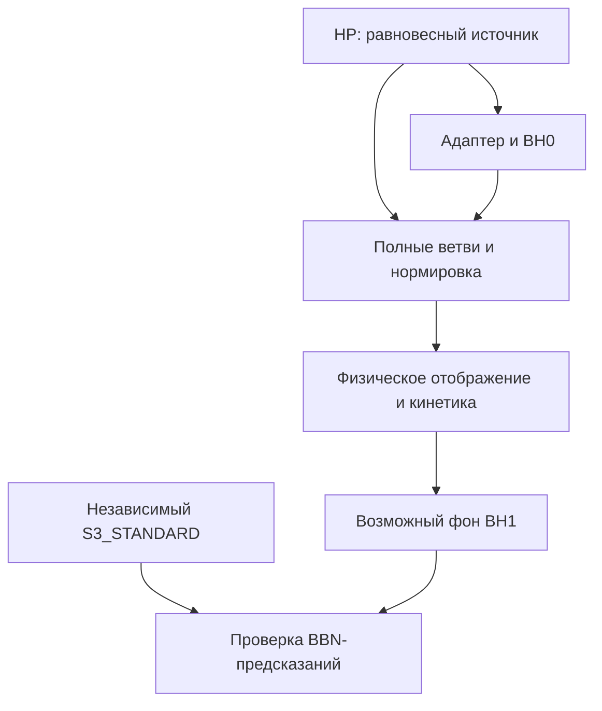

# Генеалогия HP–BH1 и место разбора в корпусе

15 ноября 2026. [Разбор](REPORT.md), [источники](SOURCES.json), задача [#66](https://github.com/IgorSabirov/vm-lab/issues/66).
База `c050a82e226e40b7dc8b43696ba2b28ff2a6ee41`, предшественник [PR #65](https://github.com/IgorSabirov/vm-lab/pull/65).
Это генеалогия утверждений и свидетельств, а не заявленная генеалогия физической Вселенной.
Даты ниже — даты материалов/каталогов; они не заменяют даты выполнения процессов.

## 1. Прямые родители: от источника до незакрытого моста

| Этап | Сохранённый материал | Что он действительно даёт | Чего из него не следует |
|---|---|---|---|
| Источник свободной теории, 2003–2005 | Aharony et al., hep-th/0310285v6, §§3.5, 4.3, 5.1 | Статистическая сумма, различие SU(N)/U(N), вакуумная конвенция и свободный конфайнментный предел | Космологический сектор, неравновесная кинетика и готовая взаимодействующая теплоёмкость |
| HP v1, 2026 | 2611.00175v1, §§1.7, 3.3, (25)–(26) | Слабосвязный большой-N результат о фазовой структуре и ведущей скрытой теплоте | Произвольная функция ΔC(χ), кинетика перехода и Q_X(t) |
| Интеграция 12 ноября | [ANTHROPIC_BH, REPORT](../ANTHROPIC_BH_20261112/REPORT.md), adapter.py, CHECKS.json | Реализация редуцированного потенциала, импорт коэффициентов; 13 локальных проверок | Полная репликация трёхпетлевой работы; абсолютные Z_A,Z_B и энергия |
| Диагностика 14 ноября | [BH0 SUMMARY](https://github.com/IgorSabirov/vm-lab/blob/af0127b07482203fb164bfcd062e93c4cd5925f4/analysis/ANTHROPIC_BH0_BARRIER_20261114/results/SUMMARY.json) | 9 случаев, 38 проверок; REDUCED_BARRIER_DIAGNOSTIC_PASS | Конечная-N мера, реальное время, кинетика; три соответствующих флага false |
| Развилка BBN | [S2 и Anthropic](https://github.com/IgorSabirov/vm-lab/blob/af0127b07482203fb164bfcd062e93c4cd5925f4/analysis/CCC_BBN_NETWORK_20261114/S2_MICROPHYSICS_AND_ANTHROPIC.md), [PIPELINE](https://github.com/IgorSabirov/vm-lab/blob/af0127b07482203fb164bfcd062e93c4cd5925f4/analysis/CCC_BBN_NETWORK_20261114/pipeline/PIPELINE.json) | Разделение микрофизики, стандартных ядерных неопределённостей и дополнительного фона | Замена отсутствующего закона S2 произвольным профилем |
| Термодинамический мост 15 ноября | [bh_bridge](https://github.com/IgorSabirov/vm-lab/blob/af0127b07482203fb164bfcd062e93c4cd5925f4/analysis/CCC_BBN_NETWORK_20261114/s3_standard/bh_bridge_20261115/REPORT.md), BRIDGE_CONTRACT.json | Явные недостающие физические определения; запрет повторного прибавления скрытой теплоты | Разрешённый BH1-прогон или установленный канал X→γ/ν |
| Связь с проверяемостью BBN | [bh_covariance](https://github.com/IgorSabirov/vm-lab/blob/af0127b07482203fb164bfcd062e93c4cd5925f4/analysis/CCC_BBN_NETWORK_20261114/s3_standard/bh_covariance_20261115/REPORT.md) | Как стандартные ядерные неопределённости влияют на различимость заданного дополнительного фона | Вывод взаимодействия X из лабораторной ковариации; идентификация HP по одному BBN-остатку |
| Типизированная карточка PR #65 | [CCC_BH1_COSMO_SCALING](https://github.com/IgorSabirov/vm-lab/blob/af0127b07482203fb164bfcd062e93c4cd5925f4/infra/relationships/CCC_BH1_COSMO_SCALING.json) | R=ζA и ρ_X=λE как условное отображение с независимыми нормировками, null для неизвестного | Выбор ζ,λ по совпадению амплитуд; космологическое толкование ANTHROPIC_HP без моста |
| Настоящий разбор | [REPORT](REPORT.md), [CHECKS](CHECKS.json) | Точные контрпримеры к интерпретации нулевых линий, уточнения нормировки и приближений | Новый общий инвариант, физический генератор, закрытие R/C/L/U |

S_ETA/F0/S1/BH0 и исходный численный FAIL линии N1 не пересчитываются и не переименовываются.
Успех BH0 относится к редуцированной диагностике. Число 38 — не число подтверждений полного HP.
Импорт скрытой теплоты из (26) обозначается литературным входом; локальный verifier её не вывел.
Замороженные прежние отчёты моста и результаты сохранены без перезаписи.

Стрелки обозначают зависимости необходимых входов. Они не утверждают, что C–E уже реализованы.
Нынешний результат уточняет C и ограничения D. S3_STANDARD не должен ждать решения D.
Изменение космологического фона при фиксированной микрофизике не требует автоматически закона дрейфа S2.

## 2. История исправлений: не стирать предыдущие ошибки

Тексты A/B и последнего вложения сохранены побайтно. Порядок строк ниже логический;
он восстановлен из предоставленной переписки, а не из независимо удостоверенной хронологии чужих вычислений.
Заявления соседей «проверено у меня» не считаются нашим исполнением.

| Утверждение в цепочке обсуждения | Независимая проверка | Итоговая формулировка |
|---|---|---|
| Фон Q0 выводится из переходного C | Производная C_A/R⁴ отдельно | Q0=C_A'χdot/R⁴; ΔC=C_B−C_A не фоновый коэффициент |
| Член ΔC fdot означает внешний обмен | Полный двухфазный баланс | Он может компенсироваться температурным вкладом; источник определён только полным балансом выбранного X |
| Фоновый член — самостоятельный физический канал | Переписывание двухфазной плотности | Это часть разложения; отдельный канал требует определения подсистемы и взаимодействия |
| Разложение «калибровочно» | Группа преобразований и динамическая симметрия не заданы | Используем «зависит от представления», не заявляем gauge symmetry |
| ΔC в переходе известно точно | Уравнение (26) и порядок источника | Только ведущий большой N и коэффициент с [1+O(λ)] |
| Редуцированный W — полная свободная энергия | I→F→E при фиксированном R | Нужны нормировка, множитель T, общий член и температурная зависимость |
| Одна нулевая кривая разделяет знаки Q | Пересечение с Q=1; касание со сменой знака | Есть семейство G=const; Q=∇G·v/R⁴ зависит от скорости |
| ΔC/ΔC' — ширина перехода | Размерность и семейство функций с одним якорем | Это локальный обратный логарифмический наклон; ширина не установлена |
| Компенсация целиком субведущая | C_A=0, ΔC=N²χ⁴, χ=eᵗ, f=e⁻⁴ᵗ | Компенсация через fΔC' остаётся в ведущем порядке |
| После отбрасывания C_A' исчезает нулевая поверхность | Явные линии f=(G*−C_A)/ΔC | Исчезнуть может конкретный вклад, а не обязательно семейство линий |
| Нулевые линии — адиабатическая конверсия | Раздельные энергия, энтропия и кинетика | Линии сохранения масштабированной энергии ещё не физические траектории |
| Три чтения f эквивалентны, кроме внешних каналов | Средние против дисперсий, интерфейсов и кинетической энергии | Одно среднее не определяет носитель; различающие наблюдения есть внутри X |
| Абсолютный C_A непременно требует нового трёхпетлевого движка | Свободная статистическая сумма Aharony et al. | Свободный контрольный уровень доступен; взаимодействующие ветви остаются отдельной задачей |
| Свободный полюс даёт λ⁻²/λ⁻⁴ прямо при взаимодействующем переходе | Различие χ_H(0) и χ_H(λ), область гауссова приближения | Только условная эвристика до согласованного вывода мягкой моды |

Исправления не обнуляют верную алгебру прежних текстов. Они ограничивают физическое прочтение.
Историческая ошибка сохраняется вместе с её исправлением, а не переписывается как якобы исходная позиция.

## 3. Связь со всем корпусом: тип отношения и предел переноса

Ниже охвачены основные линии корпуса, а не перечислены все R-записи как равнозначные родители.
Ссылки ведут в существующие реестры. Их текущие научные статусы не изменяются.

| Линия / существующие записи | Отношение данного разбора | Что именно переносится | Что не переносится |
|---|---|---|---|
| [R001](../NOW_RESULTS_SYNTHESIS_20261106/RESULTS_REGISTER.md#r001), [R128](../NOW_RESULTS_SYNTHESIS_20261106/RESULTS_REGISTER.md#r128), N02 | Граница предпосылок | Мера, геометрия и закон заданы до расчёта | Фазовая организация не выводит происхождение закона и меры из «ничто» |
| [R034](../NOW_RESULTS_SYNTHESIS_20261106/RESULTS_REGISTER.md#r034), линия CORR/E002c | Методологическое ограничение достаточности | Одинаковые маргиналы/средние не задают общий закон продолжения | Энергетическая смесь HP не считается воспроизведением транспортной когерентности |
| [R040](../NOW_RESULTS_SYNTHESIS_20261106/RESULTS_REGISTER.md#r040), [R041](../NOW_RESULTS_SYNTHESIS_20261106/RESULTS_REGISTER.md#r041), [R115](../NOW_RESULTS_SYNTHESIS_20261106/RESULTS_REGISTER.md#r115) | Сопоставление границ интерпретации | Нулевой наблюдаемый требует механизма и условий приготовления | Q=0 не означает BIC, тёмное состояние, динамическую устойчивость или равновесие |
| [R064](../NOW_RESULTS_SYNTHESIS_20261106/RESULTS_REGISTER.md#r064), N06, [U010](../NOW_RESULTS_SYNTHESIS_20261106/OPEN_QUESTIONS.md#u010) | Замыкание условий продолжения остаётся открытым | Сохранение одной энергии слабее замыкания множества жизнеспособных состояний | Никакого вывода воспроизводства аппарата, носителя или следующего цикла |
| [R075](../NOW_RESULTS_SYNTHESIS_20261106/RESULTS_REGISTER.md#r075), [R094](../NOW_RESULTS_SYNTHESIS_20261106/RESULTS_REGISTER.md#r094), L04/L07, X27 | Граница предмета исследования | Нужны физический носитель, чтение и причинное вмешательство | Поле f не становится записью, инструкцией или наследованием от смены обозначения |
| [R096](../NOW_RESULTS_SYNTHESIS_20261106/RESULTS_REGISTER.md#r096), [R101](../NOW_RESULTS_SYNTHESIS_20261106/RESULTS_REGISTER.md#r101), [Common_Model](../COMMON_MODEL_20261109/MODEL.md) | Условность самосогласованного целого | Общий баланс должен учитывать все части и внутренние потоки один раз | Уравнение баланса не создаёт самосогласованный генератор и не доказывает неаддитивность |
| [R119](../NOW_RESULTS_SYNTHESIS_20261106/RESULTS_REGISTER.md#r119) | Граница редукции | Исключение координат из описания не доказывает физического исчезновения их энергии | Потенциал u не заменяет полный тензор энергии-импульса X |
| [R120 / C041](../NOW_RESULTS_SYNTHESIS_20261106/RESULTS_REGISTER.md#r120) | Прямое ограничение кандидата-инварианта | G одинаково, но доступные скорости и Q могут различаться; нужен полный протокол Π | Контрпример не опровергает саму спецификацию Π; он опровергает достаточность одного G |
| [R123 / C042](../NOW_RESULTS_SYNTHESIS_20261106/RESULTS_REGISTER.md#r123), [U006](../NOW_RESULTS_SYNTHESIS_20261106/OPEN_QUESTIONS.md#u006), L09 | Граница геометрического отображения | Требование R∝a и согласованного давления до космологического баланса | Радиус S³ и конформный закон не выводят причинный порядок или метрику |
| [R126](../NOW_RESULTS_SYNTHESIS_20261106/RESULTS_REGISTER.md#r126), ADD_F2 | Отдельный вариант и носитель | Дисциплина pins, независимых проверок, точной идентичности оператора | Никакого отождествления стрелы ADD со знаком Q, времени HP или общего K |
| [R129](../NOW_RESULTS_SYNTHESIS_20261106/RESULTS_REGISTER.md#r129), R129_CONTACT_CAPACITY | Исключение ложного отождествления | Явный контактный бюджет и собственная мера должны сохраняться | Ёмкость контактов не Haar-мера, не скрытая теплота и не энтропия HP |
| [R127](../NOW_RESULTS_SYNTHESIS_20261106/RESULTS_REGISTER.md#r127), L10, Serbian/CDT/IsingCauset | Разделение метода, модели и физического отображения | Совместный исполнитель даёт проверяемые отдельные артефакты | SignatureKernel — метод; инженерный PASS нескольких адаптеров не объединяет физические законы |
| [CCC+TL](../CCC_TL_REVIEW_20261112/REPORT.md), BBN S0/F0/S1/Sη | Прямой космологический контекст с незакрытым отображением | Независимые нормировки и предсказания; переиспользование проверенного F0 | Совпадение степени R⁻⁴ не выбирает нормировку и не доказывает CCC↔HP |
| S3_STANDARD, [ковариационный мост](https://github.com/IgorSabirov/vm-lab/blob/af0127b07482203fb164bfcd062e93c4cd5925f4/analysis/CCC_BBN_NETWORK_20261114/s3_standard/bh_covariance_20261115/REPORT.md) | Независимая линия и будущая проверяемость | Стандартная неопределённость нужна для проверки уже заданного BH1-сигнала | Эпистемическая ковариация лаборатории не закон физического энергообмена |

Для быстрого восстановления контекста: [реестр результатов](../NOW_RESULTS_SYNTHESIS_20261106/RESULTS_REGISTER.md),
[открытые вопросы](../NOW_RESULTS_SYNTHESIS_20261106/OPEN_QUESTIONS.md),
[предпосылки и N-долги](../FOUNDATIONS_LITERATURE_20261103/PREMISES_CURRENT.md),
[типизированная навигация](../REGISTRY_LINKS/INDEX.md).
Рёбра нового review создаются компилятором реестра; они означают scope_boundary и другие явно указанные отношения, не научную приёмку.

## 4. Что передаётся автоматической системе

Передаётся аналитический вход и история ограничений. Не передаются RUN_REQUEST,
новый package_id, изменённый pin, выбранный закон Q, носитель f или допуск BH1.
Существующая карточка получает ссылку и уточнение условия радиуса; null-поля не заполняются гипотезами.
Common_Model получает обратную ссылку, без смены версии физической модели или статуса C041.

Рекомендуемый следующий отдельный документ — контракт восстановления свободной ветви:
группа, вакуум, диапазон χ, заданные функции z_B/z_F, контроль хвоста суммы и производных,
два независимых вычислительных пути и бюджет. Его подготовка не равна принятию
всей космологической модели. Для взаимодействующего перехода остаются полные ветви,
реальное время, энтропийный баланс и физические collision terms.

Это продолжение научного анализа нормировок, а не новая миграция инфраструктуры.
Происхождение данных, математическая проверка, инженерное исполнение и физическое
отображение остаются четырьмя разными уровнями свидетельства.
