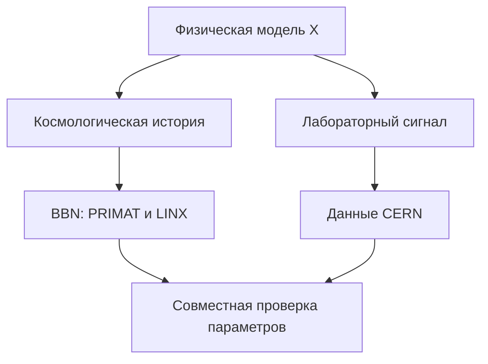

# R130–BH1–BBN: разбор соседей и предметная связь с CERN

18 ноября 2026. База: `4792fccf09e7e5b259bb5e9bfa047a5c492dbd30`. Задача: [#96](https://github.com/IgorSabirov/vm-lab/issues/96).

**Статус: критический обзор, статическая сверка закреплённых исходников и условная аналитика. Нового физического прогона нет.** Научные статусы R/C/L/U/N не повышаются. Исходный составной отзыв приложен в диалоге; его полный текст здесь не публикуется. [Происхождение, SHA-256 вложения и источники](SOURCES.json), [предыдущая архитектура](../R130_BH1_BBN_CONNECTION_20261117/ARCHITECTURE_REVIEW.md).

Главная практическая польза CERN — экспериментальные ограничения на конкретную реализацию сектора X и измеренные ядерные реакции для BBN. Для этого нужен общий набор физических параметров, связывающий космологическую историю с лабораторным сигналом. Соответствие R130 → физический X по-прежнему предстоит построить.

## 1. Что принимается из отзыва

Приложение содержит последовательность разборов, кода и последующих исправлений. Ранние статусы нельзя переносить в реестр без учёта последних исправлений. Числа, сообщённые соседями, здесь не выдаются за наши повторные исполнения.

| Предложение или вывод | Оценка после сверки |
|---|---|
| Разделить отклик BBN на заданную историю, генератор физической истории и вложение R130/BH1 | Полезная декомпозиция работы. Это не новые линии A/B вместо решения D003 и не принятие новой физической модели. |
| Паспорт потерь/возможностей каждого адаптера | Принять как требование: явно перечислить, какие входные поля реально использованы, аппроксимированы, проигнорированы или не поддерживаются. |
| Противоположные расщепления и bit-only R восстанавливают нужную C2 | Уже есть в текущем R130; проверка старого ядра — другой объект. См. §2. |
| Каналы C2 тождественны двум ветвям Janus | Раннее утверждение отозвано самим последующим разбором. Симметрия закона не отождествляет канал с космологической ветвью и не доказывает типичную стрелу. |
| D/I₃ закрывает или опровергает продолжение | Отрицательный статус отозван. Инвариант и локальная энтропия сами по себе не решают вопрос функционального продолжения. U010 остаётся открыт. |
| Сумма χ² двух кодов по одним Yp и D/H | Отвергнута в последующем разборе: наблюдения нельзя учитывать дважды. |
| f_dust<0.008 и f_stiff<0.0111 — наблюдательные границы | Это оценки по выбранному порогу доли энергии, не результат BBN likelihood. |
| CCC как crossover, Weyl→0 и позднее исчезновение масс | Не соответствует текущей ветке CCC+TL/CBST проекта. См. §3. |
| ≤600 секунд здесь, иначе ВМ; письмо Пабло следующим шагом | Не принимается как распоряжение: правило площадки отменено владельцем; письмо этим обзором не отправляется. |

## 2. Старое ядро и текущий R130

В начале приложения расположен старый `ADD_FT10_MINIMAL` с базой 8 ноября. Последний разбор отдельно признаёт, что часть именованных проверок выполнена на выдержке ядра, а не на всём исходном файле. Следует сохранять три класса свидетельств: полный файл, восстановленная выдержка, модель циклического слова.

На текущем main [`verify.py`](../ADD_NEIGHBOR_SYNTHESIS_20261117/verify.py) уже задаёт:

- `interact(..., eps=(1,-1))`: 3 → (1,2), 12 → (8,4), с обратными слияниями и согласованной алгеброй имён;
- `transport`: перенос Fig. 2(a);
- `r2`: перестановку битов без перестановки портов/разворота кольца.

В [опубликованной таблице R130](../ADD_NEIGHBOR_SYNTHESIS_20261117/REPORT.md#c2) для каждого из четырёх вариантов ε проверены 4368 именованных входов. Коммутация RI=IR и инволютивность T=IR проходят для противоположных ε; для одинаковых ε имеется по 1574 нарушения. Нельзя пересказать эту таблицу как «все четыре варианта прошли». Предложенный соседями ремонт по существу повторяет уже используемую противоположную ориентацию R130.

Точный активный цикл слова уже опубликован:

`(1,2,12) →[I₂] (3,8,4) →[Q] (2,12,1)`.

Это циклический поворот при L=3, с одним слиянием и одним расщеплением на шаге. Периодичность всего именованного состояния не следует. Дополнительная классификация циклов в приложении ограничена 40 шагами и ограничением длины; для утверждения об исчерпывающем отсутствии более длинных циклов нужен полный граф переходов заявленного конечного пространства либо отдельное доказательство. Настоящий обзор такого нового census не выполняет.

Старое ядро сохраняется как исторический объект; его молчаливая замена разрушила бы происхождение прежних результатов. Полное воспроизведение R130 через Copilot остаётся свидетельством исполнения своего закреплённого пакета, а не аттестацией старого backend или физического вложения.

## 3. Подмена значения CCC

Наша [ветка CCC+TL/CBST](../CCC_TL_REVIEW_20261112/REPORT.md) связана с меняющимися константами, масштабированием часов и моделью Гупты; закреплённый внешний репозиторий — `rgupta-uottawa/CCC_SPARC`. Приложение вводит crossover, Weyl→0 и mass fade — предпосылки другого, конформно-циклического сценария.

Следовательно, «CCC требует позднего исчезновения массы, поэтому отбирает наш X» сейчас не является ограничением принятой архитектуры. Такую отдельную гипотезу можно исследовать только с собственными источниками, контрактом и решением владельца. Нельзя приписывать её существующим U006/L09 или ветке Гупты по совпадению аббревиатуры. Даже для отдельно введённого конформного сценария равенство следа идеальной жидкости нулю не заменяет полной проверки конформной динамики, взаимодействий и аномалий.

## 4. Часы, объём и энергия: полезное условие и его предел

При L∝n^α, V∝L^γ∝a³, t∝n^β имеем a∝t^s, s=αγ/(3β). Если дополнительно принять плоскую 3+1 GR, отсутствие существенной Λ, доминирование одного компонента и постоянное w, то:

\[
w_{GR}=\frac{2\beta}{\alpha\gamma}-1.
\]

Если независимо принять изолированную масштабно-инвариантную BH1-адиабату с фиксированными остальными параметрами, TR=const, E∝R⁻¹ и физическое R∝L, то вдоль V∝L^γ:

\[
p=-\frac{dE}{dV}=\frac{E}{\gamma V},\qquad
w_{\rm eff}=\frac1\gamma,\qquad
\beta=\frac{\alpha(\gamma+1)}2.
\]

Это полезный тест совместимости предпосылок. Для физического трёхмерного объёма γ=3 получаются w=1/3 и β=2α. При γ≠3 производная по выбранному V — ещё не доказанное физическое давление BH1 на S³. Если S³ понимается буквально как замкнутая космологическая геометрия, нельзя одновременно применять плоский степенной закон без явного режима пренебрежения кривизной. Радиус границы, радиус AdS и масштаб FLRW также не тождественны по обозначению.

Указанное в отзыве `req γ=2` для строк с β=3α/2 не сохраняет «пыль»: при этой замене обе формулы дают w=1/2. При E∝L⁻¹ никакое конечное положительное γ не даёт w=0. Массивный компонент требует другого закона энергии либо взаимодействия.

### Почему выбор линейного роста пока не выведен

Сосед получает β=α+1 из дополнительного закона dt/dn∝L и затем α=1 при γ=3. Сам закон часов не выведен из R130 или BH1.

Контрпример к универсальности такого выбора: для разбавленного газа с постоянным числом частиц N, V∝L^γ и постоянным ⟨σv⟩ время ожидания столкновения частицы масштабируется как V/(N⟨σv⟩), а не как L. Если именно столкновения считать тиками, то β=1+αγ. При γ=3 совместимость с β=2α дала бы α=−1, за пределами положительного роста. Это несовместимость указанного набора предпосылок, не запрет всех внутренних часов.

В более общем анзаце ⟨σv⟩∝L^δ получаем β=1+α(γ−δ). Совместимость требует α=2/(1−γ+2δ), при ненулевом знаменателе и допустимых показателях. Для γ=3 и α=1 требуется δ=2. Значит, нужен физический закон взаимодействия, а не только выбранная степень L(n). Именно параметры такого закона в конкретной модели могут быть связаны с лабораторными ограничениями CERN. Лабораторная скорость и тепловая ⟨σv⟩ требуют расчёта из одного взаимодействия; они не равны автоматически.

Одинаковая степень a(t) также не означает полной неразличимости в BBN: нужны согласованные нормировки, Tγ(t), барионная плотность, нейтринный фон и слабые/ядерные скорости.

## 5. Что действительно видно в закреплённых PRIMAT и LINX

PRIMAT: `CyrilPitrou/primat@6f7e5680614fb119d65a6c9c65a292240b27c61e`. LINX: `cgiovanetti/LINX@bfba07c77a5fcba1cc772d42f2d9e9be8a542df8`. Это статическая сверка API и реализации, не запуск обоих BBN-решателей.

| Проверенный участок | Следствие для нашего адаптера |
|---|---|
| PRIMAT `config.py:1510–1535`, `background.py:1511–1533` | `custom_background` принудительно отключает неполное отделение нейтрино и спектральные искажения; дополнительные столбцы не дают произвольный нейтринный фон. |
| PRIMAT `background.py:1604–1626` | Сортируются не только t, но отдельно T и a. Проблема многозначных T→t/a относится и к этому маршруту PRIMAT. |
| PRIMAT `background.py:1773–1838` | В custom background выходной N_eff восстанавливается через остаток ρ_tot−ρ_plasma с H из степенной подгонки последних точек. Если там остался X, остаток включает X. Это нельзя автоматически называть плотностью нейтрино или переносить на эпоху CMB. Для нерелятивистского X это тем более не универсальная радиационная ΔN_eff. |
| PRIMAT `config.py:230–237` | `weak_rate_cache=False` отключает чтение нетеплового кэша; тепловая таблица имеет отдельное поведение. `save_nTOp=False` запрещает сохранение соответствующего результата, но не означает «все кэши отключены». Нужна проверка зависимости каждого кэша от изменённых физических входов. |
| LINX `abundances.py:139–168` | ρν задана для одного вида при общей температуре; ξν меняет слабые скорости, но не перестраивает автоматически ρν/N_eff/H. |
| LINX `abundances.py:215–219, 364–392, 440–467` | P_NP действительно используется при построении t и a. Но helpers интерполируют log(ρ_tot) и log(P_tot): требуется ρ_tot>0 и P_tot>0. «Произвольное давление» без этой оговорки — слишком сильное утверждение. Подать готовые a,t можно, но это переносит проверку физической согласованности на генератор. |
| LINX `abundances.py:238–254, 370–385, 446–460` | Сортировка по T и ρ не восстанавливает причинный порядок многозначной истории. Требуются однозначность используемых отображений, отсутствие неразрешённых повторов и контроль области интерполяции. |

Разделить физическую траекторию на монотонные сегменты недостаточно само по себе: нужно передавать конечные абундансы и остальные состояния в следующий сегмент и сохранять порядок времени. Две независимые ветви Janus — отдельная постановка, не способ автоматически обработать нагрев/отскок одной истории. Переход через H=0 текущим положительным H-контрактом не поддержан.

Для `extra_rho` табличная передача гладкой функции численно приближённа: гладкость не доказывает точности интерполяции. Нужны сходимость по сетке и отделение extra expansion от переноса энергии в плазму/нейтрино.

В паспорт включить: clock/units, branch/monotonicity, ρ/p и EOS, neutrino/weak treatment, baryon normalization, heating/source terms, rate provenance, cache dependence, interpolation error, определения выходных Yp/DH/N_eff. Неподдерживаемое поле нельзя молча игнорировать и затем объявлять входы одинаковыми.

## 6. Калибровка и статистика

1. В идеализированном релятивистском пределе до аннигиляции e±, Tν=Tγ и g*=10.75, одна дополнительная нейтринная степень ΔN_eff=1 даёт ρ_X/ρ_rad=7/43. При конечной массе электрона около 1 MeV это приближение. Значение 7/16 использует другую нормировку; конвенцию необходимо записать до расчёта.
2. Для отдельно сохраняющегося компонента с постоянным w корректен закон ρ_X∝a⁻³⁽¹⁺ʷ⁾. Подстановка a∝1/Tγ через всё окно BBN игнорирует изменение энтропийных степеней свободы и возможный нагрев.
3. При фиксированной общей ковариации одна наблюдательная функция согласия имеет вид (O(θ)−d)ᵀC⁻¹(O(θ)−d). Два решателя проверяют численную/модельную согласованность одного прогноза. Их χ² по тем же данным не складываются как независимые свидетельства. При зависящей от θ ковариации полная Gaussian likelihood требует также log det C; общие ядерные неопределённости должны учитываться согласованно.
4. Для O=(Yp,D/H) ранг якобиана по θ не больше двух. Это ограничение локальной линейной идентифицируемости регулярной задачи, не доказательство глобальной неразличимости любых нелинейных моделей. Добавление лабораторных наблюдений может повысить ранг, если они зависят от тех же θ. Второй программный расчёт тех же двух величин новых наблюдений не добавляет.

## 7. Конкретная польза CERN

| Ресурс | Связь с нашим проектом | Что требуется перед применением |
|---|---|---|
| n_TOF, мишень ISOLDE, измерение ⁷Be(n,p)⁷Li | В нашей карте 8 нуклидов / 12 реакций уже есть `Be7_n__Li7_p` ↔ `Be7nLi7p`. Можно проверить происхождение и неопределённости именно этой скорости. | Сверить, не включены ли данные уже в закреплённые таблицы, затем единицы, тепловое усреднение, обратную реакцию и корреляции. Не добавлять повторно то же измерение как независимое. |
| n_TOF, ⁷Be(n,α)⁴He | Дополнительный канал уничтожения Be7 для исследования Li7. | Его нет в текущем общем списке 12 реакций: понадобится отдельно согласованное расширение обеих сетей и оценка значимости. Это не готовое улучшение D/H. |
| NA64 и другие поиски слабосвязанных частиц | Могут исключать части пространства параметров конкретного X, например заданного тёмного фотона или другого медиатора. | Задать массы, операторы/связи, времена жизни и ветвления; вывести из них космологические collision terms, ρ_X,p_X,Qγ,Qν и лабораторный сигнал. Условия опубликованного exclusion plot должны совпадать с нашей моделью. |
| HEPData, материалы публикаций, CERN Open Data | Таблицы, неопределённости и доступные экспериментальные результаты для воспроизводимой проверки. | Выбрать конкретное измерение; проверить наличие данных и статистическую интерпретацию. Наличие портала не означает, что нужный NA64 likelihood уже там есть. |
| CERN-TH, Physics Beyond Colliders / EuCAPT | Среда для обсуждения конкретной модели частиц, термальной истории и ограничений. | Предметный вопрос с уравнениями и воспроизводимым результатом; наличие таких программ не гарантирует рецензию или сотрудничество. |

Измерение n_TOF ⁷Be(n,p)⁷Li опубликовано в [PRL 121, 042701 (2018)](https://doi.org/10.1103/PhysRevLett.121.042701), охватывает область интереса BBN; авторы прямо сообщают, что оно даёт лишь небольшое улучшение литиевой проблемы. Нельзя выдавать это за её решение. Для ⁷Be(n,α)⁴He см. [PRL 117, 152701 (2016)](https://doi.org/10.1103/PhysRevLett.117.152701).

У NA64 уже есть результаты поисков и ограничения. Пример первичной работы: [PRD 109, L031103 (2024)](https://doi.org/10.1103/PhysRevD.109.L031103), поиск с позитронным пучком и невидимым распадом тёмного фотона. [Официальная сводка CERN от 4 сентября 2026](https://home.cern/na64-a-decade-of-hunting-dark-matter/) подтверждает отсутствие установленного сигнала в описанных поисках и развитие программы. Мы пока не выбрали benchmark X, поэтому численное ограничение на наш мост из этих работ не вычислено. Планируемый SHiP нельзя записывать как уже полученные измерения.

Для BH1 исследования горячей QCD-материи также могут дать предмет сравнения, но термодинамика конкретной голографической модели не равна измеренному QCD EOS по названию. Это отдельное сопоставление, не подтверждение нашего BH1→космология.

## 8. Следующий предметный пакет

Ближайшая работа без добавления новой физической гипотезы: **проверить происхождение 12 общих скоростей и паспорт адаптеров**, начиная с уже найденного пересечения CERN `Be7(n,p)Li7`; одновременно согласовать стандартный фон, слабые скорости и нормировку барионов. Это помогает получить честное сравнение PRIMAT/LINX, пока физическое X ещё не определено.

Для использования ускорительных ограничений нужен отдельный выбор реализации X. Минимальный контракт: θ_X, взаимодействие с обычной материей, начальная заселённость, EOS, обмен энергией, время/единицы, общие физические константы, карта к лабораторному наблюдаемому. Затем одни θ_X направляются в две ветви проверки:

Связь R130 с X располагается перед этой схемой и остаётся открытым физическим соответствием. R130 — источник условных конструкций и проверенных ограничений, не уже идентифицированная частица. Полная история важнее совпадения H(T) или степени a(t).

Исполнение будущего согласованного пакета сохраняет порядок владельца: GPT готовит код и контракт → Copilot исполняет на GitHub и сохраняет raw/среду/commit → GPT сопоставляет результаты. Сейчас такого BBN-пакета не запускали и письма внешним исследователям не отправляли.

## 9. Генеалогия и предел приёмки

Родители: R126 → R130; архитектура R130–BH1–BBN; физический BH1–BBN контракт; CCC+TL/CBST; закреплённая карта PRIMAT/LINX. Связи: C042, U006, U010, L09. Новый внешний обзор связывается с ними как ограничение области вывода и требование общей модели. Он не создаёт новый R-результат, не выбирает сектор X и не закрывает вопросы происхождения геометрии, стрелы или функционального продолжения.

Достоверность: версия и ключевые ветви обоих API прочитаны; математические следствия выведены при явно записанных предпосылках; первичные данные CERN локализованы. Численная идентичность таблиц скоростей, полноценное совпадение BBN-историй и новая проверка всех чисел соседей не заявляются.
