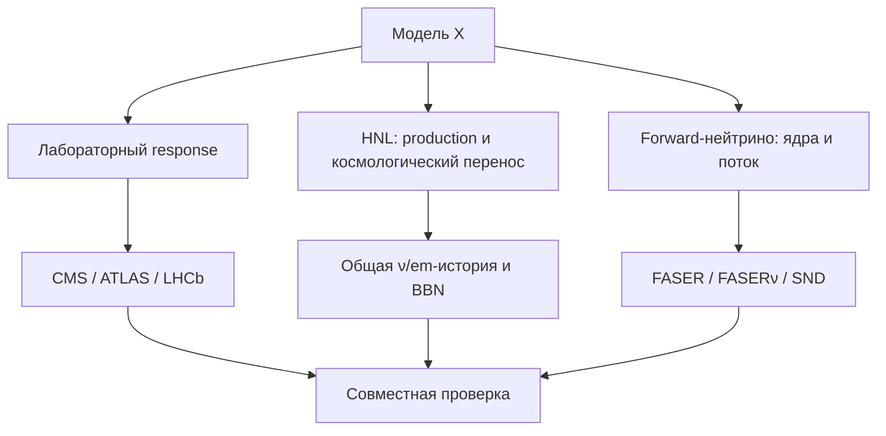

# Дополнение по отзывам: коллайдеры, BBN и корреляции

18 ноября 2026, МСК. Задача [#100](https://github.com/IgorSabirov/vm-lab/issues/100). База `8a3a8ce` (PR99).

**Итог:** полезная лабораторная ветвь расширена, но несколько предложенных «поправок» отозваны после чтения первоисточников. Прочитаны оба отзыва и код/выводы приложения. Сохраняется существующий реестр; R/C/L/U научные статусы не повышаются. Выполнены только статическое чтение кода и небольшая условная арифметика/точная линейная алгебра. BBN, LINX, HNL transport и новый X не запускались. Поручение не включает I2m или письмо Пабло.

Полная таблица решений по 16 тезисам: [CLAIM_REVIEW.json](CLAIM_REVIEW.json). Исходники и локаторы: [SOURCES.json](SOURCES.json). Основная схема и адресные карточки дополнены в [REPORT.md](../NEUTRINO_GW_ARCHITECTURE_20261118/REPORT.md).

## 1. Что подтверждено и что исправлено в collider-части

В существующей ветви CERN зарегистрированы отдельные CMS top, CMS displaced, ATLAS top/displaced/prompt и LHCb B-decay паспорта. **CMS-PAS-EXO-24-015 существует:** официальный релиз от 24.03.2026 соответствует указанным 1–5 GeV и трём мюонам с сильно смещённой вершиной. Отсутствие идентификатора в поиске соседа не было отсутствием результата. Его статус остаётся предварительным.

У ATLAS displaced минимальная моделируемая масса установлена по §3.1: 1 GeV; leptonic simulation до 20 GeV, semileptonic точки 1/2/3 GeV. Это не утверждение об исключении всего интервала. Для prompt-анализа полное окно 8–65 GeV отличается от окна наилучшей чувствительности 15–30 GeV. Для LHCb подтверждены mu-only допущение и разделение даты препринта/журнала.

**CMS top уже публикует модельные mixing limits отдельно от BR.** В паспорте сохранены обе величины; произвольная подстановка U²=10^-6 вместо предела на ветвление не допускается. Универсальной конверсии BR/U² с постоянным множителем нет: нужны phase space, W threshold, flavor pattern, branching ratios и acceptance по proper lifetime/boost. При mN<mW W производства может быть on-shell, тогда как W в распаде N виртуален; описание всех W как off-shell неверно.

На официальной CMS-странице есть ссылка HEPData `ins3222878`; прямое чтение дало 403. Значит ссылка подтверждена, а состав численных таблиц и наличие likelihood пока неизвестны. Контур исключения позволяет проверять совместимость того же benchmark на заявленном уровне; его нельзя превратить в Gaussian или перемножать как вероятность. Для LLP исключённая область может быть ограниченной полосой по mixing/lifetime.

Все численные summaries, release IDs и недостающие поля собраны в [COLLIDER_CONSTRAINTS.json](../NEUTRINO_GW_ARCHITECTURE_20261118/COLLIDER_CONSTRAINTS.json). Они не заменяют digitized contours/response или полную likelihood.

## 2. FASER: исправление ошибочного опровержения

| Анализ | Детекторная часть и набор | Опубликованный формат |
|---|---|---|
| CERN-FASER-CONF-2026-002 | FASERν emulsion/tungsten, 2022, 9.5 fb⁻¹ | Два энергетических μ-бина и один e-бин без восстановления энергии |
| 2412.03186v3 / PRL134.211801 | Electronic FASER, 2022–2023, 65.6 fb⁻¹ | Шесть бинов; flux и cross section — условные продукты тех же событий |
| CERN-FASER-CONF-2026-005 | Electronic FASER, 186 fb⁻¹ | Двумерное energy×rapidity распределение |
| SND 2606.14669 | Electronic SND@LHC, 68.6 fb⁻¹ | Комбинированное νμ+antiνμ CC-сечение на W |

Поэтому формулировка «2+1 бина опровергнута/устарела» неверна: сосед сравнил разные анализы. Поле ν/antiν задаётся для конкретного релиза и продукта, а не одним флагом для всей установки. Для 2D-релиза точный charge response и численные края бинов здесь не извлечены; они оставлены открытыми. Ни один из этих результатов напрямую не является MeV ν–e collision kernel или n↔p weak rate.

Высокоэнергетический ν–ядерный процесс может ограничивать параметры общей микрофизики после operator matching, порогов/RG при необходимости, состава мишени, PDFs и теплового усреднения. Это условная связь через X, не безусловный запрет всякой связи и не прямой вход QKE.

## 3. Почему статус «BBN-вакуумно» не принят

Формула Γ=C GF²m⁵U²/(96π³) с C=10 воспроизводит указанную арифметику τ, но не определяет всю физическую историю. Даже собственное приближение t=0.738/TMeV² в отзыве даёт для первых двух примеров **2.32 GeV и 50.8 GeV**, а не «во всех случаях T≫100 GeV». Эти числа — проверка внутренней согласованности текста; физическими температурами распада мы их не объявляем.

Причины: g*(T) меняется; proper lifetime не равно времени от начала расширения; нужны распределение моментов/boost, производство, inverse reactions и взаимодействия с плазмой. C зависит от порогов, flavor и природы HNL. Контактная m⁵-оценка на 100 GeV не используется. При T≲0.1 MeV стандартные степени свободы уже не 10.75. Масштаб τ сам по себе не доказывает thermal equilibrium, исчезновение энергии всех дочерних секторов или сохранение η/лептонной асимметрии.

Кроме того, «точки на collider sensitivity» в таблице не извлечены из единых массово-зависимых контуров; CMS top-BR был фактически использован как U². Поэтому из неё нельзя получить универсальный разрыв чувствительности или единственный crossover в 100 MeV. Первичная [BBN-работа](https://arxiv.org/abs/2006.07387v3) прямо рассматривает HNL до 1 GeV с decay showers, осцилляциями и weak corrections. [Работа о dark decays](https://doi.org/10.1103/r7bw-jzjl) показывает важность дочерней радиации при своих условиях. Они не доказывают эффект в каждой collider-точке, но не позволяют объявить целый класс космологически пустым без расчёта.

Допустимый вывод слабее: **для выбранных toy-параметров proper lifetime коротко относительно секундной эпохи; прямое позднее распадное воздействие может быть подавлено при дополнительных условиях.** Новый узел HNL_COSMOLOGY_MAPPING хранит именно недостающую связь. Статус CERN сохраняется MODEL_MAPPING_OPEN.

Численная «калибровка топологии» по cτ также недостаточна без boost/acceptance. Сравнение приблизительного σνN с ν+antiν-сечением SND после умножения на A не заменяет flux/target folding; отношение собственных per-nucleon оценок отзыва составляет ~9·10^6, примерно семь порядков, не девять.

## 4. LINX: корреляции возможны, температурная форма ограничена

На закреплённом LINX `bfba07c...` проверены abundances.py:157–161,209–213,316; nuclear.py:144–161; reactions.py:238–259. Пользователь передаёт вектор q; ядро строит таблицу каждой реакции из q_i. Совместное распределение q этим вызовом не выбирается, default — нули. Поэтому `LINX_DIAGONAL_ONLY` **не соответствует API**.

Если z имеет Cov(z)=I, то q=Lz даёт Cov(q)=LLᵀ. Точный контрпример: L=((1,0),(3/5,4/5)) даёт корреляцию 3/5 при единичных дисперсиях. Этот q можно передать в существующий интерфейс. На узлах таблиц

\[
\log R_i(T)=\log R_{i,med}(T)+s_i(T)q_i,\quad
\operatorname{Cov}(\log R_i(T),\log R_j(T'))=s_i(T)C_{ij}s_j(T').
\]

Реальная граница: **один q_i не описывает произвольную многомодовую неопределённость температурной формы**. Нужен более общий базис B_ik(T) либо совместные таблицы для полного posterior. Для custom analytic rates значение q проверяется отдельно. Интерполяция также входит в согласование, а формула выше не назначает произвольному linear-rate interpolator точную log-covariance между узлами.

[NUCLEAR_RATE_COVARIANCE.json](../NEUTRINO_GW_ARCHITECTURE_20261118/NUCLEAR_RATE_COVARIANCE.json) фиксирует оба режима и связь с ранее сохранённым S3_COVARIANCE: сравнение joint posterior с произведением **тех же marginals**, сохраняя внутриканальную температурную корреляцию. Для non-Gaussian случая зануления covariance недостаточно для независимости. Ковариация rate functions ещё не восстановлена и adapter ещё не реализован.

## 5. S3: требования разделены по проверяемому утверждению

Прочитаны сохранённые S3 audit и covariance contract на `b24c7e0...`: в них уже есть standard baseline/eta response, а joint_likelihood и theory_covariance не заданы. Эти пути отсутствуют на текущем main, но доступны на указанном историческом commit; не обнуляем готовый результат из-за перемещения истории.

| Задача | Что действительно требуется |
|---|---|
| Нативный эталон каждого автора | Его версия, входы, окружение и критерии; внешний weak adapter/observational covariance не обязательны |
| Deterministic PRIMAT↔LINX | Одинаковые nuclear rates/network, слабые поправки/спектры/фон, константы и начальные условия |
| Перенос ядерных ошибок | Совместный rate posterior/реализации и подходящий температурный базис |
| Физический BBN/CMB fit | Предыдущие входы плюс физическая история X, observational likelihood, nuisance и ηBBN–ηCMB mapping |

Три названных соседом обязательства полезны для полного статистического вывода, но их нельзя превратить в запрет любого нативного расчёта. Для общей проверки weak-режим обязателен; отдельная новая программа не обязательна, если идентичность физики реально обеспечена и проверена. V3 в нашем плане означает common X injection, а не исторический S3.

## 6. События и общие неопределённости

ATLAS-top и CMS-top используют разные детекторы и выборки. Совпадение масс не является общими данными. Однако одинаковые theory/PDF/production и signal assumptions могут давать общие nuisance. Внутри ATLAS/CMS Run2 разные каналы требуют проверки selection overlap. Для FASER 2025/2026 перекрывается data taking; разные детекторные методы сами по себе не удостоверяют независимость потоковой систематики.

В паспортах есть отдельный data_dependencies список; он дополняет прежние ORCA/ARCA правила. Комбинация допустима после проверки общей модели и статистической конструкции. Коллайдерные пределы не заменяют ядерную covariance, BBN наблюдения или нейтринные weak rates.

## 7. Состав дополнения и проверки

В существующий реестр добавлены 12 адресных компонентов: шесть HNL-анализов, forward-группа и четыре её измерительных паспорта, HNL cosmology mapping. У пяти прежних компонентов уточнены границы/следующие шаги. Итого 45 компонентов. Дополнены общий граф, source catalog, validation plan и standalone compendium; нового R-номера нет.

[verify_review.py](verify_review.py) и [CHECKS.json](CHECKS.json) сохраняют условную арифметику, exact covariance counterexample и предел её вывода. Время проверки записано отдельно. Отменённое правило «≤600 секунд → песочница» из приложения не принимается. Маршрут GPT → Copilot → GitHub и научная приёмка владельцем сохраняются; новых физических запусков нет.
