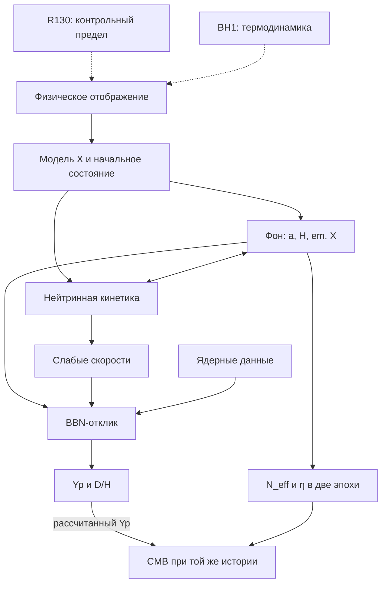
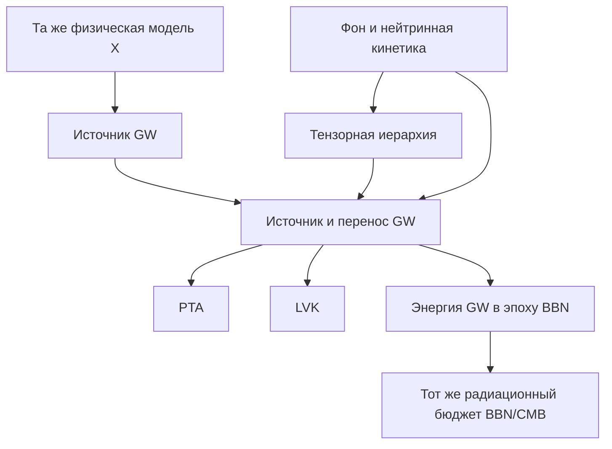
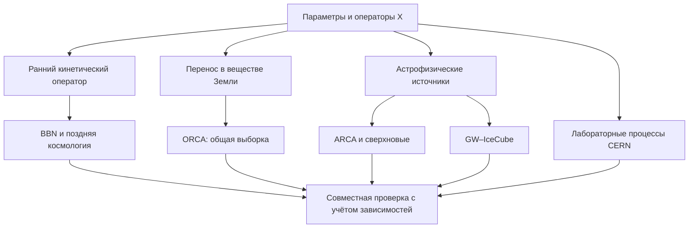
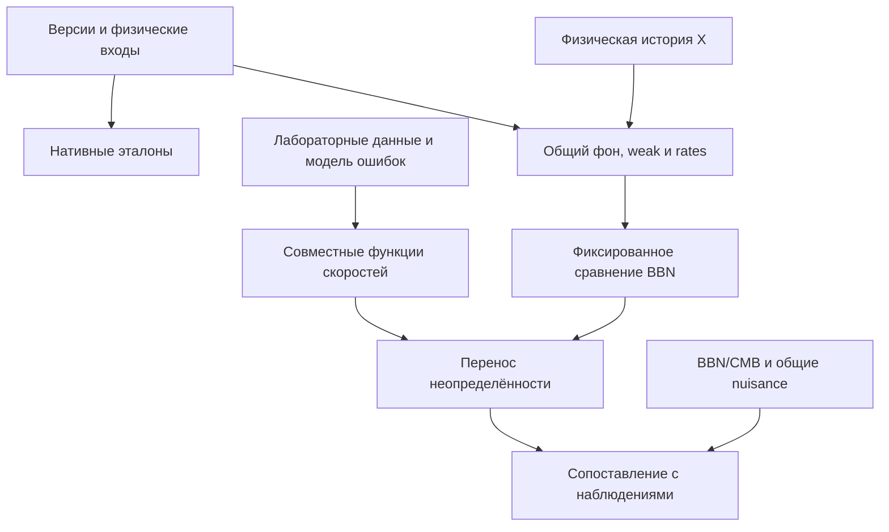

# R130–BH1–BBN: нейтрино, GW и полная генеалогия

18 ноября 2026, МСК. Задача [#98](https://github.com/IgorSabirov/vm-lab/issues/98).

**Статус: архитектура и контракты; физических прогонов нет.** Для каждого элемента ниже есть карточка в существующем `RESULTS_REGISTER.json`, типизированные родители, первичные источники, граница вывода и следующий шаг. Нового R-результата и научного принятия нет. Проверка источников не означает воспроизведение их результатов.

R130 остаётся проверкой объявленной дискретной модели. BH1 даёт условную термодинамику. Между ними и космологией требуется физическое отображение: носитель X, часы, энергия, давление, взаимодействия и обратное действие. C042 — требование причинной совместимости, а не название BH1. U006/U010 и L09 этим отчётом не закрыты.

## 1. Общая физическая схема

Стрелки ниже обозначают необходимые физические интерфейсы, не уже работающие программы. Фон и кинетика должны согласовываться совместно. Энергия ADD и BH1 не складывается, если это два описания одного носителя.

Фотонная ветвь исходного BH1–BBN контракта также сохраняется: история Q_Xem → термализация/спектральные искажения → FIRAS; она связана с ηBBN–ηCMB и включена в общую генеалогию.

Сопоставление нейтринных алгоритмов имеет смысл только в общем режиме. νDSMC хранит спектры, nudec_BSM v2 замыкает моменты, FortEPiaNO решает матрицы плотности. При общем входе сравниваем общие наблюдаемые и ошибку приближения; не объявляем отсутствующие компоненты данных вычисленными.

## 2. Исправления исходного предложения

1. **Тензорный ответ отсутствует в фоновой QKE.** Изотропные спектры не определяют πν^TT(k,t). Нужна отдельная иерархия возмущений. Уравнение в конформном времени: h″+2ℋh′+k²h=16πGa²π^TT. См. первичные источники NU_TENSOR и NU_NHZ.
2. **GW–BBN предел не является вторыми данными BBN.** h0²∫ΩGW,0 dlnf ≲5.6·10^-6 ΔNeff — производное ограничение радиационного бюджета при заданных энтропийной истории, эпохе генерации и субгоризонтном диапазоне. Нельзя добавить его как независимую likelihood к тем же Yp/D/H/CMB или заменить интеграл одной амплитудой LVK.
3. **Четыре ORCA-анализа используют перекрывающиеся данные.** Профили NSI, decoherence, sterile и decay относятся к разным расширениям модели; произведение четырёх пределов не есть совместный fit. Аналогично ARCA-DM — интерпретация того же KM3-230213A.
4. **Численные пределы сохраняют условия.** Диагональный NSI интервал асимметричен: −0.015≤εττ−εμμ≤0.017. Γ(E) в ORCA использует E0=1 GeV. Пределы LVK — 95% Bayesian credible при log-uniform amplitude prior. Условия и числа записаны в паспортах, не превращены в Gaussian likelihood.
5. **Одна буква X не объединяет разные масштабы.** Сценарии MeV-реликта, eV-скаляра CLASS и сверхтяжёлого ARCA-DM требуют явной модели общего сектора. ORCA-оператор в Земле переносится в раннюю плазму только после задания посредника, состава среды, энергетической зависимости и теплового усреднения.
6. **Нейтринная асимметрия не должна исчезнуть в адаптере.** Опубликованный νDSMC BBN-формат предполагает fν=fantiν; спектр плотности пары не равен occupation f. Преобразование, биннинг и единицы прописаны в контракте. Нельзя восстановить потерянную асимметрию или off-diagonal coherence.
7. **Ядерная независимость ограничена общими входами.** νDSMC BBN указывает PRIMAT AC2024, текущая карта LINX — PRIMAT 2023. Два алгоритма с общей таблицей не дают независимой проверки её физической точности.

## 3. Что доступно в коде

| Инструмент | Роль | Проверенная граница готовности |
|---|---|---|
| νDSMC | Неравновесные спектры, реликт, плазма, BBN-связь | Mathematica/FeynCalc/compiler; native-библиотеки MacARM/Windows. Pure Mathematica backend документирован и для Linux с локальной компиляцией, но его окружение здесь не подготовлено; native Linux backend отсутствует. BUILD.md ссылается на private C++ sources. BSD-лицензия не распространяется автоматически на все notebooks/data. Текущий BBN формат симметричен ν/antiν. |
| nudec_BSM v2 | Быстрый моментный контроль | Эффективные T/μ и приближение перераспределения между ароматами; не полная QKE. Хорошее SM-согласие не гарантирует точности сильной неравновесной инжекции. |
| FortEPiaNO | Импульсный/флейворный QKE-эталон | Первичная публикация закреплена. Канонический Bitbucket не удалось прочитать, текущий commit открыт. GitHub-копия не каноническая; README/ini расходятся по NSI. Произвольный X-оператор не подтверждён. |
| PRIMAT | BBN-приёмник | pin сохранён; custom_background ограничивает некоторые нейтринные поправки; полноценный спектральный/weak-rate адаптер ещё нужен. |
| LINX | Второй BBN-алгоритм | ξν влияет на weak rates, но автоматически не перестраивает ρν/Neff. Интерполяция и флейворная модель требуют проверки. |
| PRyMordial | Дополнительный BBN-контроль | README и лицензия прочитаны; адаптер и запуск отсутствуют. Сначала два основных приёмника. |
| CLASS_neutrinophilic | Поздняя ν–скалярная космология | Специальная модификация CLASS v2.10.1, не универсальный QKE/BBN/GW backend. |

Отдельные канонические репозитории «ννBSM», полного momentum-resolved NLO-ядра Jackson–Laine и указанной в документации νDSMC Python-зависимости `mev-universe` здесь не подтверждены. Они не зарегистрированы как готовые исполняемые инструменты.

Научная генеалогия алгоритмов также закреплена в SOURCE_INDEX: νDSMC — [DSMC-метод 2409.15129](https://arxiv.org/abs/2409.15129) → [отцепление 2508.08379](https://arxiv.org/abs/2508.08379) → [совместная X/BBN-модель 2609.31833](https://arxiv.org/abs/2609.31833); nudec — [1812.05605](https://arxiv.org/abs/1812.05605), [2001.04466](https://arxiv.org/abs/2001.04466) → [v2 2511.04747](https://arxiv.org/abs/2511.04747); FortEPiaNO — [полный SM QKE 2012.02726v3](https://arxiv.org/abs/2012.02726v3). PRyMordial связан с [2307.07061](https://arxiv.org/abs/2307.07061), CLASS_neutrinophilic — с [2305.01692](https://arxiv.org/abs/2305.01692). Это происхождение методов по авторским источникам; ранние статьи всех цепочек полностью заново не воспроизводились. История PRIMAT/LINX и общих ядерных таблиц сохраняется в существующем NETWORK_MAP и новом узле NUCLEAR_RATE_INPUTS.

## 4. Контракты и последовательность проверок

Актуальное уточнение: [разбор последовательных отзывов](../NEIGHBOR_INTEGRATION_FOLLOWUP_20261118/REPORT.md), [ядерная неопределённость](NUCLEAR_RATE_COVARIANCE.json), [изоляция PRIMAT](PRIMAT_CACHE_ISOLATION.json), [HNL mapping](HNL_COSMOLOGY_MAPPING.json). Техническая диаграмма ниже разделяет зависимости; она не утверждает готовность адаптеров.

X нужен для нестандартной физической ветви; стандартный общий thermal benchmark использует объявленные стандартные входы. Нативное согласие, UQ и наблюдательное согласие имеют разные критерии.

- [NEUTRINO_KINETIC_BRIDGE.json](NEUTRINO_KINETIC_BRIDGE.json): представления данных, единицы, энергия, ν/antiν, weak rates и ограничение возможностей адаптера.
- [GW_RESPONSE_BRIDGE.json](GW_RESPONSE_BRIDGE.json): источник, тензорный перенос, космологический интеграл и detector response.
- [KM3NET_NEUTRINO_CONSTRAINTS.json](KM3NET_NEUTRINO_CONSTRAINTS.json): паспорта ORCA/ARCA/SN и соседних наблюдательных каналов; общие выборки и статистические условия.
- [VALIDATION_PLAN.json](VALIDATION_PLAN.json): V0–V7 описывают проверки возможностей. Это не обязательная последовательная цепочка: нативный baseline и фиксированный общий BBN-контроль не требуют восстановления posterior или X-инжекции. Требования разделены по задачам в `stage_requirements_by_task`; общий weak/background режим ещё нужно согласовать.

Допуски не выдуманы: они остаются null до объявленной калибровки и замораживаются перед сравнением. Универсального временного лимита нет; оценка стоимости сохраняется, маршрут GitHub/Copilot уже выбран владельцем; готовность конкретного окружения нового пакета проверяется отдельно. Схема исполнения сохраняется: GPT собирает пакет, Copilot запускает совместимый код и фиксирует raw/logs/environment на GitHub, GPT сверяет. Исправление физического оператора является новой версией модели, а не незаметной технической починкой. Публикация архитектуры не разрешает автоматически новый физический прогон.

## 5. Адресная генеалогия каждого элемента

Канонические карточки: [RESULTS_REGISTER.json](../NOW_RESULTS_SYNTHESIS_20261106/RESULTS_REGISTER.json), поле `architecture_components`. Двунаправленная навигация: [INDEX.md](../REGISTRY_LINKS/INDEX.md), узлы `component:*` и `external:*`. Родитель означает происхождение вопроса, необходимый вход, кандидат реализации либо общий набор данных — это различается полем relation. Источники содержат даты/версии/границы чтения в [SOURCES.json](SOURCES.json).

### BH1_THERMODYNAMICS — BH1: равновесная термодинамика

**Статус:** `EXISTING_REDUCED_CONTRACT`.

**Родители:** `external:ANTHROPIC_HP` (conceptual_parent_not_derivation): Равновесный эффективный потенциал — источник условных оценок, не космологическая кинетика.

**Источники:** [BH1](https://github.com/IgorSabirov/vm-lab/blob/aa21593e16a764c487394ab307b514ac6c3285c3/analysis/CCC_BBN_NETWORK_20261114/s3_standard/bh_bridge_20261115/BRIDGE_CONTRACT.json), [CERN_REVIEW](https://github.com/IgorSabirov/vm-lab/blob/aa21593e16a764c487394ab307b514ac6c3285c3/analysis/NEIGHBOR_CERN_REVIEW_20261118/REPORT.md).

**Граница:** Скрытая теплота и переход не задают автоматически физические часы, X, скорость перехода или GW.

**Следующий шаг:** Определить физический носитель и область применимости BH1.

### R130_PHYSICAL_EMBEDDING — Физическое вложение R130

В C1 пассивный Q и одинаковая цена каждого изолированного 12↔3 при сумме по окнам из четырёх последовательных меток дают E=hL+A N_a+B N_b. Пять пар проверяют один контраст. Строгий закон даёт 0/5, локальная цена с зависимостью от соседей допускает 5/5. [Доказательство и перевод в плотность энергии](../ADD_LOCAL_EDGE_ENERGY_FOLLOWUP_20261120/contact_balance/REPORT.md).

**Статус:** `OPEN`.

**Родители:** `result:R130` (conceptual_parent_not_derivation): Свойства дискретной модели сохраняются как контрольный предел; физический смысл не доказан.; `component:BH1_THERMODYNAMICS` (conceptual_parent_not_derivation): Сопряжение двух описаний — гипотеза.; `construct:C042` (context_not_evidence): C042 задаёт требования причинной совместимости; это не результат BH1.

**Источники:** [R130](https://github.com/IgorSabirov/vm-lab/blob/aa21593e16a764c487394ab307b514ac6c3285c3/analysis/R130_BH1_BBN_CONNECTION_20261117/ARCHITECTURE_REVIEW.md), [BH1](https://github.com/IgorSabirov/vm-lab/blob/aa21593e16a764c487394ab307b514ac6c3285c3/analysis/CCC_BBN_NETWORK_20261114/s3_standard/bh_bridge_20261115/BRIDGE_CONTRACT.json).

**Граница:** Длина кольца не является масштабным фактором; BH1 и ADD могут описывать один носитель, тогда их энергии нельзя складывать.

**Следующий шаг:** Задать часы, отображение состояний/объёма/энергии, обратное действие и контрольный предел R130.

### X_MICROPHYSICS — Общая микрофизика сектора X

**Статус:** `UNDEFINED`.

**Родители:** `component:R130_PHYSICAL_EMBEDDING` (conceptual_parent_not_derivation): Необходимый вход следующего слоя; наличие связи не означает готовый адаптер.

**Источники:** [BH1](https://github.com/IgorSabirov/vm-lab/blob/aa21593e16a764c487394ab307b514ac6c3285c3/analysis/CCC_BBN_NETWORK_20261114/s3_standard/bh_bridge_20261115/BRIDGE_CONTRACT.json), [R130](https://github.com/IgorSabirov/vm-lab/blob/aa21593e16a764c487394ab307b514ac6c3285c3/analysis/R130_BH1_BBN_CONNECTION_20261117/ARCHITECTURE_REVIEW.md).

**Граница:** MeV-реликт, eV-бозон и 100 PeV DM не становятся одной частицей из-за символа X.

**Следующий шаг:** Выбрать явную модель: поля, массы, взаимодействия, стабильность, начальные условия и сохраняемые заряды.

### COSMOLOGICAL_BACKGROUND — Совместная история X, em, ν и расширения

**Статус:** `CONTRACT_DRAFT`.

**Родители:** `component:X_MICROPHYSICS` (input_contract_dependency): Необходимый вход следующего слоя; наличие связи не означает готовый адаптер.

**Источники:** [BH1](https://github.com/IgorSabirov/vm-lab/blob/aa21593e16a764c487394ab307b514ac6c3285c3/analysis/CCC_BBN_NETWORK_20261114/s3_standard/bh_bridge_20261115/BRIDGE_CONTRACT.json), [FORMAT](https://github.com/IgorSabirov/vm-lab/blob/aa21593e16a764c487394ab307b514ac6c3285c3/analysis/PRIMAT_LINX_BBN_BRIDGE_20261117/BBN_HISTORY.schema.json).

**Граница:** Фон и нейтрино должны решаться с обратной связью; H(T) не специфицирует всю физику и может быть неоднозначен при нагреве.

**Следующий шаг:** Объявить t,a,H,EOS, начальные плотности, барионное число и энергетические потоки; проверить сумму Q=0.

### NEUTRINO_KINETIC_BRIDGE — Импульсная и флейворная нейтринная кинетика

**Статус:** `CONTRACT_DRAFT`.

**Родители:** `component:X_MICROPHYSICS` (input_contract_dependency): Необходимый вход следующего слоя; наличие связи не означает готовый адаптер.; `component:COSMOLOGICAL_BACKGROUND` (input_contract_dependency): Необходимый вход следующего слоя; наличие связи не означает готовый адаптер.; `external:NUDSMC` (implementation_candidate_not_execution): Необходимый вход следующего слоя; наличие связи не означает готовый адаптер.; `external:NUDEC_BSM_V2` (implementation_candidate_not_execution): Необходимый вход следующего слоя; наличие связи не означает готовый адаптер.; `external:FORTEPIANO_QKE` (implementation_candidate_not_execution): Необходимый вход следующего слоя; наличие связи не означает готовый адаптер.

**Источники:** [NUDSMC](https://github.com/maksymovchynnikov/nuDSMC/tree/84a02c1ed7c54e8bde0e88cadb611fbe9ddb44b7), [NUDEC_PAPER](https://arxiv.org/abs/2511.04747v2), [FORT_QKE](https://arxiv.org/abs/2012.02726v3), [FORT_CODE](https://bitbucket.org/ahep_cosmo/fortepiano_public/), [FORT_COPY](https://github.com/JakeSpisak/FortEPiaNO_public_copy/tree/ee5432e11542f5f321dcb817f464d41f6b14ed91).

**Граница:** νDSMC-спектры, моментное замыкание nudec и матрицы Fort — разные объекты. Готовый общий X-оператор во всех трёх не подтверждён.

**Следующий шаг:** Начать с общего SM-предела; затем только совпадающий набор X-процессов и декларация асимметрий/осцилляций.

### WEAK_RATE_BRIDGE — Согласованные скорости n↔p

**Статус:** `CONTRACT_DRAFT`.

**Родители:** `component:NEUTRINO_KINETIC_BRIDGE` (input_contract_dependency): Необходимый вход следующего слоя; наличие связи не означает готовый адаптер.; `component:COSMOLOGICAL_BACKGROUND` (input_contract_dependency): Необходимый вход следующего слоя; наличие связи не означает готовый адаптер.

**Источники:** [PRIMAT](https://github.com/CyrilPitrou/primat/tree/6f7e5680614fb119d65a6c9c65a292240b27c61e), [LINX](https://github.com/cgiovanetti/LINX/tree/bfba07c77a5fcba1cc772d42f2d9e9be8a542df8), [FORMAT](https://github.com/IgorSabirov/vm-lab/blob/aa21593e16a764c487394ab307b514ac6c3285c3/analysis/PRIMAT_LINX_BBN_BRIDGE_20261117/BBN_HISTORY.schema.json), [COLLIDER_S3_AUDIT](https://github.com/IgorSabirov/vm-lab/blob/b24c7e0cc47ff964d576f903ce7ba507d2dd731e/analysis/CCC_BBN_NETWORK_20261114/s3_input_audit/results/RESULT.json), [FOLLOWUP_PRIMAT_CACHE_RESOLVER](https://github.com/CyrilPitrou/primat/blob/6f7e5680614fb119d65a6c9c65a292240b27c61e/primat/cache_utils.py), [FOLLOWUP_PRIMAT_CACHE_FIELDS](https://github.com/CyrilPitrou/primat/blob/6f7e5680614fb119d65a6c9c65a292240b27c61e/primat/weak_rates/cache.py), [FOLLOWUP_PRIMAT_CACHE_DOC](https://github.com/CyrilPitrou/primat/blob/6f7e5680614fb119d65a6c9c65a292240b27c61e/docs/howto/weak-rate-cache.md).

**Граница:** Пустой cache_dir PRIMAT не изолирует кэш. Нужны controlled data_dir и overlay; weak_rate_cache=False не отключает thermal reads. Проверены пути, не weak recomputation.

**Следующий шаг:** В согласованном пакете выполнить G1–G4 отдельно для Python/C, логируя оба fingerprint, actual paths, content hashes и VEGAS uncertainty.

### CERN_NTOF_RATES — CERN n_TOF: ядерные данные

**Статус:** `LINX_NP_LOW_T_PROVENANCE_VERIFIED`. Обновлено 19 ноября по [сверке исходных таблиц](../NOW_PROJECT_INTEGRATION_20261119/REPORT.md#nuclear).

**Родители:** Первичные внешние наблюдения/публикации; не потомок R130.

**Источники:** [NTOF_NP](https://doi.org/10.1103/PhysRevLett.121.042701), [de Souza](https://arxiv.org/pdf/1912.06210), [файл LINX](https://github.com/cgiovanetti/LINX/blob/bfba07c77a5fcba1cc772d42f2d9e9be8a542df8/linx/data/nuclear_rates/key_PRIMAT_2023/Be7nLi7p.txt), [NTOF_NA](https://doi.org/10.1103/PhysRevLett.117.152701), [CERN_REVIEW](https://github.com/IgorSabirov/vm-lab/blob/aa21593e16a764c487394ab307b514ac6c3285c3/analysis/NEIGHBOR_CERN_REVIEW_20261118/REPORT.md).

**Граница:** Для ⁷Be(n,p) установлен путь ISOLDE/n_TOF → Damone → de Souza → LINX. Совпадают 46/46 низкотемпературных медиан и факторов до точности публикации, включая 1 ГК. Импорт сырых сечений, совместная ковариация и вклад в выходы BBN открыты. ⁷Be(n,α) требует расширения сети.

**Следующий шаг:** Связать температурные ошибки с совместными экспериментальными нормировками и проверить фактически использованные скорости в двух решателях.

### NUCLEAR_RATE_INPUTS — Версионированные ядерные скорости

**Статус:** `MATCHING_OPEN`.

**Родители:** `component:CERN_NTOF_RATES` (input_contract_dependency): Необходимый вход следующего слоя; наличие связи не означает готовый адаптер.; `external:PRIMAT` (implementation_candidate_not_execution): Необходимый вход следующего слоя; наличие связи не означает готовый адаптер.; `external:LINX` (implementation_candidate_not_execution): Необходимый вход следующего слоя; наличие связи не означает готовый адаптер.

**Источники:** [NETWORK](https://github.com/IgorSabirov/vm-lab/blob/aa21593e16a764c487394ab307b514ac6c3285c3/analysis/PRIMAT_LINX_BBN_BRIDGE_20261117/NETWORK_MAP.json), [NUDSMC](https://github.com/maksymovchynnikov/nuDSMC/tree/84a02c1ed7c54e8bde0e88cadb611fbe9ddb44b7), [PRIMAT](https://github.com/CyrilPitrou/primat/tree/6f7e5680614fb119d65a6c9c65a292240b27c61e), [LINX](https://github.com/cgiovanetti/LINX/tree/bfba07c77a5fcba1cc772d42f2d9e9be8a542df8), [COLLIDER_LINX_Q](https://github.com/cgiovanetti/LINX/blob/bfba07c77a5fcba1cc772d42f2d9e9be8a542df8/linx/abundances.py), [COLLIDER_LINX_FORWARD](https://github.com/cgiovanetti/LINX/blob/bfba07c77a5fcba1cc772d42f2d9e9be8a542df8/linx/nuclear.py), [COLLIDER_LINX_RATE](https://github.com/cgiovanetti/LINX/blob/bfba07c77a5fcba1cc772d42f2d9e9be8a542df8/linx/reactions.py), [COLLIDER_S3_COVARIANCE](https://github.com/IgorSabirov/vm-lab/blob/b24c7e0cc47ff964d576f903ce7ba507d2dd731e/analysis/CCC_BBN_NETWORK_20261114/s3_standard/bh_covariance_20261115/CONNECTION_CONTRACT.json), [FOLLOWUP_LINX_INTERPOLATION](https://github.com/cgiovanetti/LINX/blob/bfba07c77a5fcba1cc772d42f2d9e9be8a542df8/linx/reactions.py), [FOLLOWUP_LEONARD_INPUT](https://github.com/IgorSabirov/vm-lab/blob/b24c7e0cc47ff964d576f903ce7ba507d2dd731e/analysis/CCC_BBN_NETWORK_20261114/s3_standard/bh_covariance_20261115/LEONARD_INPUT.json).

**Граница:** Латентная размерность, локальный ранг Якобиана и ранг ковариации различаются. Leonard даёт 16 измерительных компонент; измеренной потери 8:1 нет. Совместный posterior не восстановлен.

**Следующий шаг:** Сверить фиксированные rates независимо от UQ; для UQ построить физический перенос Table V и проверить совместные реализации между узлами и ошибку сжатия в abundances.

### BBN_RESPONSE_BRIDGE — BBN: PRIMAT, LINX, PRyMordial

**Статус** `THERMAL_PAIRED_FORWARD_RUN`. [Выполненные расчёты](../PRIMAT_LINX_BBN_BRIDGE_20261117/PAIRED_RUN_20261120.md).

**Родители.** component:COSMOLOGICAL_BACKGROUND (input_contract_dependency). component:WEAK_RATE_BRIDGE (input_contract_dependency). component:NUCLEAR_RATE_INPUTS (input_contract_dependency). external:PRIMAT (input_contract_dependency). external:LINX (input_contract_dependency). external:PRYMORDIAL (implementation_candidate_not_execution).

**Источники:** [FORMAT](https://github.com/IgorSabirov/vm-lab/blob/aa21593e16a764c487394ab307b514ac6c3285c3/analysis/PRIMAT_LINX_BBN_BRIDGE_20261117/BBN_HISTORY.schema.json), [PRIMAT](https://github.com/CyrilPitrou/primat/tree/6f7e5680614fb119d65a6c9c65a292240b27c61e), [LINX](https://github.com/cgiovanetti/LINX/tree/bfba07c77a5fcba1cc772d42f2d9e9be8a542df8), [PRYMORDIAL](https://github.com/vallima/PRyMordial/tree/725d8a8db3ad5ea2630580d825c9d0d69ed76533), [CERN_REVIEW](https://github.com/IgorSabirov/vm-lab/blob/aa21593e16a764c487394ab307b514ac6c3285c3/analysis/NEIGHBOR_CERN_REVIEW_20261118/REPORT.md), [FOLLOWUP_LINX_INTERPOLATION](https://github.com/cgiovanetti/LINX/blob/bfba07c77a5fcba1cc772d42f2d9e9be8a542df8/linx/reactions.py), [FOLLOWUP_PRIMAT_CACHE_DOC](https://github.com/CyrilPitrou/primat/blob/6f7e5680614fb119d65a6c9c65a292240b27c61e/docs/howto/weak-rate-cache.md).

Парная тепловая сеть имеет 8 видов и 12 ядерных каналов. Здесь PRIMAT использует свои RHS и якобиан при общих скоростях LINX. Произвольные нейтринные спектры, модель X, совместная ядерная UQ и наблюдательный fit остаются открытыми.

Сопоставить температурную нормировку ядерных полос с внешним атласом, затем проверить кинетические входы и заданный источник.

### BBN_CMB_OBSERVATIONS — Наблюдения abundances и CMB

**Статус:** `DATASET_SELECTION_OPEN`.

**Родители:** Первичные источники.

**Источники:** [BH1](https://github.com/IgorSabirov/vm-lab/blob/aa21593e16a764c487394ab307b514ac6c3285c3/analysis/CCC_BBN_NETWORK_20261114/s3_standard/bh_bridge_20261115/BRIDGE_CONTRACT.json), [CERN_REVIEW](https://github.com/IgorSabirov/vm-lab/blob/aa21593e16a764c487394ab307b514ac6c3285c3/analysis/NEIGHBOR_CERN_REVIEW_20261118/REPORT.md), [COLLIDER_S3_AUDIT](https://github.com/IgorSabirov/vm-lab/blob/b24c7e0cc47ff964d576f903ce7ba507d2dd731e/analysis/CCC_BBN_NETWORK_20261114/s3_input_audit/results/RESULT.json).

**Граница:** Конкретные likelihood, ковариации и выборки Yp,D/H/CMB здесь ещё не закреплены. Не назначать произвольные Gaussian priors. Нативный контроль может быть выполнен до выбора observational likelihood; исторический S3 baseline уже существует.

**Следующий шаг:** Явно выбрать eta free/conditioned, карту фотонного нагрева и совместную likelihood без повторного CMB prior.

### GW_SOURCE_MODEL — Источник гравитационных волн

**Статус:** `UNIMPLEMENTED`.

**Родители:** `component:X_MICROPHYSICS` (input_contract_dependency): Необходимый вход следующего слоя; наличие связи не означает готовый адаптер.; `component:BH1_THERMODYNAMICS` (input_contract_dependency): Необходимый вход следующего слоя; наличие связи не означает готовый адаптер.

**Источники:** [GW_BBN](https://arxiv.org/abs/2011.12414), [BH1](https://github.com/IgorSabirov/vm-lab/blob/aa21593e16a764c487394ab307b514ac6c3285c3/analysis/CCC_BBN_NETWORK_20261114/s3_standard/bh_bridge_20261115/BRIDGE_CONTRACT.json).

**Граница:** Для фазового перехода нужны nucleation, βPT/H, скорость стенки, энергетические эффективности; латентной теплоты недостаточно.

**Следующий шаг:** Задать источник, эпоху, UV/IR-cutoff и область формулы; не путать βPT с показателем физических часов.

### TENSOR_NEUTRINO_RESPONSE — Тензорная анизотропия нейтрино

**Статус:** `UNIMPLEMENTED`.

**Родители:** `component:NEUTRINO_KINETIC_BRIDGE` (input_contract_dependency): Необходимый вход следующего слоя; наличие связи не означает готовый адаптер.; `component:COSMOLOGICAL_BACKGROUND` (input_contract_dependency): Необходимый вход следующего слоя; наличие связи не означает готовый адаптер.

**Источники:** [NU_TENSOR](https://arxiv.org/abs/astro-ph/0306304), [NU_NHZ](https://doi.org/10.1088/0264-9381/27/19/194008).

**Граница:** Изотропные fν(p,t) и ρν не содержат πν^TT(k,t); нужен отдельный угловой/возмущённый Boltzmann/QKE-оператор.

**Следующий шаг:** Построить тензорную иерархию и проверить связанный и свободный пределы; не выдавать фоновые спектры за тензорный ответ.

### GW_RESPONSE_BRIDGE — Источник → перенос → наблюдаемый ΩGW

**Статус:** `CONTRACT_DRAFT`.

**Родители:** `component:GW_SOURCE_MODEL` (input_contract_dependency): Необходимый вход следующего слоя; наличие связи не означает готовый адаптер.; `component:TENSOR_NEUTRINO_RESPONSE` (input_contract_dependency): Необходимый вход следующего слоя; наличие связи не означает готовый адаптер.; `component:COSMOLOGICAL_BACKGROUND` (input_contract_dependency): Необходимый вход следующего слоя; наличие связи не означает готовый адаптер.

**Источники:** [GW_BBN](https://arxiv.org/abs/2011.12414), [NU_TENSOR](https://arxiv.org/abs/astro-ph/0306304), [NU_NHZ](https://doi.org/10.1088/0264-9381/27/19/194008).

**Граница:** Первичный спектр и поздние астрофизические источники имеют разную историю; красное смещение зависит от полной тепловой истории.

**Следующий шаг:** Закрепить нормировку частоты/Ω, h0, t_generation, transfer function и foreground model.

### GW_BBN_ENERGY_CONSISTENCY — Интегральная GW–BBN согласованность

**Статус:** `DERIVED_NOT_INDEPENDENT`.

**Родители:** `component:GW_RESPONSE_BRIDGE` (input_contract_dependency): Необходимый вход следующего слоя; наличие связи не означает готовый адаптер.; `component:BBN_CMB_OBSERVATIONS` (derived_consistency_not_independent): Использует тот же радиационный бюджет BBN/CMB; не добавляется повторно как независимая likelihood.

**Источники:** [GW_BBN](https://arxiv.org/abs/2011.12414).

**Граница:** Граница 5.6e-6 ΔNeff относится к интегралу ΩGW h0², существовавшему до BBN и субгоризонтным модам, при оговорённых энтропии/нормировке.

**Следующий шаг:** Включить ρGW в единый фон и BBN fit; внешнюю интегральную границу использовать как диагностику, не дублировать данные.

### PTA_CONSTRAINTS — PTA: низкочастотные GW

**Статус:** `PUBLISHED_DATA_NOT_INGESTED`.

**Родители:** `component:GW_RESPONSE_BRIDGE` (observational_constraint_requires_mapping): Необходимый вход следующего слоя; наличие связи не означает готовый адаптер.

**Источники:** [PTA](https://arxiv.org/abs/2306.16213v1), [NU_NHZ](https://doi.org/10.1088/0264-9381/27/19/194008).

**Граница:** Характерный след порядка nHz не означает обнаруженную нейтринную ступеньку. Астрофизический фон и общие пульсары мешают независимому перемножению PTA.

**Следующий шаг:** Выбрать конкретный релиз, foregrounds, корреляции и параметризованную передаточную функцию.

### LVK_CONSTRAINTS — LVK: высокочастотный стохастический фон

**Статус:** `PUBLISHED_CONSTRAINT_NOT_INGESTED`.

**Родители:** `component:GW_RESPONSE_BRIDGE` (observational_constraint_requires_mapping): Необходимый вход следующего слоя; наличие связи не означает готовый адаптер.

**Источники:** [LVK_SGWB](https://arxiv.org/abs/2608.23477v1).

**Граница:** Предел в 25 Hz условен по спектральному индексу и log-uniform prior; не полная энергия GW.

**Следующий шаг:** Получить релиз likelihood/response, полосы и covariance; применить к предсказанному спектру с foregrounds.

### ORCA_NSI — ORCA: нестандартные взаимодействия

**Статус:** `PUBLISHED_CONSTRAINT_NOT_INGESTED`.

**Родители:** `component:X_MICROPHYSICS` (observational_constraint_requires_mapping): Необходимый вход следующего слоя; наличие связи не означает готовый адаптер.; `component:NEUTRINO_KINETIC_BRIDGE` (observational_constraint_requires_mapping): Необходимый вход следующего слоя; наличие связи не означает готовый адаптер.

**Источники:** [ORCA_NSI](https://doi.org/10.1088/1475-7516/2025/02/073).

**Граница:** Эффективные ε в веществе Земли не являются ранневселенскими collision terms. Диагональный предел асимметричен: [-0.015,0.017].

**Следующий шаг:** Вывести общий оператор/посредник и отображение состава Земли в e±/ν-плазму с тепловым усреднением.

### ORCA_DECOHERENCE — ORCA: декогеренция

**Статус:** `PUBLISHED_CONSTRAINT_NOT_INGESTED`.

**Родители:** `component:X_MICROPHYSICS` (observational_constraint_requires_mapping): Необходимый вход следующего слоя; наличие связи не означает готовый адаптер.; `component:NEUTRINO_KINETIC_BRIDGE` (observational_constraint_requires_mapping): Необходимый вход следующего слоя; наличие связи не означает готовый адаптер.

**Источники:** [ORCA_DECOH](https://arxiv.org/abs/2410.01388v2).

**Граница:** Γ(E)=Γ0(E/1 GeV)^n относится к феноменологической модели; это не автоматически частота ранних столкновений.

**Следующий шаг:** Вывести модель окружения, единицы, положительность/полную положительность и исключить двойной счёт damping.

### ORCA_STERILE — ORCA: стерильное состояние

**Статус:** `PUBLISHED_CONSTRAINT_NOT_INGESTED`.

**Родители:** `component:X_MICROPHYSICS` (observational_constraint_requires_mapping): Необходимый вход следующего слоя; наличие связи не означает готовый адаптер.; `component:NEUTRINO_KINETIC_BRIDGE` (observational_constraint_requires_mapping): Необходимый вход следующего слоя; наличие связи не означает готовый адаптер.

**Источники:** [ORCA_STERILE](https://arxiv.org/abs/2510.07360v2).

**Граница:** Границы условны по 3+1, Δm41² и фиксированным параметрам; нельзя распространить их на все массы.

**Следующий шаг:** Согласовать 4×4 QKE, начальную заселённость, θ14/фазы и используемый likelihood.

### ORCA_DECAY — ORCA: невидимый распад ν3

**Статус:** `PUBLISHED_CONSTRAINT_NOT_INGESTED`.

**Родители:** `component:X_MICROPHYSICS` (observational_constraint_requires_mapping): Необходимый вход следующего слоя; наличие связи не означает готовый адаптер.; `component:NEUTRINO_KINETIC_BRIDGE` (observational_constraint_requires_mapping): Необходимый вход следующего слоя; наличие связи не означает готовый адаптер.

**Источники:** [ORCA_DECAY](https://arxiv.org/abs/2501.11336).

**Граница:** 2.1σ не обнаружение; параметр α3=m3/τ3 требует физического канала распада и дочерних состояний.

**Следующий шаг:** Перенести распад и inverse processes в энергетически согласованный оператор.

### KM3NET_NEUTRINO_CONSTRAINTS — KM3NeT: общий экспериментальный интерфейс

**Статус:** `CONTRACT_DRAFT`.

**Родители:** `component:ORCA_NSI` (input_contract_dependency): Необходимый вход следующего слоя; наличие связи не означает готовый адаптер.; `component:ORCA_DECOHERENCE` (input_contract_dependency): Необходимый вход следующего слоя; наличие связи не означает готовый адаптер.; `component:ORCA_STERILE` (input_contract_dependency): Необходимый вход следующего слоя; наличие связи не означает готовый адаптер.; `component:ORCA_DECAY` (input_contract_dependency): Необходимый вход следующего слоя; наличие связи не означает готовый адаптер.

**Источники:** [ORCA_NSI](https://doi.org/10.1088/1475-7516/2025/02/073), [ORCA_DECOH](https://arxiv.org/abs/2410.01388v2), [ORCA_STERILE](https://arxiv.org/abs/2510.07360v2), [ORCA_DECAY](https://arxiv.org/abs/2501.11336).

**Граница:** Четыре анализа существенно перекрываются по ORCA6 2020–2021/433 кт·лет и имеют разные модели. Их likelihood нельзя автоматически перемножать.

**Следующий шаг:** Закрепить overlap groups и совместную nuisance-модель либо использовать отдельные условные проверки.

### ASTROPHYSICAL_SOURCE_MODEL — Астрофизические источники и распространение

**Статус:** `UNDEFINED`.

**Родители:** `component:X_MICROPHYSICS` (conceptual_parent_not_derivation): Необходимый вход следующего слоя; наличие связи не означает готовый адаптер.

**Источники:** [ARCA_EVENT](https://doi.org/10.1038/s41586-024-08543-1), [LVK_ICECUBE](https://arxiv.org/abs/2601.07595v3), [KM3_SN](https://arxiv.org/abs/2511.18565v2).

**Граница:** История источника, пространственное распределение, фон и propagation не выводятся из ранней однородной X-истории.

**Следующий шаг:** Отдельно задать DM/source population, распады/ускорение, красное смещение и нейтринный перенос.

### ARCA_FLUX_RESPONSE — ARCA: поток → отклик детектора

**Статус:** `UNIMPLEMENTED`.

**Родители:** `component:ASTROPHYSICAL_SOURCE_MODEL` (input_contract_dependency): Необходимый вход следующего слоя; наличие связи не означает готовый адаптер.

**Источники:** [ARCA_EVENT](https://doi.org/10.1038/s41586-024-08543-1).

**Граница:** Φν(E,Ω,t) требуется свернуть с экспозицией, effective area и разрешением; оценка энергии одного события не есть готовая likelihood потока.

**Следующий шаг:** Получить response и background с версией, exposure, flavor/ν–antiν зависимостью.

### ARCA_EVENT_CONSTRAINTS — ARCA: KM3-230213A

**Статус:** `PUBLISHED_EVENT_NOT_INGESTED`.

**Родители:** `component:ARCA_FLUX_RESPONSE` (input_contract_dependency): Необходимый вход следующего слоя; наличие связи не означает готовый адаптер.

**Источники:** [ARCA_EVENT](https://doi.org/10.1038/s41586-024-08543-1).

**Граница:** 220 PeV — медиана при E^-2 prior; 68%:110–790 PeV, 90%:72 PeV–2.6 EeV. Это не моноэнергетический поток и не обнаружение X.

**Следующий шаг:** Использовать event likelihood и selection function, а не Gaussian вокруг 220 PeV.

### ARCA_DM_INTERPRETATION — Гипотеза распада DM для KM3-230213A

**Статус:** `MODEL_CONDITIONAL`.

**Родители:** `component:ARCA_EVENT_CONSTRAINTS` (shared_data_not_independent): Повторно использует KM3-230213A; это интерпретация, не второе наблюдение.; `component:X_MICROPHYSICS` (input_contract_dependency): Необходимый вход следующего слоя; наличие связи не означает готовый адаптер.

**Источники:** [ARCA_DM](https://arxiv.org/abs/2606.09986v1), [ARCA_EVENT](https://doi.org/10.1038/s41586-024-08543-1).

**Граница:** Массы >100 PeV и времена жизни порядка 10^26–10^27 s условны по каналам; нельзя отождествить этот X с BBN-реликтом.

**Следующий шаг:** Проверить ту же модель по IceCube, γ-данным, abundance и cosmological lifetime без повторного счёта события.

### KM3NET_SUPERNOVA — KM3NeT: вспышки сверхновых

**Статус:** `METHOD_PUBLISHED_NOT_INGESTED`.

**Родители:** `component:ASTROPHYSICAL_SOURCE_MODEL` (input_contract_dependency): Необходимый вход следующего слоя; наличие связи не означает готовый адаптер.

**Источники:** [KM3_SN](https://arxiv.org/abs/2511.18565v2).

**Граница:** 46% — улучшение охвата кандидатов, не число обнаруженных вспышек; hit-rate не восстанавливает полные спектры/ароматы.

**Следующий шаг:** Задать SN emission model и hit-level detector response; не использовать как реликтовый BBN спектр.

### MULTIMESSENGER_LVK_ICECUBE — Совместные GW–IceCube наблюдения

**Статус:** `PUBLISHED_CONSTRAINT_NOT_INGESTED`.

**Родители:** `component:ASTROPHYSICAL_SOURCE_MODEL` (input_contract_dependency): Необходимый вход следующего слоя; наличие связи не означает готовый адаптер.

**Источники:** [LVK_ICECUBE](https://arxiv.org/abs/2601.07595v3).

**Граница:** Астрофизические высокоэнергетические нейтрино не являются MeV-нейтрино эпохи BBN; пересечения GW-каталогов требуют учёта.

**Следующий шаг:** Построить joint source likelihood, selection effects и overlap с одиночными каталогами.

### CERN_PARTICLE_CONSTRAINTS — CERN: лабораторные ограничения X

**Статус:** `MODEL_MAPPING_OPEN`.

**Родители:** `component:X_MICROPHYSICS` (observational_constraint_requires_mapping): Необходимый вход следующего слоя; наличие связи не означает готовый адаптер.

**Источники:** [NA64](https://doi.org/10.1103/PhysRevD.109.L031103), [CERN_REVIEW](https://github.com/IgorSabirov/vm-lab/blob/aa21593e16a764c487394ab307b514ac6c3285c3/analysis/NEIGHBOR_CERN_REVIEW_20261118/REPORT.md), [COLLIDER_CMS_TOP](https://cms-results.web.cern.ch/cms-results/public-results/publications/B2G-24-023/), [COLLIDER_ATLAS_TOP](https://doi.org/10.1103/PhysRevD.110.112004).

**Граница:** NA64 проверяет определённые порталы/посредники; CERN не поставляет готовый закон X или вычислительное время автоматически. Расширено отдельными CMS/ATLAS/LHCb паспортами; предполагаемые collider limits не являются универсальной BBN-границей.

**Следующий шаг:** Проверить общую модель, mass-dependent rates/lifetimes/acceptance и полноценные статистические релизы; см. COLLIDER_CONSTRAINTS.json.

### LATE_COSMOLOGY_RESPONSE — Поздняя нейтринная космология

**Статус:** `CANDIDATE_NOT_EXECUTED`.

**Родители:** `component:COSMOLOGICAL_BACKGROUND` (input_contract_dependency): Необходимый вход следующего слоя; наличие связи не означает готовый адаптер.; `component:NEUTRINO_KINETIC_BRIDGE` (input_contract_dependency): Необходимый вход следующего слоя; наличие связи не означает готовый адаптер.; `external:CLASS_NEUTRINOPHILIC` (implementation_candidate_not_execution): Необходимый вход следующего слоя; наличие связи не означает готовый адаптер.

**Источники:** [CLASS_NEUTRINOPHILIC](https://github.com/stefanmarinus/CLASS_neutrinophilic/tree/4a043f5432e02b97190adce85f00fa890eaee499).

**Граница:** Публичная модификация CLASS v2.10.1 описывает конкретный лёгкий скаляр/majoron и приближения; не доказан общий BBN/QKE/GW адаптер.

**Следующий шаг:** Согласовать ранние/поздние переменные, массу и приближения возмущений; не заменять tensor hierarchy по названию CLASS.

### JOINT_INFERENCE — Совместная проверка одной физической модели

**Статус:** `DESIGN_ONLY`.

**Родители:** `component:BBN_RESPONSE_BRIDGE` (input_contract_dependency): Необходимый вход следующего слоя; наличие связи не означает готовый адаптер.; `component:BBN_CMB_OBSERVATIONS` (input_contract_dependency): Необходимый вход следующего слоя; наличие связи не означает готовый адаптер.; `component:GW_RESPONSE_BRIDGE` (input_contract_dependency): Необходимый вход следующего слоя; наличие связи не означает готовый адаптер.; `component:PTA_CONSTRAINTS` (input_contract_dependency): Необходимый вход следующего слоя; наличие связи не означает готовый адаптер.; `component:LVK_CONSTRAINTS` (input_contract_dependency): Необходимый вход следующего слоя; наличие связи не означает готовый адаптер.; `component:KM3NET_NEUTRINO_CONSTRAINTS` (input_contract_dependency): Необходимый вход следующего слоя; наличие связи не означает готовый адаптер.; `component:ARCA_EVENT_CONSTRAINTS` (input_contract_dependency): Необходимый вход следующего слоя; наличие связи не означает готовый адаптер.; `component:KM3NET_SUPERNOVA` (input_contract_dependency): Необходимый вход следующего слоя; наличие связи не означает готовый адаптер.; `component:MULTIMESSENGER_LVK_ICECUBE` (input_contract_dependency): Необходимый вход следующего слоя; наличие связи не означает готовый адаптер.; `component:CERN_PARTICLE_CONSTRAINTS` (input_contract_dependency): Необходимый вход следующего слоя; наличие связи не означает готовый адаптер.; `component:LATE_COSMOLOGY_RESPONSE` (input_contract_dependency): Необходимый вход следующего слоя; наличие связи не означает готовый адаптер.; `component:FIRAS_CONSTRAINTS` (input_contract_dependency): Сохраняет фотонный канал исходного BH1–BBN bridge, отдельно от CMB anisotropies.; `component:LHC_FORWARD_NEUTRINO_DATA` (input_contract_dependency): Отдельная экспериментальная ветвь с модельным matching.; `component:HNL_COSMOLOGY_MAPPING` (input_contract_dependency): При HNL-кандидате обеспечивает связь лабораторного и космологического предсказаний.

**Источники:** [CERN_REVIEW](https://github.com/IgorSabirov/vm-lab/blob/aa21593e16a764c487394ab307b514ac6c3285c3/analysis/NEIGHBOR_CERN_REVIEW_20261118/REPORT.md), [GW_BBN](https://arxiv.org/abs/2011.12414), [COLLIDER_CMS_TOP](https://cms-results.web.cern.ch/cms-results/public-results/publications/B2G-24-023/), [COLLIDER_ATLAS_TOP](https://doi.org/10.1103/PhysRevD.110.112004), [FOLLOWUP_CMS_PAPER](https://arxiv.org/html/2610.40911v1), [FOLLOWUP_HNL_DARK_V3](https://arxiv.org/html/2507.12270v3).

**Граница:** Общие данные и nuisance учитываются один раз. Covariance/rank/Jacobian сами по себе не определяют joint posterior. Детерминированное согласие не является observational fit.

**Следующий шаг:** Согласовать joint rate-function draws и наблюдательную likelihood с eta/CMB mapping; версия CMS PAS/paper считается одним анализом.

### COPILOT_REPRODUCTION — GPT → Copilot → GitHub → проверка

**Статус:** `EXISTING_METHOD_NEW_PACKAGE_NOT_RUN`.

**Родители:** `result:R130` (methodological_parent_not_physical_evidence): R130 даёт опыт воспроизведения кода/сырья, не доказательство новой физики.

**Источники:** [COPILOT](https://github.com/IgorSabirov/vm-lab/blob/aa21593e16a764c487394ab307b514ac6c3285c3/infra/METHODOLOGY_GPT_COPILOT_20261117.md), [R130](https://github.com/IgorSabirov/vm-lab/blob/aa21593e16a764c487394ab307b514ac6c3285c3/analysis/R130_BH1_BBN_CONNECTION_20261117/ARCHITECTURE_REVIEW.md).

**Граница:** Сборка пакета не равна запуску; публикация raw не равна независимому подтверждению физической интерпретации. Проверенный профиль R130 исполняет фиксированный пакет; универсальный вход и ремонт следующего пакета ещё должны быть реализованы.

**Следующий шаг:** Заморозить код, source pins, окружение, seeds и критерии; Copilot исполняет совместимый пакет, коммитит raw/logs/manifest; GPT сверяет, пользователь принимает науку.

### PHOTON_THERMALIZATION — Фотонная термализация и поздний нагрев

**Статус:** `UNIMPLEMENTED`.

**Родители:** `component:COSMOLOGICAL_BACKGROUND` (input_contract_dependency): Источник Q_Xem и redshift history должны быть общими с BBN/нейтринным балансом..

**Источники:** [BH1](https://github.com/IgorSabirov/vm-lab/blob/aa21593e16a764c487394ab307b514ac6c3285c3/analysis/CCC_BBN_NETWORK_20261114/s3_standard/bh_bridge_20261115/BRIDGE_CONTRACT.json), [FIRAS](https://arxiv.org/abs/astro-ph/9605054v1).

**Граница:** Одна температура фотонов не описывает произвольное спектральное искажение; эффект зависит от эпохи и каналов термализации.

**Следующий шаг:** Построить передачу истории инжекции в ΔIν/μ/y и изменение числа фотонов; согласовать ηBBN–ηCMB.

### FIRAS_CONSTRAINTS — COBE/FIRAS: фотонный спектр

**Статус:** `PUBLISHED_CONSTRAINT_NOT_INGESTED`.

**Родители:** `component:PHOTON_THERMALIZATION` (observational_constraint_requires_mapping): Данные ограничивают предсказанный фотонный спектр, а не любую энергию X без модели тепловыделения..

**Источники:** [FIRAS](https://arxiv.org/abs/astro-ph/9605054v1), [BH1](https://github.com/IgorSabirov/vm-lab/blob/aa21593e16a764c487394ab307b514ac6c3285c3/analysis/CCC_BBN_NETWORK_20261114/s3_standard/bh_bridge_20261115/BRIDGE_CONTRACT.json).

**Граница:** Классические |y|<1.5e-5 и |μ|<9e-5 (95% CL) условны по шаблонам и foregrounds; это не универсальный предел на Q_Xem.

**Следующий шаг:** Закрепить релиз спектра, covariance/foregrounds и модель термализации; применять согласованно с другими CMB данными.

### CMS_HNL_TOP — CMS_TOP: отдельный HNL-анализ

**Статус:** `PUBLISHED_CONSTRAINT_NOT_INGESTED`.

**Родители:** `component:X_MICROPHYSICS` (observational_constraint_requires_mapping): Ограничение действует через конкретную модель производства, распада и отбора.; `component:CERN_PARTICLE_CONSTRAINTS` (context_not_evidence): Часть существующей лабораторной ветви, без признания X обнаруженным.

**Источники:** [COLLIDER_CMS_TOP](https://cms-results.web.cern.ch/cms-results/public-results/publications/B2G-24-023/).

**Граница:** Паспорт сохраняет отдельную выборку, окно, статус релиза и модельные допущения; численная likelihood не импортирована.

**Следующий шаг:** Закрепить response/likelihood и полное отображение модели; не превращать диапазон опубликованных пределов в единое U² для всех масс.

### CMS_HNL_DISPLACED — CMS_DISPLACED: отдельный HNL-анализ

**Статус:** `PUBLISHED_CONSTRAINT_NOT_INGESTED`.

**Родители:** `component:X_MICROPHYSICS` (observational_constraint_requires_mapping): Ограничение действует через конкретную модель производства, распада и отбора.; `component:CERN_PARTICLE_CONSTRAINTS` (context_not_evidence): Часть существующей лабораторной ветви, без признания X обнаруженным.

**Источники:** [COLLIDER_CMS_DISPLACED](https://cms-results.web.cern.ch/cms-results/public-results/preliminary-results/EXO-24-015/index.html), [FOLLOWUP_CMS_PAS](https://cms-results.web.cern.ch/cms-results/public-results/preliminary-results/EXO-24-015/index.html), [FOLLOWUP_CMS_PAPER](https://arxiv.org/html/2610.40911v1), [FOLLOWUP_CMS_RELEASE](https://cms-results.web.cern.ch/cms-results/public-results/publications/EXO-24-015/).

**Граница:** PAS и arXiv:2610.40911v1 — один CMS-EXO-24-015; Majorana подтверждена, muon-only benchmark. Likelihood описана, не импортирована; 3.9% signal normalization общая между периодами.

**Следующий шаг:** Импортировать response/statistical model с nuisance и overlap map; не превращать Lxy=50–400 cm в proper-lifetime bound.

### ATLAS_HNL_TOP — ATLAS_TOP: отдельный HNL-анализ

**Статус:** `PUBLISHED_CONSTRAINT_NOT_INGESTED`.

**Родители:** `component:X_MICROPHYSICS` (observational_constraint_requires_mapping): Ограничение действует через конкретную модель производства, распада и отбора.; `component:CERN_PARTICLE_CONSTRAINTS` (context_not_evidence): Часть существующей лабораторной ветви, без признания X обнаруженным.

**Источники:** [COLLIDER_ATLAS_TOP](https://doi.org/10.1103/PhysRevD.110.112004).

**Граница:** Паспорт сохраняет отдельную выборку, окно, статус релиза и модельные допущения; численная likelihood не импортирована.

**Следующий шаг:** Закрепить response/likelihood и полное отображение модели; не превращать диапазон опубликованных пределов в единое U² для всех масс.

### ATLAS_HNL_DISPLACED — ATLAS_DISPLACED: отдельный HNL-анализ

**Статус:** `PUBLISHED_CONSTRAINT_NOT_INGESTED`.

**Родители:** `component:X_MICROPHYSICS` (observational_constraint_requires_mapping): Ограничение действует через конкретную модель производства, распада и отбора.; `component:CERN_PARTICLE_CONSTRAINTS` (context_not_evidence): Часть существующей лабораторной ветви, без признания X обнаруженным.

**Источники:** [COLLIDER_ATLAS_DISPLACED](https://arxiv.org/pdf/2503.16213v2).

**Граница:** Паспорт сохраняет отдельную выборку, окно, статус релиза и модельные допущения; численная likelihood не импортирована.

**Следующий шаг:** Закрепить response/likelihood и полное отображение модели; не превращать диапазон опубликованных пределов в единое U² для всех масс.

### ATLAS_HNL_PROMPT — ATLAS_PROMPT: отдельный HNL-анализ

**Статус:** `PUBLISHED_CONSTRAINT_NOT_INGESTED`.

**Родители:** `component:X_MICROPHYSICS` (observational_constraint_requires_mapping): Ограничение действует через конкретную модель производства, распада и отбора.; `component:CERN_PARTICLE_CONSTRAINTS` (context_not_evidence): Часть существующей лабораторной ветви, без признания X обнаруженным.

**Источники:** [COLLIDER_ATLAS_PROMPT](https://arxiv.org/pdf/2508.20929v2).

**Граница:** Паспорт сохраняет отдельную выборку, окно, статус релиза и модельные допущения; численная likelihood не импортирована.

**Следующий шаг:** Закрепить response/likelihood и полное отображение модели; не превращать диапазон опубликованных пределов в единое U² для всех масс.

### LHCB_HNL_B_DECAYS — LHCB_B: отдельный HNL-анализ

**Статус:** `PUBLISHED_CONSTRAINT_NOT_INGESTED`.

**Родители:** `component:X_MICROPHYSICS` (observational_constraint_requires_mapping): Ограничение действует через конкретную модель производства, распада и отбора.; `component:CERN_PARTICLE_CONSTRAINTS` (context_not_evidence): Часть существующей лабораторной ветви, без признания X обнаруженным.

**Источники:** [COLLIDER_LHCB_B](https://cds.cern.ch/record/2951445/files/2512.14551.pdf).

**Граница:** Паспорт сохраняет отдельную выборку, окно, статус релиза и модельные допущения; численная likelihood не импортирована.

**Следующий шаг:** Закрепить response/likelihood и полное отображение модели; не превращать диапазон опубликованных пределов в единое U² для всех масс.

### LHC_FORWARD_NEUTRINO_DATA — LHC forward: отдельные сечения/потоки

**Статус:** `PASSPORTS_DRAFT`.

**Родители:** `component:X_MICROPHYSICS` (observational_constraint_requires_mapping): Высокоэнергетические ядерные взаимодействия ограничивают общие операторы лишь после matching.

**Источники:** [COLLIDER_FASER_EMULSION](https://repository.cern/records/rv94s-t9681), [COLLIDER_FASER_ELECTRONIC_2025](https://arxiv.org/abs/2412.03186v3), [COLLIDER_FASER_ELECTRONIC_2026](https://repository.cern/records/eg0mj-1ep53), [COLLIDER_SND_CC](https://arxiv.org/abs/2606.14669).

**Граница:** Не является прямым источником MeV collision kernel; разные детекторные анализы не взаимозаменяемы.

**Следующий шаг:** Сохранить target, flavor, ν/antiν, бины, flux prior, response и covariance каждого анализа.

### FASER_EMULSION_2026 — FASER_EMULSION: измерительный паспорт

**Статус:** `PUBLISHED_CONSTRAINT_NOT_INGESTED`.

**Родители:** `component:LHC_FORWARD_NEUTRINO_DATA` (context_not_evidence): Отдельный анализ с собственной экспозицией и response.

**Источники:** [COLLIDER_FASER_EMULSION](https://repository.cern/records/rv94s-t9681).

**Граница:** Данные, бины и subdetector определены паспортом; общая выборка и потоковые nuisance требуют проверки.

**Следующий шаг:** Получить таблицы/response/covariance; не перемножать flux и cross-section продукты тех же событий.

### FASER_ELECTRONIC_2025 — FASER_ELECTRONIC_2025: измерительный паспорт

**Статус:** `PUBLISHED_CONSTRAINT_NOT_INGESTED`.

**Родители:** `component:LHC_FORWARD_NEUTRINO_DATA` (context_not_evidence): Отдельный анализ с собственной экспозицией и response.

**Источники:** [COLLIDER_FASER_ELECTRONIC_2025](https://arxiv.org/abs/2412.03186v3).

**Граница:** Данные, бины и subdetector определены паспортом; общая выборка и потоковые nuisance требуют проверки.

**Следующий шаг:** Получить таблицы/response/covariance; не перемножать flux и cross-section продукты тех же событий.

### FASER_ELECTRONIC_2026 — FASER_ELECTRONIC_2026: измерительный паспорт

**Статус:** `PUBLISHED_CONSTRAINT_NOT_INGESTED`.

**Родители:** `component:LHC_FORWARD_NEUTRINO_DATA` (context_not_evidence): Отдельный анализ с собственной экспозицией и response.

**Источники:** [COLLIDER_FASER_ELECTRONIC_2026](https://repository.cern/records/eg0mj-1ep53).

**Граница:** Данные, бины и subdetector определены паспортом; общая выборка и потоковые nuisance требуют проверки.

**Следующий шаг:** Получить таблицы/response/covariance; не перемножать flux и cross-section продукты тех же событий.

### SND_CC_2026 — SND_CC: измерительный паспорт

**Статус:** `PUBLISHED_CONSTRAINT_NOT_INGESTED`.

**Родители:** `component:LHC_FORWARD_NEUTRINO_DATA` (context_not_evidence): Отдельный анализ с собственной экспозицией и response.

**Источники:** [COLLIDER_SND_CC](https://arxiv.org/abs/2606.14669).

**Граница:** Данные, бины и subdetector определены паспортом; общая выборка и потоковые nuisance требуют проверки.

**Следующий шаг:** Получить таблицы/response/covariance; не перемножать flux и cross-section продукты тех же событий.

### HNL_COSMOLOGY_MAPPING — HNL: от лабораторной модели к космологической истории

**Статус:** `MODEL_MAPPING_OPEN`.

**Родители:** `component:X_MICROPHYSICS` (input_contract_dependency): Требуется одна микрофизическая модель.; `component:COSMOLOGICAL_BACKGROUND` (input_contract_dependency): Эпоха и эффективность production/thermalization определяются полной историей.

**Источники:** [COLLIDER_HNL_BBN](https://arxiv.org/abs/2006.07387v3), [COLLIDER_HNL_DARK](https://doi.org/10.1103/r7bw-jzjl), [FOLLOWUP_HNL_DARK_V3](https://arxiv.org/html/2507.12270v3).

**Граница:** Production regime — вывод кинетики при заданных T_reheat, операторах и начальных распределениях. Требуются дочерние спектры, возврат энергии и энтропия; lifetime не заменяет эти величины.

**Следующий шаг:** Реализовать HNL_COSMOLOGY_MAPPING.json для явно выбранной модели; получить production/decay/energy history. Ни freeze-in, ни dark branching сами по себе не закрывают BBN.

## 6. Закреплённые версии кода и научный статус

| Источник | Commit | Статус |
|---|---|---|
| NUDSMC | [84a02c1ed7c54e8bde0e88cadb611fbe9ddb44b7](https://github.com/maksymovchynnikov/nuDSMC/commit/84a02c1ed7c54e8bde0e88cadb611fbe9ddb44b7) | Изучен источник; не выполнен |
| NUDEC_BSM_V2 | [9f1824ec34031642feb0f626a162931bc48bb648](https://github.com/MiguelEA/nudec_BSM/commit/9f1824ec34031642feb0f626a162931bc48bb648) | Изучен источник; не выполнен |
| PRYMORDIAL | [725d8a8db3ad5ea2630580d825c9d0d69ed76533](https://github.com/vallima/PRyMordial/commit/725d8a8db3ad5ea2630580d825c9d0d69ed76533) | Изучен источник; не выполнен |
| CLASS_NEUTRINOPHILIC | [4a043f5432e02b97190adce85f00fa890eaee499](https://github.com/stefanmarinus/CLASS_neutrinophilic/commit/4a043f5432e02b97190adce85f00fa890eaee499) | Изучен источник; не выполнен |
| LINX | [bfba07c77a5fcba1cc772d42f2d9e9be8a542df8](https://github.com/cgiovanetti/LINX/commit/bfba07c77a5fcba1cc772d42f2d9e9be8a542df8) | Изучен источник; не выполнен |
| PRIMAT | `6f7e5680614fb119d65a6c9c65a292240b27c61e` | Существующий pin сохранён |
| FortEPiaNO | canonical commit неизвестен; научная версия `2012.02726v3` | Полный code pin остаётся обязательным долгом |

Ни одна карточка не повышает научный статус R001–R130 или 66 предпосылок. Реальные данные и likelihood не загружены, адаптеры и физические solver runs не выполнены. Главный следующий физический шаг — конкретизировать X и общий SM-контроль; наблюдательные ветви подключаются через явное отображение параметров.

Проверка регистрации: 21 локальный тест `tests/test_registry_links.py` прошёл; проверены запрет научного принятия через карточку архитектуры, отсутствие неизвестных родителей/источников и согласованность сгенерированной навигации. Отдельно проверены шесть новых DRAFT-контрактов и закрепления источников. Все прежние научные поля основного реестра сохранены без изменений. Полный набор проверок репозитория выполняется GitHub CI на коммите публикации.

## Дополнение по соседям: collider/BBN и covariance

[Проверка 16 тезисов и дополненная схема](../NEIGHBOR_COLLIDER_REVIEW_20261118/REPORT.md). Теперь 45 компонентов; отдельно зарегистрированы HNL-анализы, FASER/FASERν/SND и cosmology mapping. Сохранены [измерительные паспорта](COLLIDER_CONSTRAINTS.json) и [контракт rate covariance](NUCLEAR_RATE_COVARIANCE.json). LINX не объявляется DIAGONAL_ONLY; универсальный статус BBN_VACUOUS не принят.

## 20 ноября. Спектры и слабые скорости в общем фоне

В таблице Froustey–Pitrou–Volpe переход от мгновенного отщепления к полному даёт $Y_p$ 0,24711 → 0,24721 и $10^5$ D/H 2,4167 → 2,4261. При сравнении двух более близких вариантов с осцилляциями вклад спектральных искажений даёт Δ$Y_p$ = 0,00008. При источнике X сравниваются спектральные и тепловые слабые скорости при одном фоне и нормировке. При фундаментальной нормировке отклик гелия на $G_F$ в атласе около −1,45, при измеренном времени жизни нейтрона табличный отклик +0,00034. [Условия сравнения нейтрино](../NEIGHBOR_EXTERNAL_DATA_USE_20261119/BBN_METHOD_TRANSFER.md#neutrino-spectra) · [Ядерные ошибки, ковариация и BBN → CLASS](../NEIGHBOR_EXTERNAL_DATA_USE_20261119/BBN_METHOD_TRANSFER.md#joint-inference).
