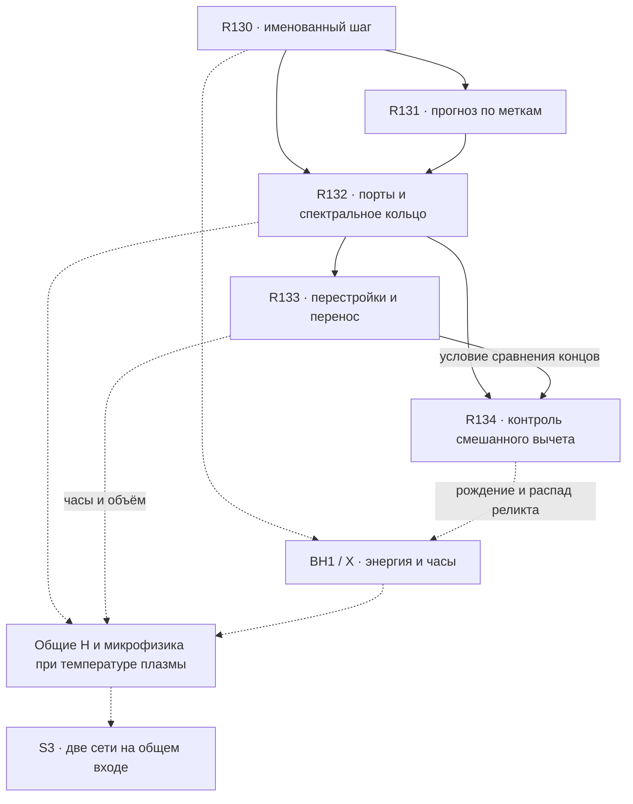
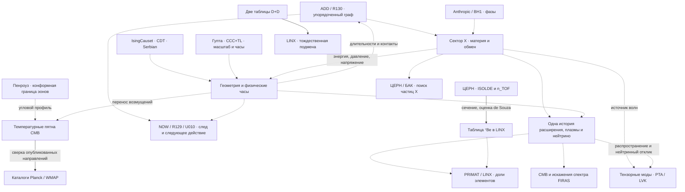

# Общая схема проектов «Сейчас» и место гравитации

19 ноября 2026 г. Сверено с [исходной версией main](https://github.com/IgorSabirov/vm-lab/commit/3a351b99455b881172b728fb9ce632339e4a17cd). Вопрос всей программы — может ли замкнутая система своей организацией воспроизводить условия следующего действия. В одном опыте хотелось бы проследить, как микросостояние определяет контакты и перенос, как материя влияет на геометрию и как изменённая геометрия возвращается в следующее действие тех же носителей. Наблюдения проверяют последствия такой истории.

По [D003](../../decisions/D003.md) линия A изучает механизм продолжения при объявленных законах. Линия B/S2 изучает происхождение и возможный дрейф безразмерных параметров. Вариант II, где граф ADD описывает внутреннее состояние физического сектора X, принят здесь за **рабочую гипотезу для изображения связей**. Выбор закона и физического носителя открыт. Вариант I переводит уже готовую траекторию графа в физическую историю через заданное отображение. Вариант III требует получить саму геометрию, часы и материю из графа. [Три варианта сопряжения](../R130_BH1_BBN_CONNECTION_20261117/ARCHITECTURE_REVIEW.md)

## Энтропия связывает пять направлений

ADD показывает, как расширение обратимого графа увеличивает число размещений частиц. CCC Пенроуза ставит встречный вопрос о низкой начальной гравитационной энтропии. В CCC+TL Гупты и Самараса тепловая история задаёт время для нуклеосинтеза. В BH1 энтропия различает фазы квантового поля и на гравитационной стороне связана с площадью горизонта. Чистая теория Янга–Миллса OpenAI даёт микроскопическую основу, для извлечения тепловой энтропии из этой конструкции ещё требуется построить тепловое состояние. Гипотезу об общем происхождении этих величин можно проверить, если вывести их из одной истории материи и геометрии. [Пять направлений, результаты и границы применимости](../ADD_BH1_CCC_PENROSE_20261119/FIVE_DIRECTIONS.md)

## Дополнение 20 ноября. Конн, петли, струны и продолжение в BBN

Общая схема в разделе «Связи проектов» сохраняет причинную постановку 19 ноября. На схеме 20 ноября сплошные стрелки указывают проверенные операции или зарегистрированное использование родительского результата, пунктирные — физический переход, для которого ещё нужен вывод. Схождение пунктирных стрелок в BBN означает общий проверяемый вход.

На R133 проверены совпадение именованных концов и локальные операторы; перенос полного оператора T3 и спинора T4 открыт. На R134 независимый смешанный коэффициент остаётся предсказать из ADD–Конна. Для эффективной петлевой космологии уже имеется внешний кандидат $G(a)$ с контролем $c=0$; его параметры пока не получены из R133. Для S3 различают истории по совместным $Y_p$ и D/H, для BH1 — по $N_{\rm eff}$ и изменению $\eta$ от BBN до рекомбинации. [Аудит с привязкой к протоколу](session_20261120/REPORT.md) · [кто применял решатели](../NEIGHBOR_EXTERNAL_DATA_USE_20261119/BBN_DONORS_R131_R134.md) · [количественные контроли](../NEIGHBOR_EXTERNAL_DATA_USE_20261119/BBN_METHOD_TRANSFER.md)

## Связи проектов

Сплошная стрелка обозначает прослеженную передачу данных или выполненную проверку на указанном участке. Пунктир обозначает требуемое физическое отображение, обратное действие или будущую проверку. У проверки лабораторного происхождения и у проверки численного интегратора разные выходы.

| Проект | Что он даёт системе | Статус передачи |
|---|---|---|
| NOW, U008, X26/X27, R128 и R129 | Наблюдаемая продолжения — удаётся ли физическому получателю прочитать след и выполнить следующее действие после снятия поддержки. Контроль меняет содержание записи при фиксированной задаче. | Есть локальные модели чтения, транспорта и ёмкости; замыкание всего цикла U010 открыто. В модели NOW изменение геометрического взаимодействия сдвинуло прибытие запаса со шага 126 на 152 при чтении на шаге 150. [Разбор результатов](../REGISTRY_SYNTHESIS_20261109/REPORT.md) · [Вопрос U010](../NOW_RESULTS_SYNTHESIS_20261106/OPEN_QUESTIONS.md#u010) |
| ADD / R126 / R130 | Правила контакта, переноса и расщепления именованного графа. Порядок вершин несёт измеримую информацию о будущем росте. | Выполнены воспроизведение C1 и проверки C2 в объявленных конвенциях. Переход от шага к физическому времени, от графа к объёму и стрессам открыт. [Результат R130](../ADD_NEIGHBOR_SYNTHESIS_20261117/REPORT.md) |
| Serbian, IsingCauset, 2D CDT | Serbian восстанавливает локальную сигнатуру из интервалов. IsingCauset предоставляет совместную статистику порядка и материи. CDT предоставляет контрольные ансамбли дискретных геометрий. | Инженерно исполнен пакет ADD и Serbian с раздельными выходами. Для физического сопряжения нужны общие носители, наблюдаемые и правило обратного действия. [Пакет двух модулей](https://github.com/IgorSabirov/vm-lab/pull/65) · [Контракты внешних проектов](../FOUR_CANDIDATE_INTEGRATION_20261108/SOURCE_INDEX.json) |
| CCC+TL и S2 | CCC+TL проверяет роль физических часов, масштаба и распространения света. S2 требует измеримого изменения независимого безразмерного отношения. | Проверены условные замены переменных; общий дрейф единиц не устанавливает физический дрейф констант. [Линии A и B](../RESEARCH_ARCHITECTURE_20261114/REPORT.md) |
| Пенроуз / Meissner / CMB | Гипотеза о конформном переходе между эонами задаёт угловой профиль температурного пятна. | Сверены таблицы Planck и WMAP и диапазон радиусов первоисточника. Значимость спорна. Рабочие версии HawkingNet и отдельного фильтра Planck/ACT закреплены в [разборе](../ADD_BH1_CCC_PENROSE_20261119/REPORT.md). |
| Anthropic / Hawking–Page / BH1 | Термодинамика фаз даёт кандидат на уравнение состояния X при заданных радиусе и температуре. | Есть аналитика и численная устойчивая ветвь. Физический смысл радиуса, кинетика перехода и обмен с плазмой остаются входами модели. [BH1](../CCC_BBN_NETWORK_20261114/s3_standard/bh_free_branch_A_20261116/REPORT.md) |

## Как замыкается гравитационная связь

В варианте II для **одного состояния** нужны физические часы, объём и правило вычисления энергии, давления и потоков. Полный источник определяет геометрию в выбранном законе гравитации. В обратном направлении эта геометрия должна изменить доступность контактов, длительности и доставку в том же состоянии. Вычислимый тест — сравнить следующий контакт или чтение при включённом и выключенном обратном действии из одинаковых начальных данных. В контрольном пределе требуется восстановить объявленное правило R130. Сейчас выполнена только отдельная проверка влияния геометрии в NOW.

| Из одной динамики | Что передаётся дальше | Проверка и граница |
|---|---|---|
| Средний тензор энергии-импульса | Фон, расширение, охлаждение и обмен с фотонами и нейтрино | Для взаимодействующих секторов допускается обмен с суммой потоков, равной нулю. Если BH1 и ADD описывают один носитель, его энергия учитывается один раз. |
| Поперечное бесследовое напряжение | Источник тензорных возмущений, для стохастического спектра — его неравновременной коррелятор | Нужны пространственное вложение и динамика источника. Равновесные плотность и скрытая теплота не задают коррелятор. |
| История расширения и отклик нейтрино | Перенос волн от источника до наблюдения | Угловая тензорная иерархия дополняет фоновое распределение по импульсу. Для PTA/LVK нужны спектр и отклик в соответствующих полосах. Для поздних астрофизических источников нужна собственная популяционная модель. |

**BH1.** При гладкой свободной энергии, фиксированных остальных параметрах, объёме, пропорциональном кубу радиуса, и ненулевой теплоёмкости на изоэнтропе выполняется

$$
\left.\frac{d\ln(T_XR)}{d\ln R}\right|_S =
\frac{1}{C_R}\left.\frac{\partial(E-3pV)}{\partial T_X}\right|_R .
$$

Для масштабной ветви $F=R^{-1}\varphi(T_XR)$ произведение $T_XR$ сохраняется. Одного роста кольца недостаточно для пересечения фазовой границы по $T_XR$. Для прогноза перехода нужны механизм отклонения от этой ветви либо другая история, а затем кинетика и бюджет выделения энергии. [Анализ BH1](../C2_S3_SYNTHESIS_20261119/REPORT.md)

**CCC+TL.** При $A=af$ и $d\tau=f\,dt$ фоновую метрику приводят к виду FLRW. При стандартном тензорном уравнении, постулированном для исходной метрики с масштабом $a$, в новых часах коэффициент при $h'$ равен $3H_A-2f'/f$. Если исходной физической метрикой служит конформная метрика с масштабом $A$, в её собственном времени коэффициент равен $3H_A$. Здесь штрих означает производную по $\tau$. Одинаковая история $A$ совместима с различным переносом волн. Выбор различает действие, связь с веществом и измеряемая деформация.

**Гравитационные волны.** В стандартной радиационной задаче нулевому напряжению соответствует $\sin(u)/u$. Для свободных нейтрино при $f_\nu=0{,}40523$ ориентир Вайнберга — амплитуда 0,8026 для мод, вошедших под горизонт после аннигиляции электрон-позитронных пар и задолго до равенства. T0–T3 в обсуждении охватывают этот численный эталон, сходимость и угловую иерархию. T4–T6 относятся к выбору действия и часов, источнику X/BH1 и спектру у детектора. Здесь опубликована постановка. Парный прогон на общем фоне и собственный GW-сигнал X остаются открытыми. [Эталон](https://arxiv.org/abs/astro-ph/0306304) · [Контракт переноса](../NEUTRINO_GW_ARCHITECTURE_20261118/GW_RESPONSE_BRIDGE.json)

## Что изменилось для C2

- На 4 368 входах на ориентацию сверены состояния, имена и направленные рёбра. Предложенная соседями «починка» при фиксированном первом канале совпала с уже объявленной конвенцией R130. У замороженного FT10 отдельное расхождение в квадрате полутранспорта сохраняется. Во всех четырёх ориентациях пространство одноузельных аддитивных инвариантов имеет размерность 6. Коррелятор −1/16 получен для указанной в разборе меры и наблюдаемой.
- В R130 (+,−) кольца (1,2,12) и (1,12,2) имеют одинаковые шесть зарядов и полный состав вершин. Длина первого всегда равна 3, для второго $L(t)=t+4$ при $t\ge2$. Здесь длина и периодичность слов учитываются с точностью до вращения.
- Для длин от 1 до 4 проверены 17 984 циклических класса. При группировке по длине, гистограмме и числам пар (1,2), (8,4) получена 5 141 группа. Следующая длина в каждой группе однозначна. Следующая гистограмма неоднозначна в 4 050 группах, длина через два шага — в 2 203. Пример (0,3,1) и (0,1,3) даёт длины 3→4→5 и 3→4→4.
- Для любого $k\ge1$ на двух кольцах длины $2k+3$ поместим символ 2 в позицию 0, а символ 1 на расстоянии $k$ либо $k+1$. Остальные узлы нулевые. Все счётчики циклических блоков длины до $k$ исходно совпадают: окно видит максимум одну метку. Перенос сближает метки на единицу за шаг, а порядок (2,1) перед встречей не запускает слияние. Первое расщепление происходит на шаг раньше в первом кольце. На шаге $k+1$ длины равны $2k+4$ и $2k+3$. Конструкция проверена для $k=1,\ldots,64$; аргумент применим для любого $k$.

Для точного прогноза длины через $H\ge2$ шагов на произвольных кольцах ширина в этой иерархии должна быть не меньше $H$. Достаточность такой ширины открыта. Иной способ сжатия можно проверять по его собственным наблюдаемым и горизонту. Это ограничение интерфейса ADD → X. Отображение длины в физический объём требует отдельного основания. [Машинная сводка](evidence/C2_S3_CHECKS.json) · [Доказательство и повторяемый расчёт](evidence/R130_Block_Closure_S3_20261119.zip)

## Где входит ЦЕРН и что проверено в S3

**ISOLDE → n_TOF → de Souza → LINX.** Мишень ⁷Be изготовлена на ISOLDE, сечение ⁷Be(n,p)⁷Li измерено на n_TOF, данные Damone вошли в оценку de Souza. В файле LINX на 46 из 46 узлов до 1 ГК включительно центральные скорости и факторы неопределённости совпали с первичной таблицей в пределах её округления. В Table III статьи LINX источники по сторонам 1 ГК указаны в обратном порядке относительно файла. Для 14 более горячих узлов значения согласуются с геометрическим средним границ Descouvemont с расхождением до 0,036%. Независимый импорт сырых событий, новый вклад в выход лития и совместная температурная ковариация требуют своих проверок. Изменение фактора 1,0206 → 1,0081 само по себе не определяет две независимые моды; обе оценки используют данные Koehler. Повторное включение измерения Damone в fit требует учесть его уже имеющийся вклад. [Эксперимент](https://doi.org/10.1103/PhysRevLett.121.042701) · [de Souza, приложение A.2 и таблица 3](https://arxiv.org/pdf/1912.06210) · [Descouvemont, таблица VI.j](https://arxiv.org/pdf/astro-ph/0407101) · [Table III LINX](https://lss.fnal.gov/archive/2024/pub/fermilab-pub-24-0737-v.pdf) · [Файл LINX](https://github.com/cgiovanetti/LINX/blob/bfba07c77a5fcba1cc772d42f2d9e9be8a542df8/linx/data/nuclear_rates/key_PRIMAT_2023/Be7nLi7p.txt)

**Общий ядерный вход.** Сопоставлены 8 нуклидов и 12 прямых реакций. В 12 файлах PRIMAT между v0.3.1 и v0.3.2 сетка выросла с 500 до 1 000 узлов; снимок LINX содержит 60. Для ³He(α,γ)⁷Be при $T_9=0{,}2179407$ линейная интерполяция LINX даёт +20,83% к значению PRIMAT, log–log даёт −1,41%. У ³H(p,γ)⁴He непрерывный максимум между этими интерполяциями на $0{,}1\le T_9\le1$ равен 1,086%. Это сравнения скоростей до интегрирования. Для двух каналов D+D уже сохранена совместная лабораторная ковариация Leonard. Перенос этой матрицы в общие реализации температурных скоростей требует восстановления модели ошибок. [Версии PRIMAT](https://github.com/CyrilPitrou/primat/commit/bea0c2263e6360b5170b78d39848c784b3f3646a) · [Контракт ковариации](../NEUTRINO_GW_ARCHITECTURE_20261118/NUCLEAR_RATE_COVARIANCE.json)

**Два решателя.** Форматы BBNHistory и NuclearRateSet, валидатор и карта реакций существуют. Тождественная подмена двух таблиц D+D в LINX в одной фиксированной точке сохранила все 8 конечных содержаний побитово. Выполнены 9 исходных и 8 уточняющих интегрирований чувствительности; при уменьшении шага 0,25 → 0,125 для двух D+D только производная $Y_p$ осталась в допуске 1%, а для D/H различие оценок составило 1,45–1,94%. Квитанции доступны по закреплённым коммитам рабочих веток. Приёмка парного расчёта требует одной истории $a,H,T_\gamma,n_b,f_\nu$, одинаковых начальных условий, единиц, фактических прямых, обратных и слабых скоростей, интерполяции и изоляции кэшей PRIMAT. Штатные эталоны каждого решателя и сравнение при фиксированных входах можно выполнить до ядерной UQ и общего fit. [Контракт](../PRIMAT_LINX_BBN_BRIDGE_20261117/BRIDGE_CONTRACT.md) · [Квитанция тождественной подмены](https://github.com/IgorSabirov/vm-lab/blob/1ff2f0310458eadb20c2b8c835488ceddb32324f/infra/autonomy/recoveries/43743586010/RECOVERED_VERIFICATION.json) · [Уточнение чувствительностей](https://github.com/IgorSabirov/vm-lab/blob/70e2f5705cf73da85745fa94a217e0258218cdc6/analysis/CCC_BBN_NETWORK_20261114/s3_standard/dd_covariance_20261115/refinement_20261116/REPORT.md)

## БАК и другие наблюдения

| Канал | Что должно дойти от общей модели | Что уже имеется |
|---|---|---|
| NA64, CMS, ATLAS, LHCb | Один набор масс, связей, ширин и ветвлений X. Для детектора нужны рождение, кинематика и эффективность отбора. Для BBN — начальная численность, распады и передача энергии. | Опубликованные ограничения, шесть паспортов поисков тяжёлых нейтральных лептонов на БАК. Короткое время жизни само по себе не исключает влияния на BBN. Пересчёт на X открыт. |
| FASERν, электронный FASER, SND@LHC | Предсказание потока и сечения с учётом мишени, энергии и детектора. Связь с ранней плазмой требует одних микроскопических операторов. | Четыре отдельных паспорта и описание пересечений. |
| KM3NeT, IceCube, PTA и LVK | Для ORCA — осцилляции и взаимодействия в Земле. Для ARCA и совместных GW–нейтринных поисков — астрофизический источник. Для PTA/LVK — спектр и перенос по полосам. | Опубликованные ограничения и карточки отклика. Перекрывающимся выборкам и одному событию требуется общий учёт. |
| Первичные доли элементов, CMB, COBE/FIRAS | Одна история радиации, нейтрино и фотонов. Производный интегральный предел BBN на ранние волны использует тот же радиационный бюджет. | Описаны зависимости и условия совместного fit. Набор данных, физический расчёт и совместная оценка открыты. |

Для нейтринного сектора предусмотрены νDSMC, nudec и FortEPiaNO с самостоятельными областями применимости. Фоновые спектры нужны слабым скоростям BBN, угловой отклик нужен тензорным модам. CLASS относится к поздней космологии при заданной модели. [Карточки и первичные источники экспериментов](../NEUTRINO_GW_ARCHITECTURE_20261118/REPORT.md) · [Десять паспортов БАК](../NEUTRINO_GW_ARCHITECTURE_20261118/COLLIDER_CONSTRAINTS.json)

## Ближайшие различающие проверки

1. **Причинный цикл NOW.** При фиксированной задаче, аппаратуре и ресурсах изменить только содержание следа. Наблюдаемая — возможность следующего физического действия, в том числе после снятия поддержки источника. [Линия A и U010](../RESEARCH_ARCHITECTURE_20261114/REPORT.md)
2. **Гравитация.** На одном носителе задать часы, объём, энергию, давление и обмен. Проверить баланс, восстановление контрольного предела и изменение следующего контакта от обратного действия. Стандартный эталон переноса GW можно проверять независимо от выбора X.
3. **S3.** После нативных эталонов получить две квитанции фактически прочитанных физических входов и одну пару выходов D/H и $Y_p$ на фиксированной стандартной истории. Физическую UQ, ветвь X и наблюдательный fit принимать отдельно. [План V0–V7](../NEUTRINO_GW_ARCHITECTURE_20261118/VALIDATION_PLAN.json)

**Приёмка на одном объекте.** Для C2 можно независимо зафиксировать вариант оператора и доказать его тождества для одного семейства именованных графов, сохранив Python как генератор контрпримеров. Это предложенная формализация Lean. Для S3 аналогичное требование численное: обе квитанции должны указывать одну физическую историю и одну реализацию скоростей. Намеренная замена ориентации, единиц или массива скоростей должна быть обнаружена. Для гравитации тот же принцип связывает фон, возмущение и наблюдаемое с одним выбранным источником. Сквозная проверка этих трёх участков остаётся открытой.

**Тепловой результат BH1.** Для контрольной модели теперь известны все пересечения адиабаты с фазовой границей при любом положительном радиусе. Для свободной планарной чистой YM на сфере воспроизведён скачок энтропии $\Delta S/N^2=(3/4)\ln(2+\sqrt3)$. Для взаимодействующей теории согласованы нормировки слабосвязного наклона границы. Физическая история сектора X требует энтропии занятой ветви при ненулевой связи. [Доказательство, первоисточники и расчёт](../BH1_YANG_MILLS_COMPARISON_20261119/ENTROPY_REVIEW.md)

**Уточнение для источника гравитации BH1.** Для проверки перехода задаются начальные температуры и радиус, направление расширения и обмен энергией между компонентами. Свободный $U(1)$ сохраняет фазовую границу и имеет вычисленный вклад в энтропию общей тепловой системы. При раздельном адиабатическом расширении его энергию можно учитывать в гравитационном фоне, а энтропию занятой материи следует отслеживать отдельно. Вклад взаимодействующей холодной чистой $SU(N)$ получен в низкотемпературном разложении по первым трём уровням. [Расчёт и границы применимости](../BH1_YANG_MILLS_COMPARISON_20261119/THERMAL_SECTORS.md) · [Журнал запусков](../BH1_YANG_MILLS_COMPARISON_20261119/THERMAL_SECTORS_CHECKS.json)

**ADD, BH1 и два значения CCC.** В C1 при одинаковой длине и зарядах возможны три разных размера следующего кольца. Для свободной конечной $SU(3)$ при максимуме восприимчивости получено $T_*R=0.72361$. Гупта даёт проверку масштабирования часов и реакций. Мейсснер и Пенроуз дают отдельную гипотезу переноса гравитационного возмущения в температурный профиль CMB. [Источники, вычисления и границы вывода](../ADD_BH1_CCC_PENROSE_20261119/REPORT.md)

**Материалы по порядку разборов.** [Физико-математический перенос из Янга — Миллса](evidence/YANG_MILLS_TRANSFER.md) · [снимок разработки моста PRIMAT/LINX](evidence/BBN_BRIDGE_STATUS.md) · [подробный разбор гравитации и T0–T6](evidence/GRAVITY_REVIEW.md). Это датированные материалы. Вопрос об участии n_TOF, ещё открытый в гравитационном обзоре, разрешён поздней сверкой выше.

[Генеалогия и статусы](../REGISTRY_LINKS/INDEX.md) · [Состав, версии и хеши свидетельств](EVIDENCE.json) · [Расчёты ориентаций, циклов, BH1 и 12 пар скоростей](evidence/Review_C2_BH1_S3_20261119.zip)
