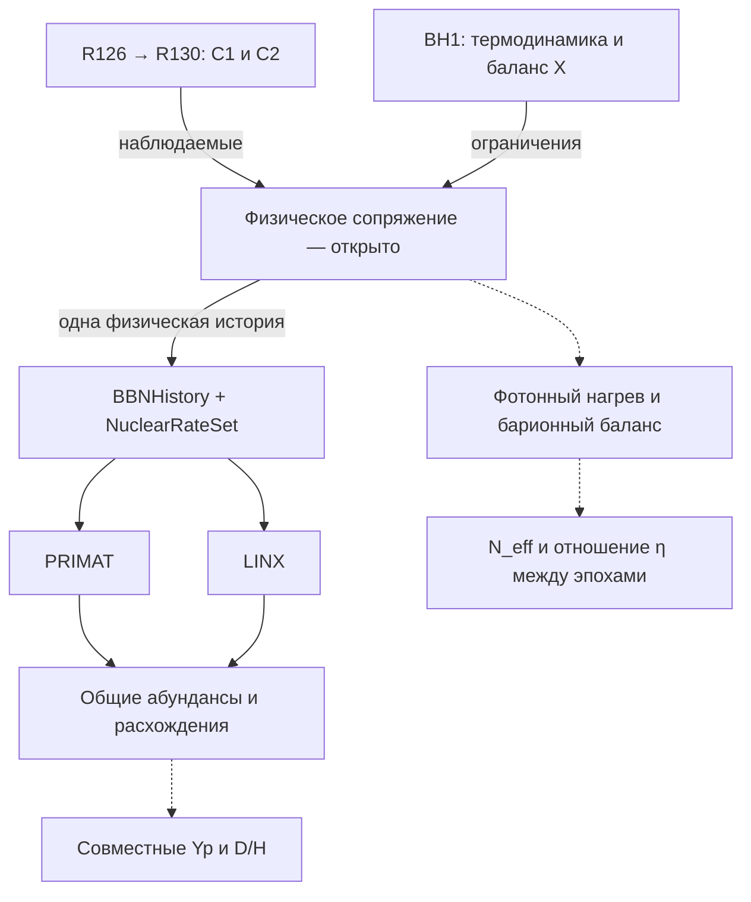

# R130 → физическое сопряжение с BH1 → BBN

**Проверка R150, 26 ноября.** Устойчивый носитель порта фиксированной длины даёт индекс нулевой фазы 3 при L=3,5,…,15. При L=7 активная часть даёт 6−4=2, пассивная 7−6=1. Счёт относится к замкнутому носителю данной длины. Переходы с изменением длины и физическая хиральность требуют дополнительных входов. [Подробности](../R150_THREE_GENERATIONS/floquet/phase_bbn/experiment_review/followup/INDEX.md).

**Итог проверки R150 ↔ BBN, 26 ноября.** На семи длинах 3–15 слияние второго канала (8,4)→12 локализовано на ребре 0→2, одновременно расщепляется первый канал. Проверена привязка межсекторного оператора к этому ребру. Выбор канала и оператора остаётся физическим входом. [Итоговый протокол E1–E6](../R150_THREE_GENERATIONS/floquet/phase_bbn/experiment_review/README.md).

**Проверка шва R150, 26 ноября.** Проверены исходные слова активного слоя при L=3,5,7,9,15. Знак локального слияния (8,4)→12 даёт произведения (+,−) на неподвижной петле и длинном цикле; такой же знак при обратном расщеплении даёт (−,−). Каноническое переупорядочение сохранённых битовых меток даёт (+,+). Физический выбор знака, секторная координата и обратный переход требуют независимого правила. [Расчёт и границы](../R150_THREE_GENERATIONS/floquet/phase_bbn/seam_audit/README.md).

**Сетевой опыт 26.11.2026.** В шовном стенде R150 проверен общий ход часов графа и ядерных реакций. При растяжении времени втрое и обратном масштабировании всех частот четыре выхода совпадают в пределах 10⁻⁶ по ln Y. Отображение исходного шага ADD в абсолютную физическую частоту остаётся открытым. [Расчёт и результаты](../R150_THREE_GENERATIONS/floquet/phase_bbn/NETWORK_RESULTS.md).

Дата: 17 ноября 2026. Задача: [#92](https://github.com/IgorSabirov/vm-lab/issues/92).  
Статус: **общий исследовательский контракт связан; физическое сопряжение не построено**.  
Научная приёмка: **false**. Новых научных прогонов: **0**.

## Зачем соединяем

Один вопрос: **может ли замкнутая динамика давать рост и стрелу, сохранять возможность локального действия и иметь физическую историю, совместимую с BBN?**

R130 даёт проверенные механизмы и контрпримеры на дискретной модели. BH1 задаёт условные термодинамические ограничения. Наш BBN bridge должен проверять наблюдаемые последствия конкретного физического сопряжения этих уровней. PRIMAT и LINX — два вычислительных backend ядерной части одной истории. Их интеграция сама по себе не выводит космологию из ADD.

До этого R130 и BH1–BBN были представлены отдельными линиями. Теперь задан общий контракт: измеренные выходы R130, необходимые физические отображения, ограничения BH1 и точные входы уже созданного BBN-интерфейса. Это объединение постановки и зависимостей; исполняемого преобразования R130 → BBNHistory пока нет.

## Генеалогия и состояние компонентов

Стрелки обозначают требуемые зависимости, а не завершённые преобразования.
BH1 не объявляется следствием R130, а ADD не назначается сектором X.

| Компонент | Что имеется | Что ещё отсутствует |
|---|---|---|
| R130 / C1-A | Проверенный конечный пакет роста/энтропии; чистое воспроизведение на GitHub, 91/91 raw совпали | Физические единицы, энергия и космологическое вложение |
| R130 / C2 | Для явно заданного правила симметрия и точный активный цикл при постоянном L=3 | Типичность, устойчивость, масштабируемое сохранение действия, физическое вложение |
| BH1–X | Условные фазовые/энергетические соотношения и контрольные сценарии | Выбор X, R-вложения, полной термодинамики, кинетики и collision terms |
| Общий BBN-вход | JSON Schema, структурный валидатор, SHA-256, карта 8 нуклидов / 12 реакций | Полнота физической истории и проверенный генератор |
| PRIMAT/LINX | Закреплённые источники и описание разных возможностей backend | Два адаптера одной полной истории, общие rates/weak sector, численное сравнение |

R130 C1 и C2 остаются разными моделями. Проверенный пакет C1 нельзя выдавать за полный статистический прогон C2. Воспроизведение одного исходного кода в двух средах не является независимой реализацией закона.

## Точная граница данных

Имена BBN-полей ниже взяты из существующего `BBN_HISTORY.schema.json`, а не введены заново.

| Выход R130 | Что он означает | Возможный потребитель | Необходимое физическое отображение |
|---|---|---|---|
| CSV `t` | Номер шага выбранного прямого/обратного итератора | `history.time_s` | Физические часы и единицы; для backward номер записи также растёт |
| `L` | Число вершин одномерного кольца | `scale_factor`, `H_s_inv`; радиус R в BH1 | Размерность, физическая длина/объём, нормировка, R(a), часы и уравнение фона |
| `na, nb` | Числа битовых частиц a/b | `n_b_cm3` или содержание X | Объявить физические степени свободы, заряд/барионное число и физический объём; a/b не названы барионами |
| `S_global, S_local_r1, S_local_r5` | Комбинаторная энтропия по объявленному coarse graining | Диагностика термодинамической/комовинговой энтропии | Физическое ансамблевое описание, сектор, мера и единицы; энтропия не задаёт температуру без термодинамики |
| `split_next, merge_next, n_f, d_f` | Геометрическая активность/паттерны C1 | Кандидат диагностик продолжения и перехода X | Закон энергии, кинетика и связь с последующим действием; split/merge не являются ядерными реакциями |
| Энергия, давление, потоки и спектры | В R130 отсутствуют | `rho_X_MeV_cm3, p_X_MeV_cm3, Q_Xem_MeV_cm3_s, Q_Xnu_MeV_cm3_s, Q_emnu_MeV_cm3_s, T_gamma_MeV, f_nu_e, f_antinu_e` | Физическое состояние X, начальные условия, взаимодействия и уравнения эволюции |

Сохраняются исходные знаки потоков: Q_Xem/Q_Xnu положительны из X, Q_emnu — из em в nu. При использовании энергетического остатка Q_out=−[dot(rho_X)+3H(rho_X+p_X)] один и тот же выпуск энергии нельзя ещё раз независимо прибавлять как «энергию слияний».

Данные R130 остаются в исходном пакете и связываются точными SHA. Не копируем их в BBNHistory и не заполняем отсутствующие физические поля нулями. В raw локальные энтропии записаны не на каждом позднем шаге; пустая ячейка не означает нулевую энтропию.

Структурный PASS нынешнего `validate_contract.py` не подтверждает физическую допустимость: его минимальный fixture не требует нейтринных спектров, потока энергии, Friedmann/baryon/energy residuals. Документированная comoving entropy пока также не представлена в текущем schema v1. Это известные ограничения общего входа для будущего физического генератора.

## Что именно R130 добавляет к нашей задаче

1. **C1 — контроль разрежения.** В проверенной постановке расширение сопровождается ростом глобальной комбинаторной энтропии и исчезновением среднего локального сигнала при фиксированном радиусе. Это мотивирует проверять сохранение следующего локального действия, а не только рост масштаба или энтропии. Конечные траектории сами по себе не доказывают асимптотику; аналитическое восстановление сохранено отдельно. Вопрос коэффициента Theorem 4 открыт.
2. **C2 — контроль активности без роста.** Явный цикл активного слова (1,2,12) при L=3 отделяет наличие взаимодействий от расширения. Это не модель устойчивой материи, не физический носитель BH1 и не установленная типичная космология. Цикличность относится к слову с точностью до циклического сдвига, а не к периодичности всех имён.
3. **Реверс — свойство полного закона.** Обратимость C1 и временная симметрия явно заданной C2 различаются. Переставить нуклиды, сохранить сумму абундансов или обратить таблицу истории недостаточно для физического обращения всей системы. Старый ADD/BBN-разбор сохраняется с уточнёнными границами R130.

**Предсказания D/H, Yp, Neff или FIRAS из R130 пока не получены.** Закон роста L по номеру шага ещё не является законом расширения a по физическому времени. Даже назначение L=a не определяет температуру, энергетический баланс и нейтринный сектор.

## Условия содержательного сопряжения

Физическая модель должна одновременно задать:

- состояние, часы и геометрию; точное правило получения a, H и радиуса R;
- энергию, давление и начальное состояние X; как сохраняется полный баланс и учитывается обратное влияние обмена на динамику;
- термодинамический смысл T_X, фазового состояния и энтропии;
- кинетику перехода и передачу энергии в em/nu, включая нужные спектры;
- независимую наблюдаемую продолжения локального действия и границы применимости выбранного R130-режима.

Это незаданные содержательные решения, а не скрытые параметры валидатора.
Пока они отсутствуют, статус машинного контракта — `PHYSICAL_EMBEDDING_OPEN`; поля отображений равны null.

Существующее ограничение BH1 сохраняет силу в своей области: для изолированной квазистатической конформной адиабаты F=R^-1 f(T_X R) с ненулевой теплоёмкостью T_X R постоянно. Один лишь рост геометрии R130 не создаёт пересечения фиксированного фазового порога. Кандидат, заявляющий такое пересечение, должен указать, какое условие этой оценки перестало выполняться, и учесть энергетическую цену.

## Как продолжать одну линию работы

**Независимая готовая работа:** завершать PRIMAT/LINX-интерфейс на их стандартных контролях и общем допустимом фоне; проверять численное совпадение rates, единиц, weak sector и нейтринных возможностей. Эта работа не требует выдумывать вложение R130.

**Связующая научная работа:** подготовить один явно сформулированный кандидат физического сопряжения и проверяемый баланс. Не выбирать L=a, шаг=секунда или ADD=X ради запуска backend. При выборе кандидата фиксировать предпосылки до сравнительного прогона.

**После появления физической истории:** использовать исходные NULL, DECOUPLED, CONFORMAL, ENERGY_BARYON, LATE_PHOTON, NU_SPECTRUM, NUMERICAL из BH1 bridge. Одни и те же сериализованные история и rate realization передаются обоим решателям. Одинакового H(T) недостаточно. Неподдерживаемый нейтринный режим остаётся явной границей сравнения.

Маршрут исполнения остаётся GPT → пакет на GitHub → Copilot → raw/квитанции/commit на GitHub → проверка GPT → научная приёмка владельца. Этот контракт не создаёт новое задание на научный расчёт и не меняет активную очередь.

## Источники и проверяемость

- [R130: текущая сводка и границы](../ADD_C1_REPRODUCTION_STATUS_20261117/REPORT.md), [реестр R130](../NOW_RESULTS_SYNTHESIS_20261106/RESULTS_REGISTER.md#r130).
- [Чистые результаты R130](https://github.com/IgorSabirov/vm-lab/tree/d2d0252f4237087552e61cb69894ad3fd6dec0aa/reproductions/R130_COPILOT_20261117/results/44082471150), [аудит передачи](https://github.com/IgorSabirov/vm-lab/blob/0c3dc25a4443d96a133a9a8fdda19bf31d071886/reproductions/R130_COPILOT_20261117/audit_20261117/REPORT_RU.md). PR #88 остаётся отдельным источником воспроизведения; научная приёмка не подменена этой связкой.
- [BH1 bridge](../CCC_BBN_NETWORK_20261114/s3_standard/bh_bridge_20261115/BRIDGE_CONTRACT.json).
- [PRIMAT/LINX bridge](../PRIMAT_LINX_BBN_BRIDGE_20261117/BRIDGE_CONTRACT.md), [schema v1](../PRIMAT_LINX_BBN_BRIDGE_20261117/BBN_HISTORY.schema.json).
- [ADD/BBN: наблюдаемая и реверс](../ADD_BBN_SYMMETRY_20261115/REPORT.md).
- [Машинный контракт соединения](CONNECTION_CONTRACT.json).

База объединения: `0c56531e2af693e28e8378cdc8a0157d96707019`.
Родители результата сохраняются: R126/R077/R078 → R130; связи C035/C037/C042 и U006/U007/U010 не закрываются. Новый номер результата и новый физический закон не вводятся.

## Проработка архитектуры и предпосылок

[Разбор 17 ноября](ARCHITECTURE_REVIEW.md) и [машинная карта](ARCHITECTURE.json): три возможные архитектуры, 18 групп предпосылок, условная неоднозначность физического закона расширения, энергетический тест и проверки замыкания. Семь групп точных алгебраических проверок прошли; физических прогонов нет. Вариант графа как внутренней структуры X рекомендован для дальнейшего анализа, но не выбран как принятая модель.

## Две эпохи для проверки нагрева BH1

При фиксированном масштабе и равном относительном увеличении энергий фотонов и прочего излучения на 4% их отношение сохраняется. При тепловых фотонах после аннигиляции пар и сохранении барионов получается η′/η = 1,04^(−3/4) = 0,971013. Для физического расчёта нужны источник энергии X, баланс обмена, температуры и скорости n ↔ p. В ADD отсутствует вывод физических часов и энергии из шага. [Сравнение нагрева фотонов и нейтрино; передача в CMB](../NEIGHBOR_EXTERNAL_DATA_USE_20261119/BBN_METHOD_TRANSFER.md#bh1-epochs).
