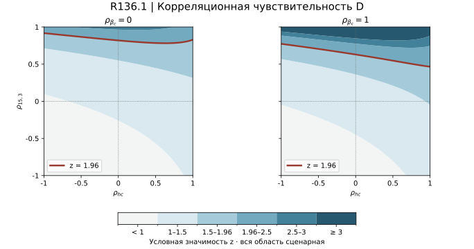

# R136. Температурная калибровка Shirogane и согласованность фазовых данных

**Последнее дополнение.** [Четыре проверки статистического бюджета и запрос U013](#statistical-budget).

R136 открыт из [#167](https://github.com/IgorSabirov/vm-lab/issues/167) как самостоятельная проверка публикации. [Задача исследования #193](https://github.com/IgorSabirov/vm-lab/issues/193). Исходный контроль по PDF находится в [отчёте R135](https://github.com/IgorSabirov/vm-lab/blob/649c1d987acdcf227a15ca7d41fd29fb455c7b08/infra/r135/research/20261121_donors/PHASE_FLOW_AND_SIGMA_AUDIT.md). Здесь числа заново получены из векторных исходников двух статей. Рисунки без указания года относятся к работе 2021 года.

**Результат первого опыта.** Опубликованная шкала 2016 года предсказывает смещение в нужную сторону на обеих решётках. При сопоставлении на объёмной критической связи центральные остатки скачка составляют +0.024 и −0.029. Их совместная статистическая значимость пока открыта. Статус статьи — вопрос о реализации температурной шкалы. Физический вход EOS и необходимость исправления публикации остаются открытыми.

## A. Восстановление температурной оси

В работе 2021 года рис. 3 измеряет J=Δ(ε+p)/T⁴ на максимуме восприимчивости петли Полякова для каждой решётки. На рис. 15 авторы переводят β в x=T/Tc по калибровке ссылки [7]. В этой работе βc сначала экстраполирована по обратному объёму. При Nt=8 получено βc(∞)=6.06307(28), тогда как βc(48)=6.06160(18) и βc(64)=6.06247(14). Уравнение (42) задаёт β=F(n), полином пятой степени от эффективного временного размера n. Из a=1/(n Tc) следует n=8x. Отсюда F(8) задаёт одну общую опорную β, а x для данного объёма решает F(8x)=βc(V). Числа энтальпии в этой процедуре не используются.

Из оригинального EPS рис. 3 работы **2016** года извлечены все 100 вершин синей кривой. Преобразования координат независимо восстановлены по подписанным делениям осей. Реконструкция полинома даёт F(8)≈6.06325 и 8F′(8)=0.62168. Авторы указывают |a dβ/da|=0.6217(8). Максимальное отклонение полинома от округлённых графических точек по β равно 0.000242. Это мера дискретизации рисунка, без интерпретации как статистической ошибки. Табличная точка 6.06307(28) и значение аппроксимации F(8) имеют разное определение. Полные коэффициенты, точные β узлов рис. 15 и фактически использованная константа нормировки в двух проверенных архивах не обнаружены. Так получена независимая реконструкция заявленного способа калибровки. Точное соответствие авторской реализации остаётся проверяемой гипотезой.

[Shirogane et al. 2016, Sec. IV, Eq. (42), Fig. 3 и Table II](https://arxiv.org/pdf/1605.02997) · [Shirogane et al. 2021, §§3–5](https://doi.org/10.1093/ptep/ptaa184)

## B и C. Скачки при общей β и знак изменения

Взяты горячая и холодная серии рис. 15 и зелёный маркер рис. 3 на t/a²=1.4, NNLO, μ₀. Значения внутри температурной сетки получены линейной интерполяцией. Контроль чтения — маркер при t=0 на рис. 3 воспроизводит столбец NNLO μ₀ табл. 2 с точностью 0.001. Погрешности округления координат EPS и независимо разобранного PDF видны в последних знаках.

| Наблюдаемая | 48³×8 | 64³×8 |
|---|---:|---:|
| Предсказанный x(βc) по F | 0.997354 | 0.998752 |
| Рис. 15 при x=1 | 1.27655 | 1.15688 |
| Рис. 15 при предсказанном x(βc) | 1.17037 | 1.06922 |
| Рис. 3 при βc и том же потоке | 1.14593 | 1.09852 |
| Исходный остаток J₁₅(1)−J₃ | +0.13062 | +0.05835 |
| Остаток после привязки к βc | **+0.02444** | **−0.02930** |
| Независимый вариант привязки по табличному якорю, остаток | +0.03656 | −0.01010 |

Последняя строка использует x=exp[(βc(V)−6.06307)/0.6217], локальный вариант с опубликованной табличной точкой. На каждом объёме переход от βc(V) к опоре x=1 повышает J. Знак предсказан и проверен на двух сериях. На 64³ центральное значение после переноса проходит ниже маркера рис. 3. Поэтому одним знаком идентифицировать точную калибровку нельзя.

**Обратная проверка.** По самим скачкам рис. 3 требуются x=0.996785 и 0.999183 на рис. 15. Если разрешить только общий аддитивный сдвиг F, каждый объём даёт эффективный якорь β₀=βc(V)+F(8)−F(8x). Получаются 6.063601 и 6.062978, разность 0.000623. Это остаток для совместного статистического теста. Подгонять два якоря по отдельности означало бы исчерпать обе наблюдаемые. Рис. 3 показывает зависимость от времени потока при фиксированной β. Получить из него независимую производную по β невозможно. Доступные dJ/dβ получены по рис. 15 и кривой F. Локальная секущая и два соседних окна дают диапазоны 68.4–69.0 и 106.8–111.0.

**Что позволяет оценить опубликованная статистика.** Для двух остаточных J в CHECKS.json приведена совместная матрица при нескольких заданных корреляциях. Для иллюстрации ошибки hot/cold взяты диагональными, нарисованные маргинальные ошибки интерполированы по x, ошибки двух βc(V) добавлены через локальные производные, а ошибка табличного якоря 0.00028 введена общей для двух объёмов. Эта величина служит приближением для ошибки калибровки. Корреляции между оценкой шкалы и βc(V) и ошибки самих производных определить по рисункам нельзя. При коэффициентах корреляции 0, 0.5, 0.9 между J₁₅ и J₃ одного объёма получаются совместные χ² соответственно 1.39, 2.27, 5.04 для двух компонент, номинальные p=0.499, 0.322, 0.081. Для каждого прогона значение корреляции задано до вычисления χ². Физического p по этим сценариям мы не присваиваем. Независимый повтор перевзвешивания требует согласованных jackknife-блоков или эквивалентной ковариации.

**Контроль другим способом измерения.** Открытые треугольники Nt=8 на правой панели рис. 13 дают J на βc методом производных. На их абсциссах авторы графически разнесли символы. По рис. 16 при предсказанных температурах получаются 1.495 и 1.083 против 1.520 и 0.970 из рис. 13. Ошибки только контрольных точек равны примерно 0.210 и 0.120, ошибки горячей серии рис. 16 также велики. Это проверка порядка величин на связанных ансамблях. Рис. 16 использует коэффициенты Карша, фиксированные при βc. Эти данные не заменяют совместной статистики SFtX.

## Что установит причину

1. Получить точную β каждого узла рис. 15 либо формулу со всеми коэффициентами и константой x=1, указанной при построении рисунка. Применить её к обоим объёмам до обращения к энтальпии.
2. Сверить J₁₅ и J₃ при тех же βc, t/a², порядке matching, масштабе μ₀ и определении двух фаз. Для разностей использовать совместную ошибку исходного перевзвешивания, обоих фазовых средних, βc и шкалы. Если расчёт повторяется по блокам, восстанавливать ось и производные внутри каждой реплики.
3. Если оба остатка совместимы с нулём, передать в #167 калиброванную область и её ошибки. Если при совпадающих условиях сохраняется статистически устойчивое расхождение, локализовать его в графике, численной обработке или описании процедуры и предложить авторам независимое воспроизведение. Пока точная сетка и ковариация неизвестны, вопрос остаётся открытым.

### Подготовленный вопрос авторам

> We are reproducing the enthalpy discontinuity in Figs. 3 and 15 of your PTEP paper (2021, 013B08) on the 48³×8 and 64³×8 lattices at t/a²=1.4, NNLO, μ₀. Could you share the β values corresponding to the plotted T/Tc nodes in Fig. 15, or the exact scale function and Tc normalization used for each volume? Reading the calibration curve in Ref. [7] puts the susceptibility peaks at T/Tc≈0.99735 and 0.99875. The corresponding differences between the phase gaps read from Figs. 15 and 3 are about +0.024 and −0.029. Are joint jackknife estimates for the hot/cold values and the gap at the two susceptibility peaks available, or is there another way to account for their shared reweighting uncertainty? An explanation of the plotting convention alone would already let us check the temperature mapping.

### Воспроизведение

Из каталога этого отчёта выполнить `python verify.py --check` с NumPy и SciPy. Для независимого чтения исходных рисунков скачать два исходных архива arXiv и выполнить `python extract.py shirogane2021.tar shirogane2016.tar > replay.json`, затем `cmp replay.json FIGURES.json`. Входные EPS проверяются по SHA-256 до обработки. Архивные файлы только читаются. Данные для другого измерителя извлекаются из тех же распределённых исходников. Полный прогон физического сектора X в эту задачу не входит.

[Исходники 2021 v2](https://arxiv.org/e-print/2011.10292v2) · [Исходники 2016 v1](https://arxiv.org/e-print/1605.02997v1) · [Извлечение](extract.py) · [Точки и нарисованные ошибки](FIGURES.json) · [Расчёт](verify.py) · [Числа](CHECKS.json)


<a id="genealogy-r136"></a>

## Генеалогия R136 и границы наследования

### 1. Происхождение задачи

R136 выделен из открытой физической задачи **#167 (EOS)** после донорского исследования Shirogane, проведённого в рамках **PR #185**. Непосредственный предшествующий материал — [аудит фазового потока и SU(3)-натяжения в PR #185](https://github.com/IgorSabirov/vm-lab/blob/649c1d987acdcf227a15ca7d41fd29fb455c7b08/infra/r135/research/20261121_donors/PHASE_FLOW_AND_SIGMA_AUDIT.md). Он выявил расхождение между фазово-раздельными данными Fig. 15 и контрольным скачком Fig. 3 и сформировал проверяемый вопрос о температурной оси.

Связанный открытый вопрос реестра — **U013**: «Совместимы ли фазовые скачки на рис. 3 и 15 Shirogane при одинаковой β?». U013 зарегистрирован из #167 и донорского аудита PR #185. R136 — отдельный ответный исследовательский трек по этому вопросу; он **не закрывает U013**.

### 2. Научные первоисточники и их разные роли

| Источник | Что именно наследует R136 | Чего источник не доказывает в R136 |
|---|---|---|
| Shirogane et al., 2016, [arXiv:1605.02997](https://arxiv.org/abs/1605.02997), Sec. IV, Eq. (42), Fig. 3, Table II | Калибровочную зависимость β=F(n), локальную производную и процедуру перевода эффективного временного размера в β | Точную реализацию нормировки, фактически использованную авторами при построении Fig. 15 работы 2021 года |
| Shirogane et al., 2021, [arXiv:2011.10292](https://arxiv.org/abs/2011.10292), §§3–5, Figs. 3, 13, 15, 16, Tables 1–2 | Объёмные βc, фазово-раздельные ряды, скачки при критической связи, конечное время потока и альтернативный метод производных | Совместную jackknife-ковариацию всех сравниваемых точек и точную β-сетку Fig. 15, если они не опубликованы отдельно |

Это две разные работы одного авторского направления, но не один и тот же набор данных: статья 2016 года поставляет калибровочную функцию; статья 2021 года — фазовые измерения и объёмные критические связи.

### 3. Цепочка данных и вычислений

1. **Первичные данные:** векторные EPS-исходники рисунков двух статей, проверяемые по SHA-256 в extract.py.
2. **Оцифровка:** extract.py восстанавливает координаты подписанных осей, 100 вершин калибровочной кривой 2016 года и фазовые маркеры/ошибки рисунков 2021 года.
3. **Промежуточный набор:** FIGURES.json хранит оцифрованные кривые и нарисованные ошибки. Это графические данные с ошибкой дискретизации, не исходные авторские конфигурации и не jackknife-реплики.
4. **Калибровка:** verify.py аппроксимирует F(n) по кривой 2016 года, независимо от значений энтальпии; использует n=8x, F(8) и 8F'(8), затем решает F(8x)=βc(V) отдельно для 48³×8 и 64³×8.
5. **Сопоставление:** при Nt=8, t/a²=1.4, NNLO, μ₀ сравниваются J₁₅(x(βc(V))) и J₃(βc(V)) для каждой решётки.
6. **Контроли:** проверяются альтернативный табличный якорь, локальные производные по Fig. 15 и связанный метод производных Fig. 13/16.
7. **Результат:** CHECKS.json сохраняет центральные остатки и сценарии чувствительности к неизвестной корреляции; REPORT.md описывает выводы и границы.

### 4. Что R136 наследует от R135 — и чего не наследует

**R135 — родительский программно-научный контекст**, задающий необходимость независимого физического фазового отклика чистой SU(3) перед использованием метастабильной EOS в R135. Это не означает, что численные тождества или физическая идентификация X из R135 доказывают калибровку Shirogane.

Непосредственная рабочая генеалогия R136:
\[
\#167\ \text{(EOS / фазовые входы)}
\rightarrow
\text{донорский аудит PR \#185}
\rightarrow
U013
\rightarrow
R136\ /\ \#193
\rightarrow
\text{PR \#194}.
\]

В этой цепочке:
- #167 — исходная задача, где обнаружен пробел сопоставимости фазовых данных;
- PR #185 — предшествующий донорский пакет и первичный численный аудит (черновик, не считать его слияние научной приёмкой);
- U013 — формализованный открытый вопрос;
- R136 — независимая реконструкция температурной шкалы и проверка согласованности;
- #193 — рабочая Issue с критериями A/B/C;
- PR #194 — код, данные и отчёт, доставляемые на review; PR остаётся draft.

R135 указан в реестре как родительский контекст. Прямыми научными донорами R136 являются две публикации Shirogane, а не сам результат R135.

### 5. Состояние критериев и downstream-потребители

| Узел | Состояние | Что именно остаётся |
|---|---|---|
| #193 / критерий A | Частично выполнен | Независимая реконструкция кривой [7] есть; точные β-узлы Fig. 15 и фактическая нормировка авторской реализации не получены |
| #193 / критерий B | Открыт | Центральные остатки и сценарии корреляций рассчитаны; нужна совместная jackknife-ковариация или эквивалент |
| #193 / критерий C | Проверен | Знак переноса от объёмной βc к x=1 воспроизведён на обеих решётках |
| U013 | OPEN | Совместимость скачков при одинаковой β ещё не установлена |
| #167 | Открыт | Может принять уточнённую температурную калибровку только после закрытия недостающих входов; фазовая EOS автоматически не закрывается |
| #168 | Не разблокирован этим результатом | Гидродинамика требует собственных допустимых фазовых ветвей и интерфейсных входов |
| #174 | Не разблокирован этим результатом | GW-источник, история XB и физическая амплитуда не получены |

### 6. Научная граница

R136 устанавливает воспроизводимый **знак и величину центрального сдвига при конкретной реконструкции опубликованной калибровки**. Он не устанавливает статистически значимое противоречие, не доказывает ошибку статьи и не даёт права исправлять публикацию без точной авторской β-сетки и совместной статистики. Варианты корреляции в CHECKS.json — анализ чувствительности, а не измеренная ковариация.

Научная приёмка R136 остаётся false; U013 остаётся открытым. Результат не является физическим входом XB, не закрывает #167/#168/#174 и не разрешает физический запуск.


<a id="extended-audit-followup"></a>
## Дополнение: расширенный аудит устойчивости R136 (22 ноября 2026)

### 1. Что проверял дополнительный прогон

К исходным тестам A–C добавлены три группы проверок:
- сохранение нормировки полинома при сдвиге калибровочной функции;
- устойчивость переноса к степени/окну фита и интерполяции Figure 15;
- разделение flow-time drift и finite-volume difference по данным Figure 3.

Это расширение аудита, а не новый физический результат и не изменение исходного архива CHECKS.json.

### 2. Исправление дефекта в exploratory-коде

В первой версии Phase 1 использовалось выражение Polynomial(poly.coef) после Polynomial.fit(...). Такой конструктор теряет domain/window нормированного полинома. Поэтому тест константного сдвига возвращал бессмысленное Delta beta ≈ 12.2056.

Исправление Phase 2:
Polynomial(poly.coef.copy(), domain=poly.domain, window=poly.window).

После исправления:
- Delta beta = 0.0006228446;
- сдвиг калибровочной функции на −0.000242, +0.000242 и +0.001000 оставляет Delta неизменной;
- это аналитически ожидаемо: общий аддитивный якорь сокращается в разности двух восстановленных beta-origin.

Дефект находился в дополнительном exploratory-сниппете, а не в каноническом verify.py. Базовый R136 replay и его CHECKS.json не переписывались.

### 3. Устойчивость к реконструкции калибровки и интерполяции

В приложенном расширенном прогоне проверены полиномы степеней 3–7, локальные окна, linear/PCHIP/cubic interpolation. Среди вариантов, совместимых с опубликованной производной 0.6217(8), сохраняются:
- x_beta_c,48 около 0.9972–0.9976;
- x_beta_c,64 около 0.9986–0.9990;
- остаток 48-го объёма положителен;
- остаток 64-го объёма отрицателен;
- разность подразумеваемых beta-origin остаётся около 6.2–6.4 × 10^-4.

Для глобального полинома степени 5 delete-one jackknife по 100 вершинам PDF дал sigma(Delta beta) ≈ 2.49 × 10^-7, block-10 — 2.24 × 10^-7. Это только устойчивость аппроксимации к удалению графических вершин; это не статистическая ошибка авторских измерений, не ошибка оцифровки и не замена jackknife по конфигурациям.

### 4. Ковариационная чувствительность: вывод зависит от неизвестных корреляций

Расширенный прогон дал для D = beta_0,48 − beta_0,64:
- при rho_hc = rho_153 = rho_x = 0: z = 1.10, p = 0.272;
- при корреляциях 0.5: z = 1.55, p = 0.122;
- при 0.7: z = 1.82, p = 0.069;
- при 0.9: z = 2.13, p = 0.034;
- при rho_hc = 0.5, rho_153 = 0.9: z = 2.25, p = 0.024;
- при rho_hc = 0.9, rho_153 = 0.5: z = 1.61, p = 0.107.

В рамках именно этой сценарной модели порог z = 1.96 достигается около общей корреляции rho ≈ 0.79. Это не оценка фактической корреляции. Карта сценариев не содержит измеренной совместной ковариации; поэтому статистический вывод о несогласованности рисунков остаётся OPEN.

GLS с одним общим сдвигом:
- rho = 0: Delta_beta_common = −0.000144 ± 0.000362, chi2_min = 1.230/1, p = 0.267;
- rho = 0.9: −0.000093 ± 0.000310, chi2_min = 4.605/1, p = 0.032.

И здесь решение зависит от не измеренной корреляционной структуры.

### 5. Flow-time и finite-volume — отдельные эффекты

Независимо пересчитаны разности Figure 3 между t/a² = 0 и 1.4, используя опубликованные центральные значения и графические ошибки:

| Объём | J(1.4) − J(0) | Ошибка | Значимость |
|---|---:|---:|---:|
| 48³×8 | −0.056256 | 0.034197 | 1.65σ |
| 64³×8 | −0.033411 | 0.024645 | 1.36σ |

Ошибки в таблице получены через hypot(σ(t=0), σ(t=1.4)), то есть при независимости двух измерений. Поскольку точки сняты на одних конфигурациях, положительная межвременная ковариация уменьшает ошибку дрейфа. Поэтому 1.65σ и 1.36σ — значения при rho_time=0 и консервативные нижние оценки значимости при положительной корреляции, не верхние границы. Межвременная ковариация не измерена.

Разность flow-time drift между объёмами: −0.022845 ± 0.042153, около 0.54σ. По этим данным выраженная объёмная зависимость самого flow-time drift не обнаружена.

Отдельно скачки Figure 3 при t/a² = 1.4 различаются между объёмами на +0.047403 ± 0.027087, около 1.75σ. Это отдельный конечный-объёмный контроль, не следует включать его в остаток температурной калибровки.

Средний линейный темп между t = 0 и 1.4 даёт ориентировочные эквивалентные Delta t, необходимые для объяснения остатка R136: 0.61 для 48³ и 1.23 для 64³. Это диагностическая оценка по среднему дрейфу, не доказательство линейности на всём интервале.

### 6. Статус воспроизведения

- Канонический R136 replay: ранее зафиксированное совпадение REPLAY == ARCHIVE: True остаётся исходным baseline.
- Дополнительные covariance/GLS и flow-time вычисления повторно рассчитаны по сохранённым численным входам.
- Расширенная серия polynomial/interpolation/jackknife зафиксирована по приложенному execution log.
- Повторное скачивание исходных arXiv e-print архивов в слабой песочнице завершилось таймаутом; это не использовалось как основание для изменения численных результатов.
- Полный отдельный replay всех расширенных блоков в чистой VM-среде не подтверждён в этой записи; поэтому не маркируется как полный независимый программный replay.

### 7. Вывод и границы

Расширенный аудит поддерживает устойчивость знака двух центральных остатков к разумным вариантам аппроксимации, но не устанавливает их статистическую значимость. Один общий температурный сдвиг совместим с данными при части моделей ошибок и становится напряжённым при других. Flow-time drift имеет отрицательный знак на обоих объёмах; заметной объёмной зависимости самого drift в имеющейся точности не видно. Различие скачков Figure 3 между объёмами остаётся отдельным конечным-объёмным эффектом.

Нужны:
1. точные авторские beta-узлы/нормировка температурной оси Figure 15;
2. совместные jackknife-реплики или эквивалентная ковариация фазовых скачков и reweighting;
3. исходные конфигурационные данные либо более полная статистика для независимого контроля.

**R136 остаётся OPEN; U013 не закрыт. Ошибка статьи не установлена.** Это расширение не закрывает #167 EOS, #168 nucleation или #174 GW-source и не меняет физическое разрешение запуска.


<a id="invariant-d-audit"></a>
## Дополнение R136.1 — якорно-свободный контраст D и методные систематики (22.11.2026)

Полный разбор: [R136_1_INVARIANT_D_AUDIT_20261122.md](R136_1_INVARIANT_D_AUDIT_20261122.md). Воспроизводимый расчёт: [audit_invariant_D.py](audit_invariant_D.py). Регрессионный тест GLS/размерностей: [test_gls_contrast_units.py](test_gls_contrast_units.py). Машинные поля добавлены в [EXTENDED_CHECKS.json](EXTENDED_CHECKS.json).

**Архивный расчёт с округлёнными якорями.** D=β₀(48)−β₀(64)=0.0006229 не зависит от общего аддитивного якоря F(8), поскольку этот член сокращается аналитически. Но D зависит от локального наклона F и не защищён от объёмно-зависимой разницы оценивателей Fig. 15 (phase-resolved) и Fig. 3 (peak/reweighting).

Общий якорь согласуется между GLS при ρ=0 (6.0631061), табличным 6.06307(28) и quintic F(8)≈6.06325 в пределах примерно 1σ при принятой модели ошибок. Это уменьшает роль общего якоря, но не устанавливает точную авторскую конвенцию.

Корреляционные сценарии дают z_D от 1.104 до 2.244σ; в одномерном срезе ρ_hc=ρ_153=ρ, ρ_x=0 порог 1.96σ достигается при ρ≈0.7931. Корреляции не измерены. D и GLS common-shift residual — один одномерный контраст, не два независимых свидетельства. Исправление численного тождества: около 2% между прежними z² и χ²_min вызвано разными числителями — точным D=0.000622900 и линеаризованным D_lin≈0.000628783 из архивных остатков/секущих, а не ковариацией. При едином C GLS на архивных остатках равен z²(D_lin); GLS на остатках из точных якорей равен z²(D_exact). Канонический числитель — D_exact; D_lin сохраняется как proxy с расхождением 0.944%. Регрессионное равенство проверено при rho=0 и 0.9 с относительным допуском 10⁻¹².

Ключевая новая граница: объёмно-зависимая разница оценивателей ΔJ≈0.02–0.05 может соответствовать δD≈2.9×10⁻⁴–7.3×10⁻⁴, то есть масштабу самого D. Поэтому flow-time/finite-volume и method controls должны предшествовать интерпретации D как ошибки температурной оси.

Сохранены как гипотезы/предложения соседа: полная t-серия Fig. 3 из EPS с явным допущением одинаковой flow-time поправки двух оценивателей; безосевой Fig. 13 vs Fig. 3 cross-check (предварительно 1.77σ и −1.07σ, требует сверки маркеров/matching); повторное чтение последней cold-точки Fig. 16 на 64³; анализ квантования вершин калибровочной кривой. Ни одно из этих предложений не повышено до установленного результата.

Phase-1 Δβ=12.2056 сохраняется как исправленный отрицательный результат: причина — потеря domain/window при Polynomial.fit → Polynomial(poly.coef). Не удалять этот след; исправленный Phase-2 вариант сохраняет domain/window.

Статус не меняется: R136 OPEN, U013 OPEN, scientific_acceptance=false, ошибка публикации не установлена. Полный clean-VM replay дополнения не заявлен; #167/#168/#174 не закрыты, физический запуск не разрешён.


### Регрессионный контроль размерностей GLS (22.11.2026)

Повторный запуск кода пользователя обнаружил ошибку в варианте построения C: дисперсия vJ уже выражена в J², поэтому множитель s² нельзя применять к ней повторно. Правильная матрица:
\[
C_J=\operatorname{diag}\bigl(v_J+(s\,\sigma_{\beta_c})^2\bigr)+E_{\rm INF}^2ss^T.
\]
Ошибочная запись \(\operatorname{diag}(v_Js^2+(s\sigma_{\beta_c})^2)\) дважды масштабирует наблюдаемую дисперсию.

Исполняемый тест [test_gls_contrast_units.py](test_gls_contrast_units.py) проверяет обе версии GLS-тождества, \(w^TCw=\operatorname{Var}(D)\) и отрицательный контроль с двойным масштабированием. Чистый запуск: rho=0: GLS=1.2411751334, z²(D_resid)=1.2411751334, z²(D_exact)=1.2180601056; rho=0.9: GLS=4.5450100673, z²(D_resid)=4.5450100673, z²(D_exact)=4.4603660624. Линеаризационный масштаб 5.8553×10⁻⁶ составляет 1.0374% от σ_D при rho=0; методная δD при ΔJ=0.02–0.05 равна 2.9002×10⁻⁴–7.2506×10⁻⁴; требуемое сжатие σ_D до 1.96σ — 43.6909%.

Это регрессионное и размерностное исправление анализа, не новый физический результат.


<a id="statistical-budget"></a>
## R136.1. Горизонтальная шкала и совместная неопределённость

**Состояние U013 — OPEN.** На тех же двух объёмах воспроизведены EPS → FIGURES.json (побайтовое совпадение) и FIGURES.json → CHECKS.json. Проверка охватывает оцифровку и вычислительную реконструкцию. Ансамблевые реплики авторов остаются недостающим входом.

### Происхождение числителя

| Значение | Как получено | Назначение |
|---:|---|---|
| 0.000622844634102 | Разность двух якорей в одном вызове verify.run до округления. В CHECKS.json поле implied_origin_difference_48_minus_64 содержит 0.00062284463 | Каноническая реконструкция для зафиксированных кривой и интерполяции |
| 0.000622900000001 | Разность уже опубликованных по отдельности 6.0636007 и 6.0629778 | Воспроизведение прежних таблиц и регрессии GLS |
| 0.000628782584 | Остатки привязки по кривой, поделённые на архивные секущие 68.96 и 106.78 | Линейная оценка при привязке по кривой |
| 0.000624802838 | Остатки при табличной привязке, те же секущие | Линейная оценка при табличной привязке |

Разница первых двух значений равна 5.54×10⁻⁸. Точной является алгебраическая отмена общей аддитивной константы F. Дополнительные цифры описывают воспроизводимость выбранного численного алгоритма. Для физического значения остаются неопределённости шкалы, локального наклона, перевзвешивания и определения скачка. [Машинное происхождение чисел](STATISTICAL_BUDGET.json)

### Горизонтальная геометрия рис. 15

По семи делениям от 0.988 до 1.012 одна целочисленная координатная единица EPS соответствует 4.25694×10⁻⁶ по x. Максимальное отклонение деления от аффинной разметки составляет 0.357 единицы EPS. В каждом варианте меняли геометрию и заново решали J_hot(x)−J_cold(x)=J₃ на обоих объёмах. Производные D по корням равны −0.622859 и +0.621982.

| Возмущение на ±½ единицы EPS | Число комбинаций | Наибольшее наблюдённое абсолютное изменение D |
|---|---:|---:|
| Общее смещение маркеров двух объёмов | 2 | 1.87×10⁻⁹ |
| Семь делений независимо, общий аффинный пересчёт оси | 128 | 3.41×10⁻⁷ |
| Свой сдвиг всей серии на каждом объёме | 4 | 2.65×10⁻⁶ |
| Восемь горизонтальных координат, ограничивающих корни горячей и холодной серий | 256 | 3.46×10⁻⁶ |

Это экстремумы перебранных сочетаний знаков. Для отдельной вероятностной модели независимого равномерного округления в ±½ единицы линейное распространение даёт σ_D=8.68×10⁻⁸ от делений и 9.41×10⁻⁷ от маркеров, совместно 9.45×10⁻⁷. Это 0.17% сценарной статистической σ_D при нулевых корреляциях. Квантование EPS ограничено в указанной модели. Конвенция β→T/Tc, интерполяция между авторскими узлами и совместная статистика фаз остаются отдельными вопросами.

### Контур значимости и допустимость

В каждой точке совпадения брали локальную производную s=dJ/dβ и интерполированные маргинальные ошибки обеих фаз. Для 48³ и 64³ наклоны равны 68.96265 и 109.74767. Для объёма V положим A_V²=σ_h²+σ_c²−2ρ_hc σ_h σ_c. При нулевых ковариациях между βc и скачками и при независимости данных J между объёмами

$$
\operatorname{Var}(D)=\sum_V\frac{A_V^2+\sigma_{3,V}^2-2\rho_{15,3} A_V\sigma_{3,V}}{s_V^2}
+\sigma_{\beta,48}^2+\sigma_{\beta,64}^2-2\rho_\beta\sigma_{\beta,48}\sigma_{\beta,64}.
$$



Для каждой пары координат карты существует положительно полуопределённая совместная матрица. Можно построить стандартизованный J₃ как сумму ρ₁₅,₃ умножить на стандартизованный фазовый скачок и независимого шума с весом √(1−ρ₁₅,₃²). Такое построение использует отдельные корреляции ρ_hc и ρ₁₅,₃, общие для обоих объёмов. Эмпирически обоснованная область внутри квадрата неизвестна. Условия уменьшения дисперсии при положительной корреляции не определяют саму корреляцию. Отношения с каждой фазой по отдельности и кросс-ковариации с оценённой βc требуют реплик.

| ρ_hc | ρ₁₅,₃ | z при ρ_β=0 | z при ρ_β=1 |
|---:|---:|---:|---:|
| 0 | 0 | 1.103 | 1.202 |
| 0.5 | 0.5 | 1.551 | 1.870 |
| 0.5 | 0.9 | 2.254 | 3.864 |
| 0.9 | 0.5 | 1.618 | 1.992 |
| 0.9 | 0.9 | 2.129 | 3.321 |

На диагонали ρ_hc=ρ₁₅,₃ порог z=1.96 достигается при 0.78699 и 0.53979 соответственно. При ρ_hc=0.5 соответствующие пороги по ρ₁₅,₃ равны 0.78410 и 0.54665. Ошибка одной лишь разности βc уменьшается с 2.2804×10⁻⁴ до 4.0×10⁻⁵. Для противоположной границы ρ_β=−1 этот вклад равен 3.2×10⁻⁴ и уже сам ограничивает z≤1.947. Обе βc в табл. 1 получены из положений максимумов на отдельных объёмах; одинаковый алгоритм не задаёт межобъёмную ковариацию. Архивный порог 0.7931 относится к прежним секущим и ошибкам при предсказанном x(βc). Доля площади карты выше порога не определяет вероятность расхождения.

### Что именно нужно от авторов

1. Значения β для точек рис. 15 или точная функция β→T/Tc с нормировкой и сведениями о её применении на обоих объёмах.
2. Согласованные jackknife-блоки для фаз рис. 15, скачка рис. 3 при t/a²=1.4 и оценок βc либо эквивалентная совместная ковариация. Важно сохранить корреляции соседних узлов, спросить об общем входе калибровки и пересчитывать оба корня в каждой реплике. Тогда можно отделить неопределённость положения пика от горизонтального округления рисунка.
3. Подтверждение обозначений рис. 13. В §4.5 для Nt=8 указан красный ромб, в легенде — зелёный треугольник. Пустые зелёные треугольники воспроизводят 1.52(21) и 0.97(12) из табл. VI работы 2016 г. Для сравнения в пределе t→0 табл. 2 работы 2021 г. даёт 1.202(26) и 1.132(20), откуда разности +0.318 и −0.162. Значения +0.374 и −0.129 относятся к сравнению с t/a²=1.4. Обе SFtX-серии на рис. 3 и 15 используют фазовое разделение и многоточечное перевзвешивание.

[Рис. 13 и §4.5 Shirogane et al.](https://doi.org/10.1093/ptep/ptaa184) · [Табл. VI, 2016](https://arxiv.org/pdf/1605.02997) · [Табл. 2, 2021](https://arxiv.org/html/2011.10292v2)

**Повтор.** Из каталога R136 выполнить команду ниже с исходными архивами arXiv 2021 v2 и 2016 v1 соответственно. Требуются NumPy и SciPy, для карты также Matplotlib. Расчёт сверяет оцифровку с FIGURES.json и проверяет хеши исходных EPS.

```bash
python audit_statistical_budget.py paper2021.tar paper2016.tar --output STATISTICAL_BUDGET.json --plot CORRELATION_MAP.svg
```

**Продолжение в [#201](https://github.com/IgorSabirov/vm-lab/issues/201).** [Согласие методов на двух объёмах](METHOD_VOLUME.md), включая общий и объёмно-зависимый контрасты, уточнённый порог 0.828534 для всего диапазона ρhc и контроль по следу. Научная приёмка остаётся открытой.

**Полный комплект обновления.** [Область определения D₁₃₆ и порог корреляции](ESTIMATOR_DOMAIN.md) · [Архивный аудит с исходными таблицами](archived_peer_audit/R136_1_audit.md) · [Единый архив с R140 и команды повтора](https://github.com/IgorSabirov/vm-lab/tree/research/r140-haar-sorkin/analysis/R140_HAAR_SORKIN/publication).
