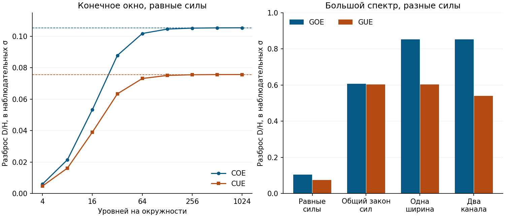

# R141. Какой сигнал стирают усреднение и малая размерность?

Проверка от 22 ноября 2026 года на исходном расчёте `a9d21b18`. При сохранении одного спектра на всей траектории результат с равными силами линий устойчив к увеличению числа уровней. Наибольшее изменение даёт снятие предположения о равных силах. При условных 10% вклада линий и среднем расстоянии 10 кэВ модельная ширина прогноза D/H возрастает с 0,105 до 0,852 наблюдательной ошибки для GOE. При одинаковом законе сил для обоих ансамблей получаются 0,607 и 0,602. Ширина прогноза и способность установить класс спектра — разные результаты. [Числа и проверки](SIGNAL_CHECKS.json) · [исходная постановка, измерения и история](REPORT.md).

## 1. Положения уровней и силы переходов

Для одного и того же набора уровней при всех температурах использована скорость $R/R_0=1+b[\Delta\sum_n A_n w_T(E_n)-1]$. Физический температурный фильтр $w_T$ получен из S-фактора LUNA. В архивной сети рассчитаны выходные фильтры $g_D$ и $g_{\rm He}$. Для независимых от энергий и друг от друга отметок $A_n$ со средним 1 и дисперсией $v$ закон полной ковариации даёт

$$
C_{ij}^{\rm marked}=C_{ij}^{\rm positions}+b^2v\Delta\int g_i(E)g_j(E)\,dE.
$$

Первое слагаемое несёт двухточечную статистику положений. Второе существует даже при фиксированных положениях после усреднения условной дисперсии по спектрам. Оно совпадает с $v$ пуассоновскими вкладами для равносильных линий. Это позволяет менять положения и силы независимо. [Расчёт](averaging.py) · [Портер и Томас](https://doi.org/10.1103/PhysRev.104.483).

| Предположение о силах | GOE, D/H | GUE, D/H | GOE, гелий | GUE, гелий |
|---|---:|---:|---:|---:|
| Все одинаковы | 0,10541 | 0,07569 | 0,0000424 | 0,0000303 |
| Одинаково распределены в обоих ансамблях, $v=1$ | 0,60685 | 0,60240 | 0,000310 | 0,000308 |
| Силу определяет одна нормированная парциальная ширина | 0,85172 | 0,60240 | 0,000436 | 0,000308 |
| Два независимых открытых канала с равными средними ширинами | 0,85172 | 0,53987 | 0,000436 | 0,000276 |

Единица таблицы — одна наблюдательная ошибка соответствующего содержания. Параметры $b=0,1$, $\Delta=10$ кэВ и барионная плотность одинаковы во всех строках. Для одиночной ширины квадрат вещественной гауссовской амплитуды даёт нормированный $\chi^2_1$ с $v=2$ (закон Портера–Томаса), комплексной — нормированный $\chi^2_2$ с $v=1$. В третьей строке на марки приходится 98,47% дисперсии D/H для GOE и 98,42% для GUE. Таким образом, почти всё увеличение ширины получается с одной лишь заменой закона сил. Знакомую пропорцию 2:1 надо сравнивать между **дисперсиями**. Между стандартными отклонениями её квадратный корень.

Что это даёт для распознавания по одному измерению D/H? В дополнительной гауссовой модели заданы равные априорные вероятности, одинаковые центральные значения, независимая гауссова наблюдательная ошибка и дисперсии из таблицы. При оптимальном пороге для модуля отклонения вероятность правильной классификации составляет 50,06% для равных сил, 50,05% для общего закона сил, 52,85% для одиночных ширин и 53,50% для двух каналов. Числа зависят от гауссова приближения и фиксированной плотности барионов. Они не представляют байесовскую оценку по экспериментальным данным.

Для изолированного узкого резонанса сила пропорциональна $\Gamma_a\Gamma_b/\Gamma_{\rm tot}$ с фактором спина. В четвёртой строке приняты только два канала и $\Gamma_{\rm tot}=\Gamma_a+\Gamma_b$. При независимых гамма-ширинах с общей шкалой $S=\Gamma_a+\Gamma_b$ и $r=\Gamma_a/S$ независимы, а сила равна $Sr(1-r)$. После нормировки среднего дисперсии сил равны 2 и 0,8. При иных ветвлениях, коррелированных параметрах, перекрытии резонансов или прямом захвате требуется соответствующее сечение. Перенос закона Портера–Томаса на измеренные ширины сам подлежит проверке. В гамовском окне $d(p,\gamma)^3\mathrm{He}$ наблюдается гладкий захват, и серия требуемых резонансов экспериментально не установлена. Утверждение «у ³He нет состояний вообще» шире данных. Обзор A=3 обсуждает и виртуальные состояния. [Нерезонансная оценка Москосо](https://arxiv.org/abs/2109.00049) · [данные TUNL](https://nucldata.tunl.duke.edu/nucldata/ourpubs/03_2010.pdf) · [границы статистической модели](https://pubmed.ncbi.nlm.nih.gov/26274413/).

## 2. Что делает конечное число уровней

Исходный расчёт использовал объёмные формфакторы бесконечного развёрнутого спектра. В независимом контроле взяты конечные круговые COE/CUE соответствующего класса симметрии. Длина окружности $N\Delta$ растёт при неизменных $\Delta$ и физическом окне. Фильтр периодизуется, все его изображения учитываются. Для CUE использован точный $K_N(m)=\min(|m|/N,1)$ при $m\ne0$, для COE — конечные суммы по формулам Хааке, Зоммерса и Вебера. Вклад постоянной моды числа уровней равен нулю. Для CUE расчёт дополнительно сверен в координатном пространстве по детерминантному ядру. Абсолютная невязка контрольной дисперсии $3,4\cdot10^{-14}$. [Формфакторы, §§III–IV](https://arxiv.org/pdf/chao-dyn/9906024).

| Уровней на окружности | Одинаковые силы, COE | Одинаковые силы, CUE | Независимые ширины, COE | COE, дополнительно фиксирована сумма ширин в каждом спектре |
|---:|---:|---:|---:|---:|
| 4 | 0,0060 | 0,0048 | 2,0587 | 0,0120 |
| 16 | 0,0534 | 0,0391 | 1,0529 | 0,2087 |
| 32 | 0,0879 | 0,0634 | 0,8715 | 0,4650 |
| 64 | 0,1018 | 0,0732 | 0,8514 | 0,6679 |
| 256 | 0,1052 | 0,0755 | 0,8517 | 0,8087 |
| 1024 | 0,1054 | 0,0757 | 0,8517 | 0,8411 |
| Бесконечный объём | 0,1054 | 0,0757 | 0,8517 | 0,8517 |

Все значения — стандартные отклонения D/H в наблюдательных ошибках. Очень короткая окружность со случайными силами многократно повторяет одни и те же линии внутри фильтра. Поэтому малое $N$ может как подавить дисперсию, так и **завысить** её. В последнем столбце гамма-ширины поделены на их среднее в каждой реализации, что вводит отрицательные межуровневые корреляции (распределение Дирихле). При $N=16$ одна операция меняет 1,053 на 0,209. Какую нормировку можно применять к реальным данным, определяет независимое измерение суммарной силы. Для исходного температурного фильтра при 0,5 ГК эффективное число уровней $1/(\Delta\int w_T^2)=22,04$. Для фильтра D/H аналогичная величина $(\int g_D)^2/(\Delta\int g_D^2)=23,73$. Это эффективные числа **в модельном окне**. Реальные резонансные доноры ⁵Li и ⁸Be дают соответственно ноль и один интервал в сравнимом секторе.

Отдельно проверена доступная информация в **одном** наблюдаемом фрагменте спектра. Взяты 400 пар независимых между парами гааровых матриц размера 48, из каждой построены CUE $U$ и COE $U^TU$. Начало фрагмента равновероятно среди уровней. Для одного интервала признак — близость к среднему шагу, для нескольких — среднее отношение меньшего соседнего интервала к большему. AUC измеряет вероятность правильного ранжирования двух спектров разных классов.

| Видимых интервалов | AUC | 95% бутстреп-интервал по парам матриц |
|---:|---:|---:|
| 1 | 0,578 | 0,543–0,618 |
| 4 | 0,618 | 0,579–0,652 |
| 12 | 0,710 | 0,674–0,747 |
| 36 | 0,812 | 0,781–0,838 |

Это результат указанного признака на синтетических спектрах, при известном среднем шаге для однопромежуточного теста. По одному интервалу распределение расстояний в ядре ⁸Be восстановить невозможно. При физическом переносе GUE-подобной арифметической статистики требуется объяснение, почему физический сектор с эффективной симметрией обращения времени должен иметь выбранный класс. [Метод конечного контроля](finite_controls.py) · [обзор ядерных симметрий](https://doi.org/10.1103/RevModPhys.82.2845).

Размер **сети реакций** имеет иной смысл. В опубликованном сравнении LINX, табл. 6, переход от 12 к 61 реакции при фиксированных космологических входах меняет центральный D/H на 0,098% относительно полной сети, гелий совпадает до показанных знаков, литий меняется на 1,174%. Сдвиг D/H по порядку величины сопоставим с шириной исходного равносильного теста (0,090–0,125%). Перенос этого сдвига в дисперсию был бы ошибкой. Наш отклик проверен на архиве восьми нуклидов. Ковариация возмущённых скоростей в расширенной сети здесь не измерена. [Giovanetti и соавторы, табл. 6](https://arxiv.org/html/2408.14538v2#S5.T6).

## 3. Порядок усреднения и нелинейный отклик

**Температура.** В исходном R141 каждый уровень попадает в несколько температурных окон. Корреляция модельных скоростей GOE при 0,5 и 0,8 ГК равна 0,819. Если при расчёте вклада независимых сил каждый временной шаг получает *новый* случайный спектр, исчезают перекрёстные члены $J_i C_{ij}J_j$. При 1, 2, 4 и 8 подразделениях архивного временного интервала остаются соответственно 15,8%, 11,2%, 7,92% и 5,60% правильного стандартного отклонения D/H от флуктуаций сил. Это пример искусственного исчезновения сигнала при уточнении шага. В R141 один и тот же спектр использован на всей истории.

**Энергия и Фурье-сетка.** В коде приложения трапеции наложены на `fftfreq` без перемещения частот в монотонный порядок. Воспроизведены отношения GOE/GUE = 1,38650 и Пуассон/GOE = 4,71992. На том же гамовском окне сумма по модам FFT и увеличение периода до 24 000 кэВ дают 1,38708 и 4,95199. В R141 использована односторонняя сумма, а для пуассоновского случая есть проверка Парсеваля. На гауссовом окне со стандартным отклонением 1, 5, 20 и 50 кэВ отношение GOE/GUE равно 1,031, 1,253, 1,368 и 1,395. Близость к $\sqrt2$ следует из отношения малочастотных наклонов при достаточно широком фильтре. Узкое энергетическое окно имеет другое отношение.

**Среднее после прохождения сети.** Если $F(y)$ — правая часть сети, $F_c$ — вклад возмущённой реакции, то при множителе $1+bm(t)$ возмущение $y=y_0+b u+b^2 v+\ldots$ удовлетворяет
$$
\dot u=Ju+F_c m,\qquad
\dot{\mathbb E v}=J\mathbb E v+\tfrac12 F''{:}\mathbb E(uu^T)+J_c\mathbb E(mu).
$$
Здесь $J=F'$ и $J_c=F_c'$. Мы вычислили эти члены на сохранённой траектории PRIMAT. Для D/H дополнительно учтена кривизна деления на содержание протонов. Получено изменение **среднего содержания**, а не логарифма среднего. Ковариация температурных профилей перенесена через 25 сингулярных мод тепловых окон, отброшенная относительная сумма квадратов менее $3,1\cdot10^{-19}$. Прямой и сопряжённый расчёты первого порядка согласуются. Квадратичные потоки сверены с симметричными разностями нативной правой части. При переходе от 4 к 8 подразделениям все приведённые коэффициенты второго порядка меняются менее чем на 0,1%. [Реализация](curvature.py) · [контрольные числа](SIGNAL_CHECKS.json).

| Силы линий | Средний сдвиг D/H, GOE | Средний сдвиг D/H, GUE |
|---|---:|---:|
| Одинаковые | +0,0000555 σ наблюдений | +0,0000287 σ |
| По одной парциальной ширине | +0,00346 σ | +0,00173 σ |

При $b=0,1$ отношение этой поправки к собственному стандартному отклонению составляет от 0,038% до 0,407% для четырёх случаев D/H. Оценить его как «1%» из одного порядка $b^2$ нельзя. Коэффициент измерен для заданной модели. Остаток третьего и более высоких порядков, физические корреляции между ширинами и энергиями и экспериментальное цензурирование узких уровней могут потребовать отдельного расчёта.

## 4. Три независимые проверки из приложения

**R132 и конечные кольца.** Для кольца длины $n$ с $p$ единицами и $h$ соседними парами 11 после циклического среднего остаётся только $\bar K=((p+h)I-h(S+S^*))/n$ (здесь $n\ge3$). Для двух исходных слов $F_A(t)-F_B(t)=t^3$, где $F=\det(I+tK)$. Определители всех циклических сопряжений совпадают с исходным определителем, поэтому их среднее при $t=1$ даёт 26 и 25. Определитель усреднённой матрицы одинаков. В резольвенте даже без усреднения есть слепая точка $t=(3+\sqrt{21})/2$, тогда как при $t=1$ разность следов равна $-1/26$. Повтор каждого слова $m$ раз даёт блоки между нулями и $F_A^m,F_B^m$, разность логарифмов детерминантов на вершину остаётся $\ln(26/25)/6$. Полный перебор непостоянных двоичных колец с точностью до поворота для $n=6,8,10,12,14$ дал 1/9, 4/16, 9/25, 16/36, 25/49 классов усреднённых матриц, в которых разные исходные слова имеют разные детерминанты. При $n=14$ в одном таком классе встречаются десять различных детерминантов. Это точная потеря информации в выбранной операции и она сохраняется с ростом размера. [Первоначальный сертификат](../HILBERT_POLYA.md) · [перебор](finite_controls.py).

**Игрушечная периодическая модель по мотивам Конна.** На окружности $D=-i\partial_v$ коммутирует со всеми переносами. Сдвиг *всех четырёх* арифметических пиков даёт унитарно эквивалентный $D+|\xi\rangle\langle\xi|$. В приложении названный «относительным» сдвиг всех пиков на 0,37 ячейки при $N=63$ даёт $1,07\cdot10^{-11}$ из-за пересэмплирования. При фиксированном физическом сдвиге 0,037 и $N=31,63,127$ видна максимальная разность уровней 0,00220, $4,69\cdot10^{-12}$, $6,82\cdot10^{-13}$. Положительный контроль сдвигает **только пик $p=2$** на те же 0,037. Получаются 0,0210930, 0,0212036, 0,0212036, а при $N=255$ значение сохраняется. Здесь увеличение размерности устраняет ложный сигнал и сохраняет настоящий сигнал относительного расположения. Это контроль игрушечной модели. Оператор дзета-тройки из него не восстанавливается. Аналогично экспоненциальный наклон $h(u)e^{-\kappa u}$ совместим со свёрткой и сдвигает аргумент преобразования Фурье на $-i\kappa$ там, где интеграл сходится. При вещественном ненулевом $\kappa$ он вообще меняет норму и не коммутирует с инволюцией $h^*(u)=\overline{h(-u)}$.

**R140 и отсечение нулей ζ.** В итоговой части приложения $r=(1,1,0)$ ошибочно назван достижимой конфигурацией. При этом $\lVert r\rVert^2=2>1$, минимальное собственное значение матрицы состояния $(1-\sqrt2)/2<0$. Пять её положительных нормированных чисел служат контрпримером достаточности линейных условий. Увеличение размерности пассивным тензорным множителем $E_1\otimes I$ сохраняет минимальное собственное значение. Для снижения порога требуется изменение измерения или динамики приготовления. В арифметической части перепроверено число положительных ординат до 1010 по mpmath (657). Пороги 596 и 617 ранее получены интервальной арифметикой для абсолютной и относительной ошибки одного сглаженного произведения. Хвост и знак суммы зависят от выбора веса. Порог этого произведения не оценивает мощность теста GOE/GUE. [Формальные проверки R140](../REPORT.md) · [интервальный контроль произведения](../spectral/ARITHMETIC.md).

## 5. Что следует для CCC+TL и физической проверки

При фиксированных $\eta(T)$, слабом секторе, начальных условиях и общем положительном множителе всех ядерных и космологических часов равенство $Y_f[m]=Y_1[m]$ верно для **каждой** реализации $m$. Поэтому равна нулю и дисперсия парной *разности* $Y_f-Y_1$. Собственная дисперсия $Y_1[m]$ по различным микроскопическим реализациям может быть положительной и одинаковой на обоих плато. Утверждение приложения, что в строгом общем масштабировании «вся таблица GOE/GUE нулевая», справедливо только для разности между плато. Само общее масштабирование не скрывает и не генерирует межуровневую статистику. Работа Гупты и Самараса отдельно рассматривает смену барионной плотности. [Первичный расчёт CCC+TL](https://arxiv.org/html/2604.03381v2) · [разбор часов корпуса](../../CCC_BBN_DRIFT_20261113/REPORT.md).

Полином Mossa с единицами и диапазоном добавлен в основной CHECKS.json. Коэффициенты уже входили в исполняемый исходник предыдущей ревизии. При одинаковых массах и квадратуре постоянный $S=0,214$ эВ·б даёт 30,336, полином — 128,906 см³ моль⁻¹ с⁻¹ при 0,5 ГК. Отношение интегралов соответствует эффективному $S=0,9093$ эВ·б. В строке приложения с вычислением $Y_p$ пропущен $b=0,1$; верно $0,00004244\,\sigma_{\rm obs}$ для равносильного GOE. Диапазон 0,057–0,216% относится к ³He(d,p)⁴He, а интеграл Mossa относится к d(p,γ)³He. [Измерение LUNA](https://www.pure.ed.ac.uk/ws/portalfiles/portal/166986970/mossa_nature_R2.pdf) · [резонансный донор](https://arxiv.org/abs/1809.06966) · [параметры для повтора](CHECKS.json).

Для проверки физической связи сильнее всего изменит вывод независимая серия одной симметрии с **измеренными энергиями, парциальными ширинами, разрешением и эффективностью регистрации**. На ней можно зафиксировать среднюю плотность и закон сил, а затем проверить корреляции положений и совместное распределение «энергия–ширина» на отложенных данных. В рассмотренном нерезонансном канале спектр такого типа не наблюдался. Приведённые числа характеризуют чувствительность измерения к заданному спектру.
