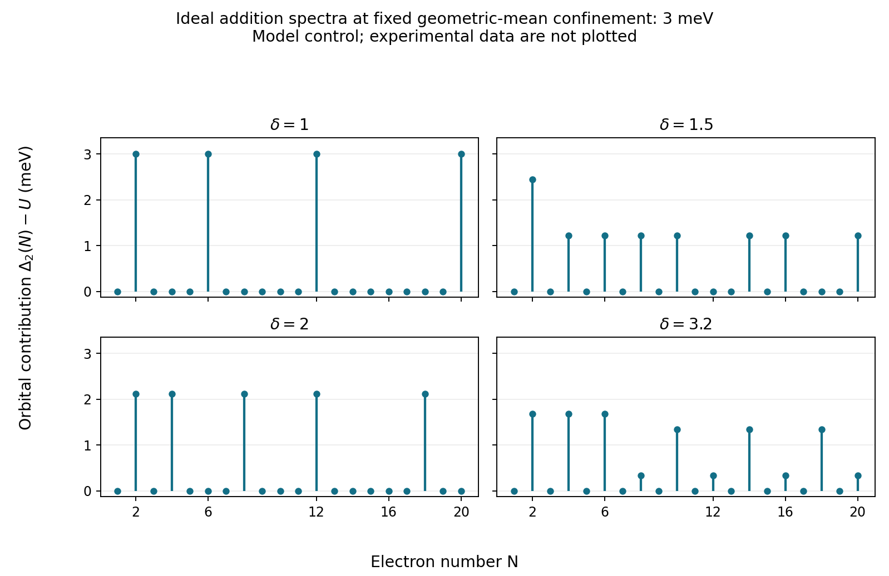

# R143 · Квантовые точки Tarucha ↔ E002c

23 ноября 2026 года. Родители: **R143 / R142 / R022 / C016**, свидетельство **E01**.

**Сопоставление выполнено.** Разобраны приборы, спектр добавления и деформация у Tarucha–Austing; восстановлены точные транспортные доноры E002c; выполнены контроль спектра, проверка геометрического предположения и расчёт закреплённых операторов. Полученный результат определяет границу переноса: имеющаяся E002c не предсказывает электронный спектр добавления одиночной точки Tarucha. Общий статус R143 и научная приёмка остаются открытыми.

Основные результаты:

- При круглом гармоническом удержании воспроизведён идеальный ряд **2, 6, 12, 20, 30, 42**. В статье Tarucha 1996 экспериментально выделены оболочечные максимумы **2, 6, 12**. Наличие токовых пиков при больших заполнениях не является измерением оболочечного максимума в каждом следующем числе ряда.
- При отношении частот **δ=2** тот же одночастичный расчёт даёт **2, 4, 8, 12, 18, 24, 32, 40** в диапазоне до 42. Изменение потенциала меняет ряд даже при сохранении геометрического среднего частот.
- Подстановка **δ=L/S** из геометрии мезы предсказывает номер первой восходящей пары **3, 3, 3** для X/Y/Z; опубликовано **3, 5, 4**. Такое отождествление не проходит проверку для Y и Z. Интервалы δ, выведенные авторами из тех же рангов, не являются независимым измерением δ.
- В определённом кодом операторе E002c число возбуждений имеет только значения **0, 1, 2, 3**, с размерностями секторов **27, 81, 81, 27**. Секторов N=6 и N=12 в этом зарядовом описании нет. Сектор N=2 сам по себе также не задаёт двухэлектронную оболочку с физическим спином и орбиталями.
- Точный транспортный контроль Emary воспроизводит **I(0)=I(π)=0**, **I(π/2)=4/15**. В полной E002c соответствующий одночастичный вектор невидим стоку, но интенсивность действия источника на него равна **0,25**. Поэтому перенос тёмности гамильтониана в стационарную блокировку полной сети требует отдельной проверки.

[Машинный результат](results/SUMMARY.json) · [Приборы и исходные факты](DEVICES.json) · [Источники и хеши](SOURCES.json) · [Замороженный протокол](LOCK.json)

## 1. Что измерено у Tarucha

Для основного состояния с N электронами определяем

$$
\mu(N)=E(N)-E(N-1),\qquad
\Delta_2(N)=\mu(N+1)-\mu(N)=E(N+1)-2E(N)+E(N-1).
$$

Здесь сопоставляется именно **Δ₂(N)**. Она определяется расстоянием между соседними кулоновскими пиками после перевода напряжения затвора в энергию. Высота пика и стационарный ток через сеть — другие наблюдаемые. В работе 1996 термин «addition energy» используется для обсуждаемого межпикового энергетического интервала; в работе 1999 различие μ и Δ₂ записано явно. [Tarucha 1996, Fig. 1 и с. 3614](https://doi.org/10.1103/PhysRevLett.77.3613) · [Austing 1999, §III](https://arxiv.org/abs/cond-mat/9905135v1).

| Прибор 1996 года | Геометрия и условия | Опубликованная наблюдаемая и диапазон | Проверяемое следствие |
|---|---|---|---|
| D=0,50 мкм | Вертикальная одиночная точка; 12-нм квантовая яма, барьеры 9 и 7,5 нм; электронная температура около 0,2 K | Δ₂(N) на Fig. 1(b), усиленные интервалы при N=2,6,12. На Fig. 2 — первые 24 токовых пика в поле; чётно-нечётное спаривание описано до N=40 | Круглый спин-вырожденный потенциал даёт оболочки 2,6,12,…; спектр в поле проверяет орбитальное назначение |
| D=0,44 мкм | Второй прибор с круглой мезой той же платформы | Второй спектр Fig. 1(b); текст сообщает усиление при N=2,6,12 для обоих приборов | Повторение первых трёх оболочек в другом приборе; абсолютные энергии нельзя переносить без его собственной калибровки |

Диаметр мезы не равен эффективному диаметру электронной области. Для прибора D=0,50 мкм авторский коэффициент перевода напряжения в энергию меняется примерно от **57 до 42 мэВ/В** между N=1 и N=6 и до **33 мэВ/В** около N=20. Поэтому одного постоянного множителя для всего экспериментального спектра недостаточно. Управление заполнением от нуля до более чем 40 электронов не означает наблюдение замыканий 30 и 42. [Tarucha 1996, с. 3614](https://www.physics.rutgers.edu/grad/682/papers/tarucha_shell_structure.pdf).

## 2. Деформация: четыре прибора и различающий контроль

Нужная работа о деформации — **Austing, Sasaki, Tarucha, Reimann, Koskinen, Manninen, PRB 60, 11514 (1999)**. Для W/X/Y/Z опубликованы Δ₂(N) до **N=17**, B=0, T≤0,3 K. Приведённые ниже четыре энергии взяты из авторского текста, а не считаны с вертикально сдвинутых кривых. Статистические ошибки этих четырёх чисел в использованном тексте не заданы. [§II–V, Fig. 3 и 5](https://arxiv.org/abs/cond-mat/9905135v1).

| Прибор | Меза, мкм | βмеза=L/S | Δ₂(4), мэВ | Номер первой восходящей пары в поле | Интервал δ по интерпретации этой же пары |
|---|---|---:|---:|---:|---|
| W | Круг, D=0,50 | 1 | 3,1 | Отдельно исследуется спаривание второго слоя | Круглый эталон δ=1 |
| X | 0,55×0,40 | 1,375 | 2,7 | 3 | 1<δ<2 |
| Y | 0,65×0,45 | ≈1,44 | 3,1 | 5 | 3<δ<4 |
| Z | 0,60×0,40 | 1,50 | 2,5 | 4 | 2<δ<3 |

**βмеза и δ — разные параметры.** Первый относится к металлическому контакту и задан геометрией; второй равен отношению энергий удержания по короткой и длинной осям, δ=Eₛ/Eₗ. Действительный потенциал зависит от обеднённой области и напряжения затвора, то есть от N. Значения δ в последнем столбце условны: они получены в одночастичной интерпретации рангов, без независимого измерения потенциала.

Выполненный отрицательный контроль использует геометрию как вход, без подбора по рангу. Для нецелого δ у орбитали (nₗ,nₛ)=(0,1) ровно `floor(δ)+1` нижележащих пространственных уровней, поэтому её номер равен `floor(δ)+2`. При предположении δ=βмеза все три мезы дают номер **3**. Это совместимо с X и расходится с **Y: 5** и **Z: 4**. Даже порядок деформаций, выводимый из спектра, получается W–X–Z–Y вместо геометрического W–X–Y–Z. Это ретроспективная проверка конкретной подстановки; статистической значимости и слепого подтверждения ей не приписывается. [Авторская интерпретация, §V](https://arxiv.org/abs/cond-mat/9905135v1).

Fig. 3 в доступном PDF — растровое изображение: точного векторного набора экспериментальных координат нет. Кривые разнесены по вертикали на 3 мэВ. Здесь сохранены авторские числовые значения, диапазоны и назначения пиков; новый точечный фит всей экспериментальной кривой не выполнялся. Векторную Fig. 4, содержащую результаты SDFT, нельзя подставлять вместо экспериментальной Fig. 3.

## 3. Выполненный спектральный расчёт

Зафиксирована одночастичная модель Fig. 2 работы 1999 при B=0:

$$
\epsilon_{n_Ln_S}=(n_L+\tfrac12)E_L+(n_S+\tfrac12)E_S,
\quad E_L=\frac{E_Q}{\sqrt\delta},\quad E_S=E_Q\sqrt\delta,
\quad E_Q=3\ \mathrm{мэВ}.
$$

Каждая пространственная орбиталь имеет два спиновых состояния. Для контрольной модели постоянного зарядового взаимодействия

$$
E(N)=\sum_{i=1}^{N}\epsilon_i+\tfrac12 U N(N-1),
\qquad \Delta_2(N)-U=\epsilon_{N+1}-\epsilon_N.
$$

Вычислены **168 значений**: N=1…42 при δ=1; 1,5; 2; 3,2. Постоянная U оставлена символической и вычтена; её не подбирали под опыт. Вычисление второй разности E(N) независимо согласуется с разностью соседних уровней. Удвоение орбитального обрезания не меняет сохранённый спектр; первый исключённый уровень расположен выше всех используемых уровней.

| Условие | N с положительной орбитальной щелью до N=42 |
|---|---|
| δ=1 | 2, 6, 12, 20, 30, 42 |
| δ=2 | 2, 4, 8, 12, 18, 24, 32, 40 |



Это воспроизведение идеального механизма оболочек и его чувствительности к деформации. Авторский SDFT здесь не воспроизводится: у него есть взаимодействия, обмен и N-зависимый масштаб удержания. В частности, круглая модель без обмена даёт **Δ₂(4)−U=0**, поэтому сама не описывает повышенные полузаполненные пики W при N=4,9,16 и спиновое правило Хунда. Значение 3,1 мэВ в таблице не является остатком относительно нуля: оно включает зарядовый вклад. [Полный ряд](results/addition_spectra.csv).

## 4. Точное сопоставление с E002c и донорами

| Свойство | Одиночная точка Tarucha–Austing | Emary 2007 | Донор R022: Pöltl–Emary–Brandes 2013 | Собственная модель E002c |
|---|---|---|---|---|
| Носитель | Многоорбитальная точка с физическим спином | Одна тройная точка, три туннельные связи | **Две** связанные тройные точки; в каждой связи 1↔3 и 2↔3 | Три узла-кубита и три связи-qutrit 0/R/L |
| Заполнение | Электроны N в одной точке; спектр 1999 до 17 | Не более одного дополнительного электрона во всём приборе | Не более одного электрона в каждой тройной точке | Число узловых возбуждений 0…3; трёхуровневые связи не являются дополнительными электронными орбиталями |
| Контакты | Вертикальные исток и сток; затвор меняет N | Два источника, один сток | Два источника и один сток для каждой тройной точки | Источник на узле 0, сток на узле 2 |
| Наблюдаемая | Δ₂(N), движение пиков в поле, спиновое заполнение | Ток, шум, зависимость от потока | Спиновый синглет двух электронов и транспортная блокировка | Потоки, конфигурации связей, тёмные подпространства, запутанность выбранных кубитных разбиений |
| Необходимый перенос | Геометрия → потенциал → уровни → Δ₂(N) | Ограничение зарядовых секторов и скачки контактов | Явный физический спин, межсистемные Coulomb и обмен | Эти физические отображения и энергетическая калибровка отдельно не заданы |

[Emary, PRB 76, 245319 (2007), Eq. 1–2](https://arxiv.org/abs/0705.2934) · [Pöltl et al., PRB 87, 045416 (2013)](https://arxiv.org/abs/1209.0992v2). Работа Pöltl–Emary–Brandes **2009** о двух электронах в одной тройной точке — другой источник; ею нельзя подменять донор R022.

В E002c не установлены равенства **δ↔epsilon**, **температура↔gamma**, **мэВ↔J=1**. `epsilon*n1` задаёт локальный детюнинг, `gamma` — скорость дефазировки. Петлевая фаза Φ=θ₀₁+θ₁₂−θ₀₂ может описывать интерференцию, но перевод B→Φ требует площади петли и заряда; он не воспроизводит автоматически орбитальные и зеемановские сдвиги одиночной точки. Транспортные h=I₀₂+I₁₂ и F=κout⟨n₂⟩ также не являются Δ₂(N).

## 5. Контроль транспортного механизма и допустимых секторов

### Проверка донора Emary

Из Eq. 1–2 независимо решена четырёхмерная задача стационарного состояния с вакуумом и тремя одноэлектронными состояниями. При t₁₂=t₁₃=t₂₃=Γ=1, Δ=ε=0 и без дефазировки аналитическое следствие Eq. 7:

$$
I(\phi)/e=\frac{4\sin^2\phi}{1+14\sin^2\phi}.
$$

| φ/π | 0 | 1/4 | 1/2 | 3/4 | 1 |
|---|---:|---:|---:|---:|---:|
| I/e, модельные единицы | 0 | 1/4 | 4/15 | 1/4 | 0 |

Численное решение совпало с формулой с максимальной абсолютной разностью **2,8×10⁻¹⁶**. Проверены единственность нормированного стационарного состояния, след, эрмитовость, положительность в численном допуске и период π. Машинные отрицательные значения около нуля сохранены в JSON как погрешность округления. Это контроль донора; равенства его тока току E002c не утверждается.

### Проверка настоящих операторов E002c

Использованы точные байты двух файлов производства **acb401f9972e064779a7c7345938cb1aea2997f6**. Их копии в `inputs/` сверяются по SHA-256 до выполнения. Эти же байты присутствуют в калибровочном ca15a197 и repair ae867241; исходный производственный расчёт не заменён новым. [Операторная модель](https://github.com/IgorSabirov/vm-lab/blob/acb401f9972e064779a7c7345938cb1aea2997f6/e002_exp/model.py) · [Наблюдаемые E002c](https://github.com/IgorSabirov/vm-lab/blob/acb401f9972e064779a7c7345938cb1aea2997f6/e002c_exp/model.py).

$$
\mathcal H=(\mathbb C^2)^{\otimes3}\otimes(\mathbb C^3)^{\otimes3},
\quad \dim\mathcal H=216,\qquad N_{\rm exc}=n_0+n_1+n_2.
$$

| Nexc | 0 | 1 | 2 | 3 |
|---|---:|---:|---:|---:|
| Размерность сектора | 27 | 81 | 81 | 27 |

Проверены [H,Nexc]=0, сдвиги числа источником и стоком на ±1 и тождество

$$
\mathcal L^\dagger N_{\rm exc}=\kappa_{\rm in}(1-n_0)-\kappa_{\rm out}n_2.
$$

Максимальная невязка этих балансов **4,44×10⁻¹⁶**. Операторы повышения разных узлов коммутируют как операторы разных кубитов; они не являются непосредственно каноническими фермионными операторами без отдельного отображения.

Для всех восьми масок связей проверено инвариантное тёмное подпространство при Φ=0,π/2,π: **24 контроля**. У полной маски его размерности **1,0,1**. Однако для замороженных связей LLL и

$$
|D\rangle=(|100\rangle-|010\rangle)/\sqrt2
$$

получено `||L_sink D||²=0`, но `||L_source D||²=κin/2=0,25`. Источник создаёт компоненту с двумя возбуждениями. Поэтому одночастичная тёмность не даёт поглощающее состояние полной E002c. Этот контроль согласуется с прежним разбором доноров; он не объявляется новым экспериментальным эффектом.

E002c ранее уже исполнялась: исправленный отчёт содержит **74 траектории**, 2,3 млн шагов и 9,2 млн RHS; сам repair исправлял обработку без новых траекторий. Историческая фраза «основная серия не запускалась» в раннем E002c.md не является текущим статусом. [Зафиксированный отчёт](https://github.com/IgorSabirov/vm-lab/blob/7fd36d60044b436484e81a5e92a80163c4688b45/results/E002c_REPAIR_v001_r001/files/RESULT.md).

## 6. Воспроизведение и статус

Требуются Python, NumPy, SciPy; Matplotlib используется только для рисунка. В фактическом расчёте: Python 3.12.14, NumPy 2.3.5, SciPy 1.17.0. Из корня репозитория:

```bash
OPENBLAS_NUM_THREADS=1 OMP_NUM_THREADS=1 python analysis/R143_PHYSICAL_GENEALOGY/quantum_dots/replay.py
OPENBLAS_NUM_THREADS=1 OMP_NUM_THREADS=1 python analysis/R143_PHYSICAL_GENEALOGY/quantum_dots/replay.py --check
```

Протокол и хеши входов/кода зафиксированы до итогового исполнения. Предшествующий операторный замер занял 0,0544 с. Прогноз для конечного численного пакета — 2 с, диапазон 0,05–10 с; факт **0,2263 с**. Вместе с рисунком и записью файлов — **0,8618 с**. Поиск источников, подготовка и публикация не включены в машинное время. [Квитанция](results/RUN_RECEIPT.json).

**Было → выполнено → стало:** донорская ссылка без спектрального отображения → приборная таблица, раздельные наблюдаемые, расчёт оболочек/деформации, точный контроль донора и операторов E002c → установленная адресная граница переноса с воспроизводимыми числами.

Чтобы получить предсказание экспериментального Δ₂(N) из новой модели, нужны собственные зарядовые сектора, спин и орбитали, потенциал удержания с независимой калибровкой, зарядовое взаимодействие и перевод затвора в энергию для конкретного прибора. Для сравнения абсолютных остатков нужны числовые спектры и их ошибки. Повтор прежних транспортных траекторий E002c этих величин не добавит. **Сопоставление E01 завершено; утверждение о воспроизведении спектров Tarucha моделью E002c не установлено, `scientific_acceptance=false`.**
