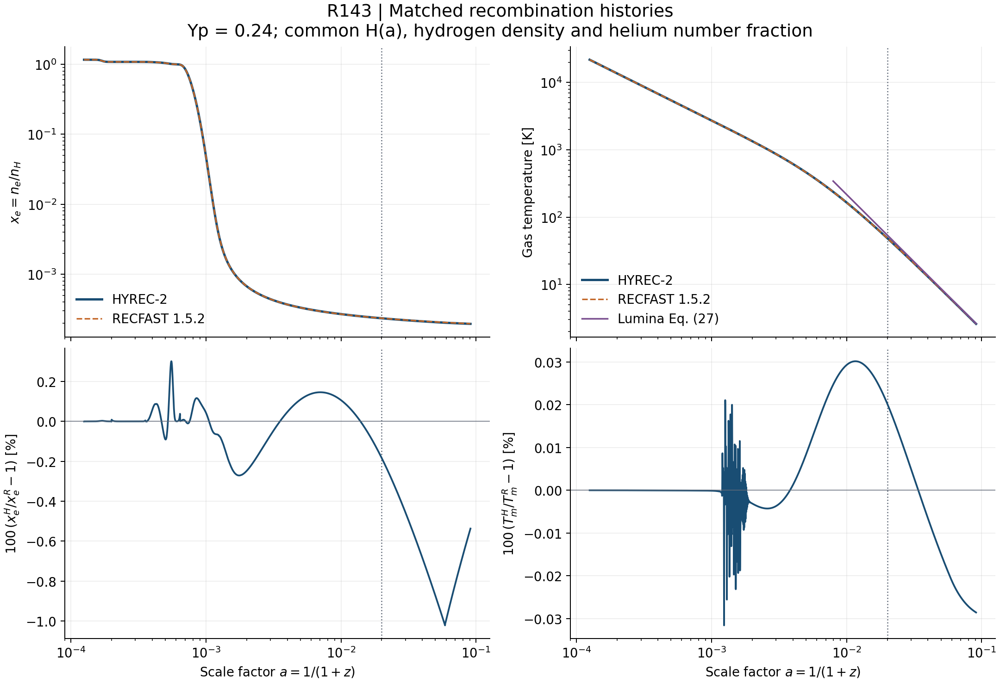

# R143: HYREC-2 и RECFAST при одном Yp

Дата: 23 ноября 2026. Связи: R143/E06, E07, E10 → R138/U014 → граница R137/Lumina.
Статус исполнения: **выполнено, истории и численные контроли сохранены**.
Научная приёмка: **не объявлена**; R143 и U014 остаются OPEN.

## Полученный результат

При одном `Yp=0.24`, одной плотности ядер водорода, одном отношении He/H и
одном фоне H(z) непосредственно исполнены HYREC-2 SWIFT и RECFAST 1.5.2.
На границе `a=1/50`, `z=49` основная замороженная пара даёт:

| Величина | RECFAST | HYREC-2 | HYREC-2 − RECFAST | Относительно RECFAST |
|---|---:|---:|---:|---:|
| Tgas, K | 48.7596664821 | 48.7695374185 | +0.0098709364 | +0.0202441% |
| xe = ne/nH | 0.0002352123960 | 0.0002347812744 | −0.0000004311216 | −0.1832903% |

Общий H(49) = 4.34532504587×10⁻¹⁶ s⁻¹, Tγ(49) = 136.275 K.
Дополнительные уменьшения шага HYREC дают Tgas(49) = 48.7698324224 K;
последнее изменение составляет 5.25×10⁻⁶ K. Контрольная пара
HYREC 0.0005 / RECFAST Nz=20000 даёт
ΔT = +0.0101659441 K (+0.0208491%), Δxe/xe_RECFAST = −0.1815877%.
Это измеренная устойчивость граничного значения, а не доказанная погрешность
или экстраполяция на нулевой шаг.

Формула Lumina (27), Tgas = 2.7255(1+z)²/125.8, даёт на этой границе
54.1633545310 K; в тексте статьи напечатано 54.17 K.
Основные расчётные температуры ниже формулы на 5.40369 и 5.39382 K,
то есть на 9.97665% и 9.95843% **при знаменателе T_Lumina**.
В данном согласованном стандартном фоне замена RECFAST на HYREC-2 не объясняет
это различие тепловых предписаний. Расчёт не устанавливает ошибку Lumina и
не воспроизводит её реальные файлы начальных условий.

**Было → действие → получено → стало.** В R138 имелось сопоставление границы
с интерполированной сторонней RECFAST-таблицей, содержащей другие параметры
и YHe=0.25. Теперь обе истории исполнены заново с одинаковыми входами Lumina,
а различия нормировок и численного разрешения вынесены в отдельные контроли.
Прежнее сравнение не используется как измерение разницы двух решателей.
Тепловая часть задачи получила воспроизводимый результат; возмущения, streaming
и фактические Lumina IC остаются незакрытой частью U014.

## Зафиксированные входы

Входы и основной код опубликованы **до исполнения** в
[ce7d57962c287c30bc8d591d2c558aa2ea78be5d](https://github.com/IgorSabirov/vm-lab/commit/ce7d57962c287c30bc8d591d2c558aa2ea78be5d).
Полный контракт и хеши: [LOCK.json](LOCK.json).
Поле `parent_commit` в LOCK обозначает научную опорную версию R143;
фактический Git-родитель фиксации также сохраняет параллельные дополнения SPARC.

| Параметр | Использованное значение |
|---|---:|
| H0 | 67.66 km s⁻¹ Mpc⁻¹ |
| Ωm / Ωb / Ωc | 0.3096 / 0.04897 / 0.26063 |
| ωb / ωc | 0.0224178568132 / 0.1193131717628 |
| Tcmb0 | 2.7255 K |
| Yp, массовая доля He | **0.24**, автоматический BBN отключён |
| Neff; массивные нейтрино | 3.046; отсутствуют |
| Ωk; w; wa | 0; −1; 0 |
| ΩΛ | 0.6903086103885309, из замыкания плоского фона |
| nH0 | 1.9122166025036682×10⁻⁷ cm⁻³ |
| fHe = nHe/nH | 0.07951538891741466 |
| Реонизация; внешняя инжекция энергии | отключены; отсутствует |

Параметры взяты из Table 2 и §§5.3, 5.4, 8.4
[Lumina, arXiv:2605.15310v1](https://arxiv.org/html/2605.15310v1).
Печатное ΩΛ=0.6903 округлено; здесь ΩΛ=1−Ωm−Ωγ−Ων, с
Ωγ=0.0000540201513524 и Ων=0.0000373694601167.
Напечатанные Tν=1.9524 K и Neff=3.046 не совпадают с формулой (26) на
указанной точности. Зафиксировано Neff=3.046; формула даёт Tν≈1.95278359 K.
Эти две печатные величины одновременно не навязываются фону.

HYREC получает H(z) прямым callback из того же CAMB background, который
использует RECFAST. Отдельной приближённой таблицы расширения нет.
Единицы callback проверены обратным преобразованием в восьми точках;
максимальный относительный остаток 2.22×10⁻¹⁶. При уточнении RECFAST фон
на всех выходных узлах остался тем же.

Общие `nH0` и `fHe` заданы явно: одинаковая массовая доля сама по себе
оставляет небольшую разницу констант перевода в двух кодах.
Штатные HYREC-значения составляют 1.912270807905817×10⁻⁷ cm⁻³ и
0.07951330436486959. Их отдельный контроль изменяет Tgas(49) на −0.000405564 K
и xe(49) на −6.93374×10⁻⁹. Основная пара использует общую нормировку.
Атомные константы и эффективные радиационные приближения кодов не уравнивались.

## Реальные реализации и сетка

| Код | Закреплённая реализация |
|---|---|
| HYREC-2 | [nanoomlee/HYREC-2, 038dc8d71baed5c30a4fdd55576b97637ba5b879](https://github.com/nanoomlee/HYREC-2/tree/038dc8d71baed5c30a4fdd55576b97637ba5b879), модель SWIFT=4 |
| RECFAST | [CAMB 1.6.5, 53c1f1c0208f75223cf3da2b163187deb7310f42](https://github.com/cmbant/CAMB/tree/53c1f1c0208f75223cf3da2b163187deb7310f42), RECFAST 1.5.2 |
| forutils | 841f06d5356877e90437f94b2d976dd98f7f923c |

Исполнен сам HYREC-2. Настройка RECFAST, подогнанная под HYREC и названная
`hyrec`, его не заменяет. Основной CAMB собран из закреплённых исходников;
исходная и уточнённая версии используют один GNU Fortran 14.2.0.
HYREC собран GCC 14.2.0 с поддерживаемым upstream интерфейсом `-DCAMB`.
Квитанции: [CAMB_BUILD.json](CAMB_BUILD.json), [HYREC_BUILD.json](HYREC_BUILD.json),
[RUN_RECEIPT.json](results/RUN_RECEIPT.json).
HYREC_BUILD содержит хеш Python-обёртки на момент сборки; перед фиксацией
из неё удалена одна пустая строка в конце файла. Её исполняемый хеш записан
в LOCK, RUN_RECEIPT и NUMERICAL_FOLLOWUP. Сравнение файлов подтверждает,
что это единственное различие; C-адаптер и собранная библиотека не менялись.

RECFAST использует fudgeH=1.125, fudgeHe=0.86, Heswitch=6, Hswitch=true
и штатные Gaussian corrections; все значения записаны в LOCK и CAMB_params.txt.
Основной шаг HYREC Δln(a)=0.004; RECFAST: Nz=10000, Δz=1, DVERK tol=10⁻⁵.
Выходная сетка содержит **6023 узла**, 10≤z≤8000, включая ровно z=49,
и одинакова для всех сравнений. `a=1/(1+z)`, `xe=ne/nH`, Tgas в K.

## Остатки по эпохам

Здесь `max |Δq/q|` означает максимум по выходным узлам данной эпохи,
со знаменателем RECFAST. Это измеренные остатки сохранённых расчётов;
глобальная сходимость всей истории не установлена — см. следующий раздел.
Уточнённая пара в этой таблице: HYREC 0.002 и RECFAST Nz=20000.

| Диапазон z | Основная xe, % | Уточнённая xe, % | Основная Tgas, % | Уточнённая Tgas, % |
|---|---:|---:|---:|---:|
| 4000–8000 | 0.008600 | 0.008606 | 0.00001312 | 0.00001312 |
| 1600–4000 | 0.301211 | 0.303521 | 0.00005135 | 0.00005131 |
| 500–1600 | 0.271145 | 0.266275 | 0.031592 | 0.017230 |
| 50–500 | 0.248850 | 0.244883 | 0.030167 | 0.030630 |
| 10–50 | 1.022085 | 1.018720 | 0.028572 | 0.027902 |

Знаки, абсолютные максимумы и положения экстремумов сохранены в
[SUMMARY.json](results/SUMMARY.json). Интервалы включают обе границы;
соседние строки поэтому могут иметь общую граничную точку.
Область z<49 — формальное продолжение однородного расчёта без реонизации,
а не последующая эволюция Lumina. Около z≈16 расхождение xe достигает ≈1%;
upstream HYREC в области низких температур переходит к приближению Peebles.
Это ограничение нельзя переносить на полностью моделируемую позднюю Вселенную.



На графике показана основная пара, вертикаль `a=0.02` отмечает границу.
Кривая формулы Lumina проведена только при z≤124.8. Колебания температурного
остатка в эпоху рекомбинации зависят от шага; их нельзя целиком отнести
к физическому различию решателей.

## Численные контроли и обнаруженное ограничение

Уточнение RECFAST выполнено отдельной сборкой: Nz=20000, Δz=0.5,
DVERK tol=10⁻⁶. Пять кривизненных членов кубического сплайна умножены
на необходимый Δz²; на штатной сетке Δz=1 этот множитель равен единице.
Это масштабирование интерполяции, а не изменение рекомбинационных уравнений.
Точный [патч](recfast_refinement.patch) и его хеш сохранены.
Контроль `AccuracyBoost=2`, `BackgroundTimeStepBoost=2` записан отдельно:
он уточняет внешнюю выборку CAMB, не нативный шаг RECFAST.

| Контроль при z=49 | Изменение Tgas, K | Изменение xe |
|---|---:|---:|
| HYREC 0.004 → 0.002 | +2.66567×10⁻⁴ | +3.61929×10⁻⁹ |
| HYREC 0.002 → 0.001 | +2.31855×10⁻⁵ | +3.14071×10⁻¹⁰ |
| HYREC 0.001 → 0.0005 | +5.25114×10⁻⁶ | +7.13721×10⁻¹¹ |
| RECFAST: внутреннее уточнение | −3.76318×10⁻⁹ | −5.12129×10⁻¹⁴ |
| RECFAST: внешняя выборка CAMB | +7.12980×10⁻¹⁰ | +2.87991×10⁻¹⁶ |

После основного расчёта обнаружена чувствительность температурного остатка
в районе z≈800. Поэтому до двух дополнительных запусков был сохранён
[NUMERICAL_FOLLOWUP.json](NUMERICAL_FOLLOWUP.json), содержащий основание,
ровно два шага 0.001/0.0005 и хеши неизменяемых первичных результатов.
Это последующая численная диагностика, не часть исходной фиксации.
Её полные результаты: [CONVERGENCE.json](results/CONVERGENCE.json).

Для z≥49 максимальное изменение Tgas между последовательными шагами
0.004→0.002→0.001→0.0005 уменьшается: 0.60750 → 0.40195 → 0.11402 K.
Но шаг **0.001** даёт локальные выбросы xe относительно 0.002:
около z=2845.60 — 0.15869 (≈14.7%), около z=1544.74 — 0.24881 (≈25.3%).
В шагах 0.004, 0.002 и 0.0005 сопоставимых провалов на этих участках нет.
Последний шаг не превращает всю последовательность в доказательство сходимости.
Отклонение 0.001 от 0.0005 превышает 1% на 392 узлах при
1857.94≤z≤2848.73 и ещё на 11 узлах при 1531.22≤z≤1548.14;
это не одиночные интерполяционные пики. При 0.0005 остаются три малых
нарушения монотонности в гелиевом окне 2800≤z≤2900, с максимумом
|xe(0.0005)−xe(0.002)|=1.86039×10⁻⁴. Этот шаг тоже не принят за
сошедшийся эталон всей истории.

Два независимых статических чтения проверили согласованность `cosmo->dlna`,
размера `Nz`, выделения обеих выходных историй и интерполяции. Несоответствия
шага или размера буферов не обнаружено. Upstream прямо допускает уменьшение
DLNA_SWIFT. Области выбросов совпадают с переходами post-Saha/интегрирование,
где включаются и выключаются десятикратные субшаги; конкретный механизм
выброса внутренней трассой не доказан. Исходный атомный код не исправлялся,
дополнительные провалы сохранены в CSV и не объявлены физическим эффектом.

**Область достоверного вывода:** граничное значение z=49 устойчиво во всех
четырёх шагах; исходные истории действительно посчитаны и сопоставлены.
**Остаётся открытым:** численная причина локальных выбросов контрольного шага
0.001 и полная сходимость истории в переходных областях. Измеренный сдвиг
последнего шага не является строгой оценкой погрешности.

## Воспроизведение и артефакты

[build.py](build.py) собирает закреплённые исходники, основную и уточнённую
версии RECFAST и HYREC-библиотеку. Нужны Python с numpy/scipy/matplotlib,
git, make, gcc и gfortran; системные пакеты скрипт не устанавливает.
Использованные сборки реально выполнены соответствующими командами.
Переносимый build.py проверен на синтаксис и CLI; отдельная чистая полная
пересборка именно этим объединённым скриптом в данной сессии не выполнялась.

Из корня репозитория, задав отдельные каталоги для зависимостей и новых результатов:

```bash
PACKAGE="$PWD/analysis/R143_PHYSICAL_GENEALOGY/recombination"
R143_BUILD="$PWD/.r143-recombination-build"
R143_OUT="$PWD/.r143-recombination-rerun"
python "$PACKAGE/build.py" --package-dir "$PACKAGE" --work-dir "$R143_BUILD"

OMP_NUM_THREADS=1 OPENBLAS_NUM_THREADS=1 python "$PACKAGE/experiment.py" \
  --camb-root "$R143_BUILD/compiled_base" \
  --hyrec-root "$R143_BUILD/HYREC-2" \
  --hyrec-library "$R143_BUILD/libhyrec_r143.so" \
  --build-receipt "$R143_BUILD/compiled_base/camb/R143_BUILD.json" \
  --output-dir "$R143_OUT"

OMP_NUM_THREADS=1 OPENBLAS_NUM_THREADS=1 python "$PACKAGE/experiment.py" \
  --mode recfast-control --control-name recfast_internal_refined \
  --camb-root "$R143_BUILD/compiled_fine" \
  --build-receipt "$R143_BUILD/compiled_fine/camb/R143_BUILD.json" \
  --output-dir "$R143_OUT"

python "$PACKAGE/analyze.py" --data-dir "$R143_OUT"
python "$PACKAGE/verify.py"
```

`verify.py` проверяет опубликованный пакет по сохранённым массивам, без нового
физического прогона. Пройдены 85 проверок целостности и числового замыкания;
они также воспроизводят обнаруженные выбросы и не являются научной приёмкой.
Для строгого повтора дополнительной диагностики
[convergence.py](convergence.py) требует бинарные SHA из NUMERICAL_FOLLOWUP,
исходную выходную сетку и неизменные первичные файлы. Команда:

```bash
OMP_NUM_THREADS=1 OPENBLAS_NUM_THREADS=1 python "$PACKAGE/convergence.py" \
  --camb-root "$R143_BUILD/compiled_base" \
  --hyrec-root "$R143_BUILD/HYREC-2" \
  --hyrec-library "$R143_BUILD/libhyrec_r143.so" \
  --output-dir "$R143_OUT/additional"
```

При другой среде сборки бинарные SHA могут отличаться: этот строгий повтор
остановится. Для новой среды нужен отдельный явно подписанный план с её
квитанциями; исходный NUMERICAL_FOLLOWUP не следует переписывать.

| Артефакт | Содержание |
|---|---|
| [histories.csv](results/histories.csv) | Основная пара, половинный шаг HYREC, контроль нормировки, внешняя выборка CAMB |
| [recfast_internal_refined.csv](results/recfast_internal_refined.csv) | RECFAST с уточнёнными внутренними параметрами |
| [hyrec_additional_steps.csv](results/hyrec_additional_steps.csv) | Два последующих шага HYREC, включая обнаруженные выбросы |
| [SUMMARY.json](results/SUMMARY.json) | Граница, эпохи, исходные контроли и хеши |
| [CONVERGENCE.json](results/CONVERGENCE.json) | Все пары разрешений и сравнение с уточнённым RECFAST |
| [CHECKS.json](CHECKS.json) | Проверка целостности и числового замыкания по сохранённым данным |
| [comparison.svg](results/comparison.svg) | Векторный график основной пары |

План основной серии: менее 30 s для трёх HYREC-историй плюс секунды на CAMB.
Факт суммы измеренных вызовов основной серии и контролей: **0.1290 s**.
Два дополнительных HYREC-вызова: **0.1062 s**, отдельный повтор общего фона:
**0.00982 s**. В эти числа не включены получение исходников, компиляция,
подготовка отчёта и публикация; они не являются длительностью всей работы.

## Что этот опыт не закрывает

Сравнение относится к однородным H/He и температуре газа в заданном ΛCDM-фоне.
Возмущения плотности, скорости и потенциала, относительный streaming, реальные
Lumina IC, эволюция с реонизацией и альтернативный CCC+TL-фон здесь не исполнены.
Согласие двух кодов с общим калибровочным происхождением не является независимым
экспериментальным подтверждением. Yp взят входом, не выведен этим расчётом;
атомный спектр Бальмера и происхождение замыкания электронных оболочек не проверены.

Источники: [HYREC-2 paper, arXiv:2007.14114](https://arxiv.org/abs/2007.14114),
[upstream HYREC-2](https://github.com/nanoomlee/HYREC-2),
[закреплённый RECFAST source](https://github.com/cmbant/CAMB/blob/53c1f1c0208f75223cf3da2b163187deb7310f42/fortran/recfast.f90),
[Lumina v1](https://arxiv.org/html/2605.15310v1),
[исходная постановка R138](https://github.com/IgorSabirov/vm-lab/tree/0adbf1e757e48fdf98a6da5a2cc3cf11b12b554a/analysis/R138_POST_BBN_DONORS),
[U014/R138 issue #199](https://github.com/IgorSabirov/vm-lab/issues/199).
