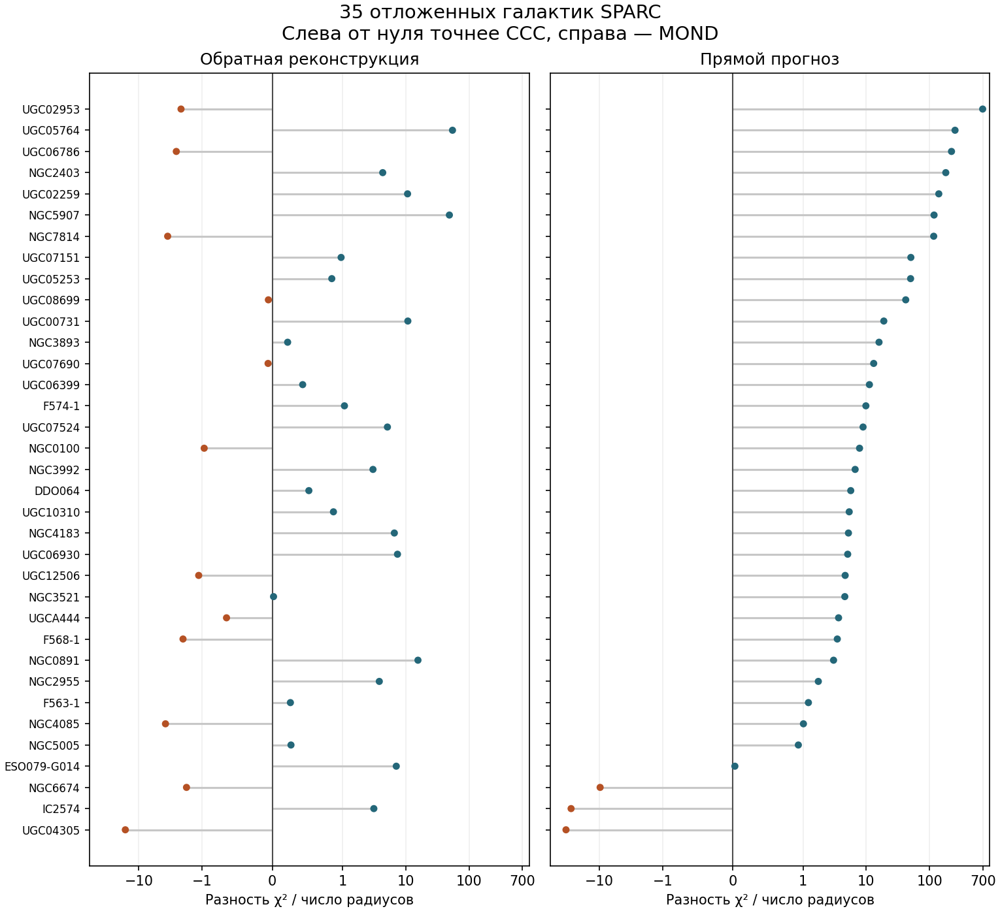

# R143 · Кривые вращения SPARC в CCC и MOND

**На тех же 35 отложенных галактиках авторский прямой расчёт CCC с единым порогом плотности уступил MOND по χ² в 32 случаях из 35.** При историческом обратном подборе одного параметра на каждую из 165 галактик результат другой. Повтор дал средние приведённые χ² 2,582 для CCC и 2,650 для MOND. В обратной задаче модель получает измеренную скорость и реконструирует барионный вклад. В прямой задаче измеренная скорость служит целью прогноза.

## Какие наблюдения действительно общие

| Выборка | Галактик | Радиальных точек |
|---|---:|---:|
| R142 и исходная Table 2 SPARC | 175 | 3 391 |
| Исключены авторским условием CCC | 10 | 46 |
| Общая расчётная выборка | 165 | 3 345 |
| Её обучающая часть | 130 | 2 475 |
| Её отложенная часть | 35 | 870 |

Точное объединение по паре «официальный идентификатор, радиус в кпк» дало один к одному все 3 391 строки. Совпали радиусы, Vobs, его ошибка, Vgas, Vdisk, Vbul и принятые расстояния. Приближённый подбор имён и интерполяция между наблюдательными сетками не потребовались. Происхождение обеих копий — одни и те же наблюдения SPARC. [Все пары строк](radial_join.csv.gz) · [175 идентификаторов, число радиусов, расстояния, наклоны, флаги, SHA-256](samples.csv)

| Число радиусов | Исключённые объекты |
|---|---|
| 4 | D512-2, NGC6789, UGC00634, UGC07232 |
| 5 | F567-2, F574-2, UGC00891, UGC02023, UGC05999, UGC09992 |

Все десять принадлежат исходным 140 обучающим галактикам R142. Код авторов ставит отсечку по числу радиусов. В §2 препринта при описании 165 объектов упомянута также измеренная плоская скорость. В Table 1 у 31 из 165 сохранённых объектов Vflat равна нулю, а у исключённой UGC09992 указано 33,6 км/с. Список 165 воспроизводится по исполняемому условию. Для основного сравнения Vflat не использовалась. [§2 и таблица 3 препринта](https://arxiv.org/pdf/2608.11575v1) · [код выбора](https://github.com/rgupta-uottawa/CCC_SPARC/blob/0a1b208227def246b43c691569adb2ae88b44231/regen_all.py)

## Идентичные входы и порядок доступа к данным

Обе модели используют расстояние D и наклон i из Table 1, уже принятые в табличных радиусах и скоростях. Отдельный наклон в файлах rotmod отсутствует. Повторная коррекция скоростей на sin(i) не применяется. D, i и звёздные M/L зафиксированы для каждой модели. Масса к светимости при 3,6 мкм равна 0,5 для диска и 0,7 для балджа в солнечных единицах. Газ входит как Vgas·|Vgas|. В этих таблицах Vdisk и Vbul неотрицательны, поэтому соглашения R142 и CCC о знаке звёздных компонент совпадают. Для двух точек в обучающей части суммарный квадрат барионной скорости после ограничения снизу равен нулю. Исторический логарифмический тест R142 исключает неположительные значения. Авторская прямая MOND использует нижнюю границу барионного ускорения 10⁻¹⁶ м/с².

Разбиение задаёт порядок **имён файлов**, начиная с единицы. Каждый пятый файл отложен до применения отсечки CCC. Исходный расчёт R142 на 140 обучающих объектах вновь дал a₀ = 7,10562995086401 × 10⁻¹¹ м/с² и средний квадрат остатка по десятичному логарифму ускорения 0,0364727567052 dex² на 35 отложенных объектах. Сверены все 35 индивидуальных оценок и числа их радиусов с ранее опубликованными. [Исходное правило R142](../../R142_MAGIC_NUMBERS/HOLDOUT_LOCK.json) · [проверка по галактикам](r142_test.csv)

Для нового парного сравнения каждый параметр подбирался один раз на 130 общих обучающих галактиках. Каждая галактика имела одинаковый вес в обучающем функционале. Список, параметры, версии программ и хеши записаны до оценки новых результатов на 35 объектах. Опубликованные объекты и старые оценки R142 были известны, поэтому это ретроспективная проверка переноса с фиксированным разбиением. Отдельный процесс воспроизвёл историческую индивидуальную подгонку **после** записи прогнозов, исключительно для сверки таблицы 3. [Параметры и идентификаторы](freeze.json) · [программа эксперимента](experiment.py)

| Режим | Данные для построения кривой | Целевая величина | Параметры, общие для всех галактик после обучения |
|---|---|---|---|
| Обратный, гладкая CCC и MOND | R, Vobs, eVobs | Vbar из компонент | ρt = 6,58906 × 10⁷ M☉/кпк³, a₀ = 1,33738 × 10⁻¹⁰ м/с² |
| Прямой, авторская CCC с резким переходом и MOND | R, Vgas, Vdisk, Vbul | Vobs | ρt = 2,51076 × 10⁷ M☉/кпк³, a₀ = 9,48796 × 10⁻¹¹ м/с² |
| Прямой, гладкая CCC и та же MOND | Те же барионные входы | Vobs | ρt = 1,81096 × 10⁷ M☉/кпк³, то же a₀ |

Авторский прямой оператор строит сферически эквивалентную плотность из барионной кривой, применяет внутреннее продолжение и резкий переход при ρt, затем интегрирует эффективную массу. Использованы поставляемые функции и настройка сглаживания s = 0,5N. Гладкий прямой вариант — наша отдельная проверка чувствительности. В той же геометрии применён локальный закон донора ρobs = ρb / [1 − exp(−√(ρb/ρt))] при ρb > 0, с нулевым пределом при ρb = 0. Оба прямых варианта условны относительно сферической геометрии, экстраполяции в центр и отсечения отрицательной плотности. Отдельная программа снова построила все 10 035 пар прямых выходов трёх сравнений из таблицы без колонок Vobs и eVobs. Максимальное отклонение от записанных значений составило 5,4 × 10⁻¹³ км/с. [Прямой оператор авторов](https://github.com/rgupta-uottawa/CCC_SPARC/blob/0a1b208227def246b43c691569adb2ae88b44231/compare_models.py) · [проверка доступа к входам](check_forward.py)

## Парная оценка

Определим Δ = χ²(CCC) − χ²(MOND). Положительная величина означает меньшую ошибку MOND. Для каждой галактики делим Δ на число её радиусов N, затем усредняем с равным весом галактик. 95%-й интервал получен 10 000 парных bootstrap-выборками целых галактик с возвращением. Внутри галактики все её радиусы и обе кривые всегда остаются вместе. Параметры зафиксированы, интервалы условны относительно обучающей выборки. Сумма Δχ² по точкам дополнительно показывает результат при большем весе длинных кривых.

| Режим на 35 отложенных | Победы CCC / MOND | Сумма Δχ² | Среднее Δ/N [95%] | Средняя по галактикам MAE, CCC / MOND, км/с |
|---|---:|---:|---|---:|
| Обратный, общая ошибка | 12 / 23 | +2 177,62 | +4,34 [0,66; 8,95] | 15,14 / 11,67 |
| Обратный, своя распространённая ошибка каждой модели | 13 / 22 | +245,63 | +2,58 [−1,72; 7,15] | 15,14 / 11,67 |
| Прямой, авторская резкая CCC | 3 / 32 | +117 355,54 | +55,34 [20,22; 104,37] | 22,39 / 13,95 |
| Прямой, гладкая CCC | 7 / 28 | +68 662,10 | +34,57 [10,94; 65,31] | 18,97 / 13,95 |
| Прямой, авторская резкая CCC против ранее фиксированной MOND R142 | 7 / 28 | +86 365,42 | +38,25 [9,93; 77,30] | 22,39 / 16,90 |

В основном прямом тесте CCC выиграла у IC2574, NGC6674 и UGC04305. Медиана Δ/N по всем 35 равна +6,67. Особенно велики положительные вклады UGC02953 и UGC05764. Удаление любого одного объекта сохраняет положительный знак среднего. [Поимённые выигрыши, χ², MAE, RMSE и смещения](galaxy_scores.csv) · [по каждому радиусу](predictions.csv.gz) · [статистика по выборкам, квартилям и исключению одной галактики](statistics.json)



В прямых режимах общий знаменатель равен max(eVobs, 1 км/с), по авторскому прямому коду. Ограничение сработало на 29 из 870 отложенных точек. В обратном режиме подбор глобальных параметров использует общую дисперсию (0,05 Vbar)² + 1 в единицах (км/с)². При оценке добавляется дисперсия переноса ошибки Vobs. Для каждой модели вычислена полуширина интервала 16–84% из 100 одинаковых для пары возмущений одной галактики. В основном сравнении добавлено среднее двух полученных дисперсий. Во второй строке каждая модель использует собственную дисперсию. Абсолютные χ² используют диагональные ошибки. Каталог не задаёт здесь полную ковариацию радиальных точек и систематик D, i и M/L. Разность χ² служит оценкой потерь в указанной метрике.

## Историческое воспроизведение и контроли

* **Таблица 3.** На 165 галактиках повтор авторского кода дал средние χ²/(N−1) 2,58203 / 2,65009 и медианы 0,89387 / 1,50462 для гладкой CCC / MOND. CCC выигрывает у 92 из 165 (55,76%). Средняя парная Δ/N равна −0,079, 95%-й интервал [−0,527; +0,360]. Расчёт воспроизводит опубликованные округления. Его 165 пар индивидуальных параметров используются только в исторической строке. Замена выходного каталога и запись промежуточных прогнозов сохраняют исходные оптимизатор, порядок моделей, seed 3 и поток случайных чисел. [Статья](https://doi.org/10.1093/mnras/stag1777) · [параметры и χ² по объектам](native_replay.csv) · [радиальные результаты](native_radial.csv.gz)
* **Разрушение радиального соответствия.** Порядок барионных скоростей развёрнут при фиксированных радиусах и параметрах. На отложенных объектах среднее χ²/N увеличилось с 87,01 до 273,35 для резкой CCC и с 31,67 до 88,89 для MOND. Ухудшение наблюдалось соответственно у 29 и 32 галактик. Ньютоновская кривая Vbar с теми же ошибками дала 335,90. [Контроли по галактикам](controls.csv)
* **Случайный обмен метками моделей.** Знак парной Δ/N менялся у всей галактики. При симметричной нулевой гипотезе двусторонняя частота столь же большой по модулю средней разности составила 0,00070 для резкого прямого режима и 0,724 для исторического обратного режима. Все статистики используют фиксированное зерно 143. [Результаты перестановок](statistics.json)
* **Отсечение отрицательной плотности.** Отрицательный участок сферически эквивалентной барионной плотности появился у 15 из 35 отложенных галактик. Авторская реализация ставит эту плотность равной нулю. На остальных 20 галактиках MOND выигрывает у резкой CCC в 18 случаях. Среднее Δ/N равно +25,32 [6,86; 46,44]. Это диагностический срез по геометрии. [Число отсечённых узлов для каждой кривой](forward_geometry.csv)

Установленная физическая связь в R143 — одни и те же дисковые галактики, радиусы и компоненты скорости в двух исследованиях. Отложенный результат относится к переносу одного порога плотности и одной шкалы ускорения на эти объекты при заданной геометрии. Следующий открытый физический вопрос — можно ли до наблюдения Vobs определить индивидуальный порог CCC из независимых свойств галактики и сохранить точность на внешней выборке.

## Воспроизведение

Запустить из корня vm-lab. Требуются Python, NumPy, SciPy, pandas и Matplotlib для рисунка. Файл freeze.json фиксирует версии численных библиотек. Источники наблюдений — Lelli, McGaugh & Schombert (2016), таблицы 1 и 2. Исходные наблюдательные работы перечислены в Table 1. [SPARC](https://astroweb.cwru.edu/SPARC/) · [публикация каталога](https://doi.org/10.3847/0004-6256/152/6/157)

```bash
d=analysis/R143_PHYSICAL_GENEALOGY/sparc
w=$(mktemp -d)
git clone -q https://github.com/rgupta-uottawa/CCC_SPARC.git "$w/ccc"
git -C "$w/ccc" checkout -q 0a1b208227def246b43c691569adb2ae88b44231
git clone -q https://github.com/carsondowns-cte/Rotmod_LTG.git "$w/rot"
git -C "$w/rot" checkout -q 84b581a5a197975ee7b21314a82e843d1e748a07
mkdir -p "$w/data" "$w/run"
curl -fLsS https://astroweb.cwru.edu/SPARC/SPARC_Lelli2016c.mrt -o "$w/data/SPARC_Lelli2016c_mrt.txt"
curl -fLsS https://astroweb.cwru.edu/SPARC/MassModels_Lelli2016c.mrt -o "$w/data/SPARC_MassModels_Lelli2016c_mrt.txt"
export OPENBLAS_NUM_THREADS=1
python "$d/experiment.py" --donor "$w/ccc" --rotmod "$w/rot" --data "$w/data" --out "$w/run"
python "$d/check_forward.py" --donor "$w/ccc" --out "$w/run"
python "$d/replay.py" --donor "$w/ccc" --data "$w/data" --out "$w/run"
python "$d/statistics.py" --out "$w/run"
python "$d/figure.py" --out "$w/run"
```

В радиальных таблицах R измеряется в кпк, скорости, ошибки и остатки — в км/с. Остаток равен прогнозу минус цель. В samples.csv расстояния даны в Мпк, наклоны — в градусах. В native_replay.csv CCC_standard_param выражен в M☉/кпк³, CCC_rhot — в г/см³, MOND_smooth_param — в м/с². В статистике train и all для глобальных параметров включают обучающие объекты. Для оценки переноса используются строки test.
