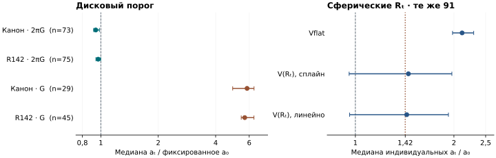

# R143 · Дисковая шкала CCC и остаток на SPARC

**На прежних 91 галактиках замена V_flat в авторском сферическом радиусе Rₜ на местную скорость снизила медиану индивидуальных отношений aₜ/a₀ с 2,118 до 1,452.** В отдельном опыте с новым дисковым радиусом первичные медианы составили 0,940 и 0,968 для двух калибровок. Последние числа зависят от поверхностной плотности, геометрии и условий за последним измерением. Сведения о дополнительной прогнозной способности CCC следует извлекать из проверок с независимыми входами. [Все 91 наблюдение](historical91.csv) · [Дисковые результаты](disk_summary.csv)



## Протокол

1. В первой фиксации записаны обе нормировки, сферический контроль, выбор первого пересечения, критерий эквивалентности ±0,10 dex и разбиение для регрессии. Ранее были опубликованы данные SPARC и исходные сферические результаты. [Исходный протокол](LOCK.json)
2. После запуска первой численной попытки, до просмотра дисковых результатов, по уточнению автора постановки первичной назначена Σ_M = a₀/(2πG), вторичной оставлена a₀/G. Зафиксированы локальная скорость, C₈₂ и регрессия. Первая попытка остановилась на вычислении сферической проекции в последней точке. Её интеграл по измеренному интервалу там равен нулю. Исправление граничного условия позволило завершить расчёт. [Поправка до просмотра](AMENDMENT.json)
3. После первичного анализа поступило окончательное определение R_g = V_flat²/a₀. Для него выполнена отдельная проверка тождества и переноса. R_HI сохранён как измеримый размер газового диска. [Уточнение обозначения](RG_DEFINITION.json) · [Результаты для R_g](gravity_summary.json)

## Поверхностная плотность и охват

Донор CCC выводит сферическую эффективную плотность из V_obs. Для сопоставимого входа в основном опыте та же кривая восстановлена в предположении осесимметричного бесконечно тонкого ньютоновского диска. Её полная эффективная Σ_dyn включает всё, что вызывает радиальное ускорение. Обратный интеграл Тумре нелокален. Внутри первого радиуса принято вращение твёрдого тела, снаружи последнего — постоянная конечная скорость сплайна; альтернативно проверен кеплеровский спад. В измеренной области принят тот же взвешенный сплайн донора s = 0,1N. Независимый численный вариант интерполирует табличное V|V| кубическими эрмитовыми полиномами с сохранением формы. [Тумре, 1963](https://articles.adsabs.harvard.edu/pdf/1963ApJ...138..385T) · [Авторский код CCC](https://github.com/rgupta-uottawa/CCC_SPARC/tree/0a1b208227def246b43c691569adb2ae88b44231) · [Оператор и проверки](disk.py)

Для каждого порога требуется первое пересечение сверху вниз внутри наблюдаемого интервала, при Σ(R_min) выше порога. У каждой галактики один вес. В таблице N — пересечение с прежней выборкой из 91 объекта; сферическая медиана пересчитана строго на тех же N идентификаторах. Знаменатель в обеих геометриях одинаков и равен фиксированному a₀ данной строки. Интервалы — процентильный bootstrap по 10 000 выборкам целых галактик, условно на принятых данных и условиях продолжения.

| Порог и калибровка | Σ, M☉/пк² | N из 91 | Прежняя сфера | Новый диск, медиана [95%] | Критерий |
|---|---:|---:|---:|---:|---|
| a₀/(2πG), канон | 137,02 | 73 | 1,783 | 0,940 [0,917; 0,983] | пройден |
| a₀/(2πG), R142 | 81,13 | 75 | 2,923 | 0,968 [0,942; 0,998] | пройден |
| a₀/G, канон | 860,91 | 29 | 2,461 | 5,846 [4,913; 6,360] | не пройден |
| a₀/G, R142 | 509,78 | 45 | 3,326 | 5,684 [5,448; 6,354] | не пройден |

Критерий требует одновременно, чтобы весь интервал медианы находился в полосе [0,794; 1,259] и чтобы верхняя граница парного изменения расстояния до единицы в логарифмах была ниже нуля. Для первичных строк интервалы изменения составили [−0,296; −0,142] и [−0,514; −0,393] dex. Обе оценки несколько ниже единицы. Среди всех 165 донорских объектов дисковое пересечение вместе с измеренной V_flat доступно у 100 и 107. В исходных 91 при каноне 14 профилей всё время ниже порога, четыре — выше; при R142 соответственно три и 13. У всех 73/75 первичных разрешённых галактик плотность положительна на всей сравниваемой сетке, нисходящее пересечение единственно. Медиана отношения нового радиуса к историческому равна 1,82 и 2,74. [Все 3300 комбинаций, радиусы, причины исключения и исходные шкалы](crossings.csv)

**Физический контроль нормировки.** В симметричном тонком листе 2πGΣ задаёт модуль вертикального поля непосредственно у поверхности. Радиальное ускорение зависит от распределения массы во всём диске. У плоского диска Местеля Σ(R)=V²/(2πGR), поэтому первичный порог даёт V²/(Rₜa₀)=1 тождественно, а вторичный — 2π. Близость к единице может возникнуть уже у почти плоской кривой при заданной инверсии. По классификации R142 совпадение численного значения 137 с приближённым значением 1/α относится к категории 4: значение размерной плотности меняется с единицами. [Диск Местеля, уравнение 7.40](https://galaxiesbook.org/chapters/II-01.-Gravitation-in-Galactic-Disks_3-Gravitational-potentials-from-disk-density-distributions.html)

**Что меняет результат при том же пороге.** Ниже каждая пара медиан получена на общих для двух операторов галактиках.

| Контроль | Канон, тонкий диск → контроль | R142, тонкий диск → контроль |
|---|---:|---:|
| Снаружи кеплеровская кривая | 0,940 → 1,099 (73) | 0,965 → 1,157 (72) |
| Сплайн → интерполяция без сглаживания | 0,940 → 0,955 (73) | 0,968 → 0,968 (75) |
| Проекция сферической массы с тех же V_obs | 0,938 → 0,619 (67) | 0,962 → 0,604 (67) |
| Барионная Σ диска | 0,923 → 2,215 (55) | 0,968 → 2,791 (55) |

При кеплеровском продолжении отдельно разрешены 83 прежних объекта для R142. Для них медиана 1,202 [1,145; 1,282]; верхняя граница выходит за допуск. Барионная ветвь использует 0,5 SBdisk и газовую Σ из подписанного вклада Vgas|Vgas|. Множитель гелия уже включён в Vgas SPARC. Звёзды балджа в массу диска этой ветви не входят. Газовая Σ здесь восстановлена из табличного гравитационного вклада, который был построен авторами по наблюдениям газа. На полном разрешённом барионном подмножестве медианы равны 2,259 (59) и 2,914 (68). Прямая работа с этим физически отличным входом не дала стягивания к единице. [Парные контроли](matched_controls.csv) · [Профили в наблюдаемых радиусах](profiles.csv.gz) · [Данные и описание SPARC](https://astroweb.cwru.edu/SPARC/)

## Местная скорость в исходном радиусе CCC

Здесь для каждой из 91 галактики сохранены исходные сферический Rₜ и индивидуальное a₀ из авторского гладкого MOND. Меняется только скорость в числителе.

| Оценка | Медиана погалактического отношения [95%] | Отношение двух медиан [95%] | SD логарифма отношения |
|---|---:|---:|---:|
| V_flat²/Rₜ | 2,118 [1,981; 2,298] | 2,249 [1,938; 2,475] | 0,159 dex |
| V(Rₜ)²/Rₜ, донорский сплайн | 1,452 [0,957; 1,971] | 1,342 [1,000; 1,781] | 0,415 dex |
| V(Rₜ)²/Rₜ, линейная интерполяция | 1,435 [0,960; 1,924] | 1,340 [1,003; 1,776] | 0,424 dex |

Локальное ускорение ниже у 60/91 галактик. Медиана парного сдвига равна −0,0944 dex [−0,2617; −0,0267]. Местная скорость приближает центр к 1,42, одновременно увеличивая межгалактический разброс. Интервал медианы не уложился в полосу ±0,10 dex вокруг 1,42. В §4.3 препринта 1,42 относится к отдельному опыту с резким порогом в **ускорительном MOND**. Подгонка того порога и местное ускорение при переходе плотности CCC — разные процедуры. При фиксированных знаменателях местные медианы равны 1,064 (канон) и 1,796 (R142). [Погалактические скорости и ошибки оценок](residual_summary.json) · [Статья донора, §4.3 и рис. 6](https://arxiv.org/abs/2608.11575)

## Почему получались 0,179 и 0,159 dex

Для x=log₁₀ aₜ и y=log₁₀ a₀,инд измерены sₓ=0,318009, sᵧ=0,299865 dex, Pearson r=0,869168 и Spearman ρ=0,834384. Подстановка Пирсона в Var(x−y) в точности восстанавливает прямые 0,159001 dex. Подстановка рангового коэффициента даёт 0,178649 dex. Фактор одного стандартного отклонения равен 1,442. Табл. 6 статьи обозначает 0,33/0,34 как обычный разброс и 0,25/0,27 как робастный NMAD.

Среднее log₁₀(aₜ/a₀,инд) равно 0,35804 dex с обычной стандартной ошибкой 0,01667. Медиана логарифмов равна 0,32593 dex. Принятое по постановке центрирование 0,352 dex близко к log₁₀ отношения отдельных медиан; после вычитания 0,352 медиана остатка составляет −0,02607 dex. Все регрессии включают свободный интерсепт. Для медиан доверительные интервалы получены непосредственной перевыборкой галактик. [Расчёт](residuals.py)

## Гравитационный радиус и проверка остатка

В окончательном определении R_g = V_flat²/a₀. Для индивидуального a₀ выполняется точное тождество
$$
r_i = \log_{10}(a_{t,i}/a_{0,i})-0.352=-\log_{10}(R_{t,i}/R_{g,i})-0.352 .
$$
Оно проверено на 91 объекте с максимальным расхождением 2,22 × 10⁻¹⁶ dex. На обучающих 67 галактиках регрессия на газовую долю, log₁₀(Rₜ/R_g) и C₈₂ дала коэффициенты 0, −1, 0 и интерсепт −0,352 с машинной точностью. На прежних 24 отложенных объектах RMSE равна 1,1 × 10⁻¹⁶ dex. В предиктор уже входит отклик. При местной скорости к правой части добавляется 2 log₁₀|V(Rₜ)/V_flat|. [Все три определения шкалы по объектам](gravity_radii.csv) · [Проверка тождеств](gravity_radius.py)

При фиксированном a₀* и индивидуальном знаменателе отклика в тождестве появляется слагаемое log₁₀(a₀*/a₀,инд). Две фиксированные калибровки сдвигают только интерсепт регрессии. На 24 отложенных для обеих RMSE 0,1550 против базовых 0,1617 dex; интервал парной ΔMSE [−0,00676; +0,00250] dex² включает нуль. Величина Rₜ по-прежнему участвует и в признаке, и в отклике. [Подгонки и ошибки](gravity_summary.json) · [Отложенные прогнозы](gravity_holdout.csv)

**Отдельная проверка измеримых свойств.** Газовая доля равна 1,33 M_HI/(1,33 M_HI+0,5 L₃.₆). Концентрация C₈₂=5 log₁₀(R₈₀/R₂₀) получена интегрированием принятых изофот наблюдаемой фотометрии 3,6 мкм до последнего доступного радиуса, с постоянным светом внутри первого радиуса и линейной интерполяцией интенсивности. Постоянное отношение осей сокращается в нормированной кривой роста; изменение формы изофот с радиусом и свет за последней изофотой здесь не моделируются. R_HI — каталожный радиус на 1 M☉/пк². Для NGC5907 в каталоге стоит ноль, поэтому модели с R_HI используют 90 объектов (67/23). Модели только с газовой долей и C₈₂ используют все 91 (67/24). Разбиение унаследовано из R142; оценка на SPARC носит ретроспективный характер. [Оригинальная фотометрия](https://astroweb.cwru.edu/SPARC/sfb_LTG.zip) · [Таблицы масс и радиусов](https://cdsarc.cds.unistra.fr/viz-bin/cat/J/AJ/152/157)

| Признаки | N отложенных | Базовая → модельная RMSE, dex | 95% интервал ΔMSE, dex² |
|---|---:|---:|---:|
| Газовая доля и C₈₂ | 24 | 0,1617 → 0,1704 | [−0,00120; +0,00786] |
| Газовая доля, R_HI/R_disk (логарифм), C₈₂ | 23 | 0,1582 → 0,1606 | [−0,00257; +0,00437] |
| Газовая доля, Rₜ/R_HI (логарифм), C₈₂ | 23 | 0,1582 → 0,1572 | [−0,00616; +0,00640] |

В последней строке Rₜ также входит в отклик. На полных 90 объектах коэффициент при log₁₀(Rₜ/R_HI) равен −0,200 с HC3-интервалом [−0,388; −0,012], R² модели 0,102. При перестановке остатков с сохранением алгебры признака контроль дал медианное R² 0,303. Высокий R² возможен за счёт общего Rₜ. У модели из трёх внешних по отношению к Rₜ признаков R² на тех же 90 равно 0,043. Критерий переноса независимой структуры остатка этими свойствами не пройден. Малые отложенные выборки ограничивают чувствительность к слабым зависимостям. [Все исходы регрессий и HC3-интервалы](residual_summary.json) · [Погалактические прогнозы](regression_holdout.csv)

## Воспроизведение

Донор и две таблицы SPARC зафиксированы по хешам. Один и тот же архив фотометрии используется для C₈₂. Во всех интервалах единицей перевыборки служит целая галактика. Интервалы условны на наблюдательных профилях; полные ковариации радиусов, расстояний, наклонов и скоростей не оценивались.

```sh
# Run from this directory. Input locations match the parent SPARC experiment.
curl -fLsS https://astroweb.cwru.edu/SPARC/sfb_LTG.zip -o /tmp/sfb_LTG.zip
python disk.py /path/to/CCC_SPARC /path/to/SPARC/tables
python residuals.py /path/to/CCC_SPARC /path/to/SPARC/tables /tmp/sfb_LTG.zip
python gravity_radius.py
python disk.py /path/to/CCC_SPARC /path/to/SPARC/tables --subdivisions 16 --order 20 --output /tmp/r143-disk-fine
python summarize.py --fine /tmp/r143-disk-fine
python figure.py
```

Удвоение сетки и повышение порядка квадратуры сохранили статусы во всех 3300 записях. Максимальное относительное изменение первичного Rₜ — 0,178%. Проверены аналитические диски Кузьмина, Местеля с ядром и проекция сферической плоской кривой. [Численные контроли](numeric_controls.json) · [Сходимость](resolution_check.json) · [Исходные таблицы и подготовка окружения](../../README.md)
