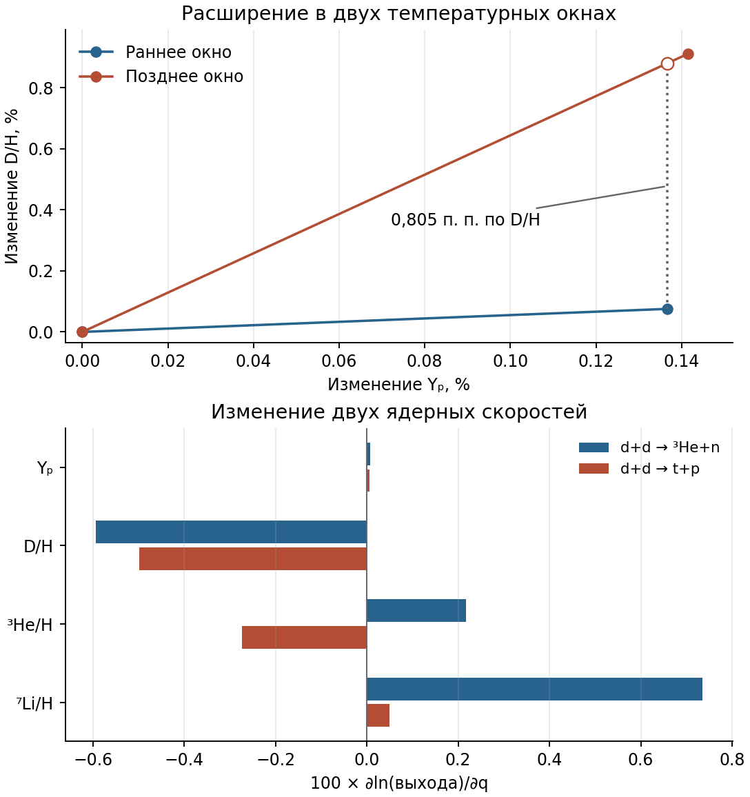

# Что дейтерий различает в R150–BBN

При одинаковом гелии позднее ускорение расширения даёт примерно на 0,805 процентного пункта больший отклик D/H, чем раннее. Ядерные неопределённости имеют другой рисунок по изотопам. На архиве LINX построена линейная комбинация четырёх содержаний, подавляющая раннее окно и два конкретных изменения скоростей D+D. При переносе тех же коэффициентов в PRIMAT сохраняется чувствительность к позднему окну. Для превращения этой проверки модели в наблюдательную нужны ошибки измерений и совместное распределение ядерных скоростей.

Это повторная обработка сохранённых траекторных итогов и лабораторной матрицы. Новые величины ниже получены интерполяцией, дифференцированием архивных точек и квадратурой. Нативные интеграторы повторно не запускались. [Парная серия и исходные данные](https://github.com/IgorSabirov/vm-lab/blob/d503ee0f1f89c99c8560803dc46277d544ef15ba/reproductions/BBN_COSMO_20261120/results/44719756079/SUMMARY.json) · [Исходный эксперимент R150](../experiment_review/followup/README.md) · [Код](diagnostic.py) · [Все числа](result.json).

## 1. Что подтверждают два решателя

У 17 общих задач одинаковы заданные Tγ(t), Tν(t), a(t), начальные содержания, прямые и слабые скорости. PRIMAT и LINX интегрировали свои реализации восьминуклидной сети из 12 реакций. Две нативные стандартные точки с собственными входами проверялись отдельно. Расхождение базовых D/H на общих входах составляет 1,62644·10⁻⁸ в относительных единицах, или 0,00000162644%. Число 0,0000681976% относится к максимуму по 17 парам, при d+d→t+p и q=−0,25.

| Вариант, изменения относительно собственной базы | Yp, % | D/H, % | ³He/H, % | ⁷Li/H, % |
|---|---:|---:|---:|---:|
| +0,30% к H, раннее окно 0,2–2 МэВ, LINX | +0,13672 | +0,07557 | +0,02673 | +0,08774 |
| +0,55% к H, позднее окно 0,02–0,2 МэВ, LINX | +0,14155 | +0,91183 | +0,33299 | −0,94732 |
| Позднее минус раннее, процентные пункты, LINX | +0,00483 | +0,83627 | +0,30626 | −1,03506 |
| Та же разность, PRIMAT | +0,00474 | +0,83620 | +0,30624 | −1,03522 |

У R150 уже были собственные H-контроли: +0,07555% и +0,91185% по D/H. Стенд воспроизводит известный отклик в обоих окнах. Его живой посредник, импульс в n+p↔D+γ и восьмиветвевой контактный контраст G вычислены самостоятельным интегратором SciPy BDF на общих входах. Нативная пара PRIMAT/LINX на этих восьми ветвях пока отсутствует. [Описание реализации R150](../network_bench/SOURCES.md).

## 2. Сравнение при равенстве гелия

Для каждого решателя интерполированы Δln y как квадратичные функции амплитуды позднего окна через три реально рассчитанные точки: нуль, половину и полную амплитуду. Затем выбрана амплитуда, при которой Yp совпадает с ранней точкой +0,30%. Все прочие входы сохранены. Это интерполяция внутри проверенного интервала.

| Реализация | Поздняя прибавка H для равного Yp | Разность процентных откликов D/H | D/H поздней истории относительно ранней |
|---|---:|---:|---:|
| LINX | +0,53115% | +0,80498 п. п. | +0,80438% |
| PRIMAT | +0,53150% | +0,80549 п. п. | +0,80488% |

Прямая интерполяция между половинной и полной амплитудой вместо параболы меняет ответ примерно на 0,00003 п. п. в каждом решателе. В первичной работе о температурных функциях отклика по округлённым коэффициентам получалось 0,808 п. п. В наблюдательном масштабе D/H около 1,16%, принятом в архивном сравнении, разность по одному дейтерию составляет около 0,69 такой ошибки до учёта теоретических ошибок. Это наглядный масштаб одной пары моделей. [Bambi, Giannotti, Villante](https://arxiv.org/abs/astro-ph/0503502) · [Наблюдательный масштаб и вычисления проекта](../../../../NEIGHBOR_EXTERNAL_DATA_USE_20261119/BBN_METHOD_TRANSFER.md#expansion-history) · [Реконструкция из наблюдаемых у An и Gluscevic](https://arxiv.org/abs/2310.17195).

## 3. Как выделить время воздействия

Обозначим y=(ln Yp, ln D/H, ln ³He/H, ln ⁷Li/H), hₑ и hₗ — дробные изменения H в раннем и позднем окне. Из нулевой, половинной и полной точек LINX вычислены касательные в нуле. По двум верхним строкам якобиана

$$
\begin{pmatrix}\delta y_{He4}\\ \delta y_D\end{pmatrix}
\simeq
\begin{pmatrix}0.45645&0.25864\\0.25213&1.65610\end{pmatrix}
\begin{pmatrix}h_e\\h_l\end{pmatrix}.
$$

При фиксированной микрофизике и η его определитель равен 0,69072 (PRIMAT 0,68905). Два заданных оконных коэффициента локально различимы. Величина δln(D/H)−0,55238 δln Yp убирает ранний столбец LINX и даёт +1,51324 hₗ. На столбцах PRIMAT с неизменными весами получаем −0,000186 hₑ +1,51301 hₗ. Само измерение содержит только конечные содержания. Форма внутри окна взята из модели.

### Разделение D+D при помощи ³He и ⁷Li

| Чувствительность в LINX, Δln y за единицу q | d+d→³He+n | d+d→t+p |
|---|---:|---:|
| Yp | +0,00006593 | +0,00005670 |
| D/H | −0,00594066 | −0,00498588 |
| ³He/H, включая последующий распад t | +0,00216974 | −0,00273443 |
| ⁷Li/H, включая ⁷Be | +0,00735321 | +0,00049803 |

Для обоих столбцов использован центральный шаг ±0,125. Для второго канала взята пара с уточнёнными допусками. Обычная пара даёт −0,00498519 по D/H. Знаки ³He противоположны, а модули отклика ⁷Li различаются почти в 15 раз. Именно эта структура позволяет отделять эффекты. Координата q меняет табличную полосу конкретной скорости; один и тот же q в двух кодах использует одну и ту же полосу. Для иллюстрации масштаба, при двух единичных дисперсиях q формальная σ(ln D/H) меняется от 0,00776 при ρ=0 до 0,01093 при ρ=1. Эти сценарии не являются оценкой лабораторной корреляции q.

Зафиксируем коэффициент при δln D/H равным 1 и потребуем занулить три столбца LINX — раннее hₑ и две q-координаты. Решение есть:

$$
C=-1.065984\,\delta\ln Y_p+\delta\ln(\mathrm{D/H})
-1.610058\,\delta\ln({}^3\mathrm{He/H})
+1.292545\,\delta\ln({}^7\mathrm{Li/H}).
$$

| Реакция этой **одной** комбинации | Ранний hₑ | Поздний hₗ | qₙ | qₚ |
|---|---:|---:|---:|---:|
| LINX, где выбраны веса | 0 | −1,83354 | 0 | 0 |
| PRIMAT, те же веса | +0,00279 | −1,83141 | −3,69·10⁻⁶ | −3,25·10⁻⁶ |

Это перенос между двумя реализациями одной сети. Поздний коэффициент меняется примерно на 0,12%. Подавление относится к двум заданным табличным направлениям скоростей в первом порядке. Дополнительные температурные моды полного ядерного распределения могут давать ненулевой вклад.

Для спектра G из R150 получается C(G)=−5,66·10⁻⁸. Отдельный D-компонент G составляет +2,879·10⁻⁹. Больший модуль C сам по себе ничего не прибавляет к статистической мощности: его ошибка равна sqrt(wᵀΣw). В Σ входят наблюдательные ошибки и систематика ³He и ⁷Li, ядерные и космологические параметры. В частности, межкодовая утечка одного q порядка 3·10⁻⁶ здесь больше самого C(G); это ограничение переноса абсолютной калибровки, а не оценка ошибки G при согласованных входах. Для наблюдательного анализа надёжный исходный набор — измеренные D/H и Yp, остальные выходы сначала проверяются как предсказания. Внешние исследования характеризуют различия ядерных компиляций и режимов нормировки слабого канала. [Burns, атлас BBN](https://arxiv.org/abs/2603.22414).

## 4. Что ограничивает вывод о механизме R150

**Свободное η.** В отдельной нативной серии значению ∂ln(D/H)/∂ln η=−1,64166 соответствует секущая между −1% и +1% по η. Она получена на собственной базе той серии. По одному D/H снижение η примерно на 0,49% имитирует разность двух согласованных по гелию историй. У комбинации C производная по ln η составляет около +1,92 при переносе той секущей. Если предполагается фотонный нагрев, нужно связывать η во время BBN и при рекомбинации; двойной учёт общего ограничения CMB исказил бы мощность. [Секущие по четырём выходам](../cosmology/data/eta.json).

**Четыре выхода и число независимых входов.** Два окна H и две табличные q-координаты дают четыре независимых столбца в пространстве четырёх выходов. После приведения столбцов к единичной норме число обусловленности около 6,91 для обеих сетей, до взвешивания по ошибкам. Если все четыре коэффициента свободны, в первом порядке любому малому четырёхкомпонентному вектору можно подобрать эти четыре входа. При свободном η появляется ещё одно вырождение. В отдельном примере с двумя окнами H, тремя узлами B_D (60, 70, 80 кэВ) и ранним Qₙₚ матрица 4×6 имеет ранг 4 и два невидимых линейных направления. Это совместная локальная диагностика архивных входов, а не нативная интеграция R150 в двух движках.

**Пример маскировки.** Если разрешить меняться только двум амплитудам H, подбор по первым двум компонентам G даёт hₑ≈−4,13·10⁻⁹ и hₗ≈+2,37·10⁻⁹ по матрице LINX. После подбора в ln(³He/H) остаётся +3,08·10⁻⁹, в ln(⁷Li/H) −3,66·10⁻⁸. Такой масштаб характеризует конечные выходы гипотезы; он не является предсказанной историей H от графа. Сам G — восьмичленный контраст по рассчитанным ветвям; в задаче наблюдения сравниваются полные предсказания моделей. В E5 D/H уже использован для подбора. Для проверки этого подбора свободными остаются Yp, ³He/H, ⁷Li/H. В обратной постановке можно подобрать по Yp и оставить D/H на проверку.

## 5. Что удалось передать из Leonard

Из Table III и Table V взяты 16 полных сечений и ковариация нормировок a₀. Выполнены преобразования E=E_lab/2 и Cσ=(4π)²Cₐ₀. Cσ положительно определена, ранг 16; межканальные корреляции исходных точек 0,01780–0,98996. Общий дополнительный масштаб 1% в Table V отсутствует. Это отдельная часть модели погрешностей. [Leonard et al., §§ III–IV и таблицы III, V](https://arxiv.org/pdf/nucl-ex/0601035) · [Исходная оцифровка](https://github.com/IgorSabirov/vm-lab/blob/b24c7e0cc47ff964d576f903ce7ba507d2dd731e/analysis/CCC_BBN_NETWORK_20261114/s3_standard/bh_covariance_20261115/LEONARD_INPUT.json).

Вычислен **вклад измеренной полосы 56,1–323,05 кэВ в скорости**, с сохранением всех межканальных и межэнергетических элементов. В полосе основная модель линейно интерполирует астрофизический S(E) между точками, контрольная — само σ(E). Веса W получены из интеграла Максвелла по Eσ(E)exp(−E/T). Использованы приведённая масса дейтеронов, единицы см³·моль⁻¹·с⁻¹ и сетка общих скоростей проекта. При фиксированных энергиях и этой интерполяции скорость полосы линейна по лабораторным сечениям: R_band=Wσ и C_band=WCσWᵀ. Поэтому передача вторых моментов не требует произвольной гауссовской формы. Пользоваться таким равенством для произвольного нелинейного продолжения за диапазон нельзя.

| T плазмы, кэВ | R полосы / табличная полная, p / n | corr(Rₚ,Rₙ) в полосе | Отношение ошибок общей моды, с / без межканального блока | То же для разности логарифмов |
|---:|---:|---:|---:|---:|
| 60 | 0,854 / 0,862 | 0,98674 | 1,410 | 0,115 |
| 70 | 0,824 / 0,829 | 0,98461 | 1,409 | 0,124 |
| 80 | 0,784 / 0,786 | 0,98232 | 1,408 | 0,133 |

При 70 кэВ относительные ошибки отдельно частичных скоростей p и n составляют 1,386% и 1,382%. Общая мода здесь — полусумма логарифмов двух скоростей в линейном приближении. Сравнение обнуляет только межканальные блоки и сохраняет обе маргинальные ковариации по энергии. При линейной интерполяции σ вместо S корреляция в той же точке 0,98424. Сопоставление частичного интеграла с полной табличной скоростью служит ориентиром энергетического покрытия: компиляции могут различаться по центральным значениям, поэтому остаток до единицы не измеряет точную долю хвоста. [Байесовские модели S-факторов двух реакций](https://arxiv.org/abs/1710.01647).

**Граница переноса.** Получена условная ковариация частичных температурных скоростей в одной измеренной полосе. Для полного совместного распределения нужны дополнительные энергии и эксперименты, модель продолжения и нормировок, корреляции этих входов с измеренной частью и проверка на данных. Матрица C_band или максимальная корреляция 0,98996 не заменяют корреляцию двух табличных q. Для передачи к обилиям нужны функции чувствительности к независимым температурным модам либо прямые общие выборки через сеть. Прежние две табличные производные задают только два направления. [Контракт переноса](../../../../NEUTRINO_GW_ARCHITECTURE_20261118/NUCLEAR_RATE_COVARIANCE.json).

## 6. Как проверять специфичность контакта

Внутри одной модели пусть J_a — производная четырёх логарифмов обилий по одним и тем же ядерным параметрам в ветви a. Тогда для G=Σ cₐyₐ общая калибровка даёт J_G=Σ cₐJₐ и C_G=J_G C_nuc J_Gᵀ в первом порядке. Независимое пересэмплирование ядерных параметров в каждой ветви разрушило бы физически общую часть ошибки. Для межкодовой проверки тот же восьмиветвевой G нужен в PRIMAT и LINX при одной таблице входов для каждого слагаемого. Уже полученное базовое расхождение сравнивает абсолютные содержания; оно само по себе не определяет точность парной разности.

Для наблюдательной проверки требуется предсказанный R150 вектор историй (δH, δB_D, δQₙₚ), определённый до подгонки по выбранным обилиям. Критерий выигрыша — изменение различимости полных предсказаний с общей ковариацией после одной и той же подгонки. Например, при известной Σ и разности предсказаний d, свободных линейных параметрах с матрицей N проверяется минимум (d−Nθ)ᵀΣ⁻¹(d−Nθ), с явными независимыми ограничениями на θ, если они есть. В этой работе такой наблюдательный выигрыш не измерялся.

## Повтор

В каталоге отчёта выполните `OPENBLAS_NUM_THREADS=1 python diagnostic.py` для воспроизведения [result.json](result.json). Нужны NumPy и SciPy; все исходные таблицы входят в репозиторий. Для рисунка используется `python figure.py` с Matplotlib. Значения двух окон и производных выведены из конечных обилий, лабораторная матрица сверена по SHA-256, сходимость квадратуры проверена удвоением числа узлов.
