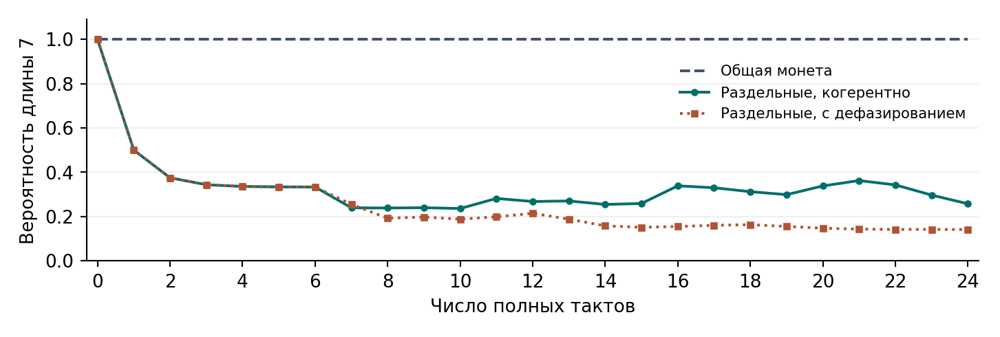

# Где R150 теряет динамику

**Аудит кода и вычислительное расширение · 26 ноября 2026 года**

Портовая тройка воспроизводится. При классическом шаге на одном активном самоотражённом слое нечётной длины две моды имеют фазу 0, одна — π. Три условия меняют физический смысл результата: разрешённые длины, корреляция двух элементарных взаимодействий и способ различения конечных графов.

## Что удалось получить непосредственно из кода

| Проверяемая величина | Результат |
|---|---|
| Двустороннее замыкание всех 343 портовых слов длины 7 | 64 конечных цикла и 31 бесконечная орбита. У исходного i(F−F†) есть 89 нормируемых нулевых мод, а ноль лежит также в непрерывном спектре. |
| Расщепление и слияние в одном такте | Два унитарных продолжения одного классического правила дают дисперсию длины 0 и 1/2 на одном и том же входе. |
| Слой, из которого разрешено уходить | При независимых каналах и z=−i у единственного активного самоотражённого слоя нечётной длины нет собственной моды, целиком живущей внутри слоя. |
| Видимость первого возврата | На седьмом такте при единичном шве вероятность исходного слова равна 41/128 на факторе по именам и 33/128 в именной модели. |
| Остаток около π | Сдвиг около 5,208·10⁻¹² при δ=0,001 обусловлен кубическим членом уравнения шва. |
| Ход часов | Два протокола, совпадающие при номинальном такте, дают при L=7 наклоны π и π/12 для одной и той же исходной π-моды. |

**Происхождение.** Из присланных 433 строк выделены шесть исполняемых ячеек. Прочитаны целевая карточка R150 в исследовательской ветке, предыдущий аудит и его первичные программы. На замороженной ревизии 2ea30a7 запущены core.py и verify.py. Полученные JSON побайтно совпали с эталонами. Новые вычисления приложены отдельно от этих эталонов.

**Граница интерпретации.** В расчётах размер кольца — число узлов, время — число тактов, фазы безразмерны. Именной граф использует правила R130. Для опытов на четырёх портах выбран вход с населённостями (1,1,1,1). Именной эксперимент H6 имеет другой вход и отдельный регистр.

# Что возвращается к длине 7

Присланный файл печатает 343−126=217, затем вычитает ещё 145. В исходной программе 145 считается по первому возврату к длине 7 после выхода за 64 такта. Чтобы выяснить судьбу каждого слова, я снял ограничение длины и отследил как длину, так и все три относительные координаты. Учитывается вращение кольца, имена вершин забываются. Шаг F=QI детерминирован.

| Судьба начального слова | Слов из 343 |
|---|---:|
| Остаётся при длине 7 на всех тактах | 126 |
| Меняет длину и принадлежит конечному циклу | 125 |
| Возвращается к 7 после первого выхода, позднее уходит на неограниченный рост | 20 |
| Уходит на неограниченный рост без возврата к 7 после первого выхода | 72 |

**Как установлен рост.** Записываем состояние как (N;x₂,x₃,x₄) относительно порта 1. Для каждого из 92 уходящих входов достигнута точка, из которой следующее семейство состояний замыкается тождеством при любом целом k≥0:

> F(N+k; x₂+k,x₃+k,x₄+k) = (N+k+1; x₂+k+1,x₃+k+1,x₄+k+1).

Сертификатор выполняет тот же split/merge и транспорт на парах «свободный член, коэффициент при k». Каждое сравнение индексов, совпадение масок и приведение по модулю разрешается только при доказанном знаке на всём луче k≥0. Проверяется точное тождество для выхода. Например, вход (7;0,1,1) за первый такт переходит в (9;2,3,3). Затем длина и все три относительные координаты прибавляют по единице. Для 92 входов максимальный префикс до сертификата составил 10 тактов.

**Точная структура всего замыкания.** Периоды 1, 5, 6, 7 встречаются соответственно у 5, 6, 25, 28 различных конечных орбит. В них 381 различное слово всех посещённых длин. На растущем хвосте тройка (N−x₂,N−x₃,N−x₄) постоянна. Совпадение этих троек означает, что хвосты совпадут при равной длине. Биективность F тогда отождествляет целые орбиты. Получена 31 различная копия двустороннего сдвига.

**Спектр и измерение.** Каждый конечный цикл даёт одну моду F=+1, каждый чётный цикл ещё одну F=−1. Итого 64+25=89 собственных нулей i(F−F†). На каждой бесконечной орбите преобразование Фурье даёт умножение на ±2 sin k, с непрерывным спектром [−2,2]. В классе всех 343 равновероятных исходных слов долговременное среднее вероятности увидеть длину 7 равно 605/1029, а увидеть исходное слово — 130/1029. Для цикла размера n с m словами длины 7 вклады до нормировки равны m²/n и m/n. Бесконечные орбиты дают ноль в этом среднем.

# Два события и одна квантовая амплитуда

В verify.py, строка 63, монета строится из всей инволюции I. Обозначим через I₁ переписывание (1,2) ↔ 3, через I₂ — (8,4) ↔ 12. Для одной копии каждого порта каналы действуют на непересекающихся подходящих масках. Замена в одном блоке сохраняет разделение блоков другого канала. Поэтому I₁²=I₂²=1, I₁I₂=I₂I₁=I на циклических словах. Обе очередности сверены с исходником на всех 4 355 словах длин 2–11 и при последующем моделировании.

Пусть |z|=1, A=(1+z)/2, B=(1−z)/2, C(J)=A·1+B·J. Монета C(J) имеет собственные значения 1 и z в двух секторах инволюции J. Две конструкции унитарны:

> Uобщ = Q C(I₁I₂),       Uразд = Q C(I₁) C(I₂).

Они совпадают при z=−1 и z=1. На состояниях, в которых только один канал способен сработать, они дают один и тот же шаг при любом z. Расхождение находится целиком в совместном секторе I₁=I₂=−1. Если P₋₋=(1−I₁)(1−I₂)/4, то Uразд = Uобщ [1+(z²−1)P₋₋]. Тем самым остаётся ровно одна совместная фаза в классе монет, диагональных в двух знаках, с уже фиксированными тремя остальными фазами. Одноканальное приготовление H6 не фиксирует эту фазу.

**Опыт на одном слове.** Берём длину 7, слой (u,v)=(4,3), t=1. Слово (1,2,0,0,12,0,0) допускает слияние первых двух масок и расщепление маски 12. При z=−i общий шаг реализует только исход без событий и исход с обоими событиями. Раздельный допускает ещё два исхода с одиночными событиями. После транспорта четыре слова различны.

| После одного такта | P(6) | P(7) | P(8) | Средняя длина | Дисперсия |
|---|---:|---:|---:|---:|---:|
| Общая монета | 0 | 1 | 0 | 7 | 0 |
| Раздельные монеты | 1/4 | 1/2 | 1/4 | 7 | 1/2 |

При p=|B|² дисперсия раздельного шага равна 2p(1−p). Для общего шага она равна нулю при любом z на этом входе. Если задать произвольную совместную поправку exp(iγP₋₋) к общему шагу, вероятность выхода в другую длину равна ½ sin²(γ/2). Опыт обнаруживает совместную фазу с обычной неоднозначностью знака. Эти выводы предполагают одну копию порта на канал. Факторизация всей монеты по двум каналам сама по себе не доказывает релятивистскую причинность на графе переменной длины.

# Может ли мода целиком остаться в слое

Пусть P выделяет один активный слой длины L. На нём Q — циклический сдвиг, а I меняет местами только t=0 и t=1. Введём локальные комбинации v₊=(e₀+e₁)/√2 и v₋=(e₀−e₁)/√2. В остальных координатах обе инволюции взаимодействия тождественны. Пусть P₊ и P₋ — проекторы на v₊ и v₋.

> P Uразд P = Q [1 + (z−1)P₋ + ((1+z²)/2−1)P₊] на слое.

Два частично переписанных внешних слова у входов e₀ и e₁ попарно совпадают. Их амплитуды уходят из симметричной комбинации и сокращаются у антисимметричной. Отсюда квадрат нормы утечки произвольного входа ψ равен sin²(arg z)·|⟨v₊,ψ⟩|². При z=−i симметричная комбинация покидает слой с вероятностью 1, антисимметричная в этот такт целиком остаётся. У e₁ получаем вероятность 1/2.

**Один такт и все такты.** При ненулевой утечке собственная мода с |λ|=1, целиком поддержанная слоем, должна удовлетворять ψ₁=−ψ₀. Уравнения сдвига и взаимодействия дают λ=−z, ψ₂=ψ₀ и λᴸ⁻²=1. Если ψ₀=0, все компоненты нулевые. Обратно, эти условия однозначно восстанавливают одну моду с точностью до нормировки. При z=−i это означает L≡2 mod 4. На нечётных кольцах такая мода отсутствует. Формула сверена со всеми активными слоями длин 3–24. Она ничего не требует от мод, одновременно занимающих несколько слоёв и длин.

**Численный опыт без обрезания длины.** На портовых словах амплитуды суммируются 24 такта, включая уход и возвращение. Контроль дефазирует в базисе слов после каждого полного такта. Для входа e₁ при z=−i и h=1 к такту 24 длины имеют поддержку от 4 до 31 в когерентном расчёте. P(L=7) составляет 0,257703 когерентно и 0,141340 после дефазирования. Для общей монеты P(L=7)=1 в обоих случаях.

# Что меняют имена вершин

У портового слова сохраняется порядок масок. Именной эталон R130, кроме него, сохраняет, из каких ветвей образованы вершины, и направленные рёбра. Для проверки я присвоил семи исходным вершинам собственные атомарные имена. На выходе суммировал вероятности ортогональных конечных именных графов с одинаковым словом. Совпадение имён проверялось с точностью до выбора начала кольца, без переименований.

**Первое эхо общей монеты.** Пусть h стоит на переходе транспорта L−1→0. Амплитуда возврата в b=e₁ в момент t<L равна Bᵗ. Остальная амплитуда ещё не успевает обойти длинный цикл. В момент t=L впервые встречаются два пути: L раз остаться и один раз выйти и вернуться. На словах получаем

> P(b,L)=|Bᴸ+hA²|². При полном дефазировании P(b,L)=|B|²ᴸ+|A|⁴.

При L=7 и z=−i когерентный диапазон по фазе шва от 0,169424 до 0,346201. Два конечных именных графа для этих путей различны. Когда прибор читает только слово после именной эволюции, смешанный вклад равен нулю. Результат 33/128 подтверждён при h=1, −1, i, −i. Различие имён делает его постоянным на всей окружности. Фаза сама по себе не стирает информацию о пути.

| Модель и событие на t=7 при h=1 | Вероятность исходного слова |
|---|---:|
| Общая монета, когерентное сложение на словах | 41/128 |
| Общая монета, измерение слова после именной эволюции | 33/128 |
| Раздельные монеты, когерентное сложение на словах | 1313/16384 |
| Раздельные монеты, измерение слова после именной эволюции | 1281/16384 |
| Раздельные монеты, полное дефазирование слов каждый такт | 1409/16384 |

**Приготовление имеет измеримый эффект.** Для двух именных входов, связанных действием I₁I₂, симметричная и антисимметричная суперпозиции дают вероятности выхода 1 и 0. Если каждому из тех же двух портовых слов заново присвоить атомарные имена по его координатам, получаются 1/2 и 1/2. Частичные истории теперь различимы по именам. Этот контроль выполнен на полном именном правиле, без предположения о малом возмущении.

**Связь с R140.** При частичной различимости двух финальных состояний перекрёстный член первого эха пропорционален их скалярному произведению. На факторе при h=1 он даёт 1/16. В данном именном опыте он равен нулю. В именном H6, выход 19, первичный расчёт на собственном входе воспроизводит другой сигнал, I₂(0)=−1/128. Для переноса интерференции из H6 нужно указать две истории, выход и измеряемый оператор, сохраняющий их перекрытие.

# Шов, кубический остаток и ход часов

**Две малые ручки.** В базисе фиксированного слова b и равномерного состояния s длинного цикла линейная матрица фаз имеет диагонали δ/2 и (δ/2+φ)/n, внедиагональные элементы −δ/(2√n), где n=L−1. Её определитель δφ/(2n). При φ=0 сохраняется глобальный равномерный вектор. При общем шве и общем z обе околонулевые фазы могут сдвигаться. Собственные значения 2×2 применимы, пока отслеживаемый пучок отделён от остальных ветвей.

**Точное управление π-ветвью.** У p(x)=xᴸ+(z−1)xᴸ⁻¹/2+h[(z−1)x/2−z] для нечётного L условие p(−1)=0 даёт h=(3−z)/(1−3z). При z=−exp(iδ) ветвь через h=1 имеет явный вид

> φ*(δ)=−2 arctan[tan(δ/2)/2]=−δ/2−δ³/32+O(δ⁵).

При установке φ=−δ/2 остаётся сдвиг π-ветви Δθ=δ³/[32(L−1)]+O(δ⁵) при фиксированном нечётном L. Производная по потоку в исходной точке равна 1/(L−1), а нечётность остатка следует из комплексного сопряжения. Расчёт с 65 десятичными знаками при δ=0,001, L=7 даёт 5,2083336046·10⁻¹². На точной кривой π закреплена тождеством. На чётных L для p(−1)=0 требуется противоположный знак h. Определитель W равен (−1)ᴸ⁻¹hz.

**Путь и кольцо.** На открытом пути статическая фаза ребра снимается диагональным преобразованием базиса. На цикле сохраняется полный поток и фазовые наклоны 1/n. Для i(S−S†) наклоны у прежних нулей равны по модулю 2/n. При потоке π у нечётного цикла остаётся один нуль, у чётного нулей нет. Величина argmin по текущему спектру теряет метку ветви при пересечении. Нужны перенос проектора и фиксированный закон связи шва с портами.

**Протокол часов.** Во вложении масштабируется выбранный логарифм полного F. Производные трёх фаз при λ=1 равны (0,0,π). Я отдельно промасштабировал длительности двух импульсов: U(λ)=exp(iλGq) exp(iλGi), где фазовый логарифм Q взят в главной ветви на нечётном кольце, а Gi=πP₋. При λ=1 получаем тот же QI. Наклоны вычисляются проекцией I†GqI+Gi на собственные подпространства F.

| L | Наклоны двух нулевых фаз | Наклон π-фазы |
|---|---|---|
| 7 | 0 и 7π/12 | π/12 |
| 9 | 0 и 9π/16 | π/16 |

Выбор логарифмов задаёт контрольную модель привода. Фазовый логарифм циклического сдвига в общем случае пространственно нелокален. Реальный отклик требует заданных импульсов, их длительностей и измеряемого отношения частот. [Goldman и Dalibard, 2014](https://doi.org/10.1103/PhysRevX.4.031027)

# Щель, градуировка и считывание

**Классический паспорт.** Во вложении таблицы cyc, obs, meas введены вручную. Я вычислил шаг по четырём позициям, сверил его с замороженным правилом на всех 105 624 словах длин 2–25, затем восстановил циклы из самой перестановки. На фиксированной длине подтверждены 3L(L−1) слов, Tr T=3−(−1)ᴸ, ядро iD размерности 5L−7 при нечётном L и 6L−6 при чётном. У нечётных L фазовые дисбалансы всего устойчивого носителя равны (3,1). У самоотражённого активного слоя они равны (2,1). После статического сдвига χ+m/L² остаются соответственно 4 и 3 нуля при нечётном L. При L=24 снова возникает предсказанный зарядовый резонанс: ядро iD+χ имеет размерность 138, после добавления m/L² остаётся 2.

**Изолированность.** На нечётном L≥5, g=2 sin(2π/(L−1)), mₘₐₓ=(L−1)/2. До первого резонанса активная щель min(2μ, g−μmₘₐₓ). В этом окне наибольшая возможная щель равна 2g/(mₘₐₓ+2), достигается при μ=g/(mₘₐₓ+2) и ведёт себя как 16π/L². Настройка μ внутри этого интервала не даёт конечной щели при росте L в исходных единицах. Пассивная щель в приложении относится к расстоянию от сдвинутой зарядом ветви до нуля. Для нечётных L она порядка 1/L с двумя коэффициентами по классу L mod 12. Это другая спектральная задача. При росте размера доля устойчивых слов во всём секторе L³ равна 3(L−1)/L². Физический вес выборки задаёт подготовка входов.

**Какой класс симметрии выбран.** При TUT=U† для линейной инволюции T комплексно-сопряжённые фазы вне ±1 дают нулевой вклад в Tr T и Tr(UT). Поэтому индексы на ±1 равны (Tr T ± Tr(UT))/2. В исходном самоотражённом слое это 2 и 1. Замена T на FT меняет знак π-индекса. При произвольном z и шве надо проверить само условие симметрии. Эта алгебра конечного пространства не задаёт лоренцевскую хиральность. [Asbóth и Obuse, 2013](https://arxiv.org/abs/1303.1199)

**Как прочесть различие мод.** Равномерный s и знакопеременный a на цикле по отдельности дают одинаковые вероятности слов. Для подготовленной суперпозиции (s+a)/√2 диагональный детектор чётности номера вдоль длинной орбиты даёт +1,−1,+1,−1 на последовательных тактах. Дефазированная смесь s и a в равных долях даёт нулевой средний сигнал. Прибору нужно уметь приготовить эту когерентность и различить позиции. Квадрат проекции I e₁ обратно на тройку равен 2/(L−1), при L=7 это 1/3. В реальной последовательности за I следует QI e₁=e₁. Вычисление Q e₁ во вложении является отдельным контрольным воздействием.

**Межслойный перенос.** Прежний цилиндр строит H=1⊗Ht+A⊗1. Его нулевая мода по слоям при выключении массового профиля сохраняется уже из-за нечётной открытой цепи. Более строгий следующий тест — получить связи между слоями из элементарного переписывания, сравнить открытые и периодические края и измерить вероятность центра, пространственное распределение и щель. Раздельная монета на стр. 3 уже даёт один такой механизм для переходов между длинами.

# Исполнимость и внешние сопоставления

| Строки вложения | Что действительно проверено и как исправить |
|---|---|
| 4–52 | Подстановка чисел в формулы, в том числе ker_pred из записанного cyc. В заголовке chi_pred/obs, в выводе сначала наблюдение. Полная генерация по словам и проверки при L=24,25 включены в архив. |
| 93–171 | Причина execute error в строках 135–136: список tgt имеет L элементов, а присваивается tgt[L]. Нужно L+1 и накапливать коэффициенты при совпадающих степенях, если поддерживается L=2. После исправления выполнен и пропущенный блок о пути и цикле. |
| 174–204 | В трёхмерном базисе поворот лежит в вырожденном +1-подпространстве, поэтому U′=F. Там проверяется компонент e₀ в этом базисе. Поворот в полном семимерном пространстве смешивает другие направления и действительно сдвигает портовое слово e₁ при прежних кратностях. |
| 205–219, 274–313 | Около λ=1 параметризовать ε=λ−1 напрямую, считать sin(πε), сверять ранги точно в особых точках. Ненулевое sin(π) машины меняет счёт у tol=10⁻¹⁶. Для T перечислять отражения цикла через его сдвиги за O(n) вариантов вместо L! кандидатов. Пустой цикл с pass ничего не тестирует, break оставляет одну реализацию. |
| 340–353, 378–384 | α=−0,8Hc даёт −1,54261·10⁻¹⁵ за 1000 с в принятой линейной параметризации. Отношение для SN при z=1 даёт 1,3058%. Это подстановка готовых чисел. Отношение lookback-времён требует модели источника для превращения в ширину световой кривой. Значение f≈3,66 не пересчитано. |
| 355–376, 410–421 | Версии массы τ и отношения мюон/электрон меняют небольшие числа в сводке. Аналитическая производная ∂ᵢQ=[S−M/√mᵢ]/S³, S=Σ√mᵢ, M=Σmᵢ исключает вычитание близких чисел. Для совместного входа σ²=∇QᵀΣ∇Q. |

**Массы.** Для использованных в файле версий mτ=1776,86±0,12 и 1776,93±0,09 МэВ остатки Коиде составляют около −0,91σ и −0,43σ, с доминирующей ошибкой mτ. Второй вход соответствует таблице PDG 2024 с обновлением 2025. Жёсткая фаза θ=2/9 даёт 206,770315973 при CODATA 2022 206,7682827(46), разница 442,02 опубликованной стандартной неопределённости при точной теории. Подгонка θ≈0,222222047073 по этому отношению расходует одну независимую проверку. Динамический оператор Юкавы и параметры ренормировки потребуются для вывода масс. [PDG](https://pdglive.lbl.gov/DataBlock.action?node=S035M) · [NIST CODATA](https://physics.nist.gov/cgi-bin/cuu/Value?mmusme)

**Наблюдение часов.** Порог алгебраической диагностики не задаёт чувствительность прибора. Дрейф размерного c сам по себе не фиксирует фазу порта. Для гипотезы CCC+TL нужны закон связи с двумя часами, интеграл разности частот и экспериментальная неопределённость. Для SN есть отдельная проверка по зависимости ширин от z на 1504 сверхновых DES: b=1,003±0,005 (стат.) ±0,010 (сист.) в законе (1+z)ᵇ. [Uzan](https://doi.org/10.1103/RevModPhys.75.403) · [DES](https://arxiv.org/abs/2406.05050)

# Какое продолжение различит механизмы

**Первый эксперимент в коде уже определён полностью.** Зафиксировать общий элементарный вход R130 с четырьмя портами, измерить длину после одного шага при общей и раздельной монетах. Затем приготовить два именных входа, связанных переписыванием, и изменить их относительную фазу. Наблюдаемые — P(6), P(7), P(8) и условная вероятность исходного слова. Конкретные различающиеся значения даны на стр. 3–5. Идентификация физического механизма потребует правила приготовления, считывания и взаимодействия в системе, способной реализовать эти операции.

**Дальнейшие проверки в порядке зависимости.**

1. Задать, какие операции над именами доступны прибору. В именном опыте измерение только длины сохраняет одношаговую разницу двух монет. Для позднего эха необходимо знать перекрытие конечных именных состояний. Сравнить намеренное сохранение, стирание и контролируемое частичное различение истории двумя путями.
2. Построить наблюдаемую вероятности возврата и её спектральную меру для расширения с раздельными монетами при росте L. Считать отдельно собственную моду на одном слое, состояние на нескольких слоях и долгоживущий резонанс. Непрерывный спектр на стр. 2 доказан у классической перестановки. Счёт через 24 такта относится к другому, квантовому оператору.
3. Для претензии на поколения СМ вывести оператор приготовления и три различимых состояния в одном заданном физическом представлении. Проверить их дисперсии, измеряемые заряды, связи с калибровочным полем, массовый оператор и меняющий базис отклик. Сохранение трёх нулей конфигурационной матрицы — более слабое свойство.

**Воспроизведение.** Архив содержит присланный протокол, вывод всех его ячеек, исправленный прогон аварийной ячейки, эталонные правила и пять программ новых проверок. Для каждой из 343 классических траекторий сохранены цикл или конечный префикс с проверяемым сертификатом. Динамические вероятности выводятся рациональными числами. Спектральные фазы и численные наклоны — отдельные расчёты с указанной точностью.

**Первоисточники и контекст.**

[Карточка R150 в исследовательской ветке](https://github.com/IgorSabirov/vm-lab/blob/research/r141-r148-html/analysis/R150_THREE_GENERATIONS/REPORT.md) · [Замороженная ревизия штатных программ](https://github.com/IgorSabirov/vm-lab/commit/2ea30a746f9a39487f1f4841d781160df676b6a3)

[Arrighi, Dowek, Durbec, 2024](https://doi.org/10.1088/1367-2630/ad93f5) — изменение объёма в обратимой модели. [Arrighi, Nesme, Werner, 2011](https://doi.org/10.1016/j.jcss.2010.05.004) — унитарность и причинность на фиксированной системе узлов. Перенос этой теоремы на сектор слов переменной длины требует проверки её предпосылок.

[Goldman, Dalibard, 2014](https://doi.org/10.1103/PhysRevX.4.031027) — микродвижение и полный период. [Asbóth, Obuse, 2013](https://arxiv.org/abs/1303.1199) — раздельные фазы 0 и π при хиральной симметрии. [Friedman, Kessler, Barkai, 2017](https://doi.org/10.1103/PhysRevE.95.032141) — отличие возврата в заданный момент от первого обнаружения при повторном измерении.
