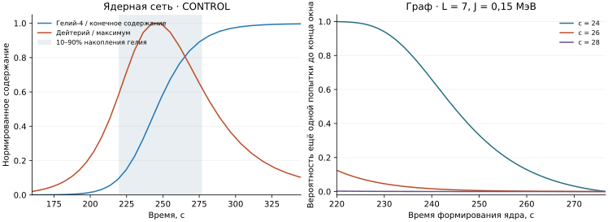

# R150 и сборка ядер. Что определяет знак и время отклика

В присланных десяти блоках спектр графа определял свободную энергию шва, а сила взаимного влияния графа и ядерного канала вводилась вторым, независимым параметром. Ниже построен вариант контакта через наблюдаемую самого R150, рассчитан его знак, восстановлена хронология сборки по сохранённой ядерной сети и проверено, какие выводы переживают смену базиса, часов и нормировки плотности. Ядерная история в этом расчёте взята из контроля. Параметры графа и контакта гипотетические. Совместный физический прогон с выведенными скоростями остаётся открытым.

[Результаты](results.json) · [граф и кинетика](audit.py) · [локальный контакт](contact.py) · [анализ траектории](trajectory.py) · [численности в CONTROL](control.csv) · [исходная модель взаимного формирования](https://github.com/IgorSabirov/vm-lab/blob/45f34fce881d5860b918fff2001bbd149a788a5b/analysis/R150_THREE_GENERATIONS/floquet/phase_bbn/formation/README.md).

## 1. Два слоя и знак контакта

При нечётном L пассивный A имеет цикл длины L и нулевой индикатор события split/merge C. Активный B имеет фиксированное слово t=1 и цикл N=L−1. В B оператор C равен единице при t=0,1. Его смысл задан до выбора ядерного канала. При шве 0→π размерность ядра i(F−F†) меняется в A с 1 до 1, в B с 3 до 1. Чётные L в блоке 10 дают допустимый тест матрицы перестановки, но уравнение 2u=1 mod L тогда не имеет решения. Если искусственно ввести тот же поток в A, тепловая реакция возможна и в A. При L=7, x=4 получены контрасты 0,0145214 в A и 0,0298330 в B. При T→0 и фиксированном J свободноэнергетический сдвиг в A стремится к 2J[1−cos(π/L)], в B — к нулю. Контакт через C имеет отдельный строгий контроль в A.

Пусть r=1 означает периодический шов, r=0 — антипериодический, d=0,1 — свободный и связанный канал пары. Добавим к H_R=−J(F+F†) ровно одно взаимодействие, H_int=−λdC. Положительное λ выгодно связанному каналу на вершине с событием C. Это физическое допущение о том, что мог бы чувствовать ядерный канал. Сам граф даёт C, но не даёт λ. При фиксированном T положим Z_rd=Tr exp[−H_rd/T]. Чистый контакт после суммирования внутренних состояний равен

$$g_{\rm eff}=\ln\frac{Z_{11}Z_{00}}{Z_{10}Z_{01}}.$$

Он равен разности логарифмов констант связывания при двух принудительно установленных швах. Та же величина равна изменению логарифма относительных весов двух швов при связывании пары. Одночастичные сдвиги при этом сокращаются. В частности, одно отношение Z₀/Zπ при d=0 определяет собственное предпочтение шва. Контроль C=I дал бы g_eff=0 при сколь угодно сильном общем сдвиге энергии ядерного канала.

В B все волны длинного цикла имеют вероятность 1/N на t=0. У фиксированного слова C=1 и вес exp(x), x=2J/T. Поэтому при λ=0

$$\langle C\rangle_\phi=\frac1N+\left(1-\frac1N\right)\frac{e^x}{Z_\phi},\qquad
\frac{\partial g_{\rm eff}}{\partial(\lambda/T)}=
\langle C\rangle_0-\langle C\rangle_\pi<0.$$

Знак следует из Z₀>Zπ при x>0. Антипериодический шов убирает низкоэнергетическую равномерную моду длинного цикла и повышает относительный вес фиксированного слова, где C=1. В A имеем C=0 и g_eff=0 точно. На B при λ/T=0,1 получаем из полного матричного экспоненциала:

| L | x | Производная при нуле | g_eff |
|---:|---:|---:|---:|
| 3 | 4 | −0,23237 | −0,022857 |
| 7 | 4 | −0,011259 | −0,00113327 |
| 9 | 4 | −0,00071316 | −0,00007231 |
| 15 | 4 | −1,535·10⁻⁸ | −1,576·10⁻⁹ |

При L=7, x=4 общий сдвиг ядерного логарифмического веса при r=0 составляет +0,055468. Смена шва даёт только −0,00113327, или −0,1133% в относительном равновесном отношении шансов. При λ/T=−0,1 знак смешанного эффекта меняется. Отождествление g с +ln 2, ΔF/T или произвольным сдвигом B_D/T меняет модель. Здесь выведен отклик для заданного оператора и знака λ. Его перенос в физику требует кандидата на взаимодействие с ядерными состояниями, масштаба, плотности и релаксации. Если физический посредник реализует этот контакт, поправка к разности свободных энергий связывания между швами составляет T g_eff в конвенции положительной энергии связи. В среде она входит в равновесное отношение прямой и обратной скоростей n+p↔D+γ. Абсолютную прямую скорость задаёт матричный элемент. При реализации через B_D(q) вклад состава в плотность свободной энергии равен −n_D B_D(q), а сила на q при фиксированном составе равна +n_D B′_D(q). Это место, куда входит архивный профиль n_D=n_b Y_D. Сеть не получает вероятность связывания отдельной пары как итоговое D/H.

## 2. В какую часть сборки попадает граф

Взяты столбцы T, t, Y_D, Y_T, Y_He3, Y_He4 из архивных CONTROL/TRACE_MT и TRACE_LT. Y_i=n_i/n_b. Все отсчёты с 0,014≤T≤0,201 МэВ сохранены в CSV. Общая точка двух эр учтена однократно. Время и температуру интерполируем по архивной сетке. За 100% гелия принято 4Y_He4 при 0,015 МэВ (0,24700138). [Исходные ряды CONTROL в фиксированном коммите](https://github.com/IgorSabirov/vm-lab/tree/b24c7e0cc47ff964d576f903ce7ba507d2dd731e/analysis/CCC_BBN_NETWORK_20261114/s1_fullnet/results/S1_FULLNET_20261114_r1/runs/CONTROL).

| Доля конечного гелия-4 | T, кэВ | Время контроля, с |
|---:|---:|---:|
| 10% | 76,26 | 219,98 |
| 50% | 72,51 | 245,38 |
| 90% | 68,56 | 276,61 |

Пик дейтерия на архивной сетке Y_D=0,00287637 приходится на 242,50 с, T=72,91 кэВ. Это промежуточная численность. К T=0,015 МэВ она падает до 0,00001871. Пик оказывается близок к половине накопления гелия. Для обратного действия через число дейтронов это даёт форму источника во времени. Для прямой тепловой оценки в блоке 8 было принято 7,07×0,247≈1,75 МэВ связанной энергии на барион при всех температурах. Явная сумма B_i Y_i по D, T, ³He, ⁴He даёт 0,0000350 МэВ при 100 кэВ, 0,02238 при 80 кэВ, 1,40369 при 70 кэВ и 1,74468 при 60 кэВ. При 80 кэВ постоянная подстановка завышает этот вклад примерно в 78 раз. Это модуль дефекта массы четырёх ядер. Вычисление потока энергии или полного следа тензора энергии требует учёта продуктов и среды.

Для примера оставлена гипотеза вложения Γ_R=(J/ℏ) exp(−cJ/T). Видимость задана условием ε≥0,01. Пусть t₁ и t₂ соответствуют 10% и 90% гелия, t₀ — более позднее из t₁ и начала видимости. Если t₀≥t₂, вес равен нулю. В остальных случаях считаем

$$W=\frac{\int_{t_0}^{t_2}dY_4(t)\,[1-\exp(-\int_t^{t_2}\Gamma_R(s)\,ds)]}{Y_4(t_2)-Y_4(t_1)}.$$

Это доля прироста гелия в окне, взвешенная вероятностью хотя бы одной последующей попытки перестройки до конца окна, при пуассоновском законе попыток. Порог, часы, закон и вес по приросту заданы явно. Вес по наличному дейтерию отвечал бы иному механизму. W может быть большим даже при λ=0. Профиль W показывает время, доступное взаимодействию. Для изменения выходов нужно ввести контакт обратно в уравнения сети.

| L | J, МэВ | c | T начала видимости, кэВ | ∫Γ_R dt за видимую часть | W |
|---:|---:|---:|---:|---:|---:|
| 7 | 0,15 | 4 | 101,21 | 3,26·10¹⁸ | ≈1 |
| 7 | 0,15 | 24 | 101,21 | 7,396 | 0,49750 |
| 7 | 0,15 | 26 | 101,21 | 0,13365 | 0,02086 |
| 7 | 0,15 | 28 | 101,21 | 0,00243 | 0,000359 |
| 9 | 0,222 | 16 | 80,51 | 20,816 | 0,70144 |
| 15 | 0,40 | 4 | 45,29 | 0 | 0 |

Смысл связи с CCC+TL записывается в тех же единицах. При общих плато-часах dt′=f dt, Γ′_R=Γ_R/f, при сохранении J/T, λ/T, функций состава от T и безразмерного барьера величины ∫Γ_Rdt и W сохраняются. Если частоты ядерных реакций делятся на f, а часы графа остаются прежними, экспозиция графа умножается на f. Для R150/BBN надо вывести именно это относительное масштабирование. Публикация Gupta и Samaras рассматривает условие общих часов для BBN, корпусный S1 проверяет соответствующую инвариантность сети. [Gupta и Samaras](https://arxiv.org/abs/2604.03381) · [контроль S1](https://github.com/IgorSabirov/vm-lab/blob/b24c7e0cc47ff964d576f903ce7ba507d2dd731e/analysis/CCC_BBN_NETWORK_20261114/s1_fullnet/results/S1_FULLNET_20261114_r1/S1_SUMMARY.json).

## 3. Что измеряет двухграничный расчёт

Для бинарных r,d обозначим R=⟨r⟩, D=⟨d⟩ и M=⟨rd⟩. Пусть σ — логистическая функция, a=σ(B), v=σ(b), α=σ(B+g_D→R)−a, κ=σ(b+g_R→D)−v. События каждого типа имеют частоты попыток w_R и w_D. Тогда генератор блока 3 точно эквивалентен уравнениям

$$\dot R=w_R(a+\alpha D-R),\quad \dot D=w_D(v+\kappa R-D),$$
$$\dot M=w_R[(a+\alpha)D-M]+w_D[(v+\kappa)R-M].$$

Равенство проверено как тождество линейных операторов при неравных частотах и раздельно выключенных направлениях. Оно сохраняется при зависимости всех коэффициентов от времени. При одинаковых постоянных частотах ν скорости релаксации в единицах ν равны 1±√(ακ) и 2. Для L=7, x=4, g_D→R=g_R→D=ln 2, b=0 имеем 0,83377, 1,16623 и 2. Прямой отклик D на малый g в момент νt=1 равен 0,0335303 на единицу g.

Чистую петлю выделяет разность четырёх запусков F_both−F_forward−F_reverse+F_off при одинаковом старте 00. Для R,D,M в момент νt=1 она равна +0,00117119, +0,00115526 и +0,00210008. В разложении по τ=νt однократное влияние на другой маргинал начинается с τ², а смешанный сигнал в R и D — с aακτ³/6 и vακτ³/6. Знак и амплитуды выше относятся к ручному g=ln 2. При равных g обе стороны совместимы с одной свободной энергией. При независимом выключении одного направления логарифм отношения произведений скоростей по прямому и обратному обходам квадрата равен g_R→D−g_D→R (обход 00→10→11→01→00). Это интервенционные, потенциально неравновесные контроли.

В протоколе сначала R, затем D значение R уже заморожено, когда регистрируют ядро. При позднем d=1 оценка раннего R меняется с 0,320846 до 0,386463. Этот сигнал полностью воспроизводится классической формулой p_i(t)h_i(t) с нормировкой, где h_i — вероятность позднего результата из i. Для квантового промежуточного инструмента с операторами K_m соответствующий числитель равен Tr[E(t) K_m ρ(t) K_m†]. Нужно предъявить инструмент, приготовление и когерентный эффект, которые отличают квантовый вариант от классического. [Gammelmark, Julsgaard, Mølmer](https://doi.org/10.1103/PhysRevLett.111.160401).

Даже вся конечная таблица p(r,d) имеет ограничение. Одновременный генератор Q_R+Q_D можно получить пределом дробления чередующихся неперекрывающихся окон. При равной интегральной экспозиции и одном календарном интервале это требует удвоения разрешённых частот на активных полуинтервалах. Для симметричного порядка R/2,D,R/2 расстояние полной вариации до одновременного протокола равно 0,002468 при одном цикле, 9,44·10⁻⁶ при 16 и 5,90·10⁻⁷ при 64. Без независимой верхней границы частоты или данных внутри окна конечный выход не различает эти механизмы с заданной конечной точностью. Если частоты зафиксированы, последовательный протокол требует большего времени.

## 4. Тепловой предел, базис и время считывания

Для B, чётного N и 0<x<∞ имеем 0<ε=1−Zπ/Z₀<1/2. Разность Z₀−Zπ равна 4N сумме модифицированных функций Бесселя I_mN(x) по положительным нечётным m. Каждое слагаемое положительно. На [0,π] функция exp(x cos θ) убывает. Сравнение узлов и полуцелых промежутков длинного цикла даёт Z₀−Zπ<exp(x)−exp(−x)<Zπ. При x→∞ у Z₀ два состояния минимальной энергии, у Zπ одно. Поэтому ε→1/2. Именно попытка найти конечный корень для половины прерывает блок 4. Переход к порогу 0,4 в блоке 5 корректен. Для подавленных сигналов следует суммировать положительный бесселев ряд со снятым exp(x). При N=14, x=1 получено 1,95005·10⁻¹⁵ вместо 2,22045·10⁻¹⁵ при вычитании двух округлённых весов. При N=30 ещё разрешается 1,04358·10⁻⁴¹.

При x=cN² и N→∞ предельный контраст равен

$$1-\frac{1+\sum_{k\in\mathbb{Z}} e^{-2\pi^2 c(k+1/2)^2}}{1+\sum_{k\in\mathbb{Z}}e^{-2\pi^2 c k^2}}.$$

Единицы в обоих выражениях — фиксированное слово. Формула следует разложением cos вблизи максимума и суммированием обеих сторон дискретной решётки импульсов. Для контрастов 1%, 10%, 40% требуются x/N²→0,0922442, 0,170850, 0,466479. При фиксированном J абсолютная энергия ΔF=−T ln(1−ε) на B уходит к нулю при обоих температурных краях. На L=7 численный максимум ΔF/J=0,0609624 при T/J=0,141184. При J=0,15 МэВ это T≈21,18 кэВ и ΔF≈9,14 кэВ, позже основного роста гелия в данном контроле. Максимизация одной видности оптимизирует другую величину.

В блоке 2 скорость перехода содержит квадрат модуля матричного элемента между отдельными собственными векторами. Равная смесь фиксированного слова и равномерной волны при нулевом потоке инвариантна при их вращении. Физический детектор связанного канала также инвариантен. Тем не менее при углах 0, π/8, π/4 код даёт P_D(1)=0,2712383, 0,2724953, 0,2732577. Значит, среда в таком рецепте различает конкретные лучи вырожденного уровня. Это дополнительная гипотеза о среде. В альтернативном генераторе скачки P_j S P_i соединяют целые энергетические подпространства при фиксированном ядерном канале, с весами детального баланса. Он сохраняет след и стационарное тепловое состояние. Для всех трёх базисов в этом варианте получено 0,2614684. Это один проверяемый выбор диссипатора. [О вырождении в кинетике открытых систем](https://doi.org/10.1103/PhysRevA.103.062226).

В исходном базисе и с исходной подготовкой переходный контраст P_D(φ=0)−P_D(φ=π) достигает 0,0466155 при νt=1,35091, или 6,157 равновесного контраста. Точка νt=1 давала 5,920. Для объявленной суммы начальных интенсивностей захвата есть прямой контрпример. При b=1, x=4, L=7 сумма 4,58583, тогда как Lσ(b)=5,11741. При b=0 равенство сохраняется за счёт попарной симметрии энергий длинного цикла и σ(z)+σ(−z)=1.

## 5. Бюджет энергии и посредник

В блоках 8–9 плотность одного флейвора ν+анти-ν завышена вдвое. В приближении мгновенного развязывания ρ_ν1=(7π²/120)T_ν⁴=6,12068·10⁻⁶ МэВ⁴ при Tγ=0,08 МэВ. Выражение для безмассового бозона в начале блока 8 уже согласуется с этой нормировкой. Для стабильного бозона с нулевым химическим потенциалом, развязавшегося релятивистски, интегрируем импульсное распределение с энергией √(p²+m²). Сценарные входы — m_X=2J, число физических степеней g_X, температура импульсов T_X/Tν=(10,75/g_*s,dec)^(1/3) и диагностический потолок ρ_X/ρ_ν1=0,17 при одной Tγ. Перевод этого потолка для массивного вещества в наблюдательное ограничение требует истории ρ_X(T), давления и сети. [PDG, Neutrinos in Cosmology](https://pdg.lbl.gov/2025/reviews/rpp2025-rev-neutrinos-in-cosmology.pdf).

| g_*s при развязывании | g_X | Нижний порог ρ_X/ρ_ν1 при m=0 | J_max, МэВ | Допустимые L из {3,7,9,15} при T_графа=Tγ и ε≥1% |
|---:|---:|---:|---:|---|
| 28 | 1 | 0,15945 | 0,01708 | 3 |
| 106,75 | 1 | 0,02677 | 0,22385 | 3, 7, 9 |
| 106,75 | 7 | 0,18740 | — | нет |
| 202 | 1 | 0,01144 | 0,42974 | 3, 7, 9 |
| 202 | 7 | 0,08007 | 0,05210 | 3 |

При L=9 нижний порог J=0,22058 МэВ, так что в часто обсуждаемой строке 106,75/1 запас всего 0,00327 МэВ. При L=15 порог 0,70649 МэВ закрывает даже строку 202/1 при общем Tγ. Если внутренний спектр мог термализоваться при T_X, в этой строке L=15 снова проходит. Графовые состояния и физические виды частиц требуют отдельного соответствия. [Обзор ядерной сети BBN](https://pdg.lbl.gov/2025/reviews/rpp2025-rev-bbang-nucleosynthesis.pdf).

В конце блока 8 диапазон m_σ/H по собственной таблице равен 2,32·10¹⁵–1,73·10¹⁷. Подпись «22–24 порядка» неверна. Для канонического поля с источником n_D B′_D и квадратичной энергией в статическом линейном приближении ΔB_D=n_D(B′_D)²/m_σ². Числа 0,0037–0,276 эВ относятся к принятому |B′_D|=1. При неизвестной связи измерима комбинация m_σ/|B′_D|. Для памяти требуется частотная восприимчивость, начальные условия и демпфирование. Источник всего следа плазмы и источник только дейтронов различны.

Интервал −32,09…+7,70 кэВ из блока 10 арифметически воспроизводится. Коэффициент 5,7701 получен для изменения силы NN-потенциала в конкретной модели, интервал δ_NN=−0,0025…+0,0006 авторы получили из D и ⁴He при выбранных параметрах. Совместное варьирование скоростей и энергий отличается от включения одного локального шва в узком окне температур. Такую границу можно применять к новому порталу после отображения его на те же ядерные параметры. [Модель потенциала](https://inspirehep.net/files/1f76fcab7c0c610d5a12183c6ea11958) · [граница из BBN, §3.2](https://www.memsait.it/volumi/Vol.%2085%20n.%201%2C%202014/2014MmSAI..85..124C.pdf).

## Проверка и граница вывода

В каталоге нужны Python 3, NumPy и SciPy. Команда `OPENBLAS_NUM_THREADS=1 python audit.py` выводит все численные таблицы. Для рисунка требуется Matplotlib и команда `python figure.py`. Исходный файл пользователя имеет SHA-256 `c078827e5790dca3541cecdbde0de033213eb641e40c06014195b39f33bd6bca`. Команда `python extract.py input.md replay` извлекает десять блоков именно этого файла, убирает экранирование Markdown и выполняет блоки по отдельности. Девять завершаются успешно, четвёртый доходит до поиска недостижимого конечного корня. Git blob архивных рядов MT и LT равен соответственно `582aa9f92610cb278b8d18e53703634b3f2ae60d` и `b6866df3148e026bfdec2d8b06a6c7977c8fe4fb`.

Физический различающий опыт требует общего кандидата на λC, связи с B_D или конкретными матричными элементами и согласованных прямых и обратных скоростей. Его выход — история n_D(t), ⁴He(t), распределение состояния графа, окончательные D/H и Yₚ в четырёх расчётах с отдельно выключенными направлениями. Для контроля следует разрешить общей локальной модели постотбор и память. Из имеющегося кода уже следуют знак выбранного контакта, временной профиль источника и различающий отклик на вмешательства в конечной модели. Численные значения масс поколений, амплитуда физической обратной связи и наблюдаемое изменение содержания элементов остаются неопределёнными.
