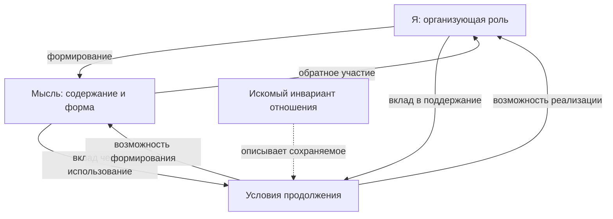

# Я / Мысль, инвариант и метафизический «Бог»

6 ноября 2026. Подробный отдельный разбор по наработкам модели «сейчас».
Исходный срез: `62f748b31ea8dc62c984ed4d85950251ee4df7e6`.

**Содержательная связь проходит через организацию, которая участвует в
формировании собственных условий продолжения.** Мысль в исходном словаре
обозначает оформленное содержание и его проявление; Я — предполагаемую
роль самоотнесения и организации этого содержания. Искомый инвариант
должен описывать сохраняемое в таком отношении при изменении реализации.
Название «Бог» может относиться к основанию всей этой возможности либо,
в более сильной гипотезе, к единому Я целого. Это разные утверждения.

В корпусе есть условные результаты, поддерживающие постановку: сохранение
канального отклика при различии реализаций, физически действенная внутренняя
коррекция, различие функции и способности её восстанавливать. Есть также
конкретный незакрытый переход: результат действия должен становиться
внутренним содержанием, а содержание — участвовать в формировании следующего
действия и условий собственного продолжения. Общей реализации этой связки
и вывода единого субъекта мира пока нет.

Ниже три вида утверждений помечаются по смыслу: **наработка** — то, что уже
сохранено с условиями; **рабочее прочтение** — предлагаемая связь понятий;
**метафизическая гипотеза** — дополнительное утверждение об устройстве
реальности. Их различие нужно для понимания аргумента, а не для оценки
престижа. Новизна не является целью этого разбора.

[Общий реестр](../NOW_RESULTS_SYNTHESIS_20261106/RESULTS_REGISTER.md) ·
[план и генеалогия](PLAN.md) · [источники](SOURCE_INDEX.json) ·
[результат работы по плану](COMPLETION.md).

## 1. Что именно означает здесь «Я(Мысли)»

Вопрос читается через исходную формулировку:

> «Я задумал Мысль, а Мысль собрала Я».

Это сохранённая в корпусе реплика пользователя [S1, §7]. Скобки в нынешнем
запросе не принимаются за уже доказанное тождество Я и Мысли. Существенна
их связь: Я рассматривается как источник/организующая сторона мысли,
а Мысль — как то, через что Я получает определённость и реализацию.

Ранее ассистент предложил самомодель как возможный способ изучать эту
связь. Пользователь не принимал её за исчерпывающее определение Я. Поэтому
сведение всего вопроса к «есть ли у системы описание себя» потеряло бы
исходный смысл. Но и простое сохранение широкого слова «Я» не задаёт
измеримого свойства: рабочую роль ещё надо связать с различиями в устройстве
и действии.

| Слово | Смысл, сохраняемый из проекта | Статус |
|---|---|---|
|Я|Кандидат на внутреннюю роль самоотнесения и организации формирования мысли/наблюдаемого|Рабочая гипотеза; не выделенный физический орган и не готовый критерий субъекта|
|Мысль|Содержание и форма его реализации; в сильном тезисе «материя — Мысль» это распространяется на наблюдаемый мир|Феноменологическое и онтологическое прочтения нужно различать|
|Наблюдаемое|Доступное проявление отношений целого, включая взаимодействие и способы различения|Должно учитывать обе роли, если проверяется именно их связь|
|Инвариант|Явно определённое сохраняемое относительно указанного сравнения или преобразования|Часть вариантов уже определена; общий генетический вариант открыт|
|Метафизический Бог|Название основания существования, целого либо предполагаемого Я целого|Значение выбирается явно; переходы между ними не автоматические|

Самый сильный смысл исходной фразы: определённое Я и определённая Мысль
могут быть двумя взаимозависимыми сторонами одной организации. Тогда
не требуется помещать готовое Я «до» любой мысли в уже существующем времени.
Однако слово «задумал» содержит целенаправленность. Если её ещё предстоит
объяснить, она остаётся частью гипотезы, а не бесплатным следствием
взаимозависимости.

## 2. Три уровня, которые важно удержать одновременно

**Локальное Я.** Внутренний наблюдатель имеет ограниченный доступ, тело
или иной носитель, историю, возможности действия. Описания собственного
состояния могут причинно влиять на его действия. Это уровень, на котором
вообще можно поставить содержательные задачи памяти, коррекции и
самопредставления.

**Организация целого.** Локальные наблюдатели, носители и записи входят
в одно «сейчас». Их отношения могут совместно определять доступные
действия и продолжения. Наличие такой организации не требует отдельного
наблюдателя за Вселенной снаружи. Но наличие субъектов внутри целого
ещё не делает всё целое одним субъектом [S2; [R080](../NOW_RESULTS_SYNTHESIS_20261106/RESULTS_REGISTER.md#r080-обучение-и-саморепрезентация-не-тождественны-сильному-выбору)].

**Основание существования организации.** Откуда берутся сами возможности
различия, связь, мера и правило? Это исходный вопрос C001/[R001](../NOW_RESULTS_SYNTHESIS_20261106/RESULTS_REGISTER.md#r001-граница-первичной-флуктуации). Он не
снимается получением работающего механизма внутри заданной физики.

Эти уровни связаны, но вопрос на одном уровне нельзя закрыть ответом
на другом. Внутренняя причинная роль Я может быть реальной при ещё
необъяснённом происхождении закона. И наоборот: гипотеза об общем основании
не указывает автоматически, где в мире имеется самопредставление.

Отсюда полезное разделение трёх задач: **реализовать роль; показать её
преемственность; объяснить происхождение условий её возможности**.
Это не три независимых мира и не новая обязательная архитектура модели.

## 3. Что у нас уже есть под именем инварианта

У слова «инвариант» в архиве несколько смыслов. Для связи с Я различие
между ними решающее [S3; [R057](../NOW_RESULTS_SYNTHESIS_20261106/RESULTS_REGISTER.md#r057-спектральный-инвариант-отклика)–[R064](../NOW_RESULTS_SYNTHESIS_20261106/RESULTS_REGISTER.md#r064-цикл-ремонта-требует-доказанного-последнего-звена), [R100](../NOW_RESULTS_SYNTHESIS_20261106/RESULTS_REGISTER.md#r100-сохранение-индексация-и-полнота-описания--разные-задачи)].

| Смысл | Что сохраняется | Что это даёт вопросу о Я |
|---|---|---|
|Инвариант представления|Предсказания при согласованной смене координат|Не позволяет объявлять новое Я из-за смены записи|
|Инвариант отклика|Полная функция действия через заданный канал|Разделяет реализацию и её наблюдаемую функцию|
|Сохраняемая величина|Значение конкретного функционала вдоль заданной динамики|Даёт ограничение, но может почти ничего не говорить о внутренней организации|
|Устойчивость роли|Работоспособность в заданном классе повреждений и на заданном горизонте|Позволяет отличить одинаковый текущий выход от разной способности продолжать|
|Генетическая преемственность|Отношение, участвующее в возникновении/воспроизводстве условий самой роли|Это ближайший кандидат на связь с исходной постановкой Я; общий объект ещё не получен|

### 3.1. Точный пример: одинаковая функция при разных реализациях

Для принятого конечномерного эрмитова класса уже рассмотрены

\[
\mu_V(B)=V^\dagger P_H(B)V,\qquad
\Sigma(z)=\int\frac{d\mu_V(E)}{z-E}.
\]

При фиксированных видимом секторе и его гамильтониане полная операторная
мера задаёт соответствующий эффективный отклик. Согласованная унитарная
смена внутреннего базиса сохраняет его. Это известный спектральный аппарат,
применённый к задаче проекта, а не отдельное открытие [S3, §§1–2; [R057](../NOW_RESULTS_SYNTHESIS_20261106/RESULTS_REGISTER.md#r057-спектральный-инвариант-отклика)].

Здесь появляется полезный смысл «того же самого»: разные внутренние
реализации могут выполнять одну и ту же функцию на объявленном интерфейсе.
Такой язык позволяет обсуждать сохранение организации без требования
неизменности каждого её элемента.

Но он пока не описывает физическую замену элементов во времени. Равенство
двух математических реализаций по функции и процесс перехода от одной
к другой — разные задачи. Для процесса нужны допустимые взаимодействия,
ресурсы и условия сохранения функции по пути.

### 3.2. Контрпример уже лежит в нашем архиве

Расширение H до H⊕K и V до V⊕0 сохраняет μ_V при произвольном отвязанном K.
Следовательно, одинаковый канальный инвариант допускает разные полные
устройства. По нему нельзя восстановить всё целое, его историю или наличие
какого-либо не заданного этим каналом свойства.

Другой пример — [R060](../NOW_RESULTS_SYNTHESIS_20261106/RESULTS_REGISTER.md#r060-нейронная-линейная-игрушка-одинаковый-отклик-разный-ремонт): реализации с одним текущим произведением ac могут
по-разному восстанавливаться после повреждения при объявленном законе
обучения. Здесь существенны физически выбранные воздействия и динамика.
При простой смене координат нужно переносить и их: смена обозначений сама
не создаёт различия устройств [S2; [R059](../NOW_RESULTS_SYNTHESIS_20261106/RESULTS_REGISTER.md#r059-стоимость-смены-реализации-зависит-от-допустимых-повреждений)–[R061](../NOW_RESULTS_SYNTHESIS_20261106/RESULTS_REGISTER.md#r061-нелинейный-постоянный-шрам-не-доказан-для-полного-обучения)].

**Приращение для вопроса о Я:** функциональный инвариант — хорошая
начальная опора для понятия преемственности, но его недостаточность уже
продемонстрирована внутри нашей программы. Повторять этот факт новым
численным опытом не требуется.

### 3.3. Один и тот же инвариант и одно и то же Я

Если I(S₁)=I(S₂), это означает равенство выделенного признака.
Чтобы отсюда получить S₁=S₂, нужна инъективность I в объявленном классе.
А чтобы говорить о тождестве субъекта, сначала требуется определить,
какое отношение тождества вообще проверяется. Подставить слово «Я» вместо
S недостаточно.

Нужно различать одинаковую функцию, сходное содержание, причинную
преемственность и численное тождество конкретного субъекта. Наш спектральный
результат касается первого пункта. Он не решает вопрос переноса переживания
между носителями, сохранения личности после копирования или бессмертия.
Эти выводы нельзя получить лишь из того, что инвариант не зависит от
выбора внутреннего базиса.

## 4. Самое содержательное прочтение связи Я и инварианта

Предлагаемое прочтение: **Я ищется как реализованная роль в организации,
а инвариант — как описание того, что делает эту роль преемственной при
допустимых изменениях.** Так инвариант не заменяет собой действующую
организацию, а помогает формулировать, что именно в ней считается
сохранившимся.

В этой постановке Мысль не обязана быть пассивной записью. Её содержание
может изменять последующее действие организации. Тогда возникает вопрос,
которого не было у одного спектрального отклика: меняет ли содержание
условия, благодаря которым сама способность формировать содержание
продолжает существовать?

Полезно различать три постепенно усиливающихся утверждения:

1. Организация сохраняет некоторую функцию при изменении состояния.
2. Её внутреннее содержание причинно влияет на дальнейшее действие.
3. Это влияние участвует в воспроизводстве условий функции и формирования
   нового содержания.

Первый пункт встречается в многочисленных обычных системах. Второй
требует отличить содержание от сопутствующего физического воздействия.
Третий связывает вопрос Я/Мысли с генетической преемственностью. Даже
вся тройка пока является кандидатом для исследования определённой
организационной роли, а не принятым достаточным критерием переживания.

Принять эти пункты как определение любого генетического инварианта было
бы преждевременно: тогда самопредставление оказалось бы внесено в исходные
условия. Пользователь ранее оставлял его отдельной повесткой; нынешний
запрос разрешает анализ связи, но не отменяет необходимость вывести её
в конкретной модели [S4; [R006](../NOW_RESULTS_SYNTHESIS_20261106/RESULTS_REGISTER.md#r006-генетический-порядок-до-времени), [R082](../NOW_RESULTS_SYNTHESIS_20261106/RESULTS_REGISTER.md#r082-фильтры-t-coreadm_t-не-выделили-субъекта)].

## 5. «Мысль собрала Я»: как читать взаимное становление

У фразы есть два разных прочтения.

**В уже заданном времени** действие организации формирует содержание;
следы и использование содержания меняют организацию следующих действий.
Так может возникать и сохраняться определённый способ самоотнесения.
Процесс имеет носители, взаимодействия, затраты и историю.

**До введения временной очередности** речь может идти о совместной
определимости: допустимое целое должно одновременно удовлетворять
условиям организации и реализуемого содержания. Тогда вопрос «кто был
первым по часам?» не является обязательным. Взаимная обусловленность
не превращается от этого в объяснение существования целого.

Для второго смысла у нас уже рассмотрена схема самосогласованности
μ=P(C), C=R(μ) [S5; [R037](../NOW_RESULTS_SYNTHESIS_20261106/RESULTS_REGISTER.md#r037-неподвижная-точка-не-равна-происхождению-и-устойчивости)]. Она полезна тем, что не требует готового
временного первенства одной стороны. Но C нельзя без вывода назвать Я,
а μ — Мыслью: одному распределению может не хватать потоков, истории
или отношений, необходимых для определения R.

В прежнем разборе уже отделены существование решения, его нетривиальность,
единственность, устойчивость и физическое осуществление. Для каждой из
этих задач нужны свои основания. Нельзя замкнуть объяснение таким ходом:
«Я существует, потому что его собирает Мысль; Мысль существует, потому
что её мыслит Я» — без предъявления хотя бы одного согласованного
нетривиального целого и условий его осуществимости.

Генетическая зависимость также не обязана быть строгим порядком. Если
выбран именно строгий порядок ≺, одновременно Я≺Мысль и Мысль≺Я
недопустимы. Взаимную определимость надо описывать отношением другого
типа. Это уточнение языка, не доказательство невозможности исходной идеи.

## 6. Почему запись должна становиться действием

Самый конкретный мост к Я/Мысли сейчас находится в [R075](../NOW_RESULTS_SYNTHESIS_20261106/RESULTS_REGISTER.md#r075-запись-теми-же-взаимодействиями-что-исполнение), а не в одном
названии сознания: **взаимодействие оставляет внутренний след; использование
следа меняет последующее действие; дальнейшее использование физически
возможно** [S6].

Это точка, где фраза «Мысль участвует в формировании Я» может получить
отличимый смысл. Должно быть возможно указать, какое внутреннее различие
используется, как оно возникло, что именно оно меняет и что происходит
с носителем при таком использовании.

Формула наблюдаемой O=f(x,x) сама по себе этого не делает. Ещё нужны
реальное взаимодействие, запись результата, влияние чтения на состояние
и возможность следующего действия. Прибор, архив или планировщик нельзя
считать внутренними только потому, что их названия включены в схему.

Обратно, не нужно требовать полного знания системой всех своих степеней
свободы. Для конкретной коррекции могут быть достаточны различия,
существенные для требуемого действия. Полная самопрозрачность не выведена
как необходимое условие Я или коррекции. Из ограниченности доступа также
не следует отсутствие самого причинного отношения.

Следующая схема показывает **целевую гипотезу связи**, а не уже
реализованный механизм. Пунктир означает описание, а не физическую силу.

Инвариант не добавляется сюда как ещё один исполнитель. Действуют
конкретные отношения и процессы; инвариант характеризует их организацию.
Если теория хочет придать самому инварианту отдельный онтологический
статус, это уже дополнительная гипотеза, которую надо сформулировать.

## 7. «Материя — Мысль»: два уровня силы утверждения

Слабое рабочее прочтение: содержание существует в доступной физической
форме и влияет на действие через эту форму. Это позволяет искать
механизм внутренней записи и использования без отдельного нематериального
посредника. Оно не требует считать любую физическую корреляцию мыслью.

Сильное онтологическое прочтение: весь наблюдаемый материальный мир
есть реализация Мысли, а Я связано с её формированием на уровне целого.
Тогда меняется не только описание локального наблюдателя, но и объяснение
статуса всей физики. Наши транспортные, спектральные и композиционные
результаты этого тождества не устанавливают.

Промежуточная исследовательская возможность — показать, что структура
физической организации и структура используемого содержания связаны
одним механизмом. Это усилило бы слабое прочтение, но всё равно не было
бы автоматическим доказательством сильного.

Сохранённый пример Вики мотивировал для пользователя вопрос о единстве
мысли и выражения. В данном разборе это феноменологическая опора смысла,
без вывода о доступе ко всей чужой мысли, особом статусе конкретного
человека или устройстве Вселенной. Никакого нового исследования человека
этой постановкой не назначается [S1, §8].

## 8. Четыре смысла метафизического «Бога»

Здесь не предлагается одно определение для всех религий. Разбираются
возможные значения слова относительно поставленной модели.

| Значение | Утверждение | Связь с Я и инвариантом |
|---|---|---|
|Основание существования|Есть основание, благодаря которому вообще возможны различия и организация|Я могло бы быть производным проявлением; субъектность основания ещё не следует|
|Имманентное целое|Мир включает условия своих проявлений|Инвариант описывает отношения целого; наличие локальных Я не устанавливает одного Я целого|
|Единое Я целого|Целое обладает единой ролью самоотнесения и, в сильной версии, субъективностью|Нужно обосновать единство этой роли и отношение к локальным наблюдателям|
|Внешний конструктор|Мир создаётся или управляется отдельным субъектом|Происхождение конструктора и механизм воздействия становятся новыми вопросами|

### 8.1. Бог как основание

Это самое близкое вопросу об абсолютном «ничего» значение: речь идёт
об основании, а не о механизме внутри готовой физики. Но имя само
не отвечает, почему основание существует, почему допускает различие
и почему реализована именно такая организация.

Если основание объявляется необходимым, нужны смысл этой необходимости
и аргумент в её пользу. Совместимость возможного мира не равна его
необходимому существованию. [R003](../NOW_RESULTS_SYNTHESIS_20261106/RESULTS_REGISTER.md#r003-самосогласованность-не-обеспечивает-непустоту) относится к определённому классу
условий замкнутости и показывает опасность пустого решения; он не
является универсальной теоремой против любой метафизики.

В этой версии Я не обязано совпадать с основанием. Оно может быть одной
из допускаемых им организаций. Чтобы назвать его выражением свойств
основания, нужна связь наследования. В [R006](../NOW_RESULTS_SYNTHESIS_20261106/RESULTS_REGISTER.md#r006-генетический-порядок-до-времени) эта гипотеза сохранена,
но отображение между уровнями не построено. Появление способности
из основания не означает, что она уже имеется у основания в том же виде.

### 8.2. Бог как имманентное целое

Эта версия согласуется с установкой не вводить внешнего исполнителя
законов. Организация, проявления и локальные наблюдатели входят в одну
реальность. Математическое описание исследователя не является ещё одной
физической сущностью за пределами модели.

Содержательный вопрос: целое только содержит процессы или отношения
целого участвуют в определении их допустимости и продолжения? Чтобы
второе стало физической гипотезой, надо указать ограничения и отличимые
следствия. Одного слова «целое» недостаточно.

Если «Бог» просто заменяет выражение «всё существующее» без дополнительных
условий, предсказания от переименования не меняются. Философское значение
такого словаря может сохраняться; эмпирическое обоснование требует
отдельного шага.

### 8.3. Бог как Я целого

Это наиболее сильная связь с исходной формулой. В ней мир не только
совместно организован: его содержание участвует в определении собственной
организации как содержание **одного** целого. «Мысль собрала Я» получает
космологическое прочтение.

Однако добавляются два самостоятельных утверждения: наличие соответствующей
роли на глобальном уровне и её единство. Из многочастичных корреляций,
общего происхождения или неаддитивного ответа не следует единственный
субъект. Из множества локальных субъектов он также не получается простым
суммированием.

Нужно выяснить, что определяет границу этого единства и почему отношение
является самоотнесением целого, а не совокупностью локальных контуров.
Это не требование человеческого лица, биографии или внешнего наблюдателя
за Вселенной. Требуется связать приписываемую целому роль с его устройством.

Если дополнительно утверждается переживание целого, оно не становится
теоремой от одного функционального критерия. Это отдельное онтологическое
утверждение, связь которого с механизмом можно исследовать.

### 8.4. Бог как внешний конструктор

В принятой постановке такая версия не является исходным решением:
организатор снова оставляет вопрос о своём происхождении, правилах
действия и отношении к миру. Объяснительный долг переносится, пока
не показано, что именно новый объект объясняет.

Но **внешний физический управляющий** и **метафизическое основание** —
не одно и то же. Основание не обязано быть объектом в соседнем пространстве.
Отказ от внешней лаборатории Вселенной не является эмпирическим
опровержением всех понятий Бога. Он определяет границы нашей постановки.

## 9. Какая связь между Богом и Я вырисовывается

Первое рабочее прочтение задаёт последовательность вопросов:

**Основание → возможность организованного целого → внутреннее
самоотнесение → реализация Я/Мысли.**

Это порядок объяснительных задач, а не временная хроника и не доказанная
цепочка причин. Искомый генетический инвариант должен показать, какое
отношение сохраняется или преобразуется между уровнями. Он не получает
эту функцию просто по названию.

Второе прочтение сильнее: основание, целое и его самоотнесение — аспекты
одной реальности. Тогда «Бог», «Я» и «Мысль» именуют разные стороны
единого. Это метафизическая гипотеза; в корпусе нет вывода
их тождества.

Цена прочтений различается. В первом остаётся объяснить переход от
основания к самоотнесению. Во втором связь внесена как свойство основания:
надо показать, что этим объясняется, а что лишь переописано. Идея
становится полезной, если позволяет связать прежде независимые входы
модели одним явно предъявленным отношением.

Поэтому она не исчерпывается метафорой. Она направляет поиск организации,
в которой формирование проявлений и формирование условий этих проявлений
связаны одними процессами. Успех уменьшил бы объяснительный долг;
неудача конкретной реализации ограничила бы её, не всю мыслимую
метафизику.

**Самая содержательная формулировка на сегодня:** Я/Мысль — кандидат
на отношение взаимного формирования; инвариант — искомая характеристика
его преемственности; метафизический Бог — возможное имя основания или
предельного целого, к которому предлагается распространить это отношение.
Последнее распространение требует собственного аргумента.

## 10. Неизменность, жизнь и собственное продолжение

Инвариант не обязательно означает неподвижность. Фиксироваться может
определённый класс отношений, тогда как состояния и носители меняются.
Но слишком грубый инвариант сохранится и после утраты интересующей роли:
равная энергия или энтропия не удостоверяет сохранение содержания[[R100](../NOW_RESULTS_SYNTHESIS_20261106/RESULTS_REGISTER.md#r100-сохранение-индексация-и-полнота-описания--разные-задачи)].

Вопрос состоит в том, **какие изменения совместимы с продолжением именно
этой организации**. Для Я общего ответа пока нет. Его нельзя получить
кругом: назвать допустимыми только сохраняющие Я преобразования,
а затем объявить сохранение Я выведенной теоремой.

[R062](../NOW_RESULTS_SYNTHESIS_20261106/RESULTS_REGISTER.md#r062-m4-внутренний-ремонт-возможен-с-подготовленным-запасом) даёт внутренний ремонт за счёт подготовленного запаса; [R064](../NOW_RESULTS_SYNTHESIS_20261106/RESULTS_REGISTER.md#r064-цикл-ремонта-требует-доказанного-последнего-звена) требует
замкнуть последнюю стрелку регенерации; [R063](../NOW_RESULTS_SYNTHESIS_20261106/RESULTS_REGISTER.md#r063-ремонт-доступа-и-восстановление-старого-содержания-различны) различает ремонт доступа
и возврат старого содержания. Формула «Я сохраняет себя» должна учитывать
судьбу носителей, записи, ошибок и ресурсов.

Название «Бог» не устраняет физических условий организации. Для
локального организма учитываются отношения с окружением. Для замкнутого
целого возможны внутренние потоки между частями, но внешняя подпитка
не может появиться незаявленной. К метафизическому основанию вне выбранного
физического класса, в свою очередь, нельзя автоматически переносить
свойства локального ремонта.

Инвариант отклика, отсутствие внешнего источника и внутреннее поддержание
могут быть совместимы. Из их совместимости не следует бесконечный ресурс
повторения. Ограничения [R066](../NOW_RESULTS_SYNTHESIS_20261106/RESULTS_REGISTER.md#r066-информационная-ёмкость-точного-исправления) и [R077](../NOW_RESULTS_SYNTHESIS_20261106/RESULTS_REGISTER.md#r077-конечное-унитарное-целое-не-имеет-нетривиального-вечного-монотонного-функционала-указанного-типа)/[R078](../NOW_RESULTS_SYNTHESIS_20261106/RESULTS_REGISTER.md#r078-симметрия-ансамбля-не-запрещает-направленные-истории) сохраняются в своих классах.

## 11. Я, свобода и «программа первого удара»

В бильярдном обсуждении пользователь уточнил раннюю реплику: наблюдатель
с Я может существовать при детерминизме; спор касается более сильной
свободы, если вся трассировка уже определена [S7]. Это уточнение сохраняется.

| Утверждение | Что требуется различить |
|---|---|
|Внутреннее содержание действует|Меняется ли действие при согласованном изменении релевантного внутреннего состояния|
|Организация имеет цели/критерии|Как они представлены, используются и поддерживаются; что заранее задано постановкой|
|При одних полных условиях возможен иной исход в сильном смысле|Каков класс полных описаний и какие пополнения допустимы|

Детерминированный закон сам по себе не делает первые два свойства
фиктивными. Случайность сама по себе не даёт ни субъекта, ни намерения,
ни выбора в чьих-либо интересах[[R076](../NOW_RESULTS_SYNTHESIS_20261106/RESULTS_REGISTER.md#r076-классификация-проекта-определяется-корректирующей-ролью),[R080](../NOW_RESULTS_SYNTHESIS_20261106/RESULTS_REGISTER.md#r080-обучение-и-саморепрезентация-не-тождественны-сильному-выбору)]. Представленная альтернатива
и физически неопределённое полное будущее тоже различаются.

Из упорядоченности истории не выводится бильярдист; из непредсказуемости
не выводится Я; из наличия Я без дополнительного аргумента не выводится
фундаментальная непредрешённость. Кодирование истории в начальных данных
ещё не объясняет происхождения данных и не доказывает программиста.

Для внутреннего наблюдателя вопрос о Я целого получает эмпирическое
содержание через отличимые последствия в доступных историях и допустимых
вмешательствах. Если два описания совпадают по всем таким проверкам,
эмпирического различия в этом классе доступа нет [S2]. Это условие
сильнее совпадения одной случившейся истории.

Остаются философские вопросы экономии объяснения и онтологии. Их можно
исследовать содержательно, но предпочтённое описание не становится
экспериментальным обнаружением Бога. Наличие Я у конкретного человека
также не отождествляет его с предполагаемым субъектом целого.

## 12. Два маршрута возникновения и довременное основание

В реестре сохранены оба маршрута:

1. **Пуск → организация → продолжение после завершения инициатора.**
   Можно искать образование отношений, участвующих в воспроизводстве
   собственных условий.
2. **Флуктуация уже организованного целого на допустимой стадии.**
   В [R096](../NOW_RESULTS_SYNTHESIS_20261106/RESULTS_REGISTER.md#r096-возникновение-на-допустимой-внутренней-стадии-с-самосогласованным-причинным-прошлым) целое имеет согласованное причинное прошлое и механику
   продолжения, не обязательно начиная с первого момента внутренней истории.

Во втором случае согласованные записи и связи ещё не доказывают
фактического прохождения представленного прошлого. В первом образование
структуры ещё не объясняет происхождения физики и начальных условий.
Эти различия нужны вопросу основания; внутреннюю причинность они не
обесценивают.

Одинаковый текущий инвариант может соответствовать разным способам
происхождения. Поэтому он не обязан определять генеалогию. Для более
сильного генетического инварианта надо указать, какую связь с происхождением
он содержит и как она отличима от согласованной записи о происхождении.

В обоих маршрутах Я/Мысль можно рассматривать как внутреннюю связь
организованного целого. Ни один маршрут не доказывает обязательность
этой связи для любого мира или единство всех локальных Я в одном переживании.

«Довременное» означает отсутствие принятой временной очередности в
основании. Оно не следует из отсутствия t в спектральной формуле.
Описание целой истории не порождает её механизма; генетическая зависимость
сама ещё не задаёт часы и стрелу [S4;[R006](../NOW_RESULTS_SYNTHESIS_20261106/RESULTS_REGISTER.md#r006-генетический-порядок-до-времени),[R077](../NOW_RESULTS_SYNTHESIS_20261106/RESULTS_REGISTER.md#r077-конечное-унитарное-целое-не-имеет-нетривиального-вечного-монотонного-функционала-указанного-типа)/[R078](../NOW_RESULTS_SYNTHESIS_20261106/RESULTS_REGISTER.md#r078-симметрия-ансамбля-не-запрещает-направленные-истории)]. Метафизическое
прочтение сохраняет задачу получения времени из выбранной структуры.

## 13. Что даёт ограниченная сверка с литературой

Поиск нужен для применения готовых различений, без оценки новизны
и без обзора всей теологии.

**Организационное замыкание.** Montévil и Mossio различают процессы и
относительно устойчивые на выбранном масштабе времени ограничения;
замыкание связывается с взаимным поддержанием ограничений. Это опора
вопросу о поддержании условий деятельности. Авторы отдельно предупреждают:
одно замыкание ещё не определяет организм. Для нас это частично применимое
готовое описание; перенос к субъекту, Вселенной или довременному основанию
им не обоснован. Проверены определения, зависимость, замыкание и
оговорка 25; полная аттестация всей программы не проводилась. [L1]

**Имманентный Бог.** В части I «Этики» Спинозы различаются причина себя,
субстанция и модус; положение 18 описывает Бога как имманентную причину,
положение 29 связывает происходящее с необходимостью природы Бога.
Это философская конструкция Бога без внешнего мастера. Она не тождественна
нашему проекту: необходимая субстанция нашими расчётами не выведена,
а спинозовская свобода не совпадает автоматически с вопросом сильной
непредрешённости. Сходство проясняет словарь, не переносит доказательства.
Прочитаны названные определения и положения; всё учение не разбиралось.[L2]

Для специальных ограничений инварианта, ремонта и самосчитывания достаточно
уже имеющихся разборов проекта. Новая модель сознания или повтор расчётов
ради подтверждения готового различения здесь не нужны.

## 14. Что наработки дают этой связке

| Опора | Положительное содержание | Недостающий переход |
|---|---|---|
|[R057](../NOW_RESULTS_SYNTHESIS_20261106/RESULTS_REGISTER.md#r057-спектральный-инвариант-отклика)|Функция сохраняется при разных реализациях|К преемственности полной организации|
|[R059](../NOW_RESULTS_SYNTHESIS_20261106/RESULTS_REGISTER.md#r059-стоимость-смены-реализации-зависит-от-допустимых-повреждений)–[R061](../NOW_RESULTS_SYNTHESIS_20261106/RESULTS_REGISTER.md#r061-нелинейный-постоянный-шрам-не-доказан-для-полного-обучения)|Одинаковый выход совместим с разной чувствительностью/ремонтом|К общему генетическому инварианту|
|[R062](../NOW_RESULTS_SYNTHESIS_20261106/RESULTS_REGISTER.md#r062-m4-внутренний-ремонт-возможен-с-подготовленным-запасом)–[R066](../NOW_RESULTS_SYNTHESIS_20261106/RESULTS_REGISTER.md#r066-информационная-ёмкость-точного-исправления)|Внутренняя коррекция имеет механизм и учитываемую цену|К воспроизводству всех условий и содержания|
|[R074](../NOW_RESULTS_SYNTHESIS_20261106/RESULTS_REGISTER.md#r074-выходные-истории-различают-больше-чем-один-профиль)/[R075](../NOW_RESULTS_SYNTHESIS_20261106/RESULTS_REGISTER.md#r075-запись-теми-же-взаимодействиями-что-исполнение)|Выходные истории и запись задают конкретный вопрос о доступе|К использованию содержания теми же процессами без скрытого внешнего исполнителя|
|[R076](../NOW_RESULTS_SYNTHESIS_20261106/RESULTS_REGISTER.md#r076-классификация-проекта-определяется-корректирующей-ролью)/[R080](../NOW_RESULTS_SYNTHESIS_20261106/RESULTS_REGISTER.md#r080-обучение-и-саморепрезентация-не-тождественны-сильному-выбору)|Коррекция и внутренняя причинность совместимы с детерминизмом|К более сильным утверждениям о свободе и переживании|
|[R003](../NOW_RESULTS_SYNTHESIS_20261106/RESULTS_REGISTER.md#r003-самосогласованность-не-обеспечивает-непустоту)/[R037](../NOW_RESULTS_SYNTHESIS_20261106/RESULTS_REGISTER.md#r037-неподвижная-точка-не-равна-происхождению-и-устойчивости)|Совместная определимость возможна как постановка без временного первенства|К существованию нетривиального реализуемого целого|
|[R006](../NOW_RESULTS_SYNTHESIS_20261106/RESULTS_REGISTER.md#r006-генетический-порядок-до-времени)/[R096](../NOW_RESULTS_SYNTHESIS_20261106/RESULTS_REGISTER.md#r096-возникновение-на-допустимой-внутренней-стадии-с-самосогласованным-причинным-прошлым)|Различены генетический порядок и внутренняя история; сохранены оба маршрута|К основанию и связи организации с происхождением|
|[R098](../NOW_RESULTS_SYNTHESIS_20261106/RESULTS_REGISTER.md#r098-линейный-тест-неаддитивности-отозван)/[R104](../NOW_RESULTS_SYNTHESIS_20261106/RESULTS_REGISTER.md#r104)/[R110](../NOW_RESULTS_SYNTHESIS_20261106/RESULTS_REGISTER.md#r110)–[R114](../NOW_RESULTS_SYNTHESIS_20261106/RESULTS_REGISTER.md#r114)|Уточнены неаддитивность, интервенции и отрицательные исходы|К единству субъекта, которого эти признаки сами не устанавливают|
|[R090](../NOW_RESULTS_SYNTHESIS_20261106/RESULTS_REGISTER.md#r090-единого-сквозного-исполнения-пока-нет)/[R100](../NOW_RESULTS_SYNTHESIS_20261106/RESULTS_REGISTER.md#r100-сохранение-индексация-и-полнота-описания--разные-задачи)|Названы условия единого описания и пределы индексации|К одной реализации со всеми заявленными свойствами|

Механизм, описание, роль и происхождение становятся различимыми задачами.
Это позволяет сформулировать сильную связку Я/Мысли без подстановки ответа
в определение инварианта.

Неаддитивность может участвовать в совместной организации, но сама Я
не выделяет. Fano/BIC может защищать отношение, спин-протон-электронная
ветвь может быть кандидатом на носитель; это ещё не источник значения,
цели или субъективности. Роль должна быть показана в единой реализации.

## 15. Оставшийся вопрос и экономное продолжение

Главный пробел формулируется без нового стенда:

> Как одно внутреннее отношение участвует в формировании содержания,
> делает его использование причинно значимым и поддерживает условия
> продолжения этой способности?

Это связь C010,C028,C033. Для метафизического расширения понадобятся
дополнительные ответы: что обосновывает перенос роли на целое и что
объясняет происхождение самих условий её возможности?

Перед новым расчётом нужны четыре конкретизации:

1. **Сохраняемое:** какая функция/отношение и относительно каких
   преобразований? Критерий нельзя выбирать после исхода.
2. **Содержание:** какое физическое различие используется и каким
   действием? Как отделено его значение для процесса от простого
   изменения энергии, шума или иной нагрузки?
3. **Внутренний возврат:** что обеспечивает следующее использование,
   где находятся запас, следы ошибок и условия продолжения?
4. **Различающий исход:** какой результат изменит родительское утверждение,
   а какой только повторит известный факт?

Для генетического вопроса самопредставление не становится обязательным
предварительным барьером. Для отдельной гипотезы Я надо сказать, какой
её аспект проверяется. Иначе один опыт будет выдан попеременно за ремонт,
сознание и Бога.

При возобновлении ветви ближайшая полезная работа — разбор уже предложенного
механизма записи/исполнения [R075](../NOW_RESULTS_SYNTHESIS_20261106/RESULTS_REGISTER.md#r075-запись-теми-же-взаимодействиями-что-исполнение) на полноту условий. Конкретный протокол
требует отдельной постановки по RESEARCH_LINEAGE.md. Здесь новый протокол
и запуск не назначены.

## 16. Итоговые положения и статус

1. **Рабочая связка:** Я и Мысль рассматриваются как взаимно определяющиеся
   роли одной организации. Это гипотеза связи, не установленное тождество.
2. **Полученное различение:** равенство инварианта на ограниченном интерфейсе
   не устанавливает ни полную организацию, ни тождество субъекта.
3. **Конкретный мост:** внутреннее содержание становится причинно действенным
   и участвует в продолжении условий своей реализации. Отдельные звенья
   изучались; сквозная реализация открыта.
4. **Метафизическая развилка:** основание, целое и Я целого — разные
   утверждения. Их соединение требует явных дополнительных предпосылок.
5. **Граница вывода:** корпус не устанавливает ни существование, ни
   невозможность такого метафизического Бога. Он позволяет точнее поставить
   вопрос и обнаружить подмены в попытках ответить на него.

Содержательное направление — выяснять, может ли одна организация
объяснить взаимное становление содержания и условий его реализации.
В таком результате инвариант мог бы стать связующим понятием между
Я/Мыслью и вопросом основания. Его имя само эту работу не выполняет.

## Источники и границы чтения

Репозиторные материалы привязаны к базовому срезу в SOURCE_INDEX.json.
Старые численные расчёты в этой работе не перезапускались.

| Метка | Источник | Использованный материал |
|---|---|---|
|S1|[SESSION_ANALYSIS](../E_SESSION_20261101/SESSION_ANALYSIS.md),§§6–9|Исходный смысл Я/Мысли, статус самомодели и феноменологического примера|
|S2|[UNIVERSE_AGENCY](../UNIVERSE_AGENCY_20261105/RESULT.md)|Внутренний доступ, причинная роль и условная эквивалентность|
|S3|[INVARIANT_RECOVERY](../INVARIANT_RECOVERY_20261105/RESULT.md),§§1–7|Канальная мера, невидимое расширение, стоимость и виды инварианта|
|S4|[GENETIC_ORDER](../GENETIC_ORDER_20261105/RESULT.md)|Генезис, наследование, самоотнесение и временная очередь|
|S5|[FIXPOINT_REVIEW](../FIXPOINT_REVIEW_20261102/REVIEW.md),§§1–5|Совместимость, существование, устойчивость и поддержание|
|S6|[OUTPUT_HISTORIES](../OUTPUT_HISTORIES_REVIEW_20261105/RESULT.md)|Цена записи/считывания и предел требования наблюдаемости|
|S7|[Собственные реплики пользователя](../UNIVERSE_AGENCY_20261105/BILLIARD_USER_REPLIES.md)|Уточнение существования Я при детерминизме|
|S8|[Общий реестр](../NOW_RESULTS_SYNTHESIS_20261106/RESULTS_REGISTER.md)|Карточки C/R и незакрытые переходы|
|L1|[Montévil,Mossio,2015](https://montevil.org/publications/articles/2015-mm-organisation-closure-constraints/)|Авторский текст: определения,зависимость,замыкание,оговорка 25; частичная применимость|
|L2|[Spinoza,Ethics,PartI](https://www.gutenberg.org/cache/epub/3800/pg3800-images.html)|Первичный текст в переводе R.H.M.Elwes: определения 1,3,6,7; положения 18,29; сопоставление понятий|
