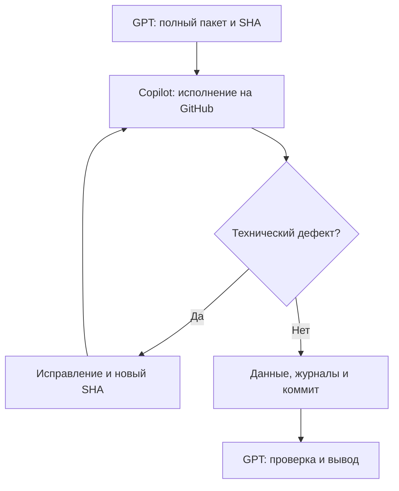

# Методологические выводы R130 и рабочий порядок GPT → Copilot → GitHub

**Решение владельца от 17 ноября 2026; действует для последующей работы.**

> «Собираем на тебе, потом отправляем Копилоту и он гоняет на хабе».

Документ сохранён по отдельному прямому поручению владельца опубликовать методологические выводы. Разбор основан на внутренней истории разговоров 15–17 ноября и текущем диалоге. Ссылки GitHub ниже подтверждают конкретное исполнение; они не подменяют источник ретроспективы. Это выводы об организации работы, а не новые научные результаты.

## Что привело к потере времени

| Наблюдаемая ошибка ассистента | Методологический вывод | Обязательное действие |
|---|---|---|
| В прогноз вычислений включались подготовка, обсуждение и публикация; оценка превращалась в основание остановки или смены площадки | Оценка стоимости, разрешение и фактическое время — разные величины | Считать гейт только по исполнению кода; калибровку отдельно; учитывать подготовку отдельно; применять выбор площадки владельца |
| 6032 операторных случая были названы полным воспроизведением при незавершённых росте, Lemma 1 и энтропии | Завершение части не равно выполнению поручения | Сверять итог с полным согласованным составом, а не с последним запущенным скриптом |
| После получения данных публикация оставалась незавершённой, ранее данное разрешение обсуждалось снова | Расчёт и доставка результата составляют одно обязательство | До финального сообщения обеспечить доступный commit/PR с данными и проверить публикацию |
| Пользователь повторял задачу, восстанавливал контекст и переносил ZIP между средами | Пользователь не должен выполнять функции транспорта и восстановления состояния ассистента | Ассистенты передают пакет и результат непосредственно через GitHub; после обрыва продолжают по сохранённому состоянию |
| Вместо проверки известного канала Copilot сначала давался общий ответ о возможностях сервиса | Возможность продукта не равна состоянию нашего подключения | Сначала читать текущий маршрут, конкретную задачу и последнее свидетельство его работы |
| Появление Issue, ответ модели или зелёный технический шаг могли восприниматься как завершение задачи | Статус должен иметь свидетельство своего уровня | Раздельно подтверждать передачу, запуск, полный объём, проверку, публикацию и научную приёмку |
| Технические проблемы превращались в новые обсуждения организации работы | Исправление должно обслуживать исходную задачу и иметь ограниченный объём | Исправлять конкретный дефект, сохранять полезное и продолжать; не создавать новый инфраструктурный проект без необходимости |

Повторявшийся сбой поведения: ассистент удерживал ближайший технический этап и терял конечный критерий — **весь согласованный результат получен, проверен и доступен владельцу**. Это описание наблюдаемой работы, а не гипотеза о внутренних механизмах модели.

Часть остановок была реальными отказами платформы/автопроверки. Их нельзя скрывать, обходить или выдавать за отсутствие пользовательского разрешения. В разрешённых пределах применять более безопасный способ исполнения; если он невозможен, сообщать точное действие и причину отказа. Не заставлять владельца повторять уже данное общее поручение.

Сообщение владельца о расходе около 10% недельных кредитов сохраняется как его оценка, без заявления о независимой проверке биллинга. Машинное время расчёта и затраты диалога учитываются раздельно.

## Рабочий порядок и ответственность

1. **GPT собирает пакет здесь.** Полный научный вопрос и состав, исходники, входы/seeds, зависимости, команды, проверка и ожидаемые сохраняемые результаты. Публикует пакет на GitHub с точным SHA и передаёт Copilot конкретное задание. Пользователь не переносит файлы между средами.
2. **Copilot выполняет на GitHub.** Калибрует, сохраняет прогноз до основного процесса, исполняет весь согласованный объём и исправляет технические ошибки в пределах задания. Исправления фиксируются коммитом до соответствующего повторного исполнения.
3. **Copilot/доверенный публикатор сохраняет результат на GitHub.** Код фактически исполненного SHA, сырые данные, stdout/stderr, среда, команды/exit codes, время, сравнение и хеши остаются в репозитории с доступным commit/PR. Одного временного Actions artifact недостаточно.
4. **GPT читает и проверяет на GitHub.** Сверяет фактический объём с заданием, разбирает реальные расхождения, проверяет доставку и отвечает по научному вопросу. Владелец остаётся единственным научным приёмщиком.

Выбор GitHub сделан владельцем и не выводится из величины прогноза. Более позднее прямое решение владельца о конкретной площадке сохраняет приоритет. Не возвращать ручной перенос результатов из среды GPT как штатный маршрут.

## Исправлять по дороге, сохраняя научный вопрос

- Технический ремонт загрузки, зависимостей, публикации и реализации уже объявленного закона входит в поручение. Не возвращать владельцу каждый устранимый технический дефект.
- Не менять молча закон, меру, корпус, seeds, горизонт, точность или критерий успеха ради зелёного результата. Содержательный выбор выделяется отдельно; независимая разрешённая работа продолжается.
- Сохранять исходную ошибку и прежние данные. Исправленный код получает новый SHA; к нему привязывается новое исполнение. Повторять затронутую часть, когда это достаточно для достоверности полного результата.
- При сбое публикации восстанавливать публикацию из сохранённых данных. Не повторять расчёт ради отчёта, переноса файлов или изменения документации.
- Повтор научного расчёта допускается по поручению о воспроизведении либо из-за конкретной ошибки/изменения, влияющего на результат; повтор доставки команды не является основанием для дубля.
- Права и инструменты профиля проверяются до передачи. Требование самостоятельного ремонта — принятая ответственность Copilot, но оно само по себе не добавляет отсутствующий инструмент редактирования.

## Свидетельства завершения

Использовать существующие Issue/PR и квитанции, не создавать новый общий реестр или дополнительный гейт.

| Сообщаемый статус | Минимальное свидетельство |
|---|---|
| Пакет передан | Доступный точный SHA, задание и ссылка на него |
| Copilot принял | Ответ/сессия агента; это ещё не расчёт |
| Расчёт начался | Реальный процесс или квитанция запуска вычислителя |
| Полный расчёт завершён | Exit codes, фактический полный состав и сохранённые выходы |
| Проверка выполнена | Результат verifier/сравнения и конкретные расхождения |
| Результат опубликован | Commit/PR с данными и проверка опубликованного состояния |
| Научный вывод принят | Решение владельца; не следует автоматически из предыдущих строк |

Не обнулять разрешение и контекст при новом сообщении или переходе между чатами. Сначала читать последний сохранённый статус той же задачи; затем продолжать её. Не ставить ещё один круг проверок после достаточных пройденных проверок без нового изменения или конкретного противоречия.

## Проверенный маршрут R130

- Задание: [#85](https://github.com/IgorSabirov/vm-lab/issues/85).
- Frozen payload: [9e53090](https://github.com/IgorSabirov/vm-lab/tree/9e53090e6f288d16adc692e57a22ab7326459bf9/reproductions/R130_COPILOT_20261117).
- Исполнитель: [workflow и точный исходный SHA 2c6f647](https://github.com/IgorSabirov/vm-lab/blob/2c6f647ee4c9b87bc2918c6bf9a87e18b67a16a7/.github/workflows/r130-copilot-reproduction.yml).
- Успешный запуск: [44082471150](https://github.com/IgorSabirov/vm-lab/actions/runs/44082471150).
- Результаты: [PR #88](https://github.com/IgorSabirov/vm-lab/pull/88), [отчёт на d2d0252](https://github.com/IgorSabirov/vm-lab/blob/d2d0252f4237087552e61cb69894ad3fd6dec0aa/reproductions/R130_COPILOT_20261117/results/44082471150/REPORT_RU.md).

Copilot CLI 1.0.103 / native Auto вызвал узкий MCP-инструмент r130.execute;
r130.status читал тот же процесс. Исполнитель не принимал произвольную команду,
путь или код; токены удалялись из его окружения. Отдельный job сохранил результат.
Прямое API-назначение cloud agent вернуло 403; этот путь не является проверенным
маршрутом аккаунта. Две попытки через shell остановились до научного исполнения,
их квитанции сохранены. Не повторять эти попытки вместо использования успешного пути.

Факт: три блока; 6032 операторных входа, 10920 коротких и 30 длинных траекторий;
91/91 raw-файлов совпали после распаковки. Все семь команд — 63,626091 с,
включая 0,905211 с калибровок. Подготовка и публикация исключены.
15 добавлений вычисляемых полей статуса разобраны отдельно; исходный
REVIEW_DIFFERENCES сохранён. Конечные траектории не доказывают асимптотику,
оговорка о буквальном коэффициенте Theorem 4 сохраняется.

**Граница реализации:** этот успешный профиль запускает неизменный пакет R130
и читает статус; самостоятельный ремонт кода Copilot в нём не проверялся.
Он закреплён в указанной ветке/коммите и не объявляется универсальным
исполнителем произвольного пакета на main. Следующий пакет должен получить
конкретный исполнимый вход и необходимые для разрешённого ремонта инструменты,
без расширения научного вопроса и без возвращения переноса файлов владельцу.

Связанные действующие правила: [полномочия](../COMPUTE_AUTHORITY.md),
[время](../RUNTIME_GATE.md), [наука и инфраструктура](../SCIENCE_INFRASTRUCTURE_SEPARATION.md),
[канал Copilot](copilot/README.md).
